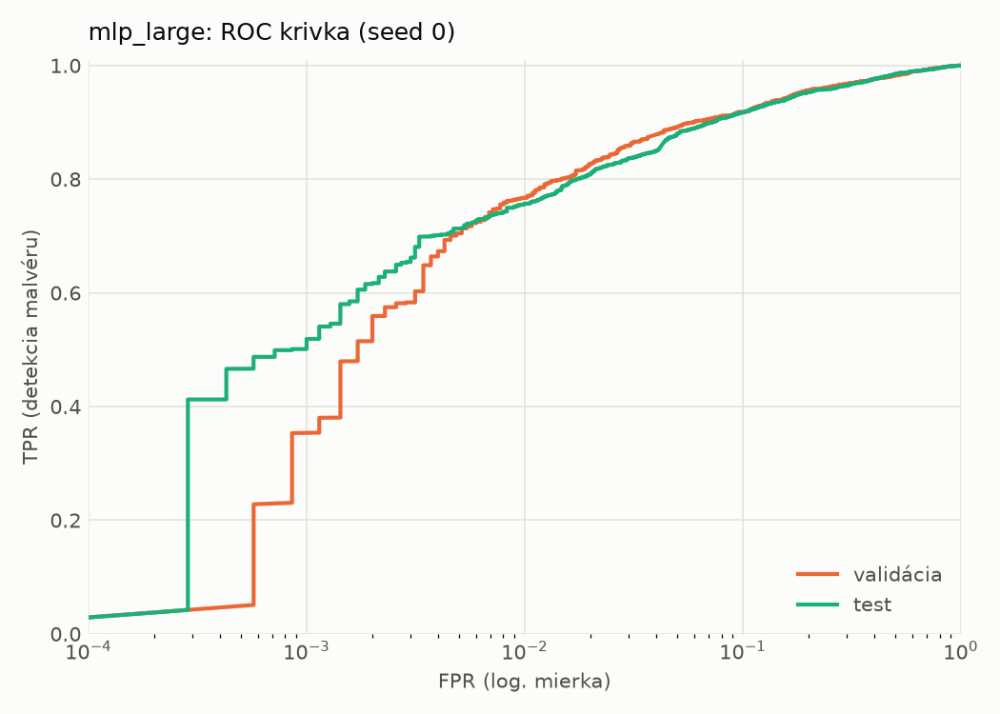
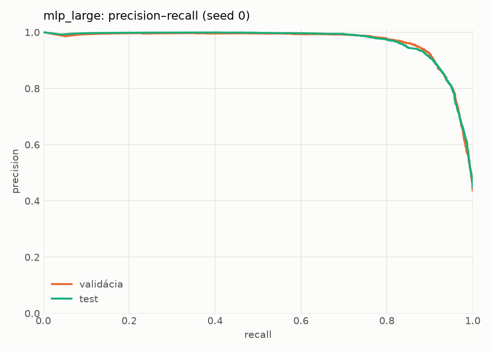
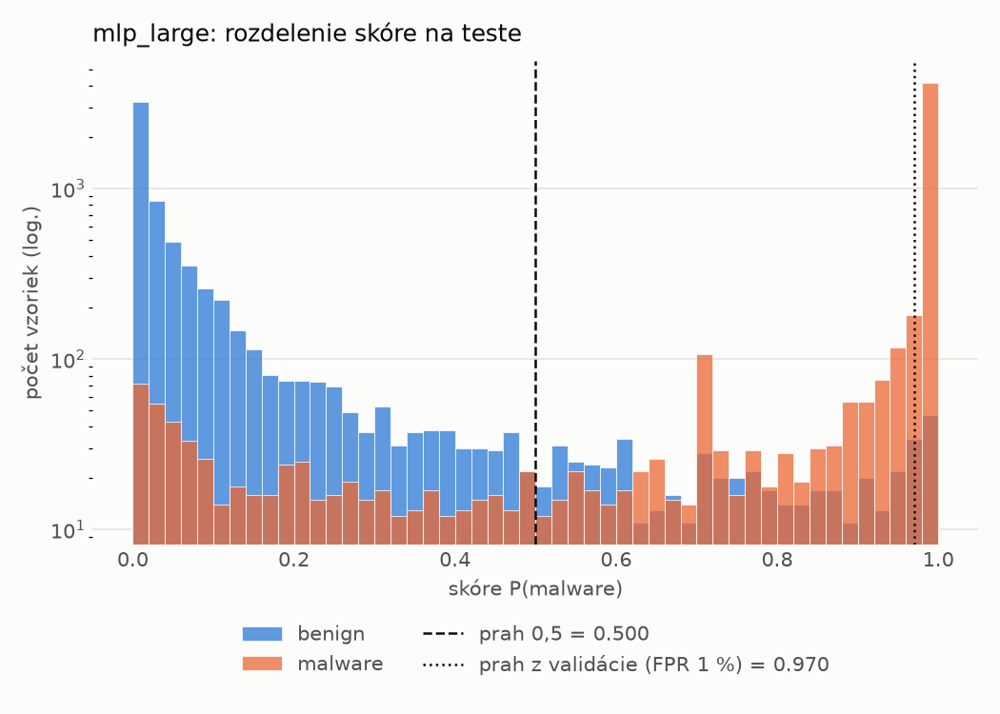
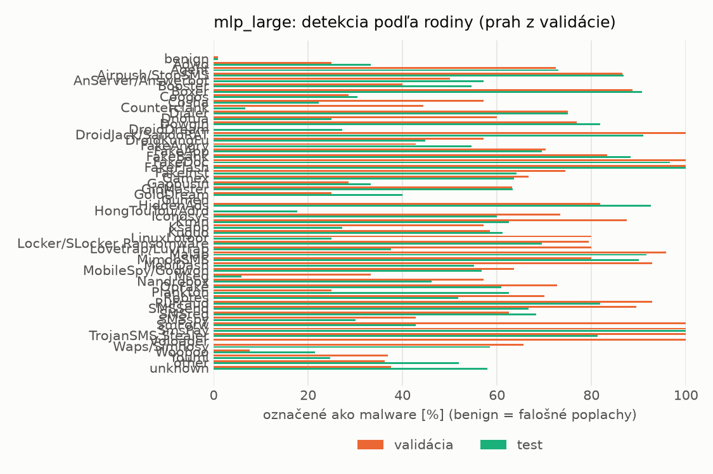
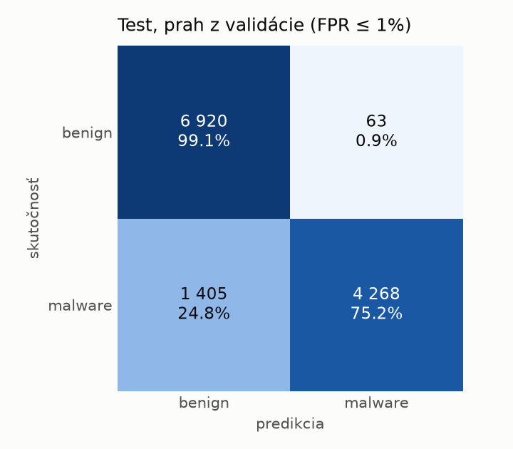
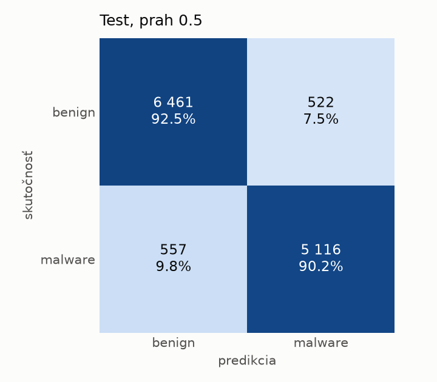
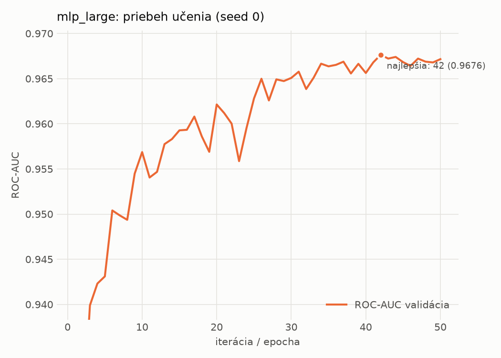

# dynamic/mlp_large – beh `20261123-221829`

> Automaticky generované (`src/training/run_tabular.py`). Konfigurácia: `config.yaml`, protokol: `protocol.yaml`.

- **Model:** `mlp` – veľká neurónová sieť (3–5 skrytých vrstiev, 512–2048 neurónov), kandidát na učiteľa
- **Ladenie:** bez ladenia – hyperparametre prevzaté z `runs_v4/emu_p/full/dynamic/mlp_large/20261123-194626`
- **Finálne modely:** seedy [0, 1, 2]; hodnoty sú priemer ± smerodajná odchýlka cez seedy
- **Najlepšie hyperparametre:** `{"max_epochs": 100, "patience": 8, "hidden_layers": 3, "hidden_width": 1024, "width_decay": 0.5, "dropout": 0.11628417924821868, "lr": 0.0004582958225587737, "weight_decay": 0.0007705605519981878, "batch_size": 512}`

## Detekčná kvalita (bez prahu)
| metrika | train (podvzorka) | validácia | test |
|---|---|---|---|
| ROC-AUC | 0.9938 ± 0.0005 | 0.9675 ± 0.0001 | 0.9664 ± 0.0001 |
| PR-AUC | 0.9930 ± 0.0006 | 0.9664 ± 0.0004 | 0.9675 ± 0.0001 |
| TPR pri FPR 1 % | 0.9125 ± 0.0079 | 0.7677 ± 0.0094 | 0.7569 ± 0.0045 |
| TPR pri FPR 0,1 % | 0.8468 ± 0.0184 | 0.3508 ± 0.0381 | 0.4605 ± 0.0549 |
| log loss | 0.1001 ± 0.0051 | 0.2380 ± 0.0034 | 0.2380 ± 0.0025 |
| Brier skóre | 0.0283 ± 0.0013 | 0.0624 ± 0.0005 | 0.0644 ± 0.0010 |

Rozdiel ROC-AUC train − validácia: **0.0263** (veľký rozdiel = preučenie).

## Pri prahu z validácie (FPR ≤ 1% na validácii)
| metrika | train (podvzorka) | validácia | test |
|---|---|---|---|
| accuracy | 0.9138 ± 0.0016 | 0.8930 ± 0.0041 | 0.8836 ± 0.0016 |
| balanced accuracy | 0.9002 ± 0.0019 | 0.8790 ± 0.0047 | 0.8713 ± 0.0020 |
| precision | 0.9995 ± 0.0003 | 0.9839 ± 0.0002 | 0.9850 ± 0.0022 |
| recall (TPR) | 0.8006 ± 0.0039 | 0.7677 ± 0.0094 | 0.7519 ± 0.0053 |
| FPR | 0.0003 ± 0.0002 | 0.0097 ± 0.0000 | 0.0093 ± 0.0015 |
| F1 | 0.8891 ± 0.0023 | 0.8624 ± 0.0060 | 0.8528 ± 0.0026 |
| MCC | 0.8335 ± 0.0029 | 0.7931 ± 0.0076 | 0.7784 ± 0.0024 |

## Pri pevnom prahu 0.5
| metrika | train (podvzorka) | validácia | test |
|---|---|---|---|
| accuracy | 0.9626 ± 0.0010 | 0.9187 ± 0.0013 | 0.9167 ± 0.0018 |
| balanced accuracy | 0.9614 ± 0.0010 | 0.9174 ± 0.0010 | 0.9150 ± 0.0014 |
| precision | 0.9610 ± 0.0031 | 0.9070 ± 0.0045 | 0.9146 ± 0.0065 |
| recall (TPR) | 0.9521 ± 0.0024 | 0.9070 ± 0.0023 | 0.8982 ± 0.0032 |
| FPR | 0.0293 ± 0.0025 | 0.0722 ± 0.0040 | 0.0682 ± 0.0059 |
| F1 | 0.9565 ± 0.0012 | 0.9070 ± 0.0012 | 0.9063 ± 0.0016 |
| MCC | 0.9238 ± 0.0021 | 0.8348 ± 0.0026 | 0.8315 ± 0.0037 |

## Výpočtové nároky (seed 0, testovacia množina)
| meranie | hodnota |
|---|---|
| tréning finálneho modelu | 9.5 s (priemer cez seedy) |
| ladenie spolu | 0 s |
| počet parametrov / uzlov | 786 945 |
| veľkosť modelu na disku | 3.17 MB |
| transformácia vstupu – latencia (1 vlákno) | 0.015 ms |
| transformácia vstupu – priepustnosť | 773 443 vzoriek/s |
| CPU latencia modelu (batch 1, 1 vlákno) | 0.170 ms (p95 0.381) |
| CPU priepustnosť (24 vlákien) | 460 036 vzoriek/s |
| GPU latencia (batch 1) | 0.454 ms (p95 0.953) |
| GPU priepustnosť | 1 484 053 vzoriek/s |
| GPU špičková pamäť | 146 MB |

## Grafy
| | |
|---|---|
|  |  |
|  |  |
|  |  |
|  |  |

## Súbory
`metrics.json` (všetky metriky po seedoch vrátane rodín), `timing.json`, `hpo_trials.csv`,
`predictions/<časť>_seed<N>.parquet` (sha256, family, label, score), `model/seed_<N>/`, `log.txt`.
