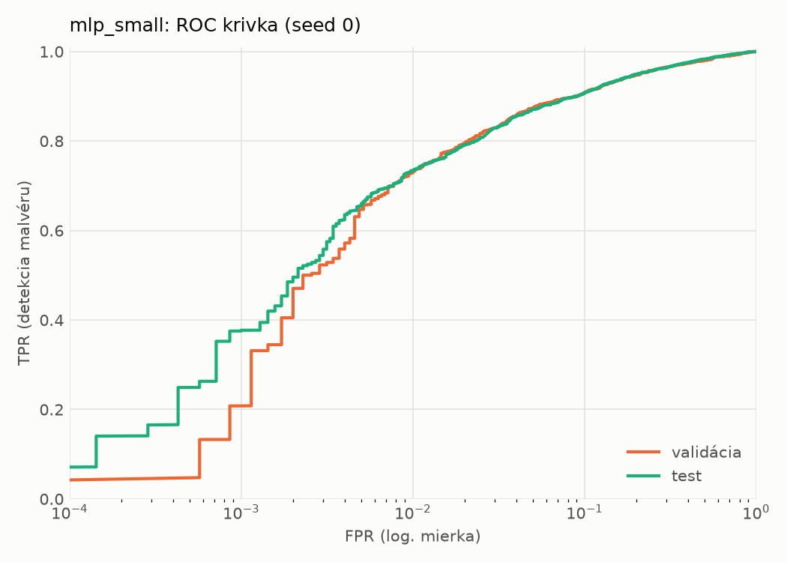
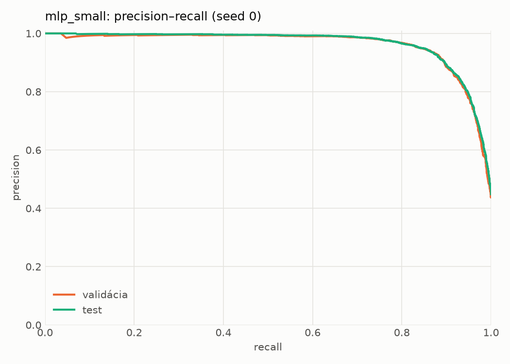
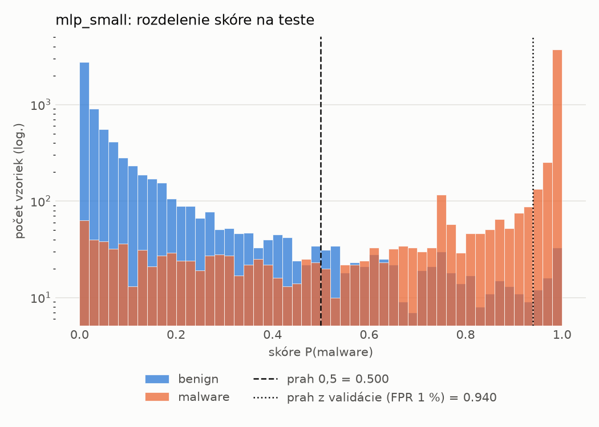
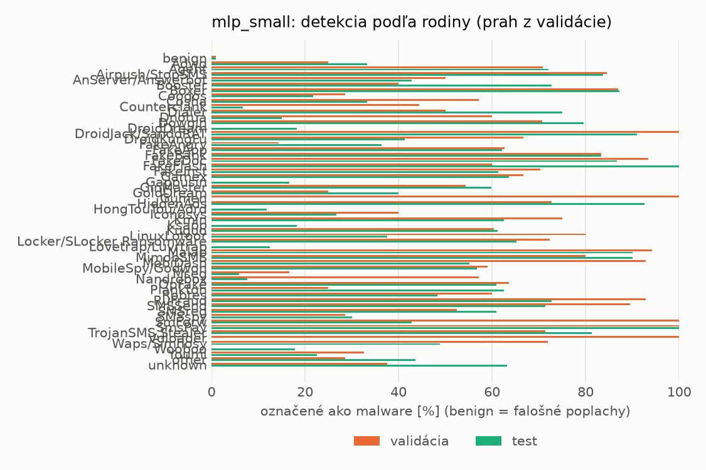
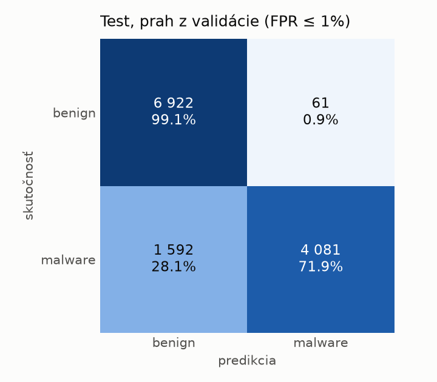
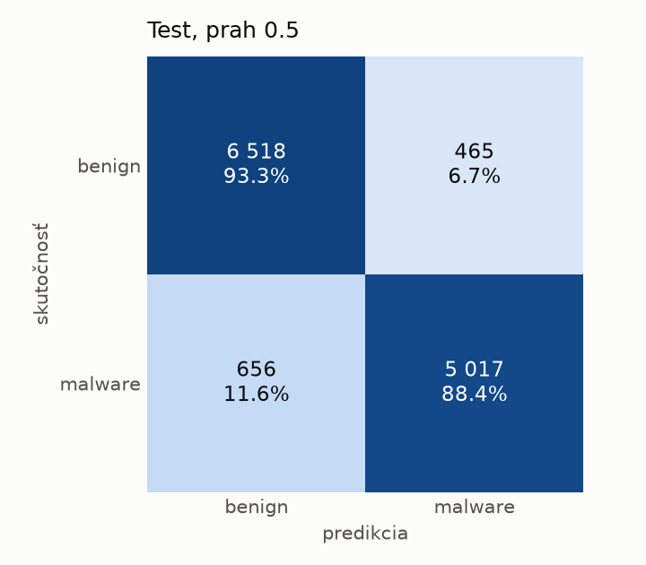
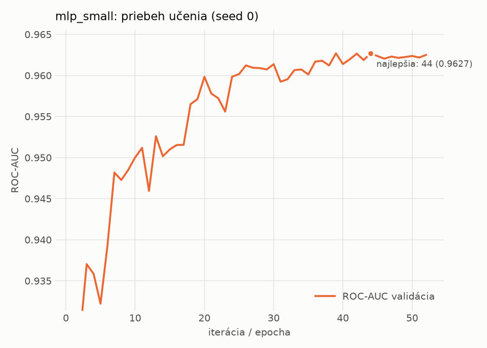

# dynamic/mlp_small – beh `20261123-221731`

> Automaticky generované (`src/training/run_tabular.py`). Konfigurácia: `config.yaml`, protokol: `protocol.yaml`.

- **Model:** `mlp` – malá neurónová sieť (1–2 skryté vrstvy), kandidát na ľahkého študenta
- **Ladenie:** bez ladenia – hyperparametre prevzaté z `runs_v4/emu_p/full/dynamic/mlp_small/20261123-193925`
- **Finálne modely:** seedy [0, 1, 2]; hodnoty sú priemer ± smerodajná odchýlka cez seedy
- **Najlepšie hyperparametre:** `{"width_decay": 0.5, "max_epochs": 100, "patience": 8, "hidden_layers": 2, "hidden_width": 256, "dropout": 0.06125761383416514, "lr": 0.0018225597913134257, "weight_decay": 9.759441755448828e-06, "batch_size": 256}`

## Detekčná kvalita (bez prahu)
| metrika | train (podvzorka) | validácia | test |
|---|---|---|---|
| ROC-AUC | 0.9892 ± 0.0023 | 0.9644 ± 0.0017 | 0.9646 ± 0.0010 |
| PR-AUC | 0.9882 ± 0.0023 | 0.9628 ± 0.0018 | 0.9648 ± 0.0016 |
| TPR pri FPR 1 % | 0.8728 ± 0.0171 | 0.7386 ± 0.0154 | 0.7394 ± 0.0061 |
| TPR pri FPR 0,1 % | 0.7643 ± 0.0114 | 0.2276 ± 0.0409 | 0.3861 ± 0.0351 |
| log loss | 0.1294 ± 0.0123 | 0.2432 ± 0.0026 | 0.2387 ± 0.0032 |
| Brier skóre | 0.0370 ± 0.0040 | 0.0646 ± 0.0015 | 0.0661 ± 0.0013 |

Rozdiel ROC-AUC train − validácia: **0.0249** (veľký rozdiel = preučenie).

## Pri prahu z validácie (FPR ≤ 1% na validácii)
| metrika | train (podvzorka) | validácia | test |
|---|---|---|---|
| accuracy | 0.8957 ± 0.0062 | 0.8803 ± 0.0067 | 0.8710 ± 0.0055 |
| balanced accuracy | 0.8794 ± 0.0072 | 0.8645 ± 0.0077 | 0.8572 ± 0.0062 |
| precision | 0.9980 ± 0.0008 | 0.9833 ± 0.0003 | 0.9851 ± 0.0013 |
| recall (TPR) | 0.7599 ± 0.0146 | 0.7386 ± 0.0154 | 0.7232 ± 0.0134 |
| FPR | 0.0012 ± 0.0004 | 0.0097 ± 0.0000 | 0.0089 ± 0.0009 |
| F1 | 0.8628 ± 0.0093 | 0.8435 ± 0.0101 | 0.8340 ± 0.0084 |
| MCC | 0.8001 ± 0.0114 | 0.7699 ± 0.0122 | 0.7561 ± 0.0094 |

## Pri pevnom prahu 0.5
| metrika | train (podvzorka) | validácia | test |
|---|---|---|---|
| accuracy | 0.9515 ± 0.0063 | 0.9155 ± 0.0015 | 0.9134 ± 0.0025 |
| balanced accuracy | 0.9496 ± 0.0067 | 0.9135 ± 0.0021 | 0.9112 ± 0.0025 |
| precision | 0.9512 ± 0.0055 | 0.9079 ± 0.0036 | 0.9148 ± 0.0041 |
| recall (TPR) | 0.9358 ± 0.0097 | 0.8977 ± 0.0078 | 0.8897 ± 0.0047 |
| FPR | 0.0365 ± 0.0040 | 0.0707 ± 0.0037 | 0.0674 ± 0.0036 |
| F1 | 0.9434 ± 0.0075 | 0.9028 ± 0.0022 | 0.9021 ± 0.0028 |
| MCC | 0.9011 ± 0.0130 | 0.8282 ± 0.0031 | 0.8247 ± 0.0050 |

## Výpočtové nároky (seed 0, testovacia množina)
| meranie | hodnota |
|---|---|
| tréning finálneho modelu | 18.9 s (priemer cez seedy) |
| ladenie spolu | 0 s |
| počet parametrov / uzlov | 65 537 |
| veľkosť modelu na disku | 0.27 MB |
| transformácia vstupu – latencia (1 vlákno) | 0.015 ms |
| transformácia vstupu – priepustnosť | 767 863 vzoriek/s |
| CPU latencia modelu (batch 1, 1 vlákno) | 0.079 ms (p95 0.091) |
| CPU priepustnosť (24 vlákien) | 2 875 318 vzoriek/s |
| GPU latencia (batch 1) | 0.373 ms (p95 0.401) |
| GPU priepustnosť | 1 472 672 vzoriek/s |
| GPU špičková pamäť | 66 MB |

## Grafy
| | |
|---|---|
|  |  |
|  |  |
|  |  |
|  |  |

## Súbory
`metrics.json` (všetky metriky po seedoch vrátane rodín), `timing.json`, `hpo_trials.csv`,
`predictions/<časť>_seed<N>.parquet` (sha256, family, label, score), `model/seed_<N>/`, `log.txt`.
