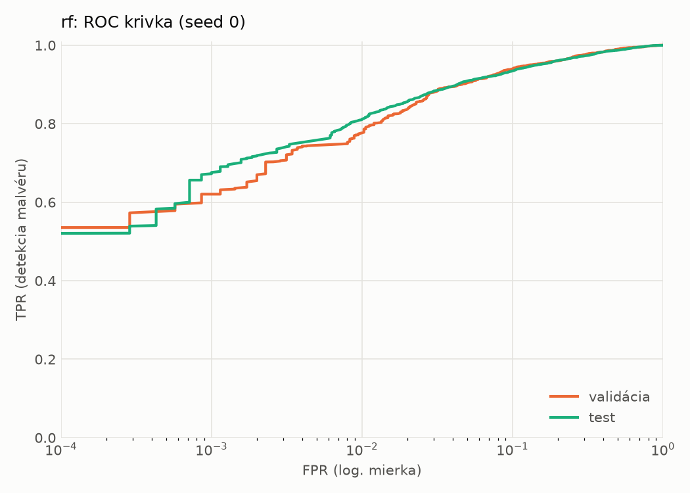
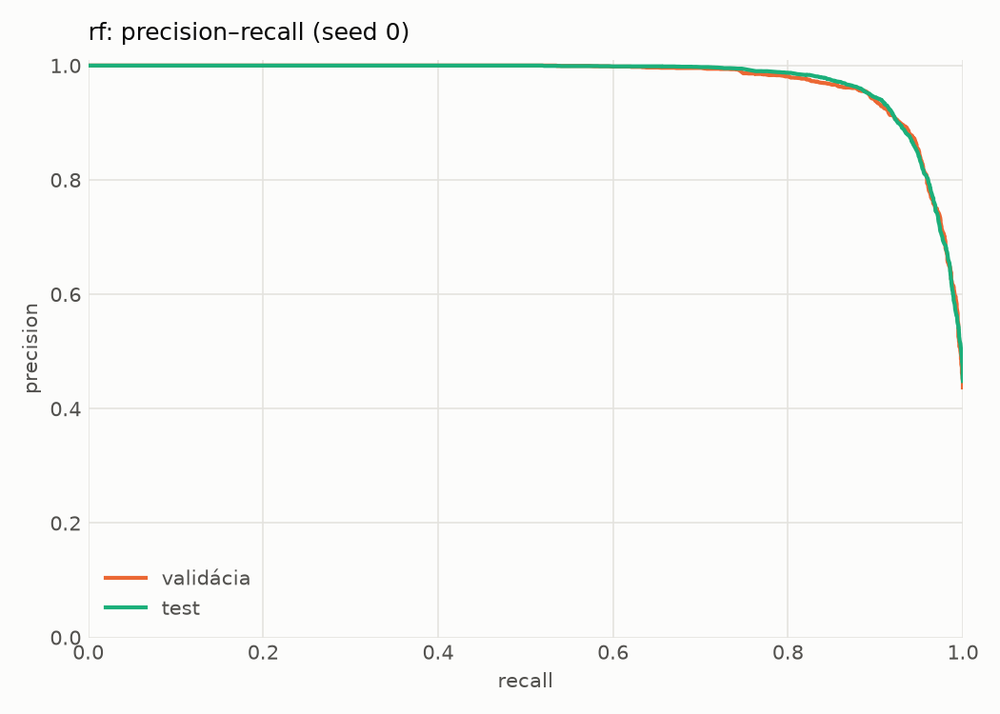
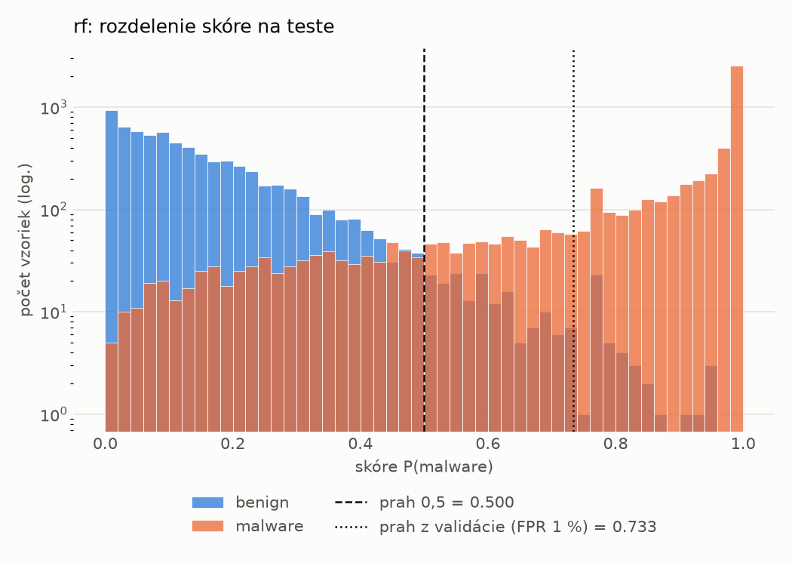
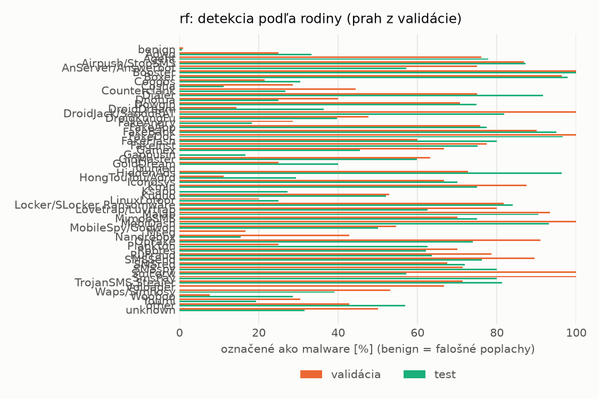
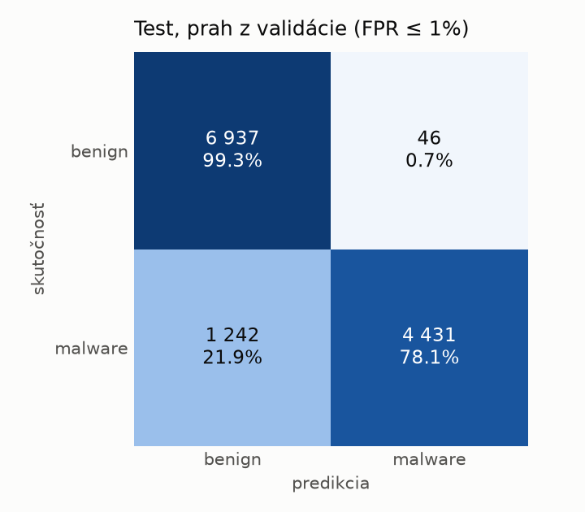
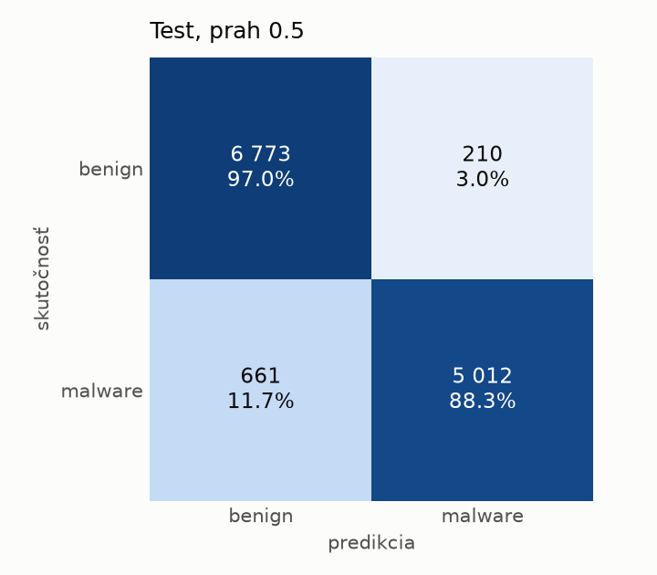

# dynamic/rf – beh `20261123-221520`

> Automaticky generované (`src/training/run_tabular.py`). Konfigurácia: `config.yaml`, protokol: `protocol.yaml`.

- **Model:** `random_forest` – Random Forest (pôvodné hodnoty príznakov)
- **Ladenie:** bez ladenia – hyperparametre prevzaté z `runs_v4/emu_p/full/dynamic/rf/20261123-191811`
- **Finálne modely:** seedy [0, 1, 2]; hodnoty sú priemer ± smerodajná odchýlka cez seedy
- **Najlepšie hyperparametre:** `{"n_estimators": 450, "max_depth": null, "min_samples_leaf": 1, "max_features": "sqrt"}`

## Detekčná kvalita (bez prahu)
| metrika | train (podvzorka) | validácia | test |
|---|---|---|---|
| ROC-AUC | 0.9997 ± 0.0000 | 0.9751 ± 0.0001 | 0.9742 ± 0.0002 |
| PR-AUC | 0.9996 ± 0.0000 | 0.9751 ± 0.0000 | 0.9758 ± 0.0002 |
| TPR pri FPR 1 % | 0.9991 ± 0.0000 | 0.7754 ± 0.0017 | 0.8121 ± 0.0020 |
| TPR pri FPR 0,1 % | 0.9407 ± 0.0024 | 0.6166 ± 0.0078 | 0.6691 ± 0.0122 |
| log loss | 0.0674 ± 0.0002 | 0.2119 ± 0.0001 | 0.2148 ± 0.0003 |
| Brier skóre | 0.0101 ± 0.0000 | 0.0596 ± 0.0000 | 0.0598 ± 0.0002 |

Rozdiel ROC-AUC train − validácia: **0.0246** (veľký rozdiel = preučenie).

## Pri prahu z validácie (FPR ≤ 1% na validácii)
| metrika | train (podvzorka) | validácia | test |
|---|---|---|---|
| accuracy | 0.9885 ± 0.0009 | 0.8964 ± 0.0007 | 0.8991 ± 0.0011 |
| balanced accuracy | 0.9872 ± 0.0011 | 0.8829 ± 0.0008 | 0.8882 ± 0.0012 |
| precision | 0.9951 ± 0.0000 | 0.9842 ± 0.0002 | 0.9893 ± 0.0005 |
| recall (TPR) | 0.9781 ± 0.0022 | 0.7754 ± 0.0017 | 0.7833 ± 0.0029 |
| FPR | 0.0037 ± 0.0000 | 0.0096 ± 0.0002 | 0.0069 ± 0.0004 |
| F1 | 0.9865 ± 0.0011 | 0.8674 ± 0.0010 | 0.8743 ± 0.0016 |
| MCC | 0.9766 ± 0.0019 | 0.7994 ± 0.0013 | 0.8070 ± 0.0018 |

## Pri pevnom prahu 0.5
| metrika | train (podvzorka) | validácia | test |
|---|---|---|---|
| accuracy | 0.9963 ± 0.0000 | 0.9303 ± 0.0006 | 0.9308 ± 0.0005 |
| balanced accuracy | 0.9966 ± 0.0000 | 0.9249 ± 0.0006 | 0.9263 ± 0.0004 |
| precision | 0.9929 ± 0.0000 | 0.9550 ± 0.0010 | 0.9593 ± 0.0012 |
| recall (TPR) | 0.9986 ± 0.0000 | 0.8821 ± 0.0009 | 0.8830 ± 0.0006 |
| FPR | 0.0055 ± 0.0000 | 0.0323 ± 0.0007 | 0.0304 ± 0.0010 |
| F1 | 0.9957 ± 0.0000 | 0.9171 ± 0.0007 | 0.9196 ± 0.0005 |
| MCC | 0.9925 ± 0.0000 | 0.8591 ± 0.0012 | 0.8612 ± 0.0010 |

## Výpočtové nároky (seed 0, testovacia množina)
| meranie | hodnota |
|---|---|
| tréning finálneho modelu | 2.7 s (priemer cez seedy) |
| ladenie spolu | 0 s |
| počet parametrov / uzlov | 4 202 834 |
| veľkosť modelu na disku | 336.58 MB |
| CPU latencia modelu (batch 1, 1 vlákno) | 13.120 ms (p95 13.503) |
| CPU priepustnosť (24 vlákien) | 108 777 vzoriek/s |

## Grafy
| | |
|---|---|
|  |  |
|  |  |
|  |  |
|  |  |

## Súbory
`metrics.json` (všetky metriky po seedoch vrátane rodín), `timing.json`, `hpo_trials.csv`,
`predictions/<časť>_seed<N>.parquet` (sha256, family, label, score), `model/seed_<N>/`, `log.txt`.
