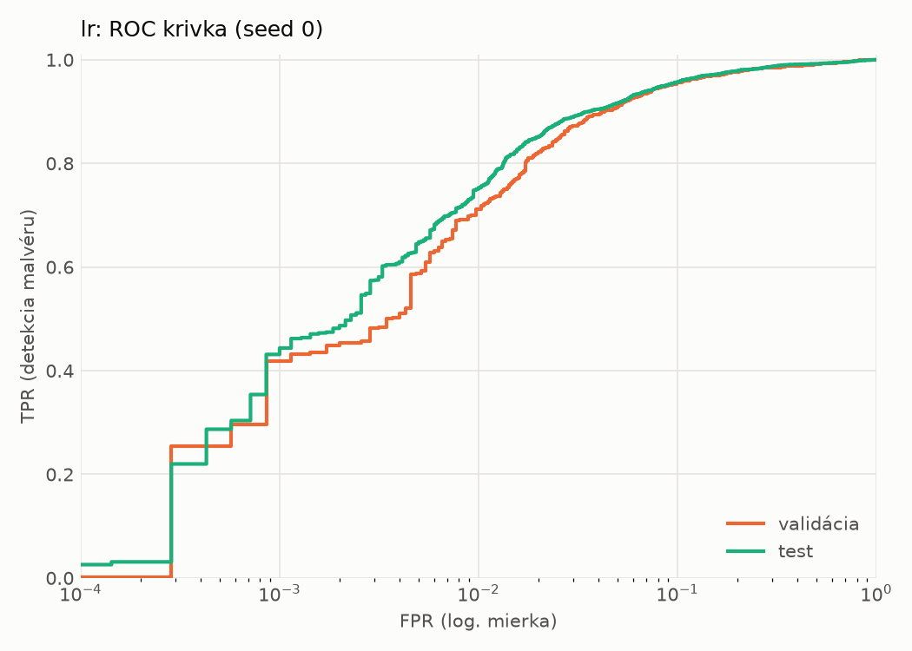
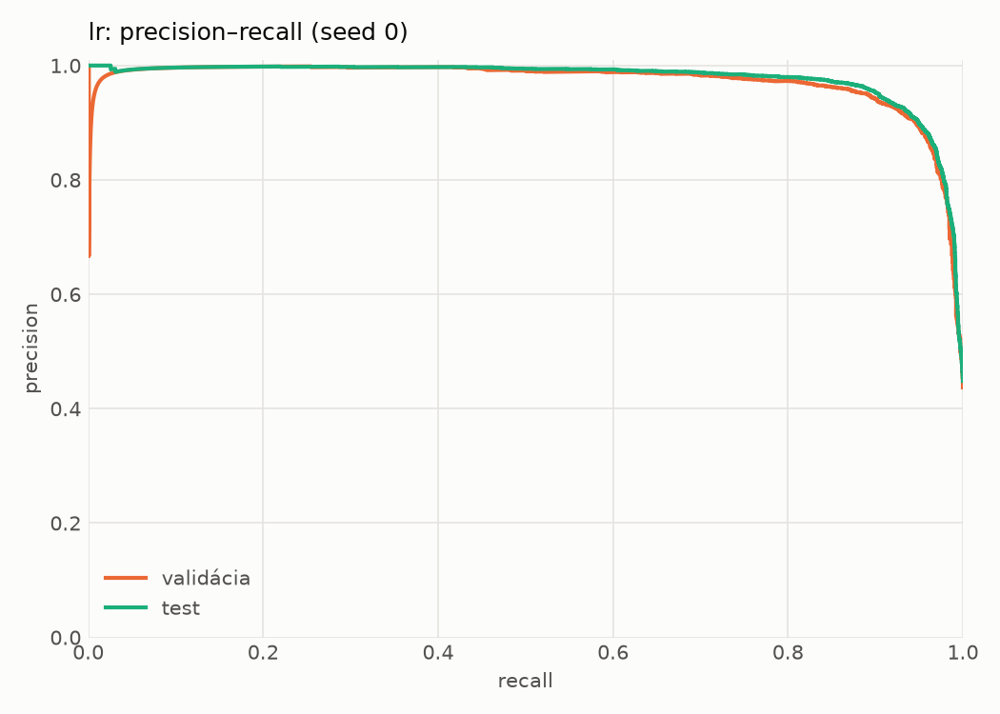
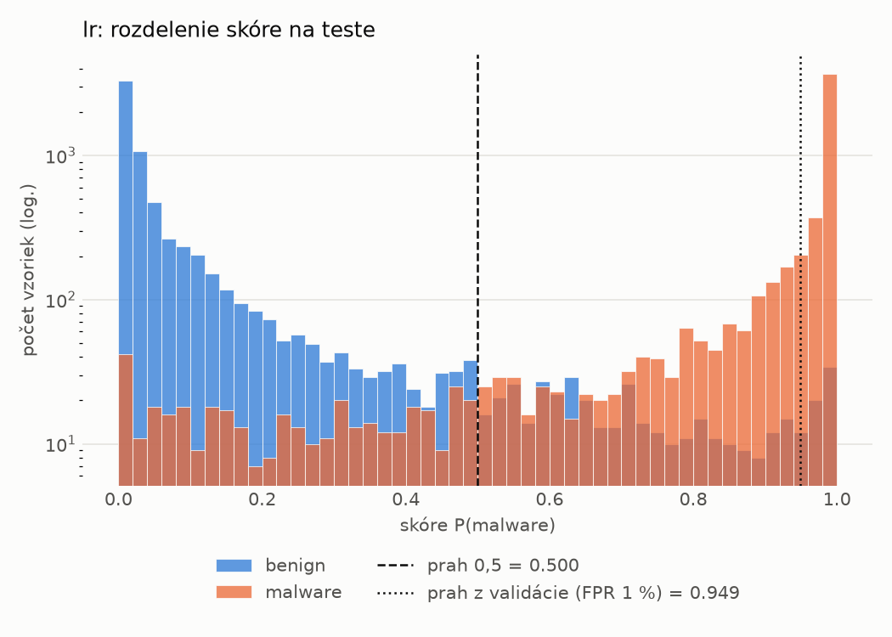
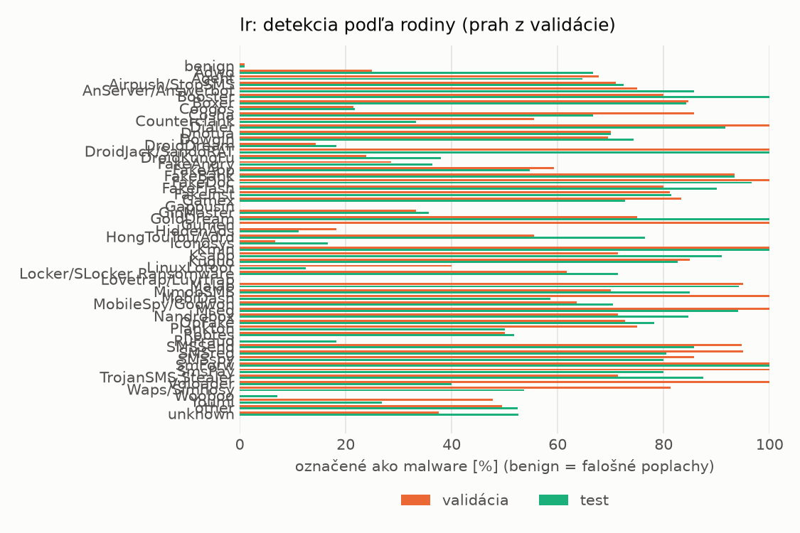
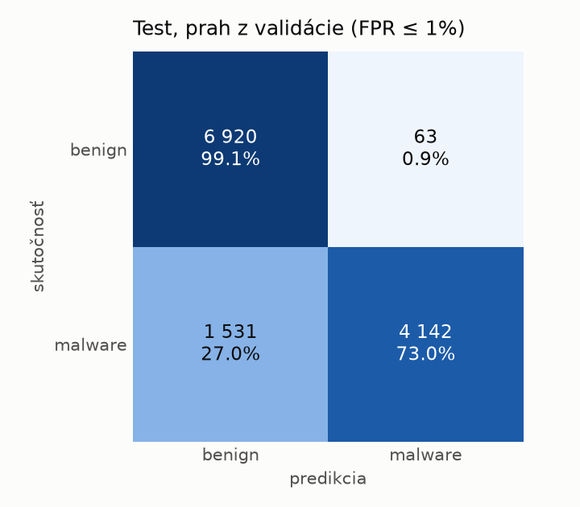
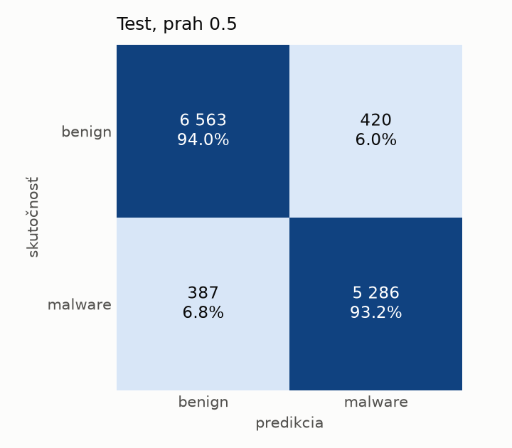

# hybrid/lr – beh `20261123-221903`

> Automaticky generované (`src/training/run_tabular.py`). Konfigurácia: `config.yaml`, protokol: `protocol.yaml`.

- **Model:** `logreg` – logistická regresia s L2 regularizáciou (vstup signed log1p + štandardizácia)
- **Ladenie:** bez ladenia – hyperparametre prevzaté z `runs_v4/emu_p/full/hybrid/lr/20261123-195300`
- **Finálne modely:** seedy [0, 1, 2]; hodnoty sú priemer ± smerodajná odchýlka cez seedy
- **Najlepšie hyperparametre:** `{"max_iter": 2000, "C": 7.106361724509844}`

## Detekčná kvalita (bez prahu)
| metrika | train (podvzorka) | validácia | test |
|---|---|---|---|
| ROC-AUC | 0.9811 ± 0.0000 | 0.9773 ± 0.0000 | 0.9796 ± 0.0000 |
| PR-AUC | 0.9782 ± 0.0000 | 0.9729 ± 0.0000 | 0.9776 ± 0.0000 |
| TPR pri FPR 1 % | 0.7545 ± 0.0000 | 0.7110 ± 0.0000 | 0.7506 ± 0.0000 |
| TPR pri FPR 0,1 % | 0.4332 ± 0.0000 | 0.4182 ± 0.0000 | 0.4313 ± 0.0000 |
| log loss | 0.1694 ± 0.0000 | 0.1876 ± 0.0000 | 0.1776 ± 0.0000 |
| Brier skóre | 0.0467 ± 0.0000 | 0.0511 ± 0.0000 | 0.0486 ± 0.0000 |

Rozdiel ROC-AUC train − validácia: **0.0038** (veľký rozdiel = preučenie).

## Pri prahu z validácie (FPR ≤ 1% na validácii)
| metrika | train (podvzorka) | validácia | test |
|---|---|---|---|
| accuracy | 0.8744 ± 0.0000 | 0.8682 ± 0.0000 | 0.8741 ± 0.0000 |
| balanced accuracy | 0.8556 ± 0.0000 | 0.8506 ± 0.0000 | 0.8606 ± 0.0000 |
| precision | 0.9882 ± 0.0000 | 0.9827 ± 0.0000 | 0.9850 ± 0.0000 |
| recall (TPR) | 0.7176 ± 0.0000 | 0.7110 ± 0.0000 | 0.7301 ± 0.0000 |
| FPR | 0.0065 ± 0.0000 | 0.0097 ± 0.0000 | 0.0090 ± 0.0000 |
| F1 | 0.8315 ± 0.0000 | 0.8250 ± 0.0000 | 0.8386 ± 0.0000 |
| MCC | 0.7592 ± 0.0000 | 0.7480 ± 0.0000 | 0.7614 ± 0.0000 |

## Pri pevnom prahu 0.5
| metrika | train (podvzorka) | validácia | test |
|---|---|---|---|
| accuracy | 0.9381 ± 0.0000 | 0.9337 ± 0.0000 | 0.9362 ± 0.0000 |
| balanced accuracy | 0.9374 ± 0.0000 | 0.9328 ± 0.0000 | 0.9358 ± 0.0000 |
| precision | 0.9251 ± 0.0000 | 0.9224 ± 0.0000 | 0.9264 ± 0.0000 |
| recall (TPR) | 0.9321 ± 0.0000 | 0.9262 ± 0.0000 | 0.9318 ± 0.0000 |
| FPR | 0.0574 ± 0.0000 | 0.0605 ± 0.0000 | 0.0601 ± 0.0000 |
| F1 | 0.9286 ± 0.0000 | 0.9243 ± 0.0000 | 0.9291 ± 0.0000 |
| MCC | 0.8740 ± 0.0000 | 0.8653 ± 0.0000 | 0.8712 ± 0.0000 |

## Výpočtové nároky (seed 0, testovacia množina)
| meranie | hodnota |
|---|---|
| tréning finálneho modelu | 0.5 s (priemer cez seedy) |
| ladenie spolu | 0 s |
| počet parametrov / uzlov | 286 |
| veľkosť modelu na disku | 0.01 MB |
| transformácia vstupu – latencia (1 vlákno) | 0.006 ms |
| transformácia vstupu – priepustnosť | 502 577 vzoriek/s |
| CPU latencia modelu (batch 1, 1 vlákno) | 0.004 ms (p95 0.005) |
| CPU priepustnosť (24 vlákien) | 2 281 635 vzoriek/s |

## Grafy
| | |
|---|---|
|  |  |
|  |  |
|  |  |
|  |  |

## Súbory
`metrics.json` (všetky metriky po seedoch vrátane rodín), `timing.json`, `hpo_trials.csv`,
`predictions/<časť>_seed<N>.parquet` (sha256, family, label, score), `model/seed_<N>/`, `log.txt`.
