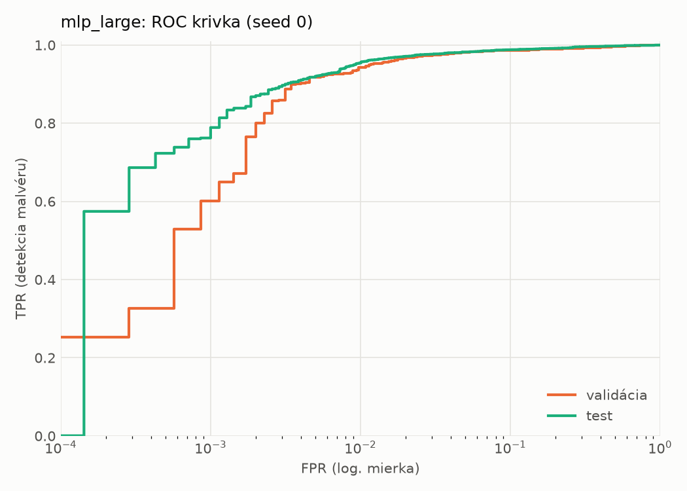
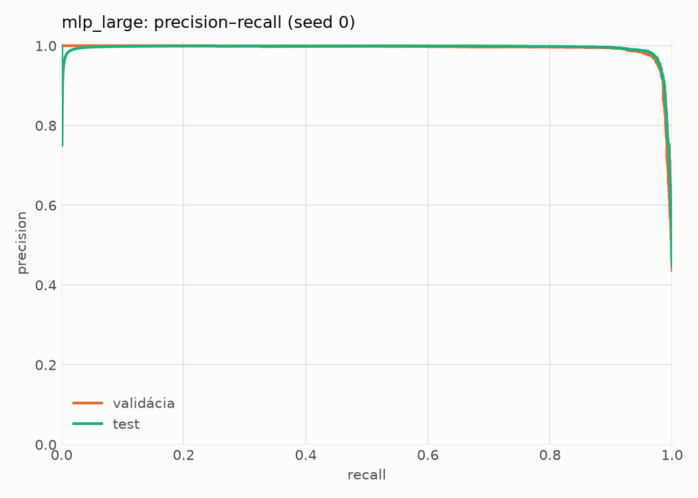
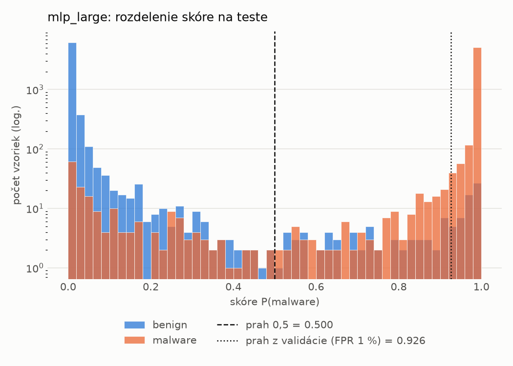
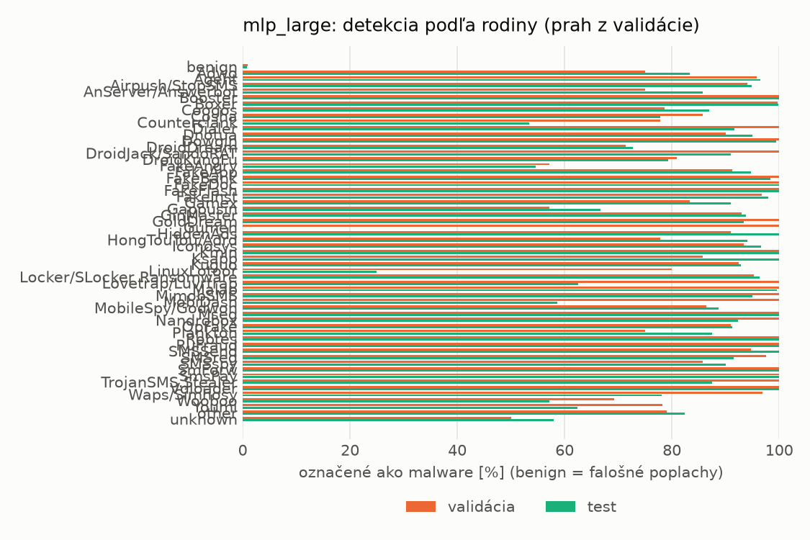
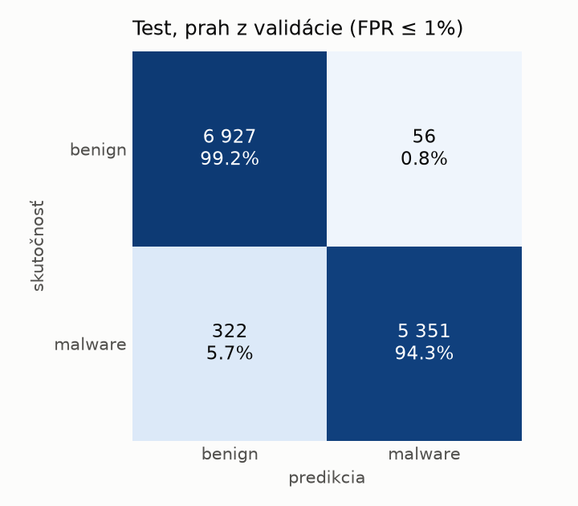
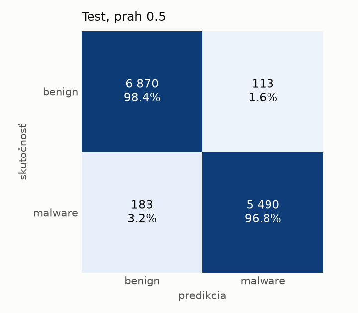
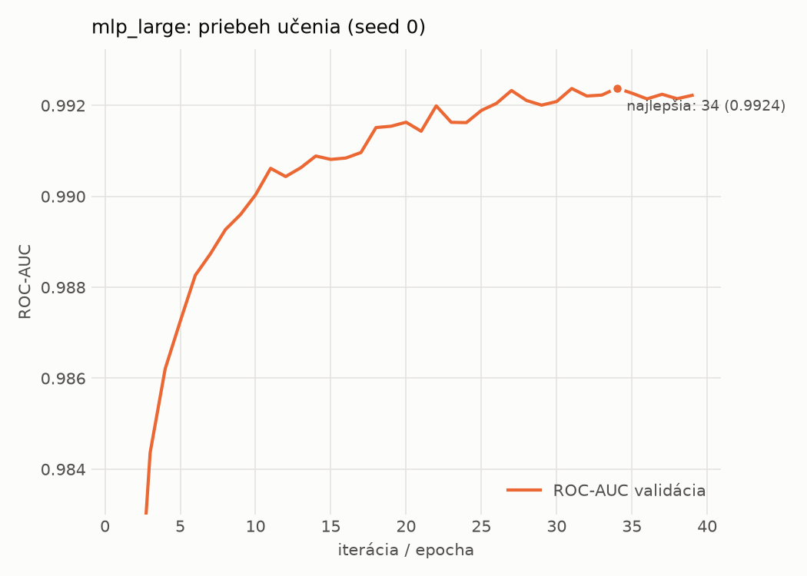

# hybrid/mlp_large – beh `20261123-222020`

> Automaticky generované (`src/training/run_tabular.py`). Konfigurácia: `config.yaml`, protokol: `protocol.yaml`.

- **Model:** `mlp` – veľká neurónová sieť (3–5 skrytých vrstiev, 512–2048 neurónov), kandidát na učiteľa
- **Ladenie:** bez ladenia – hyperparametre prevzaté z `runs_v4/emu_p/full/hybrid/mlp_large/20261123-200933`
- **Finálne modely:** seedy [0, 1, 2]; hodnoty sú priemer ± smerodajná odchýlka cez seedy
- **Najlepšie hyperparametre:** `{"max_epochs": 100, "patience": 8, "hidden_layers": 5, "hidden_width": 512, "width_decay": 0.5, "dropout": 0.18561035972653261, "lr": 0.00013117672209273214, "weight_decay": 3.948210593203141e-06, "batch_size": 512}`

## Detekčná kvalita (bez prahu)
| metrika | train (podvzorka) | validácia | test |
|---|---|---|---|
| ROC-AUC | 0.9984 ± 0.0003 | 0.9927 ± 0.0003 | 0.9944 ± 0.0004 |
| PR-AUC | 0.9985 ± 0.0002 | 0.9924 ± 0.0006 | 0.9944 ± 0.0009 |
| TPR pri FPR 1 % | 0.9897 ± 0.0007 | 0.9398 ± 0.0026 | 0.9572 ± 0.0030 |
| TPR pri FPR 0,1 % | 0.9756 ± 0.0039 | 0.7016 ± 0.0893 | 0.7917 ± 0.0402 |
| log loss | 0.0341 ± 0.0033 | 0.0938 ± 0.0024 | 0.0819 ± 0.0021 |
| Brier skóre | 0.0069 ± 0.0005 | 0.0228 ± 0.0006 | 0.0202 ± 0.0006 |

Rozdiel ROC-AUC train − validácia: **0.0058** (veľký rozdiel = preučenie).

## Pri prahu z validácie (FPR ≤ 1% na validácii)
| metrika | train (podvzorka) | validácia | test |
|---|---|---|---|
| accuracy | 0.9836 ± 0.0006 | 0.9684 ± 0.0011 | 0.9699 ± 0.0008 |
| balanced accuracy | 0.9811 ± 0.0007 | 0.9652 ± 0.0012 | 0.9672 ± 0.0010 |
| precision | 0.9993 ± 0.0004 | 0.9872 ± 0.0007 | 0.9916 ± 0.0018 |
| recall (TPR) | 0.9628 ± 0.0013 | 0.9398 ± 0.0026 | 0.9408 ± 0.0029 |
| FPR | 0.0005 ± 0.0003 | 0.0095 ± 0.0005 | 0.0064 ± 0.0014 |
| F1 | 0.9807 ± 0.0008 | 0.9629 ± 0.0013 | 0.9656 ± 0.0010 |
| MCC | 0.9670 ± 0.0013 | 0.9363 ± 0.0021 | 0.9399 ± 0.0015 |

## Pri pevnom prahu 0.5
| metrika | train (podvzorka) | validácia | test |
|---|---|---|---|
| accuracy | 0.9921 ± 0.0007 | 0.9733 ± 0.0007 | 0.9756 ± 0.0011 |
| balanced accuracy | 0.9915 ± 0.0006 | 0.9728 ± 0.0005 | 0.9749 ± 0.0011 |
| precision | 0.9948 ± 0.0010 | 0.9701 ± 0.0026 | 0.9774 ± 0.0022 |
| recall (TPR) | 0.9869 ± 0.0005 | 0.9689 ± 0.0012 | 0.9680 ± 0.0021 |
| FPR | 0.0039 ± 0.0008 | 0.0232 ± 0.0021 | 0.0182 ± 0.0018 |
| F1 | 0.9908 ± 0.0008 | 0.9695 ± 0.0007 | 0.9727 ± 0.0012 |
| MCC | 0.9839 ± 0.0013 | 0.9458 ± 0.0013 | 0.9507 ± 0.0022 |

## Výpočtové nároky (seed 0, testovacia množina)
| meranie | hodnota |
|---|---|
| tréning finálneho modelu | 11.7 s (priemer cez seedy) |
| ladenie spolu | 0 s |
| počet parametrov / uzlov | 323 009 |
| veľkosť modelu na disku | 1.32 MB |
| transformácia vstupu – latencia (1 vlákno) | 0.017 ms |
| transformácia vstupu – priepustnosť | 287 780 vzoriek/s |
| CPU latencia modelu (batch 1, 1 vlákno) | 0.163 ms (p95 0.457) |
| CPU priepustnosť (24 vlákien) | 722 271 vzoriek/s |
| GPU latencia (batch 1) | 0.567 ms (p95 1.384) |
| GPU priepustnosť | 527 923 vzoriek/s |
| GPU špičková pamäť | 183 MB |

## Grafy
| | |
|---|---|
|  |  |
|  |  |
|  |  |
|  |  |

## Súbory
`metrics.json` (všetky metriky po seedoch vrátane rodín), `timing.json`, `hpo_trials.csv`,
`predictions/<časť>_seed<N>.parquet` (sha256, family, label, score), `model/seed_<N>/`, `log.txt`.
