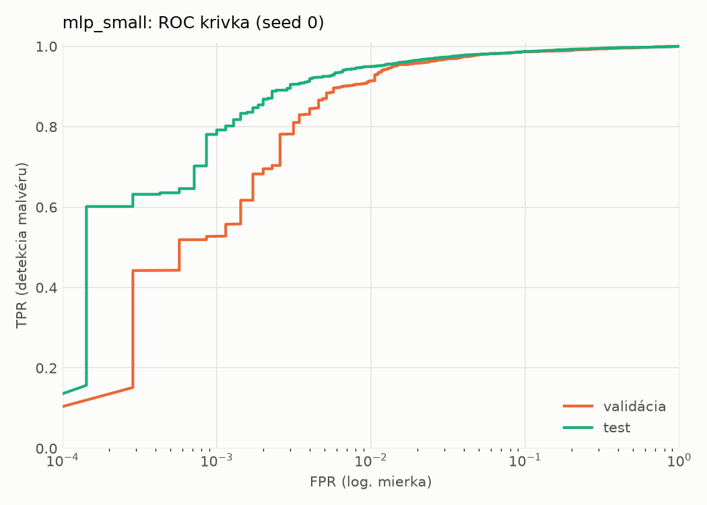
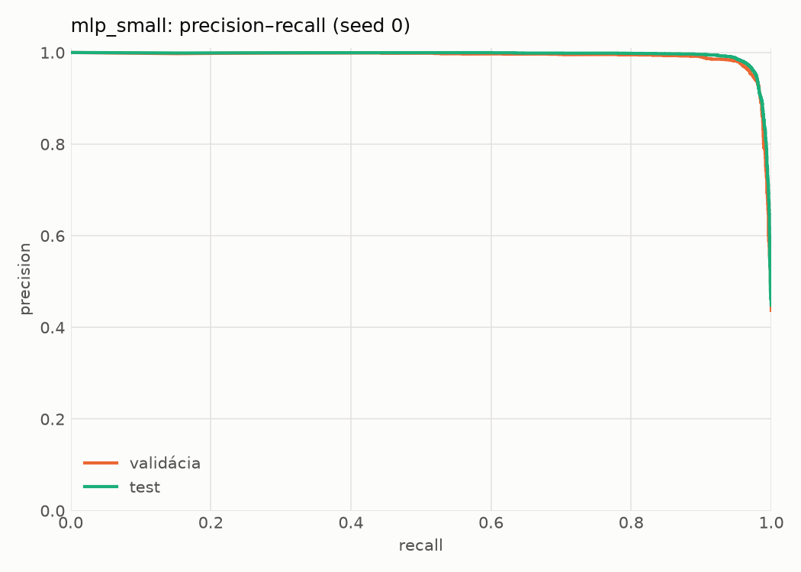
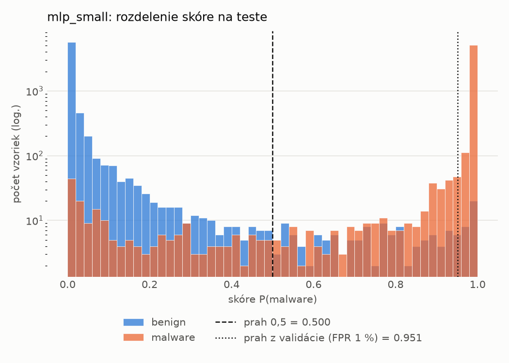
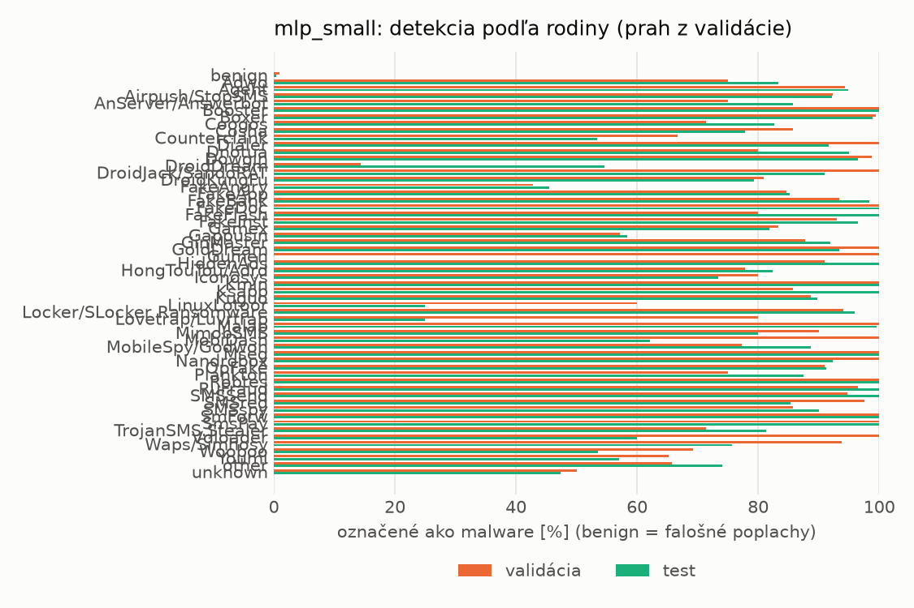
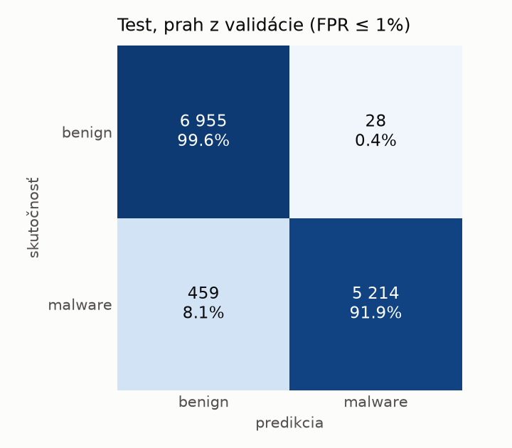
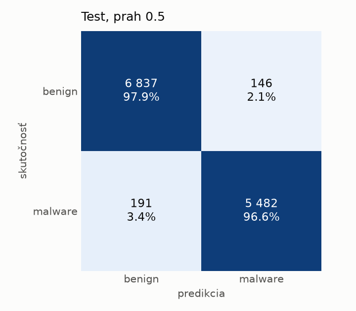
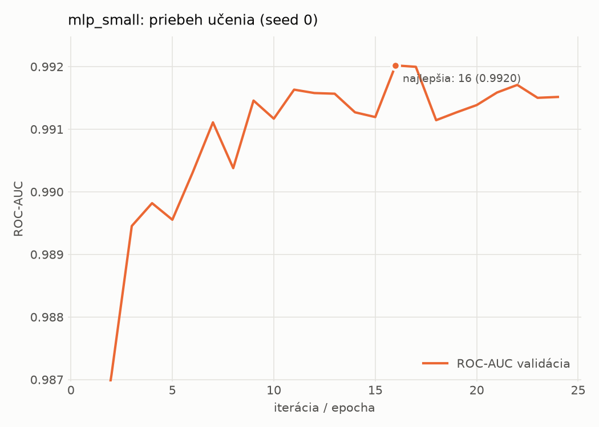

# hybrid/mlp_small – beh `20261123-222008`

> Automaticky generované (`src/training/run_tabular.py`). Konfigurácia: `config.yaml`, protokol: `protocol.yaml`.

- **Model:** `mlp` – malá neurónová sieť (1–2 skryté vrstvy), kandidát na ľahkého študenta
- **Ladenie:** bez ladenia – hyperparametre prevzaté z `runs_v4/emu_p/full/hybrid/mlp_small/20261123-200627`
- **Finálne modely:** seedy [0, 1, 2]; hodnoty sú priemer ± smerodajná odchýlka cez seedy
- **Najlepšie hyperparametre:** `{"width_decay": 0.5, "max_epochs": 100, "patience": 8, "hidden_layers": 2, "hidden_width": 256, "dropout": 0.2736594475747717, "lr": 0.0019631646658614973, "weight_decay": 0.0007425190310675283, "batch_size": 512}`

## Detekčná kvalita (bez prahu)
| metrika | train (podvzorka) | validácia | test |
|---|---|---|---|
| ROC-AUC | 0.9979 ± 0.0007 | 0.9920 ± 0.0003 | 0.9937 ± 0.0002 |
| PR-AUC | 0.9978 ± 0.0007 | 0.9914 ± 0.0003 | 0.9939 ± 0.0001 |
| TPR pri FPR 1 % | 0.9771 ± 0.0060 | 0.9166 ± 0.0027 | 0.9424 ± 0.0075 |
| TPR pri FPR 0,1 % | 0.9419 ± 0.0090 | 0.5853 ± 0.0583 | 0.7841 ± 0.0081 |
| log loss | 0.0474 ± 0.0093 | 0.1065 ± 0.0011 | 0.0885 ± 0.0013 |
| Brier skóre | 0.0124 ± 0.0025 | 0.0251 ± 0.0012 | 0.0219 ± 0.0015 |

Rozdiel ROC-AUC train − validácia: **0.0059** (veľký rozdiel = preučenie).

## Pri prahu z validácie (FPR ≤ 1% na validácii)
| metrika | train (podvzorka) | validácia | test |
|---|---|---|---|
| accuracy | 0.9719 ± 0.0012 | 0.9581 ± 0.0012 | 0.9620 ± 0.0011 |
| balanced accuracy | 0.9675 ± 0.0013 | 0.9534 ± 0.0013 | 0.9583 ± 0.0013 |
| precision | 0.9990 ± 0.0007 | 0.9865 ± 0.0000 | 0.9930 ± 0.0015 |
| recall (TPR) | 0.9358 ± 0.0025 | 0.9166 ± 0.0027 | 0.9219 ± 0.0033 |
| FPR | 0.0007 ± 0.0005 | 0.0097 ± 0.0000 | 0.0053 ± 0.0011 |
| F1 | 0.9663 ± 0.0015 | 0.9502 ± 0.0014 | 0.9561 ± 0.0014 |
| MCC | 0.9437 ± 0.0024 | 0.9159 ± 0.0023 | 0.9247 ± 0.0021 |

## Pri pevnom prahu 0.5
| metrika | train (podvzorka) | validácia | test |
|---|---|---|---|
| accuracy | 0.9843 ± 0.0027 | 0.9684 ± 0.0013 | 0.9726 ± 0.0021 |
| balanced accuracy | 0.9836 ± 0.0026 | 0.9683 ± 0.0012 | 0.9721 ± 0.0020 |
| precision | 0.9846 ± 0.0044 | 0.9611 ± 0.0028 | 0.9711 ± 0.0044 |
| recall (TPR) | 0.9788 ± 0.0019 | 0.9669 ± 0.0002 | 0.9676 ± 0.0013 |
| FPR | 0.0116 ± 0.0034 | 0.0304 ± 0.0023 | 0.0234 ± 0.0037 |
| F1 | 0.9817 ± 0.0032 | 0.9640 ± 0.0014 | 0.9693 ± 0.0023 |
| MCC | 0.9679 ± 0.0056 | 0.9359 ± 0.0026 | 0.9445 ± 0.0043 |

## Výpočtové nároky (seed 0, testovacia množina)
| meranie | hodnota |
|---|---|
| tréning finálneho modelu | 3.4 s (priemer cez seedy) |
| ladenie spolu | 0 s |
| počet parametrov / uzlov | 107 009 |
| veľkosť modelu na disku | 0.44 MB |
| transformácia vstupu – latencia (1 vlákno) | 0.007 ms |
| transformácia vstupu – priepustnosť | 367 611 vzoriek/s |
| CPU latencia modelu (batch 1, 1 vlákno) | 0.089 ms (p95 0.232) |
| CPU priepustnosť (24 vlákien) | 1 387 430 vzoriek/s |
| GPU latencia (batch 1) | 0.391 ms (p95 0.418) |
| GPU priepustnosť | 1 337 631 vzoriek/s |
| GPU špičková pamäť | 107 MB |

## Grafy
| | |
|---|---|
|  |  |
|  |  |
|  |  |
|  |  |

## Súbory
`metrics.json` (všetky metriky po seedoch vrátane rodín), `timing.json`, `hpo_trials.csv`,
`predictions/<časť>_seed<N>.parquet` (sha256, family, label, score), `model/seed_<N>/`, `log.txt`.
