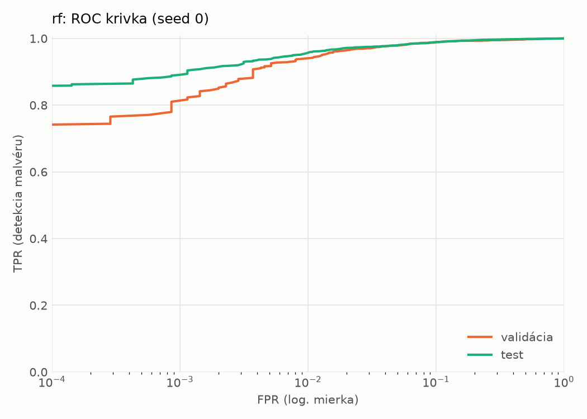
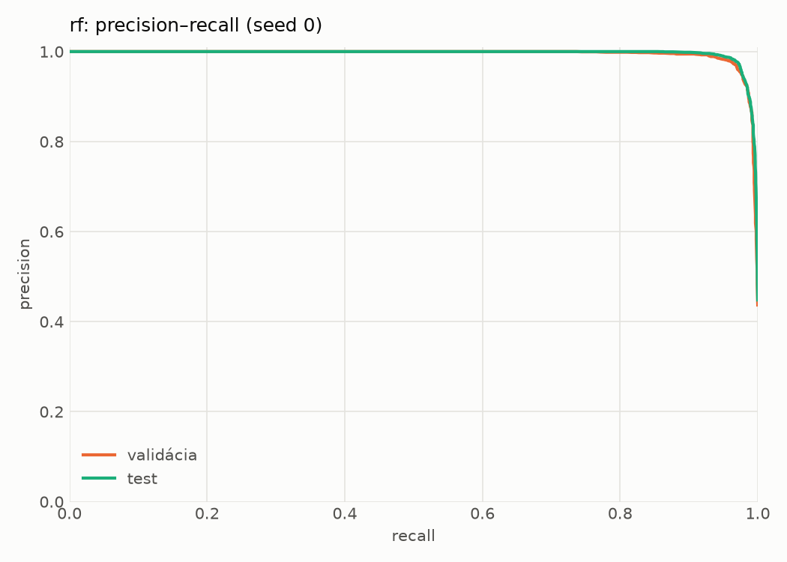
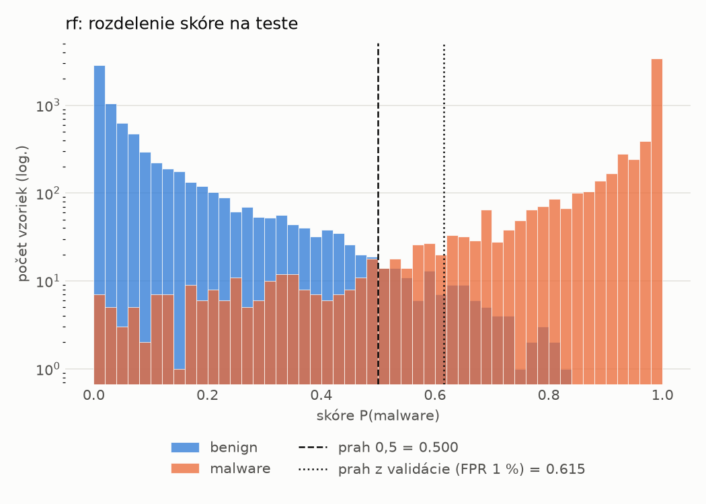
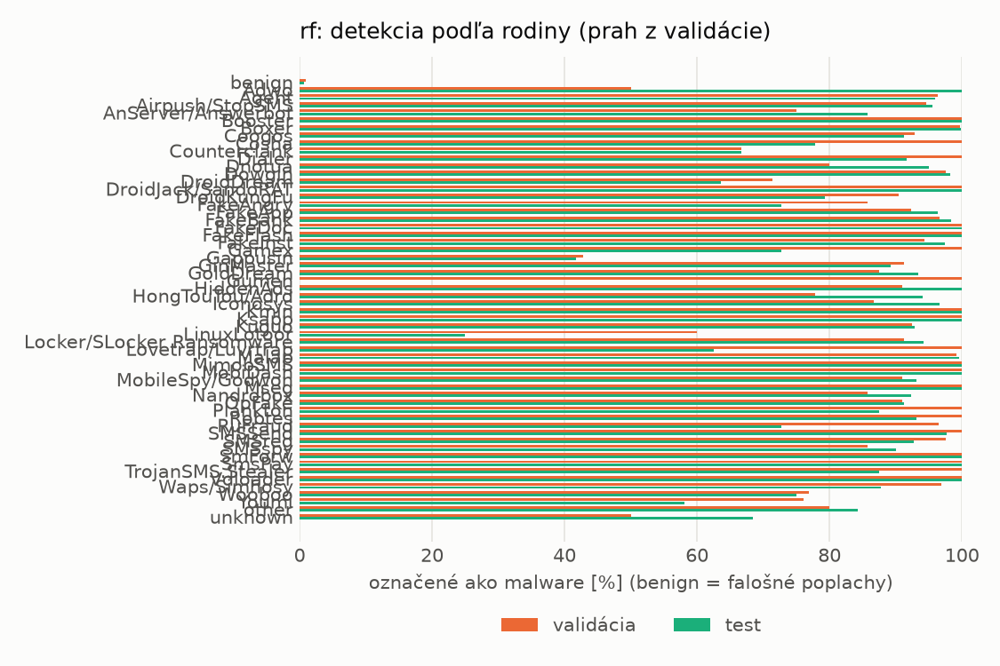
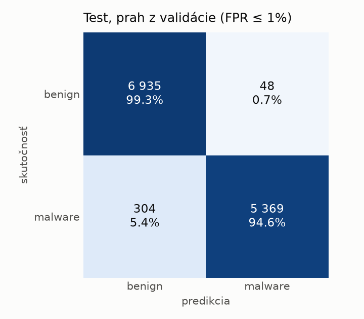
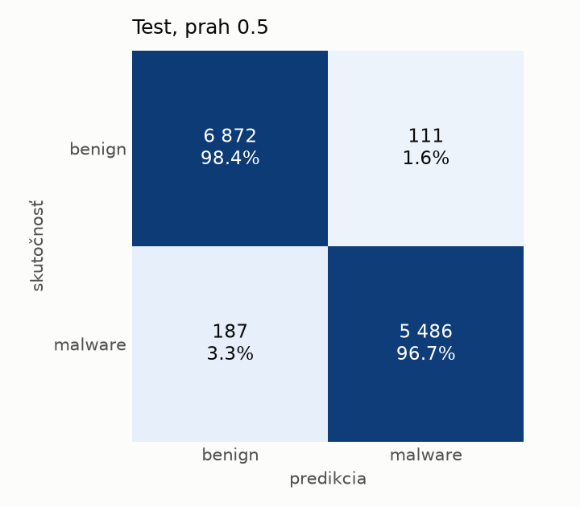

# hybrid/rf – beh `20261123-221906`

> Automaticky generované (`src/training/run_tabular.py`). Konfigurácia: `config.yaml`, protokol: `protocol.yaml`.

- **Model:** `random_forest` – Random Forest (pôvodné hodnoty príznakov)
- **Ladenie:** bez ladenia – hyperparametre prevzaté z `runs_v4/emu_p/full/hybrid/rf/20261123-195313`
- **Finálne modely:** seedy [0, 1, 2]; hodnoty sú priemer ± smerodajná odchýlka cez seedy
- **Najlepšie hyperparametre:** `{"n_estimators": 200, "max_depth": null, "min_samples_leaf": 1, "max_features": "sqrt"}`

## Detekčná kvalita (bez prahu)
| metrika | train (podvzorka) | validácia | test |
|---|---|---|---|
| ROC-AUC | 1.0000 ± 0.0000 | 0.9943 ± 0.0001 | 0.9955 ± 0.0001 |
| PR-AUC | 1.0000 ± 0.0000 | 0.9943 ± 0.0001 | 0.9956 ± 0.0000 |
| TPR pri FPR 1 % | 1.0000 ± 0.0000 | 0.9398 ± 0.0015 | 0.9566 ± 0.0010 |
| TPR pri FPR 0,1 % | 1.0000 ± 0.0000 | 0.8037 ± 0.0119 | 0.8897 ± 0.0045 |
| log loss | 0.0308 ± 0.0001 | 0.1080 ± 0.0011 | 0.1035 ± 0.0003 |
| Brier skóre | 0.0034 ± 0.0000 | 0.0259 ± 0.0001 | 0.0245 ± 0.0001 |

Rozdiel ROC-AUC train − validácia: **0.0057** (veľký rozdiel = preučenie).

## Pri prahu z validácie (FPR ≤ 1% na validácii)
| metrika | train (podvzorka) | validácia | test |
|---|---|---|---|
| accuracy | 1.0000 ± 0.0000 | 0.9684 ± 0.0006 | 0.9722 ± 0.0005 |
| balanced accuracy | 1.0000 ± 0.0000 | 0.9652 ± 0.0007 | 0.9698 ± 0.0006 |
| precision | 1.0000 ± 0.0000 | 0.9873 ± 0.0002 | 0.9909 ± 0.0002 |
| recall (TPR) | 1.0000 ± 0.0000 | 0.9398 ± 0.0015 | 0.9467 ± 0.0012 |
| FPR | 0.0000 ± 0.0000 | 0.0094 ± 0.0002 | 0.0071 ± 0.0002 |
| F1 | 1.0000 ± 0.0000 | 0.9630 ± 0.0007 | 0.9683 ± 0.0006 |
| MCC | 1.0000 ± 0.0000 | 0.9364 ± 0.0011 | 0.9444 ± 0.0010 |

## Pri pevnom prahu 0.5
| metrika | train (podvzorka) | validácia | test |
|---|---|---|---|
| accuracy | 1.0000 ± 0.0000 | 0.9732 ± 0.0005 | 0.9762 ± 0.0003 |
| balanced accuracy | 1.0000 ± 0.0000 | 0.9723 ± 0.0004 | 0.9753 ± 0.0002 |
| precision | 1.0000 ± 0.0000 | 0.9731 ± 0.0010 | 0.9795 ± 0.0011 |
| recall (TPR) | 1.0000 ± 0.0000 | 0.9653 ± 0.0000 | 0.9672 ± 0.0005 |
| FPR | 0.0000 ± 0.0000 | 0.0207 ± 0.0008 | 0.0165 ± 0.0009 |
| F1 | 1.0000 ± 0.0000 | 0.9692 ± 0.0005 | 0.9733 ± 0.0003 |
| MCC | 1.0000 ± 0.0000 | 0.9454 ± 0.0009 | 0.9519 ± 0.0006 |

## Výpočtové nároky (seed 0, testovacia množina)
| meranie | hodnota |
|---|---|
| tréning finálneho modelu | 1.4 s (priemer cez seedy) |
| ladenie spolu | 0 s |
| počet parametrov / uzlov | 1 024 300 |
| veľkosť modelu na disku | 82.20 MB |
| CPU latencia modelu (batch 1, 1 vlákno) | 5.947 ms (p95 6.281) |
| CPU priepustnosť (24 vlákien) | 169 600 vzoriek/s |

## Grafy
| | |
|---|---|
|  |  |
|  |  |
|  |  |
|  |  |

## Súbory
`metrics.json` (všetky metriky po seedoch vrátane rodín), `timing.json`, `hpo_trials.csv`,
`predictions/<časť>_seed<N>.parquet` (sha256, family, label, score), `model/seed_<N>/`, `log.txt`.
