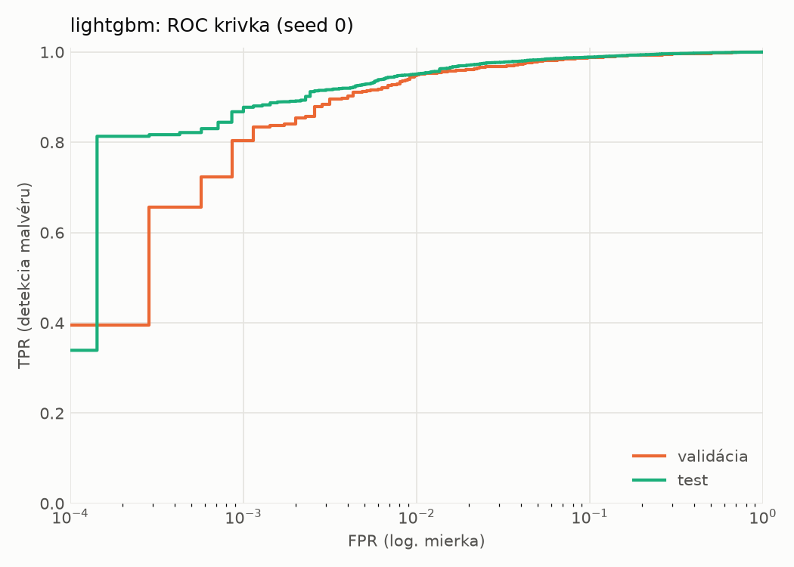
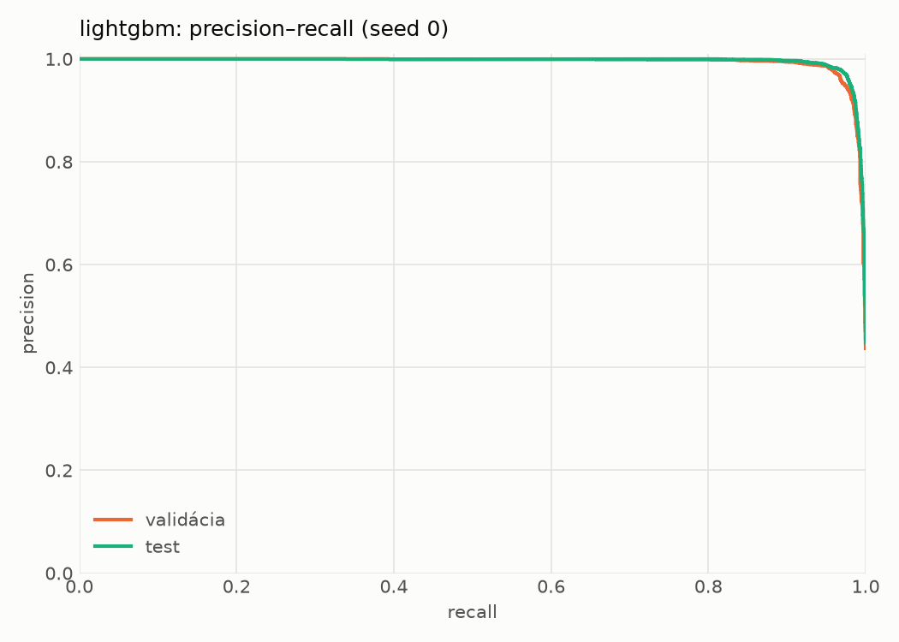
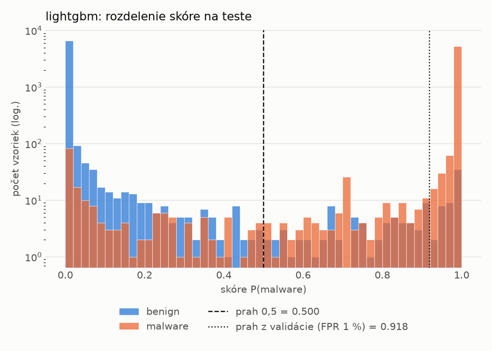
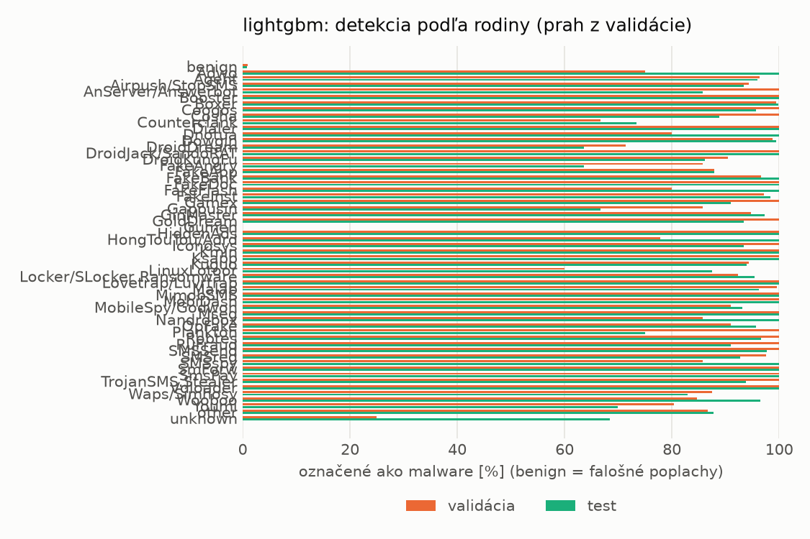
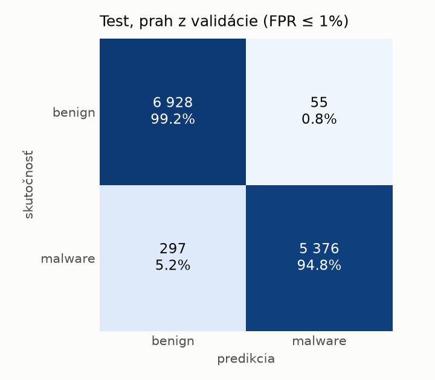
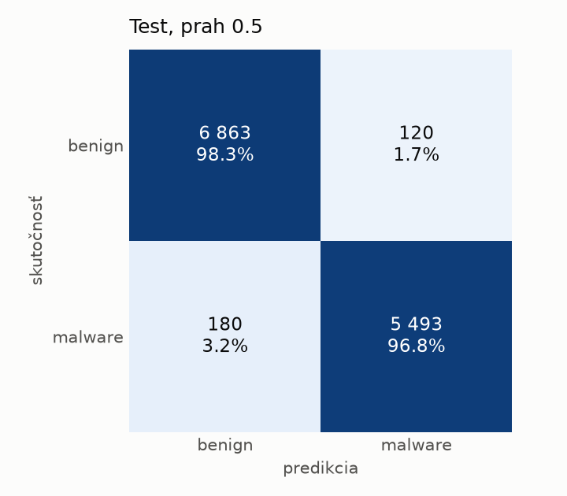
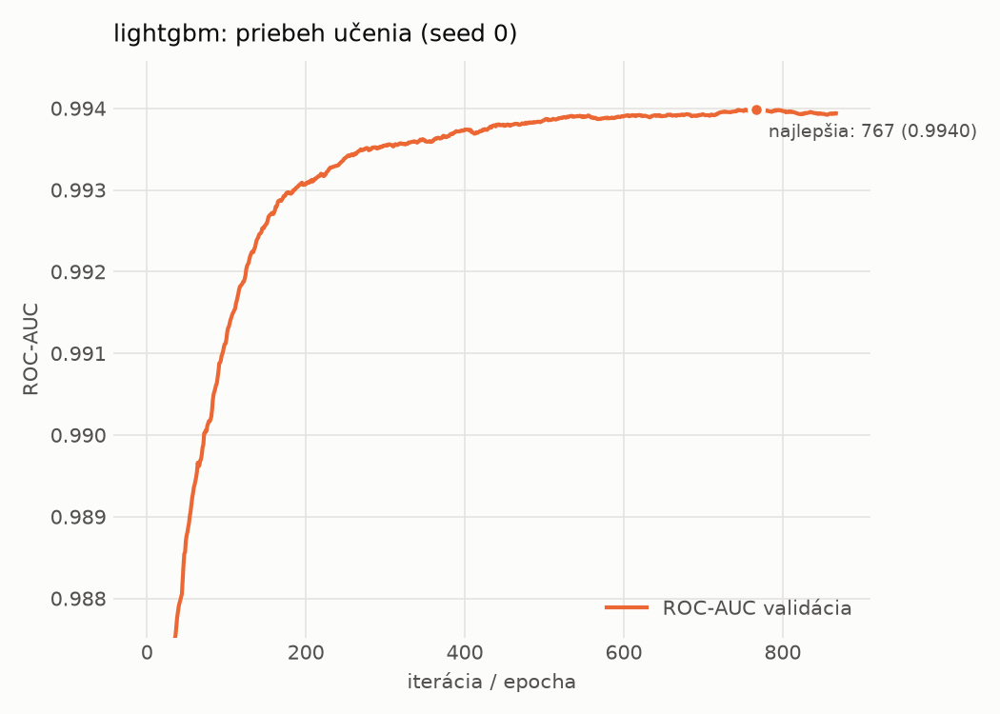

# static/lightgbm – beh `20261123-190600`

> Automaticky generované (`src/training/run_tabular.py`). Konfigurácia: `config.yaml`, protokol: `protocol.yaml`.

- **Model:** `lightgbm` – LightGBM, gradient boosting stromov s early stopping na validácii (pôvodné hodnoty príznakov)
- **Ladenie:** bez ladenia – hyperparametre prevzaté z `runs_v4/real_p/full/static/lightgbm/20261122-231010`
- **Finálne modely:** seedy [0, 1, 2]; hodnoty sú priemer ± smerodajná odchýlka cez seedy
- **Najlepšie hyperparametre:** `{"num_boost_round": 5000, "early_stopping_rounds": 100, "learning_rate": 0.03701536655085927, "num_leaves": 240, "min_child_samples": 18, "feature_fraction": 0.860319963795015, "bagging_fraction": 0.9949001098214416, "lambda_l1": 1.0205843882460235e-07, "lambda_l2": 0.00015478320101473535}`

## Detekčná kvalita (bez prahu)
| metrika | train (podvzorka) | validácia | test |
|---|---|---|---|
| ROC-AUC | 1.0000 ± 0.0000 | 0.9940 ± 0.0000 | 0.9952 ± 0.0000 |
| PR-AUC | 1.0000 ± 0.0000 | 0.9938 ± 0.0001 | 0.9954 ± 0.0000 |
| TPR pri FPR 1 % | 1.0000 ± 0.0000 | 0.9435 ± 0.0041 | 0.9497 ± 0.0012 |
| TPR pri FPR 0,1 % | 1.0000 ± 0.0000 | 0.8138 ± 0.0094 | 0.8730 ± 0.0048 |
| log loss | 0.0015 ± 0.0008 | 0.1139 ± 0.0069 | 0.0932 ± 0.0053 |
| Brier skóre | 0.0001 ± 0.0001 | 0.0238 ± 0.0004 | 0.0202 ± 0.0000 |

Rozdiel ROC-AUC train − validácia: **0.0060** (veľký rozdiel = preučenie).

## Pri prahu z validácie (FPR ≤ 1% na validácii)
| metrika | train (podvzorka) | validácia | test |
|---|---|---|---|
| accuracy | 0.9992 ± 0.0010 | 0.9699 ± 0.0018 | 0.9708 ± 0.0013 |
| balanced accuracy | 0.9991 ± 0.0012 | 0.9669 ± 0.0021 | 0.9683 ± 0.0015 |
| precision | 1.0000 ± 0.0000 | 0.9870 ± 0.0002 | 0.9897 ± 0.0007 |
| recall (TPR) | 0.9981 ± 0.0024 | 0.9435 ± 0.0041 | 0.9447 ± 0.0033 |
| FPR | 0.0000 ± 0.0000 | 0.0096 ± 0.0002 | 0.0080 ± 0.0006 |
| F1 | 0.9991 ± 0.0012 | 0.9648 ± 0.0022 | 0.9667 ± 0.0016 |
| MCC | 0.9984 ± 0.0021 | 0.9392 ± 0.0036 | 0.9415 ± 0.0026 |

## Pri pevnom prahu 0.5
| metrika | train (podvzorka) | validácia | test |
|---|---|---|---|
| accuracy | 0.9999 ± 0.0000 | 0.9719 ± 0.0005 | 0.9766 ± 0.0003 |
| balanced accuracy | 0.9999 ± 0.0000 | 0.9710 ± 0.0005 | 0.9759 ± 0.0003 |
| precision | 0.9998 ± 0.0000 | 0.9717 ± 0.0007 | 0.9787 ± 0.0001 |
| recall (TPR) | 1.0000 ± 0.0000 | 0.9638 ± 0.0004 | 0.9689 ± 0.0005 |
| FPR | 0.0002 ± 0.0000 | 0.0218 ± 0.0006 | 0.0171 ± 0.0001 |
| F1 | 0.9999 ± 0.0000 | 0.9678 ± 0.0005 | 0.9738 ± 0.0003 |
| MCC | 0.9998 ± 0.0000 | 0.9429 ± 0.0010 | 0.9527 ± 0.0005 |

## Výpočtové nároky (seed 0, testovacia množina)
| meranie | hodnota |
|---|---|
| tréning finálneho modelu | 9.0 s (priemer cez seedy) |
| ladenie spolu | 0 s |
| počet parametrov / uzlov | 367 393 |
| veľkosť modelu na disku | 20.61 MB |
| CPU latencia modelu (batch 1, 1 vlákno) | 0.137 ms (p95 0.160) |
| CPU priepustnosť (24 vlákien) | 110 719 vzoriek/s |

## Grafy
| | |
|---|---|
|  |  |
|  |  |
|  |  |
|  |  |

## Súbory
`metrics.json` (všetky metriky po seedoch vrátane rodín), `timing.json`, `hpo_trials.csv`,
`predictions/<časť>_seed<N>.parquet` (sha256, family, label, score), `model/seed_<N>/`, `log.txt`.
