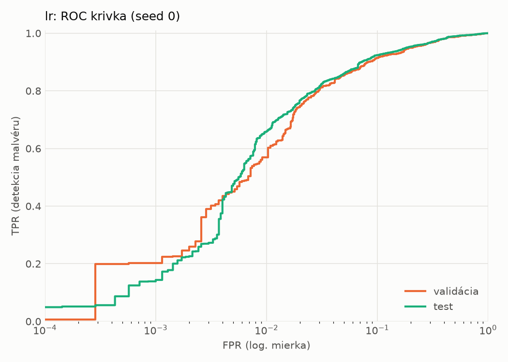
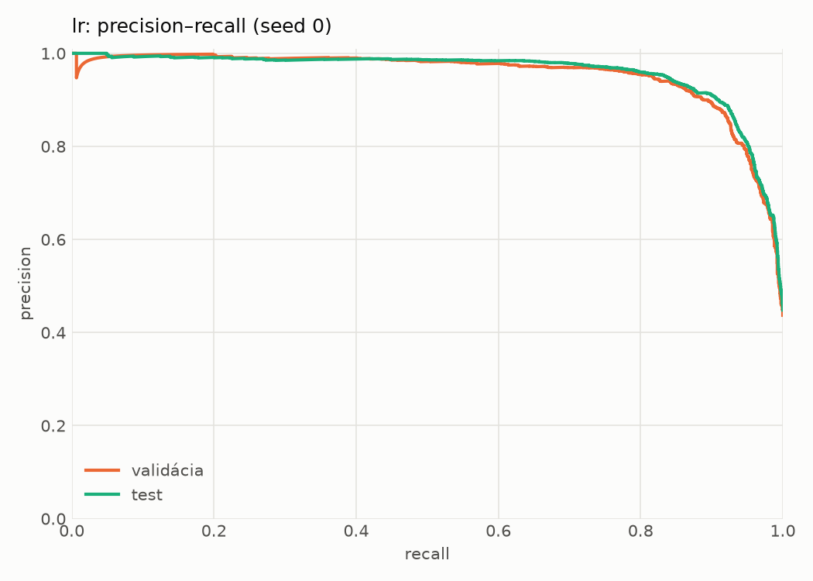
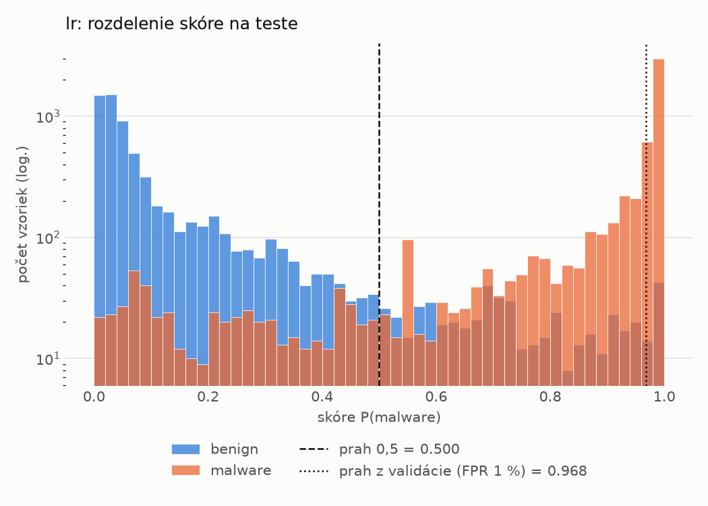
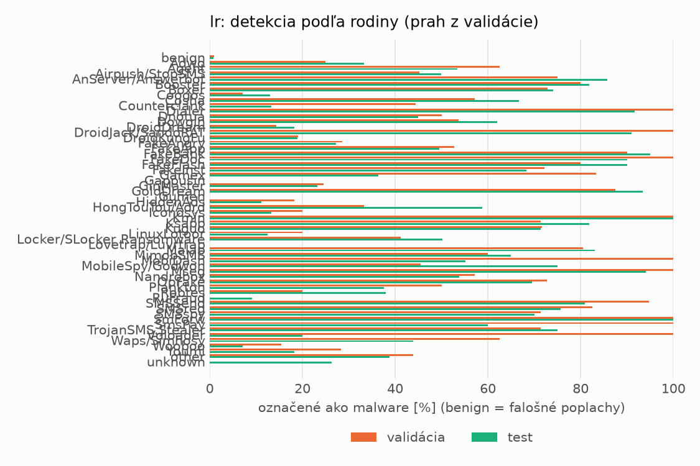
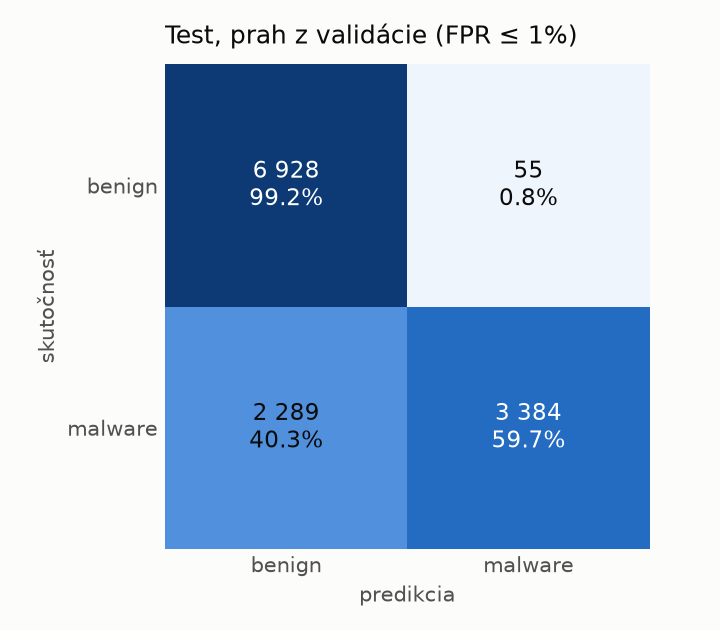
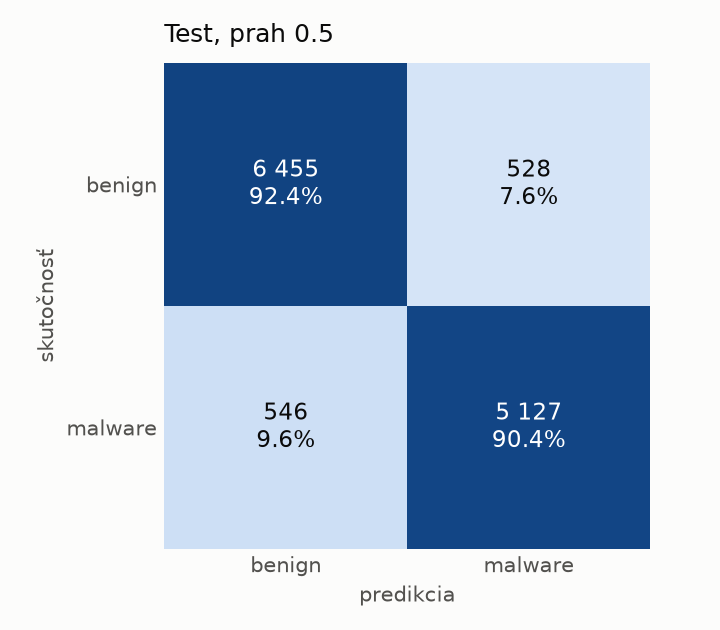

# static/lr – beh `20261123-190544`

> Automaticky generované (`src/training/run_tabular.py`). Konfigurácia: `config.yaml`, protokol: `protocol.yaml`.

- **Model:** `logreg` – logistická regresia s L2 regularizáciou (vstup signed log1p + štandardizácia)
- **Ladenie:** bez ladenia – hyperparametre prevzaté z `runs_v4/real_p/full/static/lr/20261122-230905`
- **Finálne modely:** seedy [0, 1, 2]; hodnoty sú priemer ± smerodajná odchýlka cez seedy
- **Najlepšie hyperparametre:** `{"max_iter": 2000, "C": 5.669849511478847}`

## Detekčná kvalita (bez prahu)
| metrika | train (podvzorka) | validácia | test |
|---|---|---|---|
| ROC-AUC | 0.9670 ± 0.0000 | 0.9615 ± 0.0000 | 0.9647 ± 0.0000 |
| PR-AUC | 0.9597 ± 0.0000 | 0.9548 ± 0.0000 | 0.9600 ± 0.0000 |
| TPR pri FPR 1 % | 0.6356 ± 0.0000 | 0.5696 ± 0.0000 | 0.6577 ± 0.0000 |
| TPR pri FPR 0,1 % | 0.1647 ± 0.0000 | 0.2030 ± 0.0000 | 0.1389 ± 0.0000 |
| log loss | 0.2289 ± 0.0000 | 0.2469 ± 0.0000 | 0.2368 ± 0.0000 |
| Brier skóre | 0.0649 ± 0.0000 | 0.0701 ± 0.0000 | 0.0670 ± 0.0000 |

Rozdiel ROC-AUC train − validácia: **0.0055** (veľký rozdiel = preučenie).

## Pri prahu z validácie (FPR ≤ 1% na validácii)
| metrika | train (podvzorka) | validácia | test |
|---|---|---|---|
| accuracy | 0.8087 ± 0.0000 | 0.8066 ± 0.0000 | 0.8148 ± 0.0000 |
| balanced accuracy | 0.7794 ± 0.0000 | 0.7801 ± 0.0000 | 0.7943 ± 0.0000 |
| precision | 0.9859 ± 0.0000 | 0.9791 ± 0.0000 | 0.9840 ± 0.0000 |
| recall (TPR) | 0.5650 ± 0.0000 | 0.5696 ± 0.0000 | 0.5965 ± 0.0000 |
| FPR | 0.0062 ± 0.0000 | 0.0095 ± 0.0000 | 0.0079 ± 0.0000 |
| F1 | 0.7183 ± 0.0000 | 0.7202 ± 0.0000 | 0.7428 ± 0.0000 |
| MCC | 0.6415 ± 0.0000 | 0.6380 ± 0.0000 | 0.6581 ± 0.0000 |

## Pri pevnom prahu 0.5
| metrika | train (podvzorka) | validácia | test |
|---|---|---|---|
| accuracy | 0.9160 ± 0.0000 | 0.9082 ± 0.0000 | 0.9151 ± 0.0000 |
| balanced accuracy | 0.9140 ± 0.0000 | 0.9060 ± 0.0000 | 0.9141 ± 0.0000 |
| precision | 0.9053 ± 0.0000 | 0.9004 ± 0.0000 | 0.9066 ± 0.0000 |
| recall (TPR) | 0.8995 ± 0.0000 | 0.8882 ± 0.0000 | 0.9038 ± 0.0000 |
| FPR | 0.0714 ± 0.0000 | 0.0762 ± 0.0000 | 0.0756 ± 0.0000 |
| F1 | 0.9024 ± 0.0000 | 0.8943 ± 0.0000 | 0.9052 ± 0.0000 |
| MCC | 0.8287 ± 0.0000 | 0.8132 ± 0.0000 | 0.8284 ± 0.0000 |

## Výpočtové nároky (seed 0, testovacia množina)
| meranie | hodnota |
|---|---|
| tréning finálneho modelu | 0.2 s (priemer cez seedy) |
| ladenie spolu | 0 s |
| počet parametrov / uzlov | 163 |
| veľkosť modelu na disku | 0.01 MB |
| transformácia vstupu – latencia (1 vlákno) | 0.005 ms |
| transformácia vstupu – priepustnosť | 1 227 999 vzoriek/s |
| CPU latencia modelu (batch 1, 1 vlákno) | 0.004 ms (p95 0.004) |
| CPU priepustnosť (24 vlákien) | 3 323 006 vzoriek/s |

## Grafy
| | |
|---|---|
|  |  |
|  |  |
|  |  |
|  |  |

## Súbory
`metrics.json` (všetky metriky po seedoch vrátane rodín), `timing.json`, `hpo_trials.csv`,
`predictions/<časť>_seed<N>.parquet` (sha256, family, label, score), `model/seed_<N>/`, `log.txt`.
