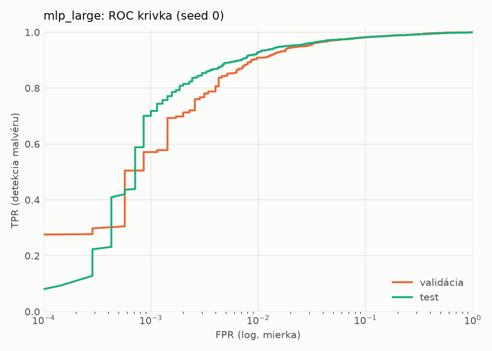
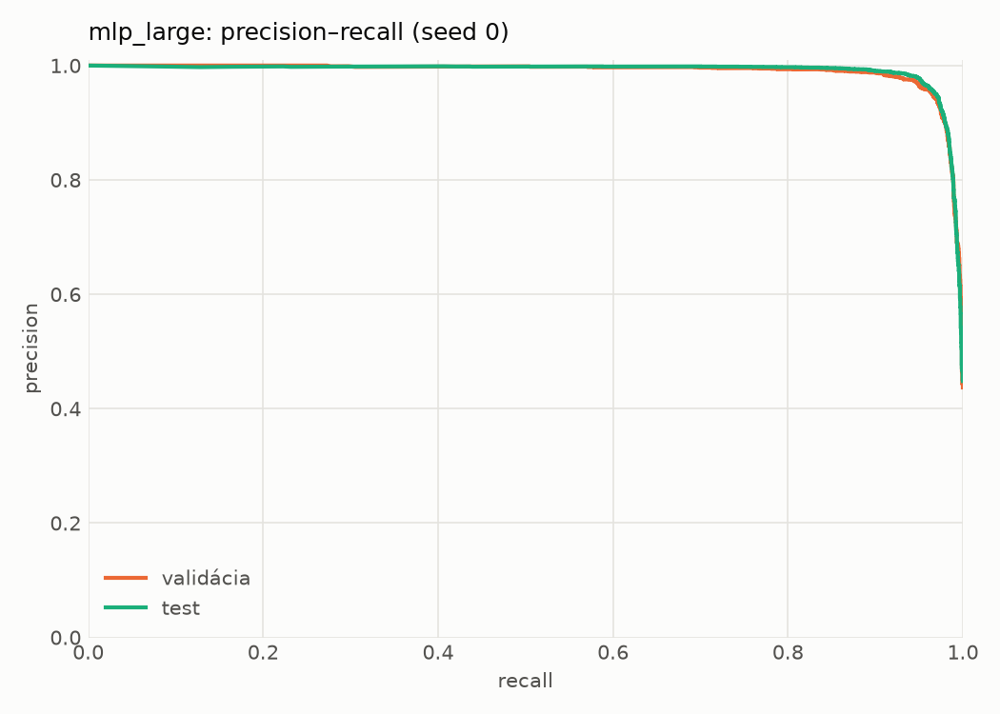
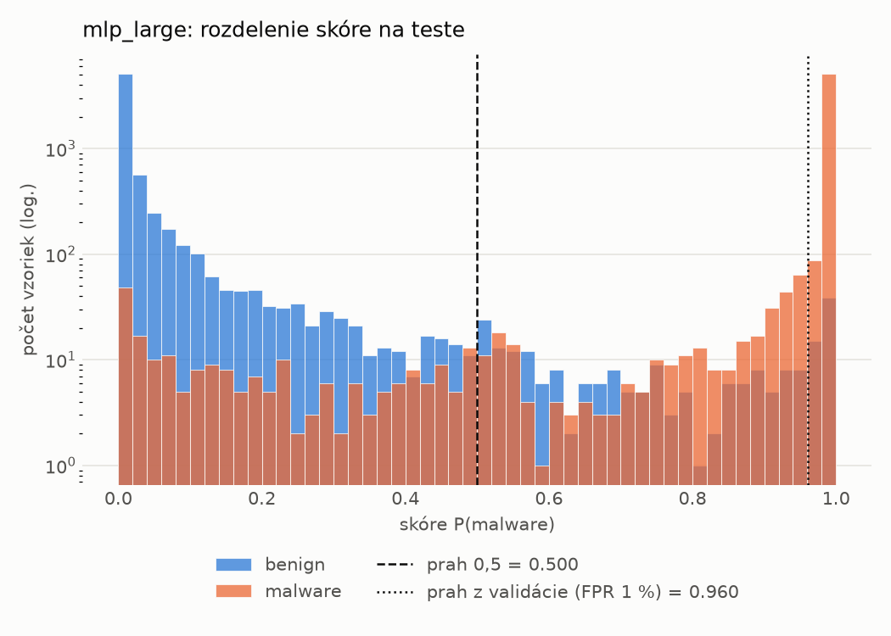
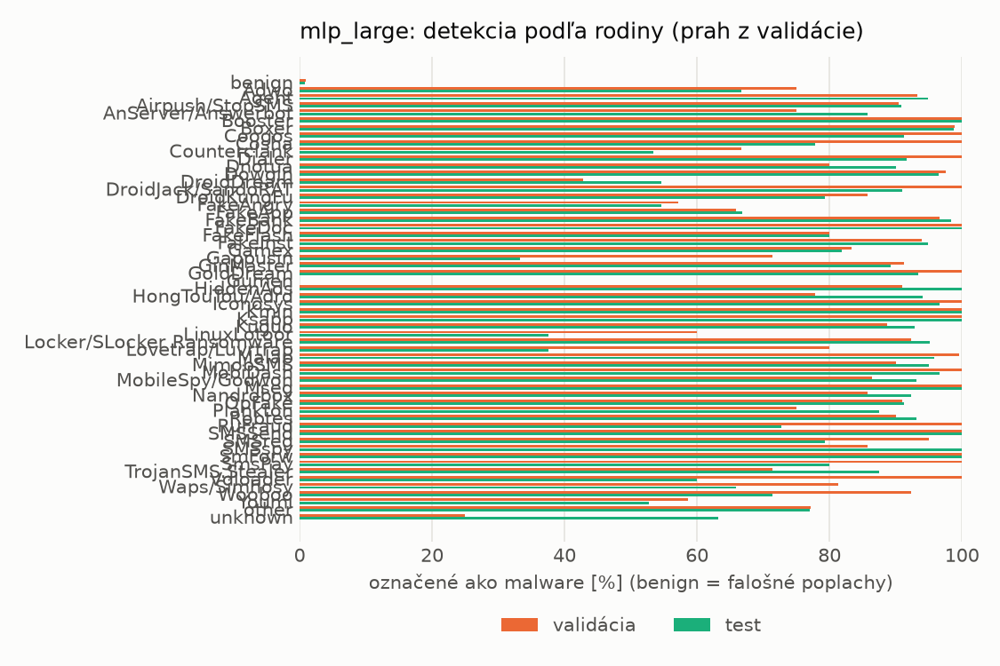
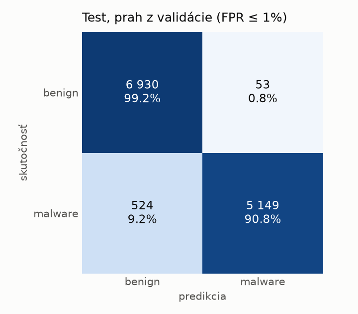
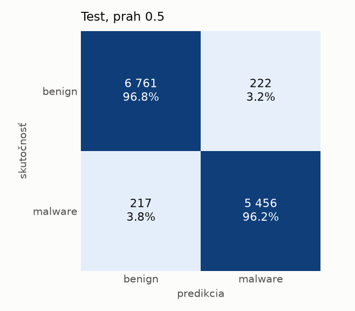
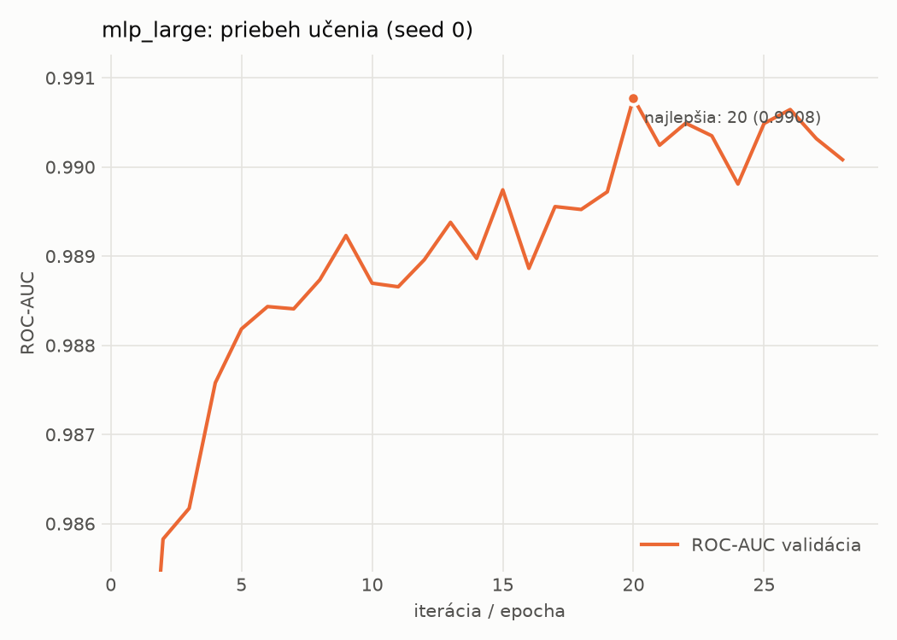

# static/mlp_large – beh `20261123-190713`

> Automaticky generované (`src/training/run_tabular.py`). Konfigurácia: `config.yaml`, protokol: `protocol.yaml`.

- **Model:** `mlp` – veľká neurónová sieť (3–5 skrytých vrstiev, 512–2048 neurónov), kandidát na učiteľa
- **Ladenie:** bez ladenia – hyperparametre prevzaté z `runs_v4/real_p/full/static/mlp_large/20261122-232356`
- **Finálne modely:** seedy [0, 1, 2]; hodnoty sú priemer ± smerodajná odchýlka cez seedy
- **Najlepšie hyperparametre:** `{"max_epochs": 100, "patience": 8, "hidden_layers": 3, "hidden_width": 2048, "width_decay": 0.5, "dropout": 0.24592095800405475, "lr": 0.0002046278772560144, "weight_decay": 0.007038560648637635, "batch_size": 256}`

## Detekčná kvalita (bez prahu)
| metrika | train (podvzorka) | validácia | test |
|---|---|---|---|
| ROC-AUC | 0.9979 ± 0.0006 | 0.9906 ± 0.0005 | 0.9905 ± 0.0005 |
| PR-AUC | 0.9976 ± 0.0006 | 0.9897 ± 0.0008 | 0.9900 ± 0.0007 |
| TPR pri FPR 1 % | 0.9700 ± 0.0066 | 0.9002 ± 0.0080 | 0.9191 ± 0.0105 |
| TPR pri FPR 0,1 % | 0.9309 ± 0.0098 | 0.5971 ± 0.0458 | 0.6205 ± 0.1154 |
| log loss | 0.0536 ± 0.0056 | 0.1245 ± 0.0009 | 0.1172 ± 0.0031 |
| Brier skóre | 0.0147 ± 0.0016 | 0.0299 ± 0.0012 | 0.0279 ± 0.0013 |

Rozdiel ROC-AUC train − validácia: **0.0074** (veľký rozdiel = preučenie).

## Pri prahu z validácie (FPR ≤ 1% na validácii)
| metrika | train (podvzorka) | validácia | test |
|---|---|---|---|
| accuracy | 0.9648 ± 0.0046 | 0.9509 ± 0.0035 | 0.9511 ± 0.0031 |
| balanced accuracy | 0.9593 ± 0.0053 | 0.9452 ± 0.0040 | 0.9462 ± 0.0036 |
| precision | 0.9990 ± 0.0000 | 0.9862 ± 0.0001 | 0.9908 ± 0.0009 |
| recall (TPR) | 0.9193 ± 0.0105 | 0.9002 ± 0.0080 | 0.8992 ± 0.0078 |
| FPR | 0.0007 ± 0.0000 | 0.0097 ± 0.0000 | 0.0068 ± 0.0007 |
| F1 | 0.9575 ± 0.0057 | 0.9413 ± 0.0044 | 0.9428 ± 0.0039 |
| MCC | 0.9299 ± 0.0089 | 0.9020 ± 0.0068 | 0.9035 ± 0.0059 |

## Pri pevnom prahu 0.5
| metrika | train (podvzorka) | validácia | test |
|---|---|---|---|
| accuracy | 0.9813 ± 0.0026 | 0.9628 ± 0.0034 | 0.9635 ± 0.0024 |
| balanced accuracy | 0.9807 ± 0.0033 | 0.9622 ± 0.0042 | 0.9627 ± 0.0030 |
| precision | 0.9804 ± 0.0033 | 0.9579 ± 0.0025 | 0.9633 ± 0.0032 |
| recall (TPR) | 0.9761 ± 0.0086 | 0.9571 ± 0.0105 | 0.9551 ± 0.0090 |
| FPR | 0.0148 ± 0.0027 | 0.0327 ± 0.0023 | 0.0296 ± 0.0030 |
| F1 | 0.9782 ± 0.0031 | 0.9575 ± 0.0042 | 0.9591 ± 0.0029 |
| MCC | 0.9618 ± 0.0053 | 0.9245 ± 0.0070 | 0.9263 ± 0.0048 |

## Výpočtové nároky (seed 0, testovacia množina)
| meranie | hodnota |
|---|---|
| tréning finálneho modelu | 10.8 s (priemer cez seedy) |
| ladenie spolu | 0 s |
| počet parametrov / uzlov | 2 964 481 |
| veľkosť modelu na disku | 11.90 MB |
| transformácia vstupu – latencia (1 vlákno) | 0.015 ms |
| transformácia vstupu – priepustnosť | 748 681 vzoriek/s |
| CPU latencia modelu (batch 1, 1 vlákno) | 0.317 ms (p95 0.647) |
| CPU priepustnosť (24 vlákien) | 132 442 vzoriek/s |
| GPU latencia (batch 1) | 0.527 ms (p95 0.570) |
| GPU priepustnosť | 807 818 vzoriek/s |
| GPU špičková pamäť | 248 MB |

## Grafy
| | |
|---|---|
|  |  |
|  |  |
|  |  |
|  |  |

## Súbory
`metrics.json` (všetky metriky po seedoch vrátane rodín), `timing.json`, `hpo_trials.csv`,
`predictions/<časť>_seed<N>.parquet` (sha256, family, label, score), `model/seed_<N>/`, `log.txt`.
