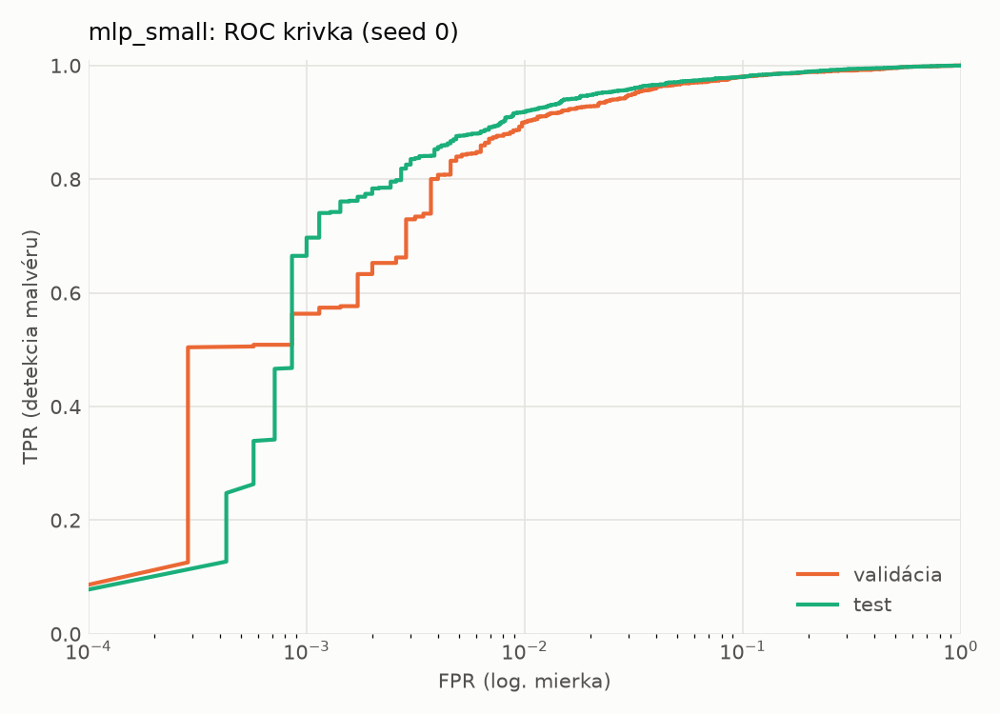
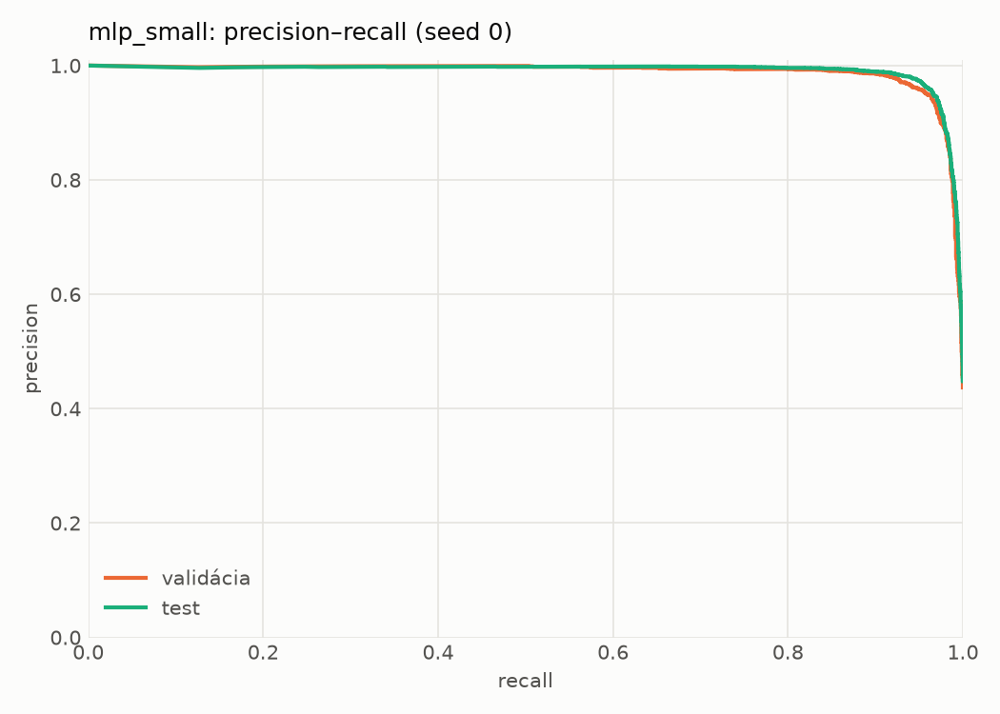
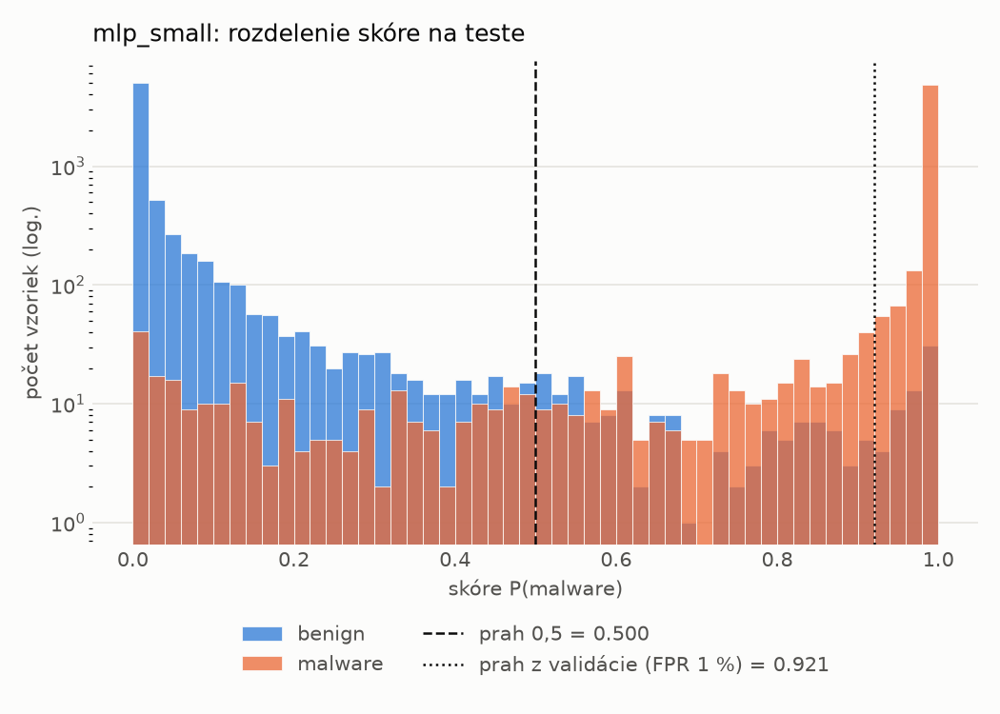
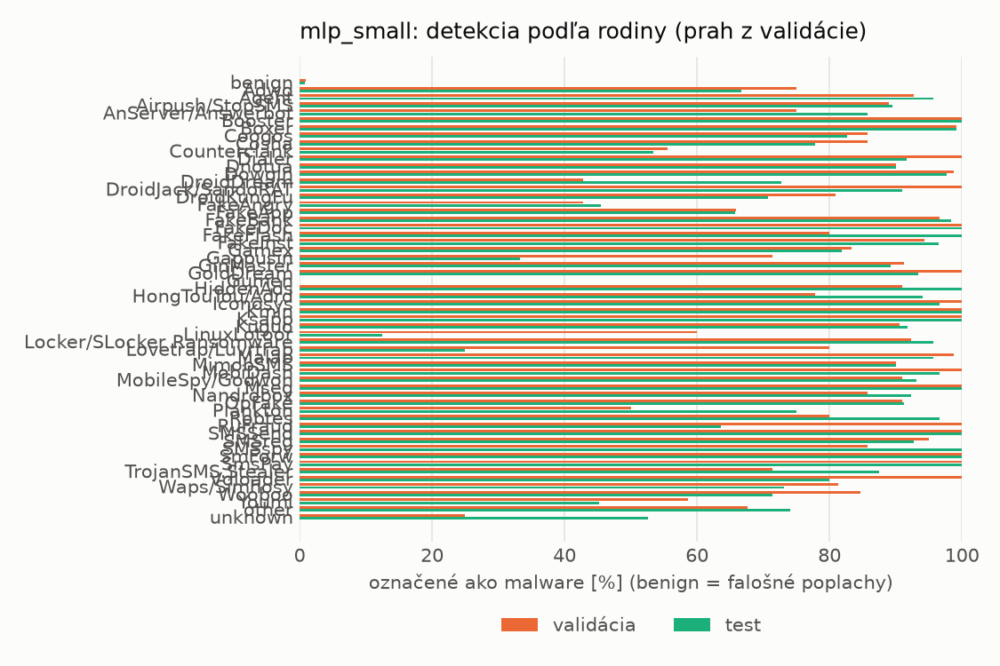
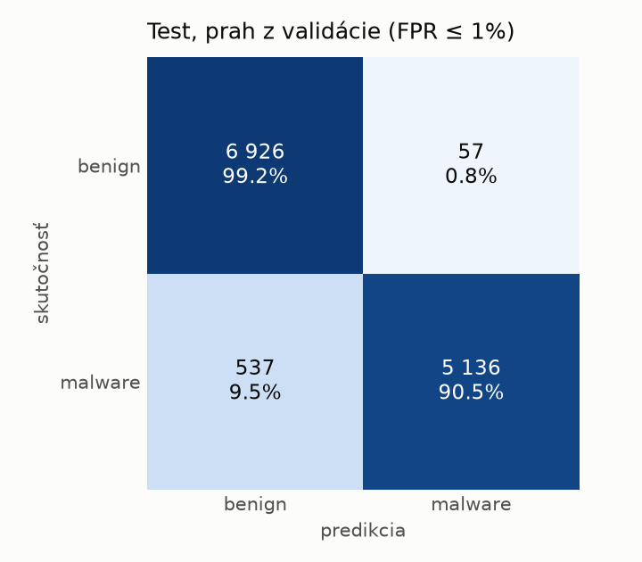
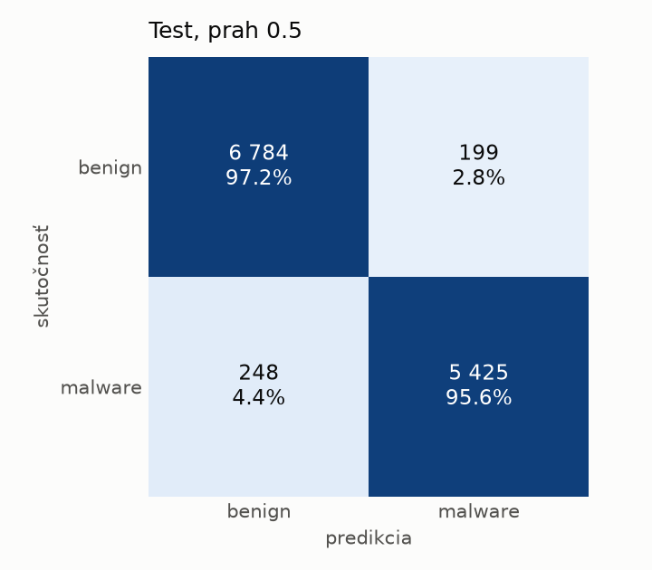
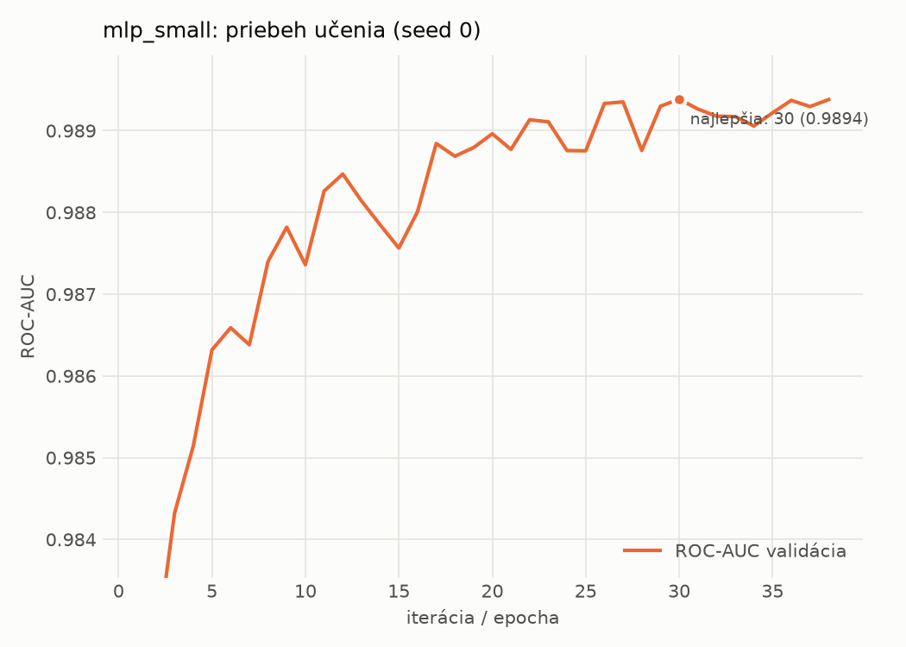

# static/mlp_small – beh `20261123-190638`

> Automaticky generované (`src/training/run_tabular.py`). Konfigurácia: `config.yaml`, protokol: `protocol.yaml`.

- **Model:** `mlp` – malá neurónová sieť (1–2 skryté vrstvy), kandidát na ľahkého študenta
- **Ladenie:** bez ladenia – hyperparametre prevzaté z `runs_v4/real_p/full/static/mlp_small/20261122-231849`
- **Finálne modely:** seedy [0, 1, 2]; hodnoty sú priemer ± smerodajná odchýlka cez seedy
- **Najlepšie hyperparametre:** `{"width_decay": 0.5, "max_epochs": 100, "patience": 8, "hidden_layers": 2, "hidden_width": 256, "dropout": 0.2770731649287669, "lr": 0.0010447758392925718, "weight_decay": 0.0006745378680415608, "batch_size": 256}`

## Detekčná kvalita (bez prahu)
| metrika | train (podvzorka) | validácia | test |
|---|---|---|---|
| ROC-AUC | 0.9973 ± 0.0002 | 0.9900 ± 0.0006 | 0.9911 ± 0.0000 |
| PR-AUC | 0.9970 ± 0.0002 | 0.9893 ± 0.0009 | 0.9907 ± 0.0005 |
| TPR pri FPR 1 % | 0.9651 ± 0.0010 | 0.8933 ± 0.0063 | 0.9240 ± 0.0049 |
| TPR pri FPR 0,1 % | 0.9017 ± 0.0135 | 0.6131 ± 0.0433 | 0.6829 ± 0.0271 |
| log loss | 0.0603 ± 0.0025 | 0.1238 ± 0.0031 | 0.1119 ± 0.0013 |
| Brier skóre | 0.0164 ± 0.0006 | 0.0305 ± 0.0009 | 0.0274 ± 0.0003 |

Rozdiel ROC-AUC train − validácia: **0.0072** (veľký rozdiel = preučenie).

## Pri prahu z validácie (FPR ≤ 1% na validácii)
| metrika | train (podvzorka) | validácia | test |
|---|---|---|---|
| accuracy | 0.9611 ± 0.0019 | 0.9480 ± 0.0027 | 0.9504 ± 0.0029 |
| balanced accuracy | 0.9551 ± 0.0022 | 0.9419 ± 0.0031 | 0.9454 ± 0.0033 |
| precision | 0.9983 ± 0.0004 | 0.9864 ± 0.0002 | 0.9911 ± 0.0018 |
| recall (TPR) | 0.9114 ± 0.0046 | 0.8933 ± 0.0063 | 0.8974 ± 0.0077 |
| FPR | 0.0012 ± 0.0003 | 0.0096 ± 0.0002 | 0.0066 ± 0.0014 |
| F1 | 0.9529 ± 0.0024 | 0.9376 ± 0.0034 | 0.9419 ± 0.0036 |
| MCC | 0.9227 ± 0.0036 | 0.8964 ± 0.0051 | 0.9022 ± 0.0053 |

## Pri pevnom prahu 0.5
| metrika | train (podvzorka) | validácia | test |
|---|---|---|---|
| accuracy | 0.9792 ± 0.0001 | 0.9608 ± 0.0014 | 0.9649 ± 0.0007 |
| balanced accuracy | 0.9783 ± 0.0002 | 0.9600 ± 0.0013 | 0.9640 ± 0.0007 |
| precision | 0.9798 ± 0.0014 | 0.9571 ± 0.0029 | 0.9657 ± 0.0014 |
| recall (TPR) | 0.9718 ± 0.0014 | 0.9531 ± 0.0016 | 0.9556 ± 0.0007 |
| FPR | 0.0153 ± 0.0011 | 0.0332 ± 0.0024 | 0.0275 ± 0.0012 |
| F1 | 0.9758 ± 0.0001 | 0.9551 ± 0.0016 | 0.9607 ± 0.0008 |
| MCC | 0.9575 ± 0.0002 | 0.9204 ± 0.0029 | 0.9290 ± 0.0014 |

## Výpočtové nároky (seed 0, testovacia množina)
| meranie | hodnota |
|---|---|
| tréning finálneho modelu | 10.9 s (priemer cez seedy) |
| ladenie spolu | 0 s |
| počet parametrov / uzlov | 75 521 |
| veľkosť modelu na disku | 0.32 MB |
| transformácia vstupu – latencia (1 vlákno) | 0.014 ms |
| transformácia vstupu – priepustnosť | 754 609 vzoriek/s |
| CPU latencia modelu (batch 1, 1 vlákno) | 0.081 ms (p95 0.233) |
| CPU priepustnosť (24 vlákien) | 1 879 139 vzoriek/s |
| GPU latencia (batch 1) | 0.636 ms (p95 0.687) |
| GPU priepustnosť | 1 643 786 vzoriek/s |
| GPU špičková pamäť | 75 MB |

## Grafy
| | |
|---|---|
|  |  |
|  |  |
|  |  |
|  |  |

## Súbory
`metrics.json` (všetky metriky po seedoch vrátane rodín), `timing.json`, `hpo_trials.csv`,
`predictions/<časť>_seed<N>.parquet` (sha256, family, label, score), `model/seed_<N>/`, `log.txt`.
