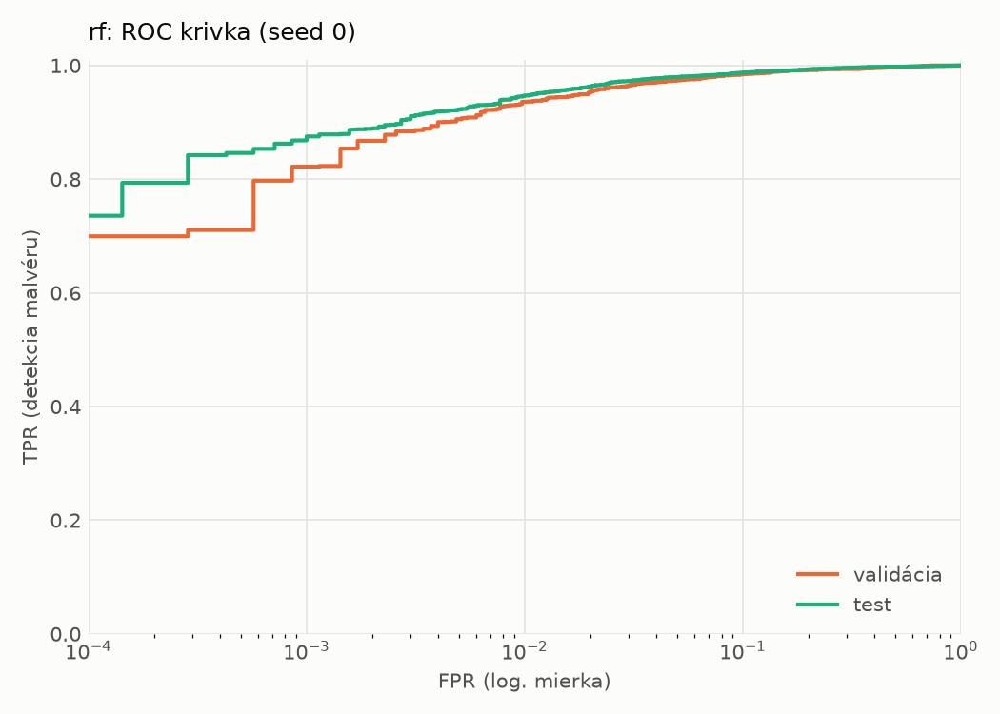
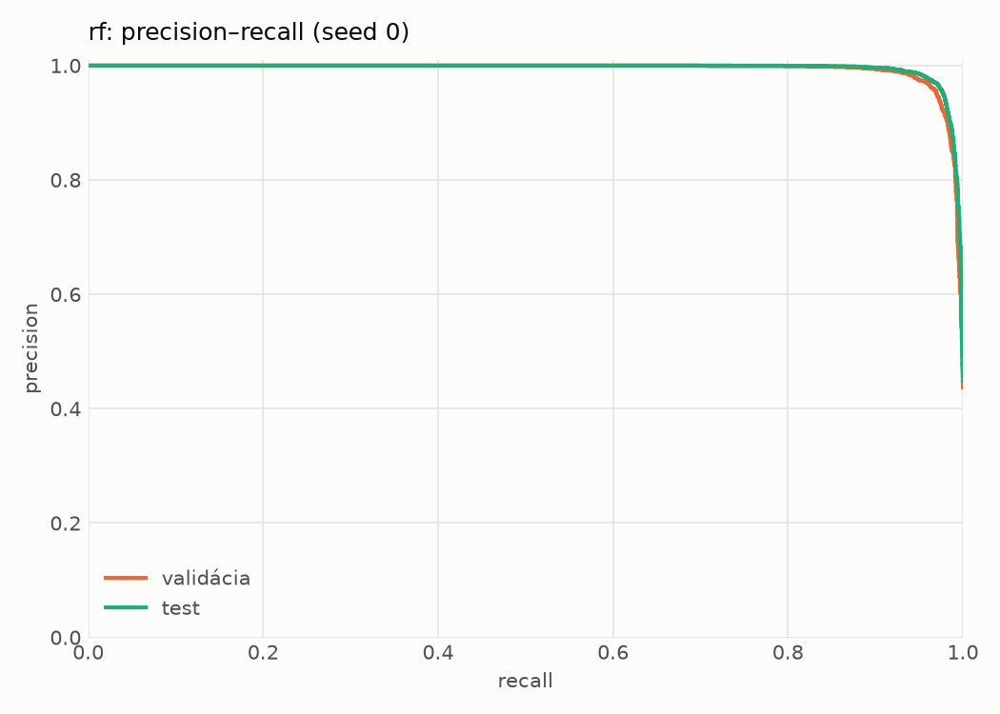
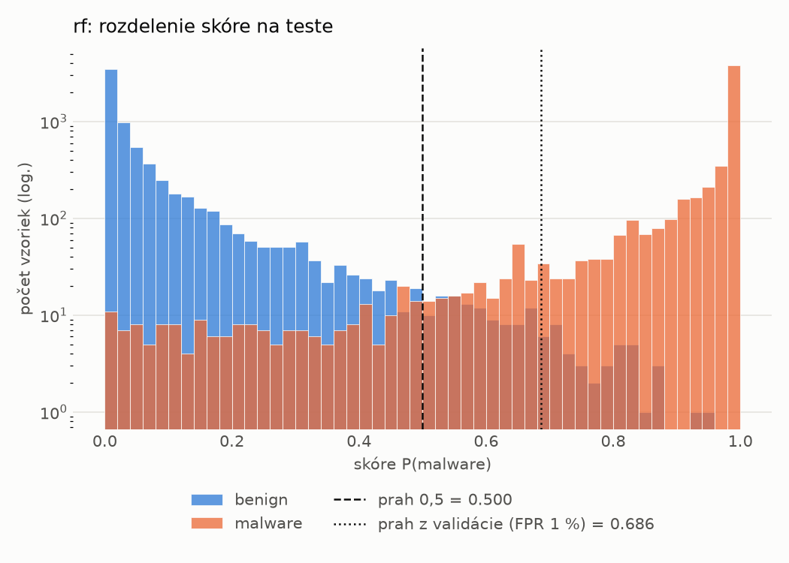
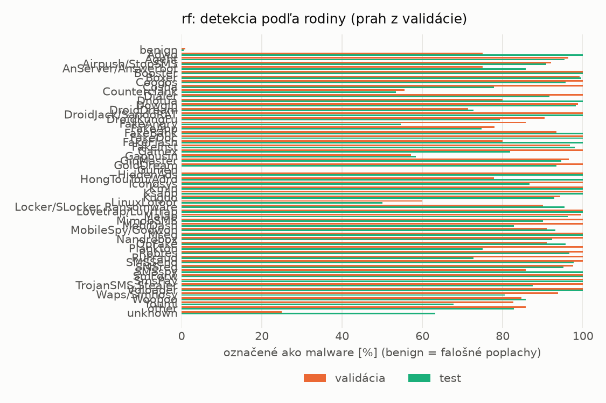
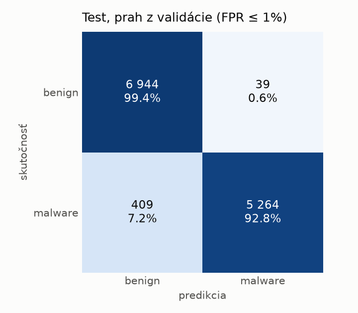
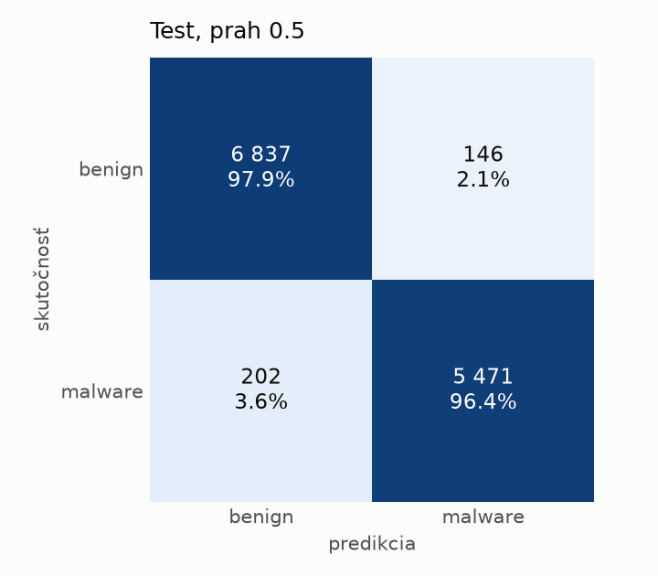

# static/rf – beh `20261123-190545`

> Automaticky generované (`src/training/run_tabular.py`). Konfigurácia: `config.yaml`, protokol: `protocol.yaml`.

- **Model:** `random_forest` – Random Forest (pôvodné hodnoty príznakov)
- **Ladenie:** bez ladenia – hyperparametre prevzaté z `runs_v4/real_p/full/static/rf/20261122-230914`
- **Finálne modely:** seedy [0, 1, 2]; hodnoty sú priemer ± smerodajná odchýlka cez seedy
- **Najlepšie hyperparametre:** `{"n_estimators": 500, "max_depth": 32, "min_samples_leaf": 1, "max_features": "log2"}`

## Detekčná kvalita (bez prahu)
| metrika | train (podvzorka) | validácia | test |
|---|---|---|---|
| ROC-AUC | 1.0000 ± 0.0000 | 0.9932 ± 0.0001 | 0.9946 ± 0.0001 |
| PR-AUC | 1.0000 ± 0.0000 | 0.9932 ± 0.0000 | 0.9949 ± 0.0000 |
| TPR pri FPR 1 % | 0.9998 ± 0.0001 | 0.9349 ± 0.0013 | 0.9464 ± 0.0011 |
| TPR pri FPR 0,1 % | 0.9979 ± 0.0002 | 0.8158 ± 0.0057 | 0.8629 ± 0.0055 |
| log loss | 0.0380 ± 0.0003 | 0.1018 ± 0.0002 | 0.0963 ± 0.0001 |
| Brier skóre | 0.0057 ± 0.0001 | 0.0264 ± 0.0000 | 0.0242 ± 0.0000 |

Rozdiel ROC-AUC train − validácia: **0.0068** (veľký rozdiel = preučenie).

## Pri prahu z validácie (FPR ≤ 1% na validácii)
| metrika | train (podvzorka) | validácia | test |
|---|---|---|---|
| accuracy | 0.9918 ± 0.0006 | 0.9661 ± 0.0006 | 0.9649 ± 0.0007 |
| balanced accuracy | 0.9905 ± 0.0007 | 0.9626 ± 0.0006 | 0.9616 ± 0.0008 |
| precision | 1.0000 ± 0.0000 | 0.9868 ± 0.0000 | 0.9924 ± 0.0003 |
| recall (TPR) | 0.9811 ± 0.0013 | 0.9349 ± 0.0013 | 0.9289 ± 0.0017 |
| FPR | 0.0000 ± 0.0000 | 0.0097 ± 0.0000 | 0.0058 ± 0.0002 |
| F1 | 0.9905 ± 0.0007 | 0.9601 ± 0.0007 | 0.9596 ± 0.0008 |
| MCC | 0.9835 ± 0.0012 | 0.9317 ± 0.0011 | 0.9303 ± 0.0013 |

## Pri pevnom prahu 0.5
| metrika | train (podvzorka) | validácia | test |
|---|---|---|---|
| accuracy | 0.9979 ± 0.0002 | 0.9679 ± 0.0003 | 0.9726 ± 0.0002 |
| balanced accuracy | 0.9975 ± 0.0002 | 0.9673 ± 0.0003 | 0.9719 ± 0.0002 |
| precision | 0.9998 ± 0.0001 | 0.9641 ± 0.0004 | 0.9740 ± 0.0001 |
| recall (TPR) | 0.9952 ± 0.0004 | 0.9623 ± 0.0004 | 0.9647 ± 0.0005 |
| FPR | 0.0001 ± 0.0001 | 0.0278 ± 0.0003 | 0.0210 ± 0.0001 |
| F1 | 0.9975 ± 0.0002 | 0.9632 ± 0.0003 | 0.9693 ± 0.0003 |
| MCC | 0.9957 ± 0.0004 | 0.9347 ± 0.0006 | 0.9447 ± 0.0005 |

## Výpočtové nároky (seed 0, testovacia množina)
| meranie | hodnota |
|---|---|
| tréning finálneho modelu | 1.5 s (priemer cez seedy) |
| ladenie spolu | 0 s |
| počet parametrov / uzlov | 3 069 768 |
| veľkosť modelu na disku | 245.96 MB |
| CPU latencia modelu (batch 1, 1 vlákno) | 14.365 ms (p95 14.820) |
| CPU priepustnosť (24 vlákien) | 102 956 vzoriek/s |

## Grafy
| | |
|---|---|
|  |  |
|  |  |
|  |  |
|  |  |

## Súbory
`metrics.json` (všetky metriky po seedoch vrátane rodín), `timing.json`, `hpo_trials.csv`,
`predictions/<časť>_seed<N>.parquet` (sha256, family, label, score), `model/seed_<N>/`, `log.txt`.
