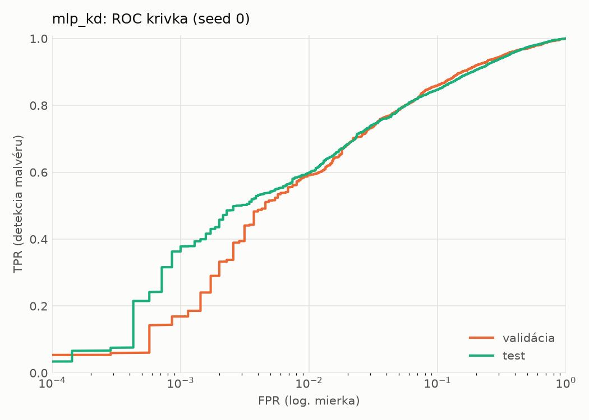
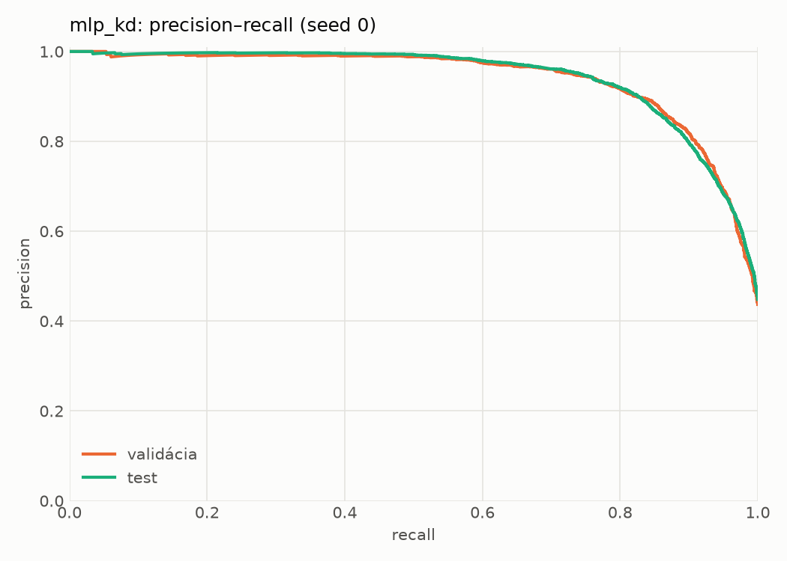
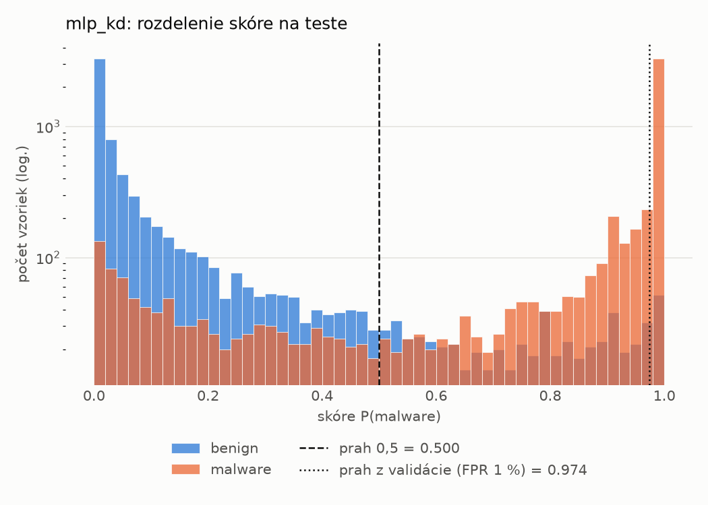
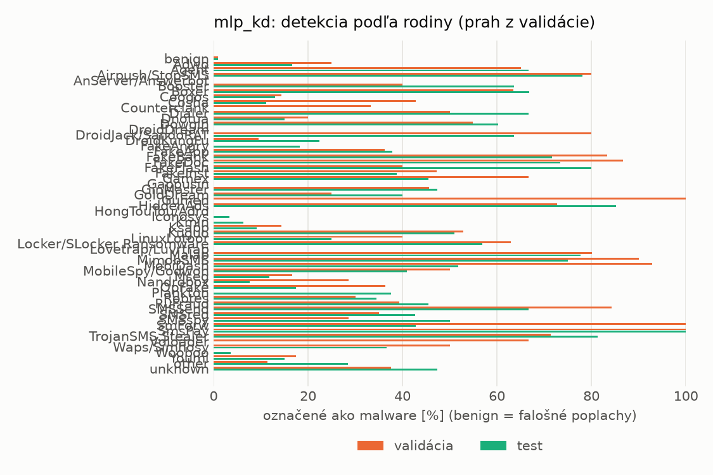
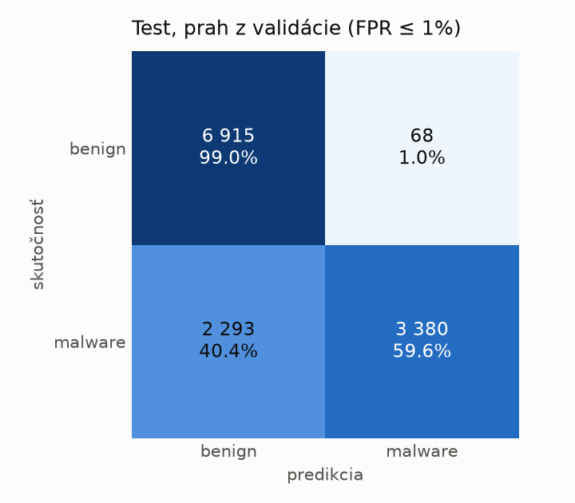
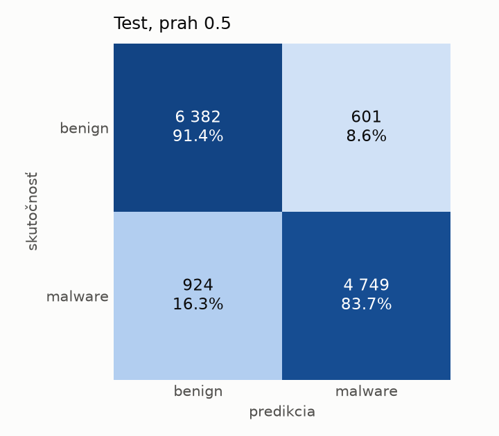
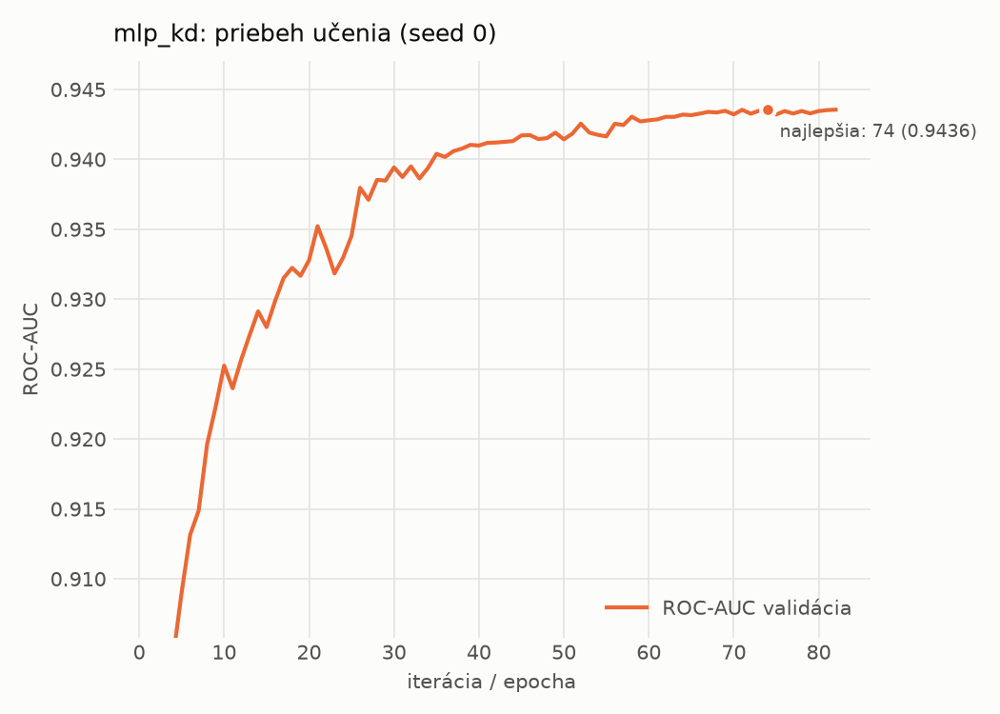

# dynamic/mlp_kd – beh `20261123-222733`

> Automaticky generované (`src/training/run_tabular.py`). Konfigurácia: `config.yaml`, protokol: `protocol.yaml`.

- **Model:** `mlp` – študent – malé MLP učené destiláciou z hybridného učiteľa
- **Ladenie:** bez ladenia – hyperparametre prevzaté z `runs_v4/emu_p/full/students_dynamic/mlp_kd/20261123-204643`
- **Finálne modely:** seedy [0, 1, 2]; hodnoty sú priemer ± smerodajná odchýlka cez seedy
- **Najlepšie hyperparametre:** `{"hidden_layers": 1, "max_epochs": 100, "patience": 8, "hidden_width": 64, "dropout": 0.18336599346560475, "lr": 0.002029071520651615, "weight_decay": 5.085344324013556e-05, "batch_size": 1024, "kd_alpha": 0.6628106947860043, "kd_temperature": 3.3639590927520047}`

## Detekčná kvalita (bez prahu)
| metrika | train (podvzorka) | validácia | test |
|---|---|---|---|
| ROC-AUC | 0.9520 ± 0.0021 | 0.9447 ± 0.0010 | 0.9433 ± 0.0012 |
| PR-AUC | 0.9501 ± 0.0025 | 0.9408 ± 0.0009 | 0.9432 ± 0.0010 |
| TPR pri FPR 1 % | 0.6508 ± 0.0168 | 0.5958 ± 0.0124 | 0.6173 ± 0.0170 |
| TPR pri FPR 0,1 % | 0.4716 ± 0.0291 | 0.1851 ± 0.0258 | 0.3525 ± 0.0112 |
| log loss | 0.2849 ± 0.0081 | 0.3204 ± 0.0045 | 0.3232 ± 0.0048 |
| Brier skóre | 0.0816 ± 0.0019 | 0.0868 ± 0.0017 | 0.0903 ± 0.0018 |

Rozdiel ROC-AUC train − validácia: **0.0073** (veľký rozdiel = preučenie).

## Pri prahu z validácie (FPR ≤ 1% na validácii)
| metrika | train (podvzorka) | validácia | test |
|---|---|---|---|
| accuracy | 0.8285 ± 0.0043 | 0.8178 ± 0.0054 | 0.8148 ± 0.0040 |
| balanced accuracy | 0.8023 ± 0.0051 | 0.7930 ± 0.0062 | 0.7943 ± 0.0044 |
| precision | 0.9863 ± 0.0017 | 0.9794 ± 0.0004 | 0.9832 ± 0.0026 |
| recall (TPR) | 0.6111 ± 0.0109 | 0.5958 ± 0.0124 | 0.5970 ± 0.0090 |
| FPR | 0.0065 ± 0.0009 | 0.0097 ± 0.0000 | 0.0083 ± 0.0013 |
| F1 | 0.7546 ± 0.0080 | 0.7408 ± 0.0097 | 0.7429 ± 0.0069 |
| MCC | 0.6766 ± 0.0074 | 0.6580 ± 0.0097 | 0.6578 ± 0.0069 |

## Pri pevnom prahu 0.5
| metrika | train (podvzorka) | validácia | test |
|---|---|---|---|
| accuracy | 0.8940 ± 0.0015 | 0.8881 ± 0.0027 | 0.8815 ± 0.0019 |
| balanced accuracy | 0.8891 ± 0.0013 | 0.8845 ± 0.0028 | 0.8776 ± 0.0020 |
| precision | 0.8962 ± 0.0042 | 0.8843 ± 0.0045 | 0.8895 ± 0.0018 |
| recall (TPR) | 0.8532 ± 0.0026 | 0.8559 ± 0.0057 | 0.8400 ± 0.0038 |
| FPR | 0.0751 ± 0.0035 | 0.0869 ± 0.0040 | 0.0848 ± 0.0015 |
| F1 | 0.8742 ± 0.0015 | 0.8699 ± 0.0032 | 0.8640 ± 0.0023 |
| MCC | 0.7834 ± 0.0031 | 0.7721 ± 0.0054 | 0.7602 ± 0.0038 |

## Výpočtové nároky (seed 0, testovacia množina)
| meranie | hodnota |
|---|---|
| tréning finálneho modelu | 6.4 s (priemer cez seedy) |
| ladenie spolu | 0 s |
| počet parametrov / uzlov | 8 129 |
| veľkosť modelu na disku | 0.04 MB |
| transformácia vstupu – latencia (1 vlákno) | 0.007 ms |
| transformácia vstupu – priepustnosť | 1 176 853 vzoriek/s |
| CPU latencia modelu (batch 1, 1 vlákno) | 0.055 ms (p95 0.063) |
| CPU priepustnosť (24 vlákien) | 7 744 462 vzoriek/s |
| GPU latencia (batch 1) | 0.267 ms (p95 0.285) |
| GPU priepustnosť | 2 297 248 vzoriek/s |
| GPU špičková pamäť | 53 MB |

## Grafy
| | |
|---|---|
|  |  |
|  |  |
|  |  |
|  |  |

## Súbory
`metrics.json` (všetky metriky po seedoch vrátane rodín), `timing.json`, `hpo_trials.csv`,
`predictions/<časť>_seed<N>.parquet` (sha256, family, label, score), `model/seed_<N>/`, `log.txt`.
