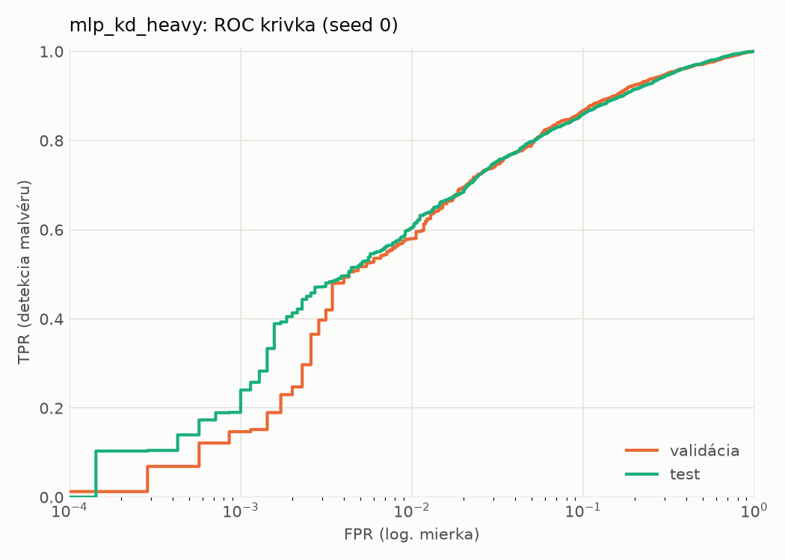
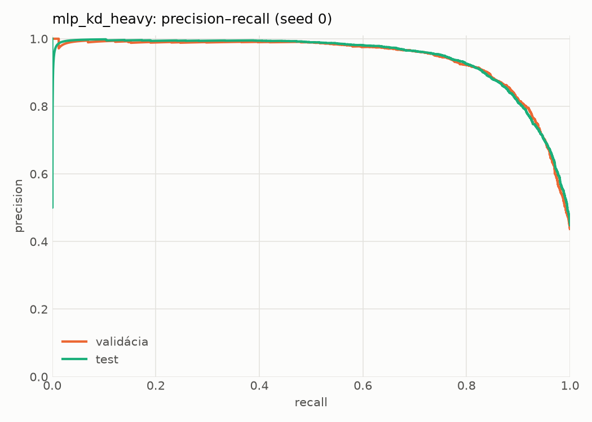
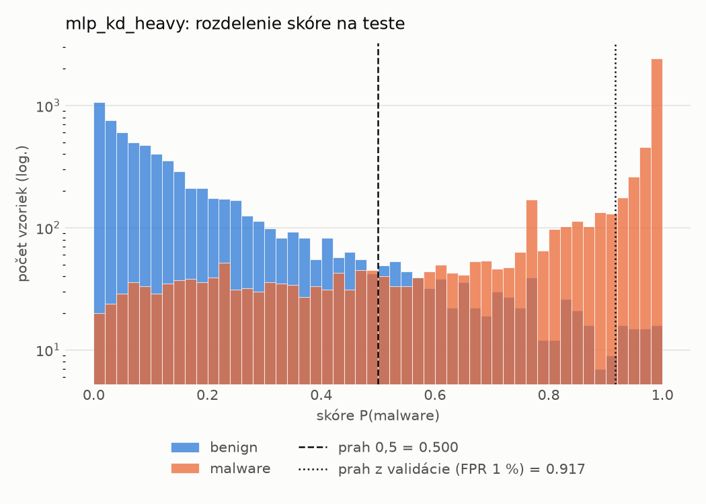
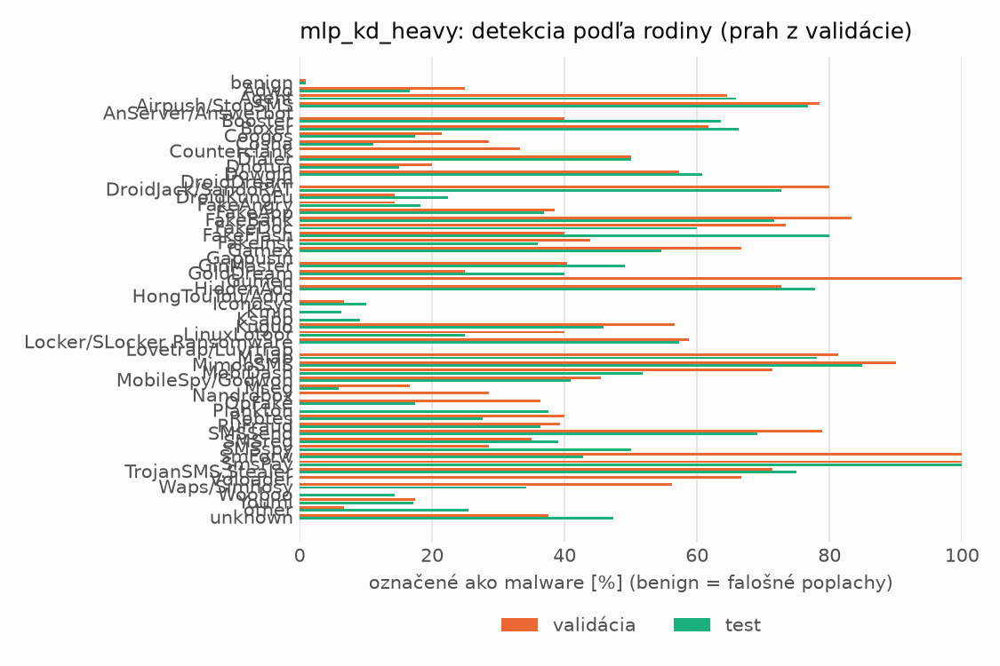
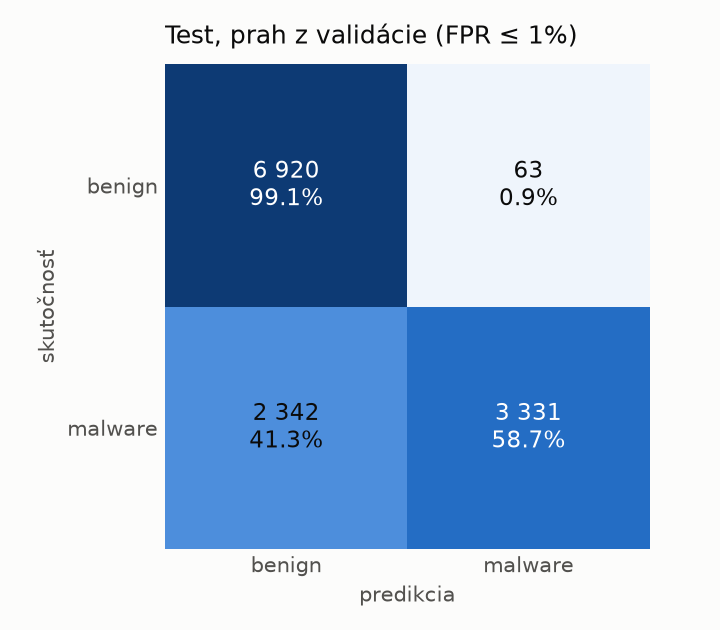
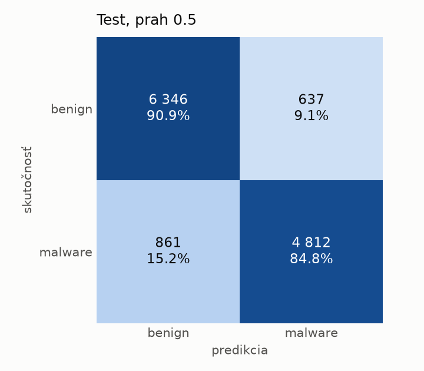
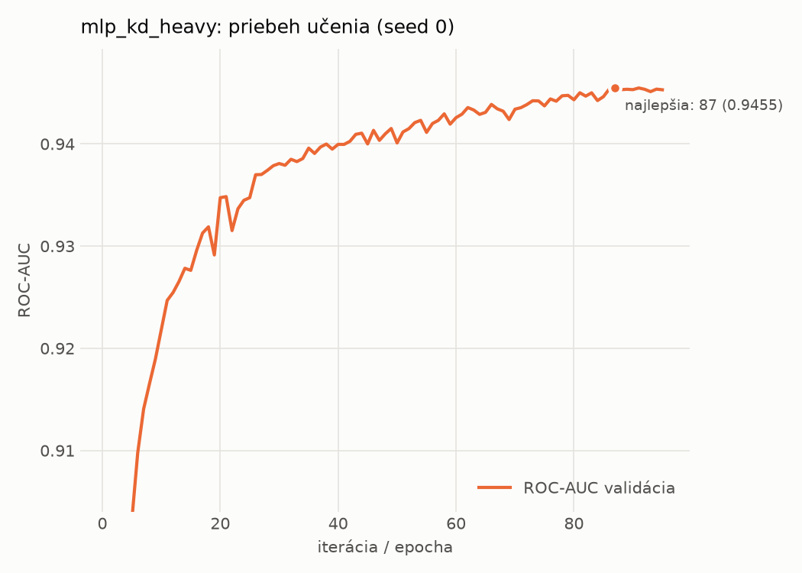

# dynamic/mlp_kd_heavy – beh `20261123-222902`

> Automaticky generované (`src/training/run_tabular.py`). Konfigurácia: `config.yaml`, protokol: `protocol.yaml`.

- **Model:** `mlp` – študent – malé MLP učené destiláciou z mlp_large hybridu (V4)
- **Ladenie:** bez ladenia – hyperparametre prevzaté z `runs_v4/emu_p/full/students_dynamic/mlp_kd_heavy/20261123-210504`
- **Finálne modely:** seedy [0, 1, 2]; hodnoty sú priemer ± smerodajná odchýlka cez seedy
- **Najlepšie hyperparametre:** `{"hidden_layers": 1, "max_epochs": 100, "patience": 8, "hidden_width": 64, "dropout": 0.11940169496551375, "lr": 0.0010131280233016235, "weight_decay": 6.964554367863767e-06, "batch_size": 1024, "kd_alpha": 0.5527208987397508, "kd_temperature": 1.1661827551200896}`

## Detekčná kvalita (bez prahu)
| metrika | train (podvzorka) | validácia | test |
|---|---|---|---|
| ROC-AUC | 0.9541 ± 0.0026 | 0.9451 ± 0.0018 | 0.9451 ± 0.0025 |
| PR-AUC | 0.9519 ± 0.0026 | 0.9414 ± 0.0018 | 0.9441 ± 0.0025 |
| TPR pri FPR 1 % | 0.6629 ± 0.0053 | 0.5861 ± 0.0085 | 0.6212 ± 0.0187 |
| TPR pri FPR 0,1 % | 0.4618 ± 0.0169 | 0.1094 ± 0.0355 | 0.2693 ± 0.1045 |
| log loss | 0.2646 ± 0.0068 | 0.2921 ± 0.0043 | 0.2900 ± 0.0064 |
| Brier skóre | 0.0796 ± 0.0023 | 0.0851 ± 0.0017 | 0.0870 ± 0.0021 |

Rozdiel ROC-AUC train − validácia: **0.0089** (veľký rozdiel = preučenie).

## Pri prahu z validácie (FPR ≤ 1% na validácii)
| metrika | train (podvzorka) | validácia | test |
|---|---|---|---|
| accuracy | 0.8273 ± 0.0046 | 0.8136 ± 0.0037 | 0.8137 ± 0.0046 |
| balanced accuracy | 0.8009 ± 0.0054 | 0.7882 ± 0.0043 | 0.7932 ± 0.0050 |
| precision | 0.9881 ± 0.0006 | 0.9790 ± 0.0003 | 0.9836 ± 0.0024 |
| recall (TPR) | 0.6074 ± 0.0112 | 0.5861 ± 0.0085 | 0.5943 ± 0.0090 |
| FPR | 0.0056 ± 0.0004 | 0.0097 ± 0.0000 | 0.0080 ± 0.0011 |
| F1 | 0.7523 ± 0.0084 | 0.7332 ± 0.0067 | 0.7409 ± 0.0077 |
| MCC | 0.6751 ± 0.0081 | 0.6504 ± 0.0066 | 0.6561 ± 0.0086 |

## Pri pevnom prahu 0.5
| metrika | train (podvzorka) | validácia | test |
|---|---|---|---|
| accuracy | 0.8955 ± 0.0034 | 0.8896 ± 0.0040 | 0.8835 ± 0.0027 |
| balanced accuracy | 0.8907 ± 0.0039 | 0.8861 ± 0.0037 | 0.8799 ± 0.0028 |
| precision | 0.8978 ± 0.0033 | 0.8860 ± 0.0077 | 0.8896 ± 0.0056 |
| recall (TPR) | 0.8553 ± 0.0083 | 0.8580 ± 0.0036 | 0.8451 ± 0.0063 |
| FPR | 0.0740 ± 0.0028 | 0.0858 ± 0.0066 | 0.0853 ± 0.0052 |
| F1 | 0.8760 ± 0.0045 | 0.8717 ± 0.0042 | 0.8668 ± 0.0032 |
| MCC | 0.7865 ± 0.0070 | 0.7753 ± 0.0080 | 0.7643 ± 0.0055 |

## Výpočtové nároky (seed 0, testovacia množina)
| meranie | hodnota |
|---|---|
| tréning finálneho modelu | 6.2 s (priemer cez seedy) |
| ladenie spolu | 0 s |
| počet parametrov / uzlov | 8 129 |
| veľkosť modelu na disku | 0.04 MB |
| transformácia vstupu – latencia (1 vlákno) | 0.015 ms |
| transformácia vstupu – priepustnosť | 740 563 vzoriek/s |
| CPU latencia modelu (batch 1, 1 vlákno) | 0.153 ms (p95 0.162) |
| CPU priepustnosť (24 vlákien) | 9 239 979 vzoriek/s |
| GPU latencia (batch 1) | 0.442 ms (p95 0.467) |
| GPU priepustnosť | 3 584 660 vzoriek/s |
| GPU špičková pamäť | 77 MB |

## Grafy
| | |
|---|---|
|  |  |
|  |  |
|  |  |
|  |  |

## Súbory
`metrics.json` (všetky metriky po seedoch vrátane rodín), `timing.json`, `hpo_trials.csv`,
`predictions/<časť>_seed<N>.parquet` (sha256, family, label, score), `model/seed_<N>/`, `log.txt`.
