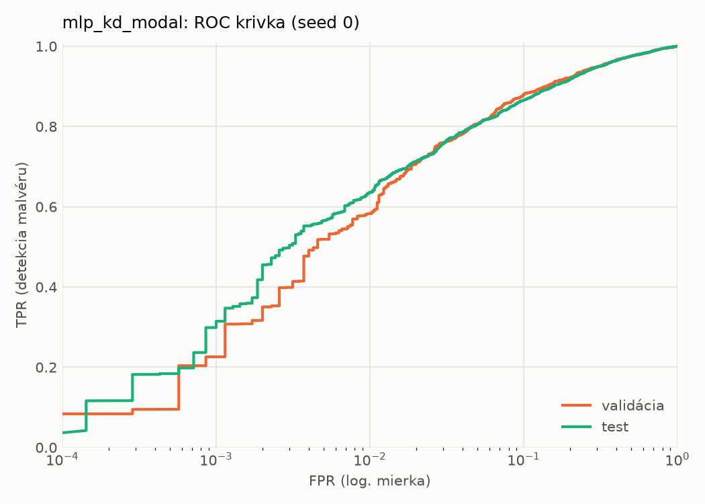
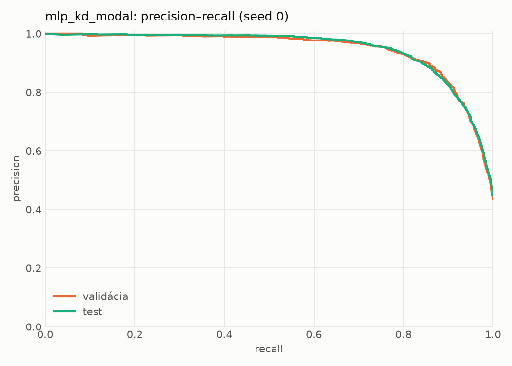
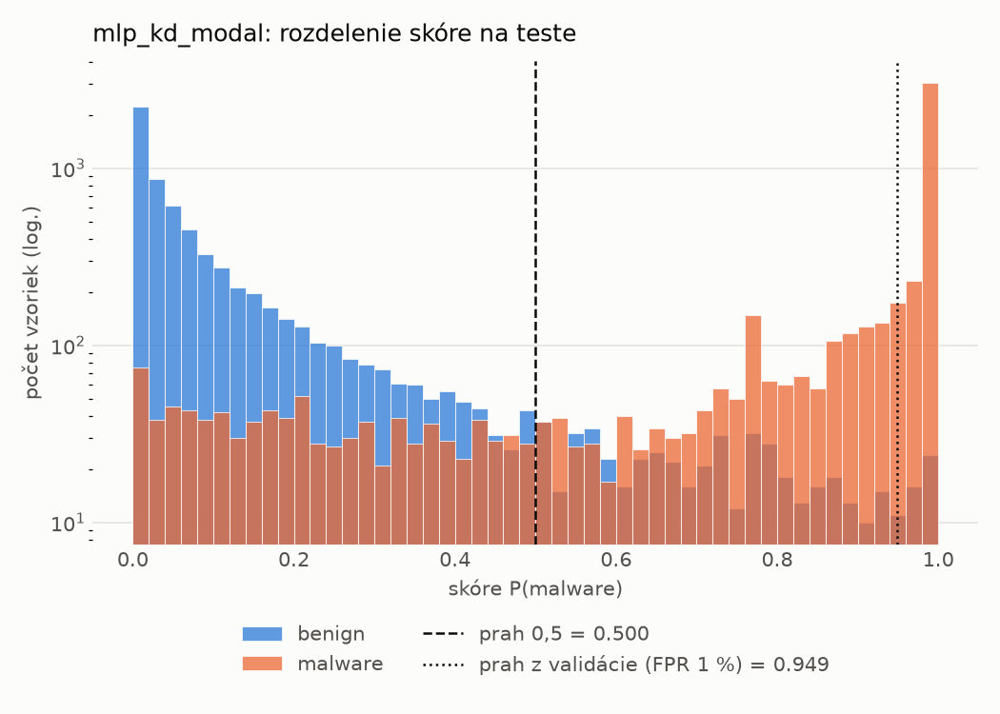
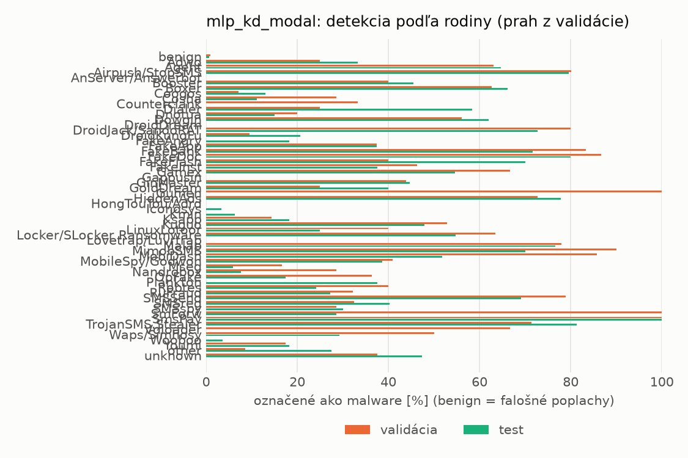
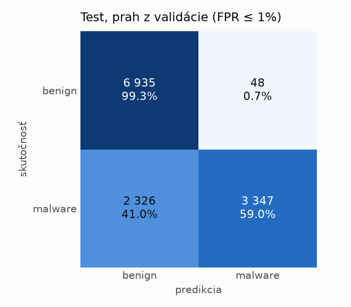
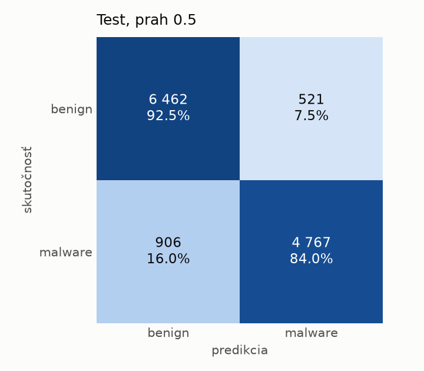
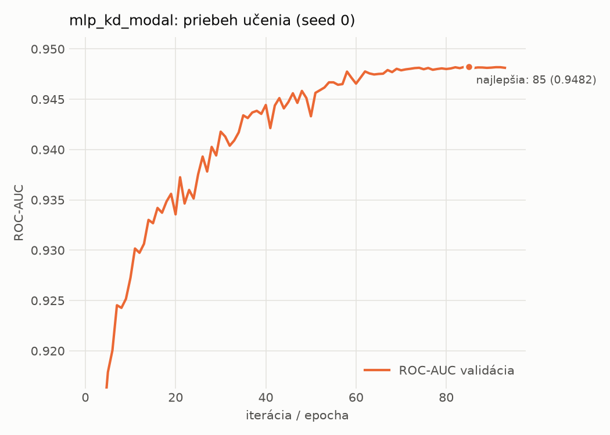

# dynamic/mlp_kd_modal – beh `20261123-222843`

> Automaticky generované (`src/training/run_tabular.py`). Konfigurácia: `config.yaml`, protokol: `protocol.yaml`.

- **Model:** `mlp` – študent – malé MLP učené destiláciou z učiteľa rovnakej modality (variant A)
- **Ladenie:** bez ladenia – hyperparametre prevzaté z `runs_v4/emu_p/full/students_dynamic/mlp_kd_modal/20261123-210004`
- **Finálne modely:** seedy [0, 1, 2]; hodnoty sú priemer ± smerodajná odchýlka cez seedy
- **Najlepšie hyperparametre:** `{"hidden_layers": 1, "max_epochs": 100, "patience": 8, "hidden_width": 64, "dropout": 0.17256398759806554, "lr": 0.00273877224500614, "weight_decay": 0.00015336049950880602, "batch_size": 1024, "kd_alpha": 0.5720540077101433, "kd_temperature": 1.5970216771892711}`

## Detekčná kvalita (bez prahu)
| metrika | train (podvzorka) | validácia | test |
|---|---|---|---|
| ROC-AUC | 0.9550 ± 0.0010 | 0.9475 ± 0.0007 | 0.9466 ± 0.0010 |
| PR-AUC | 0.9531 ± 0.0010 | 0.9448 ± 0.0007 | 0.9471 ± 0.0007 |
| TPR pri FPR 1 % | 0.6561 ± 0.0068 | 0.5983 ± 0.0136 | 0.6334 ± 0.0017 |
| TPR pri FPR 0,1 % | 0.4637 ± 0.0211 | 0.2262 ± 0.0214 | 0.3225 ± 0.0210 |
| log loss | 0.2594 ± 0.0030 | 0.2905 ± 0.0012 | 0.2898 ± 0.0022 |
| Brier skóre | 0.0772 ± 0.0009 | 0.0825 ± 0.0006 | 0.0846 ± 0.0006 |

Rozdiel ROC-AUC train − validácia: **0.0075** (veľký rozdiel = preučenie).

## Pri prahu z validácie (FPR ≤ 1% na validácii)
| metrika | train (podvzorka) | validácia | test |
|---|---|---|---|
| accuracy | 0.8298 ± 0.0024 | 0.8189 ± 0.0059 | 0.8171 ± 0.0041 |
| balanced accuracy | 0.8039 ± 0.0030 | 0.7943 ± 0.0068 | 0.7969 ± 0.0047 |
| precision | 0.9860 ± 0.0021 | 0.9794 ± 0.0005 | 0.9846 ± 0.0013 |
| recall (TPR) | 0.6145 ± 0.0068 | 0.5983 ± 0.0136 | 0.6014 ± 0.0100 |
| FPR | 0.0066 ± 0.0011 | 0.0097 ± 0.0000 | 0.0076 ± 0.0008 |
| F1 | 0.7571 ± 0.0047 | 0.7427 ± 0.0107 | 0.7467 ± 0.0074 |
| MCC | 0.6789 ± 0.0039 | 0.6599 ± 0.0106 | 0.6622 ± 0.0067 |

## Pri pevnom prahu 0.5
| metrika | train (podvzorka) | validácia | test |
|---|---|---|---|
| accuracy | 0.8977 ± 0.0020 | 0.8918 ± 0.0021 | 0.8872 ± 0.0009 |
| balanced accuracy | 0.8919 ± 0.0023 | 0.8874 ± 0.0025 | 0.8825 ± 0.0013 |
| precision | 0.9077 ± 0.0008 | 0.8955 ± 0.0012 | 0.9045 ± 0.0034 |
| recall (TPR) | 0.8494 ± 0.0046 | 0.8520 ± 0.0051 | 0.8368 ± 0.0056 |
| FPR | 0.0656 ± 0.0005 | 0.0772 ± 0.0010 | 0.0718 ± 0.0033 |
| F1 | 0.8775 ± 0.0026 | 0.8732 ± 0.0028 | 0.8693 ± 0.0016 |
| MCC | 0.7911 ± 0.0040 | 0.7798 ± 0.0044 | 0.7723 ± 0.0016 |

## Výpočtové nároky (seed 0, testovacia množina)
| meranie | hodnota |
|---|---|
| tréning finálneho modelu | 5.6 s (priemer cez seedy) |
| ladenie spolu | 0 s |
| počet parametrov / uzlov | 8 129 |
| veľkosť modelu na disku | 0.04 MB |
| transformácia vstupu – latencia (1 vlákno) | 0.014 ms |
| transformácia vstupu – priepustnosť | 760 783 vzoriek/s |
| CPU latencia modelu (batch 1, 1 vlákno) | 0.154 ms (p95 0.164) |
| CPU priepustnosť (24 vlákien) | 5 203 733 vzoriek/s |
| GPU latencia (batch 1) | 0.454 ms (p95 0.479) |
| GPU priepustnosť | 3 791 606 vzoriek/s |
| GPU špičková pamäť | 53 MB |

## Grafy
| | |
|---|---|
|  |  |
|  |  |
|  |  |
|  |  |

## Súbory
`metrics.json` (všetky metriky po seedoch vrátane rodín), `timing.json`, `hpo_trials.csv`,
`predictions/<časť>_seed<N>.parquet` (sha256, family, label, score), `model/seed_<N>/`, `log.txt`.
