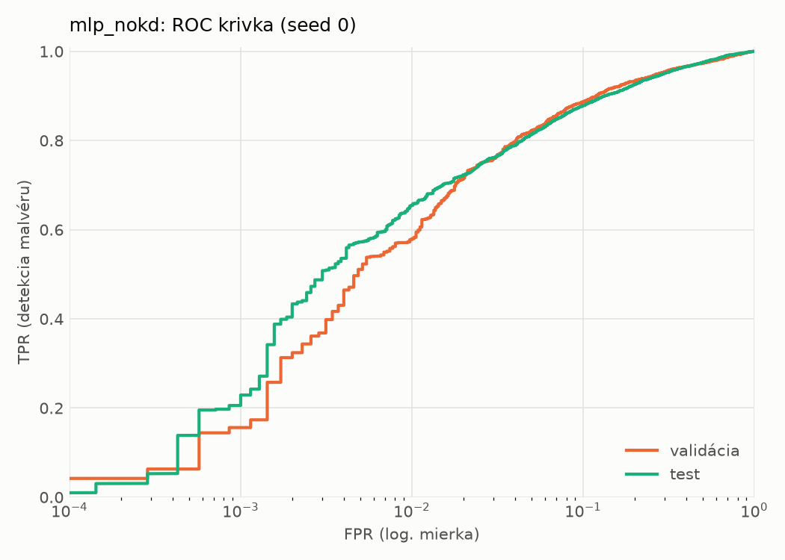
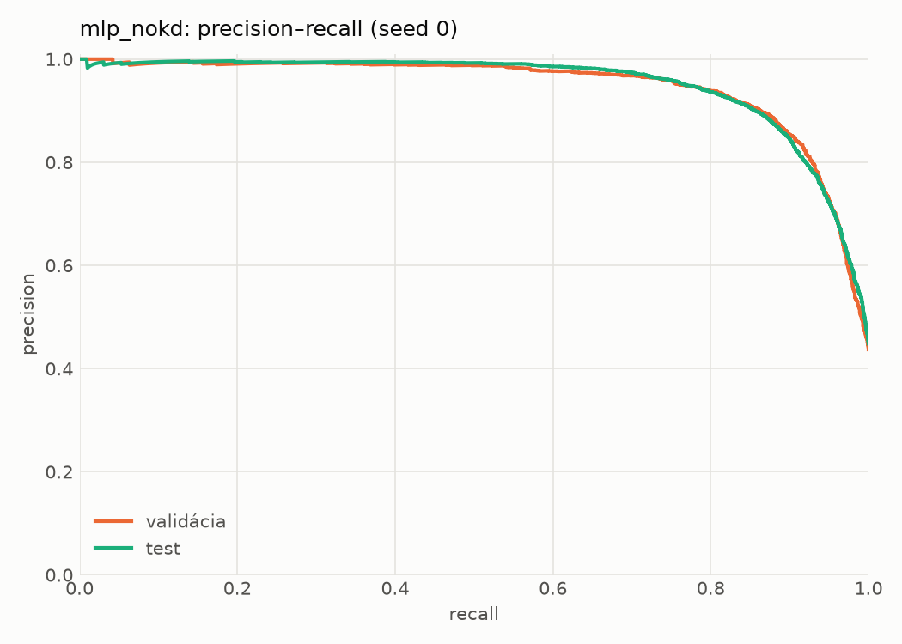
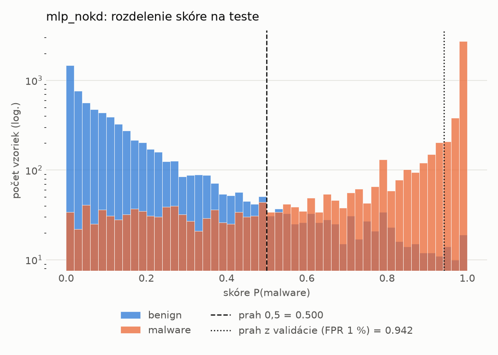
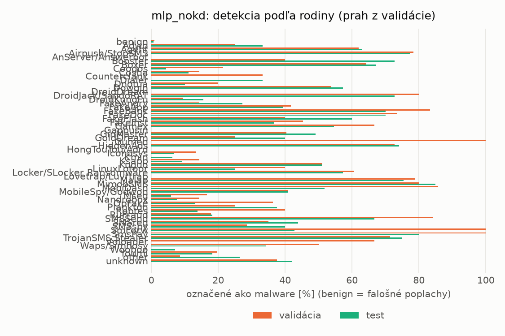
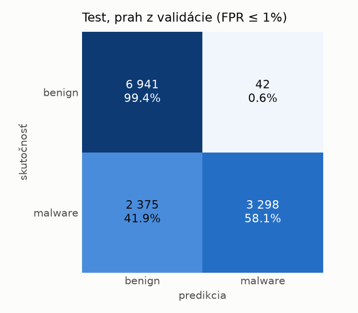
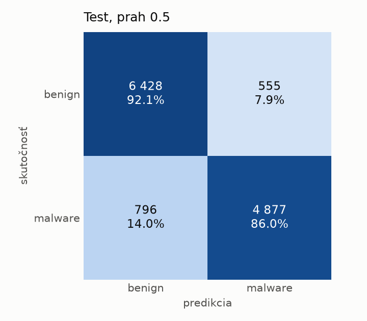
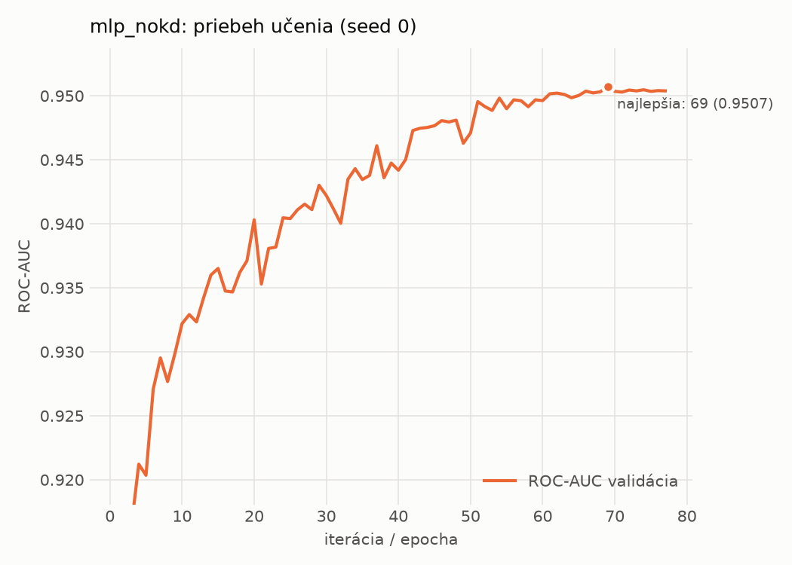

# dynamic/mlp_nokd – beh `20261123-222754`

> Automaticky generované (`src/training/run_tabular.py`). Konfigurácia: `config.yaml`, protokol: `protocol.yaml`.

- **Model:** `mlp` – kontrola – rovnaké malé MLP bez destilácie (iba skutočné označenia)
- **Ladenie:** bez ladenia – hyperparametre prevzaté z `runs_v4/emu_p/full/students_dynamic/mlp_nokd/20261123-205230`
- **Finálne modely:** seedy [0, 1, 2]; hodnoty sú priemer ± smerodajná odchýlka cez seedy
- **Najlepšie hyperparametre:** `{"hidden_layers": 1, "max_epochs": 100, "patience": 8, "hidden_width": 64, "dropout": 0.039782849658421375, "lr": 0.0018574312606020214, "weight_decay": 6.674701047165933e-06, "batch_size": 256}`

## Detekčná kvalita (bez prahu)
| metrika | train (podvzorka) | validácia | test |
|---|---|---|---|
| ROC-AUC | 0.9624 ± 0.0019 | 0.9489 ± 0.0024 | 0.9492 ± 0.0014 |
| PR-AUC | 0.9600 ± 0.0018 | 0.9454 ± 0.0022 | 0.9485 ± 0.0013 |
| TPR pri FPR 1 % | 0.6993 ± 0.0089 | 0.5944 ± 0.0150 | 0.6456 ± 0.0078 |
| TPR pri FPR 0,1 % | 0.5071 ± 0.0255 | 0.1681 ± 0.0233 | 0.2494 ± 0.0687 |
| log loss | 0.2418 ± 0.0061 | 0.2837 ± 0.0061 | 0.2796 ± 0.0033 |
| Brier skóre | 0.0722 ± 0.0021 | 0.0813 ± 0.0019 | 0.0828 ± 0.0016 |

Rozdiel ROC-AUC train − validácia: **0.0135** (veľký rozdiel = preučenie).

## Pri prahu z validácie (FPR ≤ 1% na validácii)
| metrika | train (podvzorka) | validácia | test |
|---|---|---|---|
| accuracy | 0.8319 ± 0.0046 | 0.8173 ± 0.0066 | 0.8154 ± 0.0055 |
| balanced accuracy | 0.8059 ± 0.0054 | 0.7924 ± 0.0075 | 0.7949 ± 0.0063 |
| precision | 0.9919 ± 0.0012 | 0.9795 ± 0.0008 | 0.9857 ± 0.0019 |
| recall (TPR) | 0.6156 ± 0.0113 | 0.5944 ± 0.0150 | 0.5968 ± 0.0134 |
| FPR | 0.0038 ± 0.0006 | 0.0096 ± 0.0002 | 0.0071 ± 0.0011 |
| F1 | 0.7597 ± 0.0083 | 0.7398 ± 0.0118 | 0.7434 ± 0.0101 |
| MCC | 0.6843 ± 0.0078 | 0.6571 ± 0.0118 | 0.6595 ± 0.0091 |

## Pri pevnom prahu 0.5
| metrika | train (podvzorka) | validácia | test |
|---|---|---|---|
| accuracy | 0.9040 ± 0.0035 | 0.8956 ± 0.0035 | 0.8901 ± 0.0027 |
| balanced accuracy | 0.9001 ± 0.0036 | 0.8927 ± 0.0038 | 0.8869 ± 0.0028 |
| precision | 0.9026 ± 0.0037 | 0.8894 ± 0.0028 | 0.8945 ± 0.0029 |
| recall (TPR) | 0.8717 ± 0.0046 | 0.8692 ± 0.0058 | 0.8558 ± 0.0034 |
| FPR | 0.0714 ± 0.0026 | 0.0839 ± 0.0019 | 0.0820 ± 0.0022 |
| F1 | 0.8869 ± 0.0042 | 0.8792 ± 0.0043 | 0.8747 ± 0.0032 |
| MCC | 0.8039 ± 0.0071 | 0.7875 ± 0.0072 | 0.7776 ± 0.0056 |

## Výpočtové nároky (seed 0, testovacia množina)
| meranie | hodnota |
|---|---|
| tréning finálneho modelu | 15.6 s (priemer cez seedy) |
| ladenie spolu | 0 s |
| počet parametrov / uzlov | 8 129 |
| veľkosť modelu na disku | 0.04 MB |
| transformácia vstupu – latencia (1 vlákno) | 0.015 ms |
| transformácia vstupu – priepustnosť | 781 693 vzoriek/s |
| CPU latencia modelu (batch 1, 1 vlákno) | 0.154 ms (p95 0.163) |
| CPU priepustnosť (24 vlákien) | 6 034 425 vzoriek/s |
| GPU latencia (batch 1) | 0.445 ms (p95 0.485) |
| GPU priepustnosť | 3 497 389 vzoriek/s |
| GPU špičková pamäť | 77 MB |

## Grafy
| | |
|---|---|
|  |  |
|  |  |
|  |  |
|  |  |

## Súbory
`metrics.json` (všetky metriky po seedoch vrátane rodín), `timing.json`, `hpo_trials.csv`,
`predictions/<časť>_seed<N>.parquet` (sha256, family, label, score), `model/seed_<N>/`, `log.txt`.
