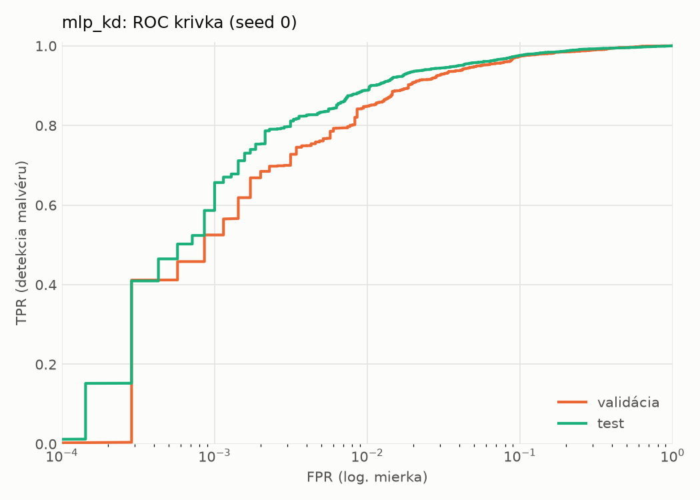
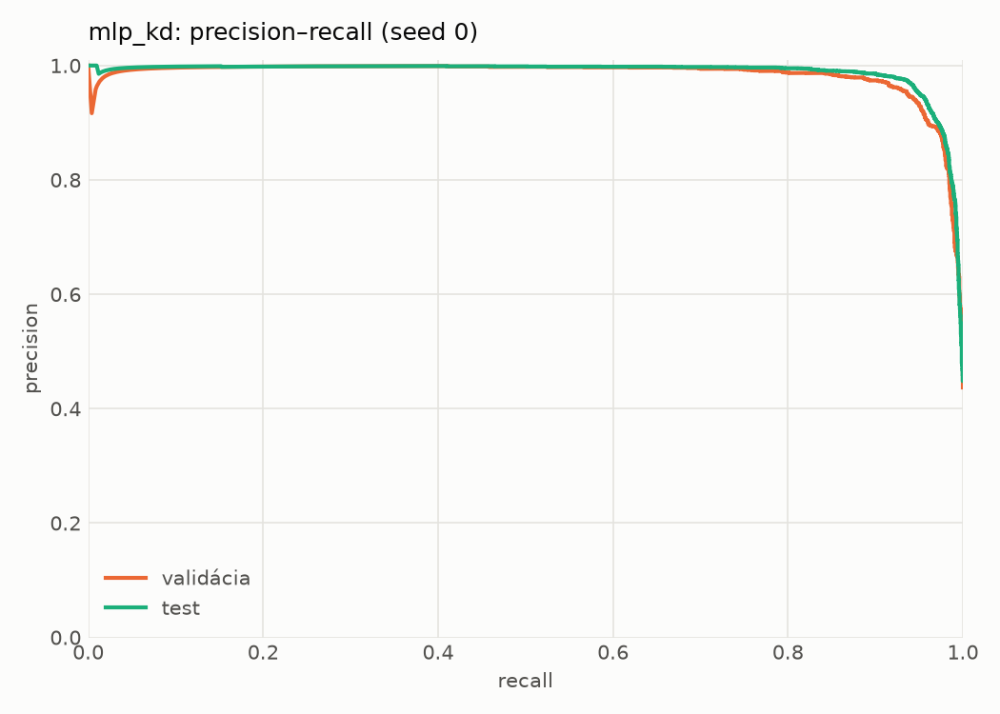
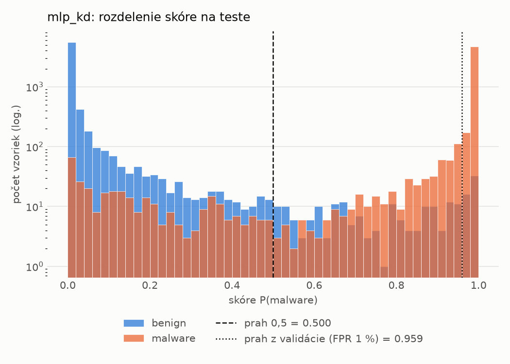
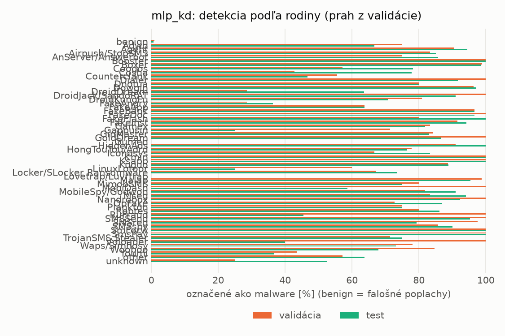
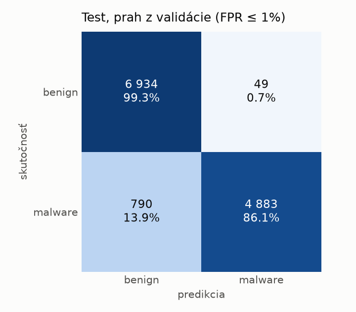
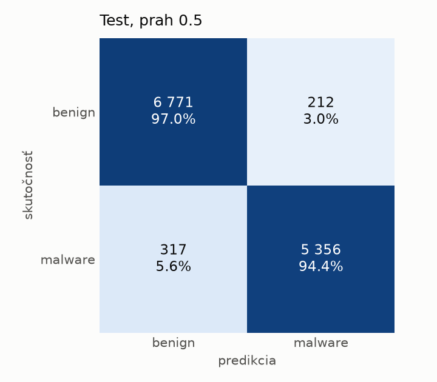
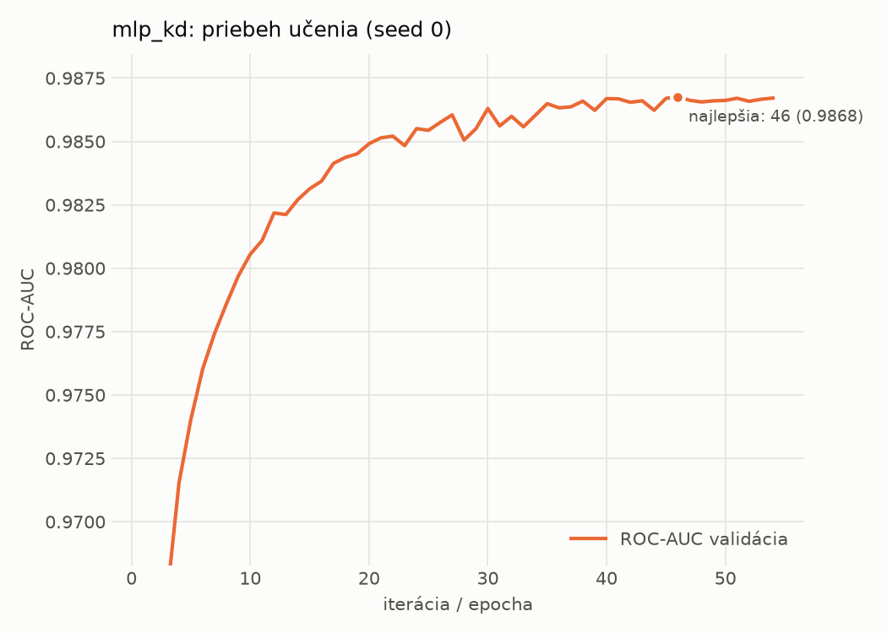

# static/mlp_kd – beh `20261123-222615`

> Automaticky generované (`src/training/run_tabular.py`). Konfigurácia: `config.yaml`, protokol: `protocol.yaml`.

- **Model:** `mlp` – študent – malé MLP učené destiláciou z hybridného učiteľa
- **Ladenie:** bez ladenia – hyperparametre prevzaté z `runs_v4/emu_p/full/students_static/mlp_kd/20261123-203204`
- **Finálne modely:** seedy [0, 1, 2]; hodnoty sú priemer ± smerodajná odchýlka cez seedy
- **Najlepšie hyperparametre:** `{"hidden_layers": 1, "max_epochs": 100, "patience": 8, "hidden_width": 64, "dropout": 0.0038513032258879476, "lr": 0.0011339137585789736, "weight_decay": 0.00026533084929296607, "batch_size": 1024, "kd_alpha": 0.3835611341536954, "kd_temperature": 1.7047486853284286}`

## Detekčná kvalita (bez prahu)
| metrika | train (podvzorka) | validácia | test |
|---|---|---|---|
| ROC-AUC | 0.9924 ± 0.0004 | 0.9871 ± 0.0005 | 0.9887 ± 0.0009 |
| PR-AUC | 0.9921 ± 0.0004 | 0.9840 ± 0.0004 | 0.9882 ± 0.0010 |
| TPR pri FPR 1 % | 0.9216 ± 0.0064 | 0.8484 ± 0.0019 | 0.8860 ± 0.0098 |
| TPR pri FPR 0,1 % | 0.8121 ± 0.0241 | 0.4574 ± 0.0739 | 0.6170 ± 0.0273 |
| log loss | 0.1021 ± 0.0039 | 0.1506 ± 0.0033 | 0.1325 ± 0.0057 |
| Brier skóre | 0.0278 ± 0.0012 | 0.0386 ± 0.0006 | 0.0337 ± 0.0009 |

Rozdiel ROC-AUC train − validácia: **0.0053** (veľký rozdiel = preučenie).

## Pri prahu z validácie (FPR ≤ 1% na validácii)
| metrika | train (podvzorka) | validácia | test |
|---|---|---|---|
| accuracy | 0.9394 ± 0.0017 | 0.9283 ± 0.0008 | 0.9330 ± 0.0016 |
| balanced accuracy | 0.9303 ± 0.0018 | 0.9194 ± 0.0009 | 0.9260 ± 0.0018 |
| precision | 0.9954 ± 0.0015 | 0.9856 ± 0.0002 | 0.9904 ± 0.0009 |
| recall (TPR) | 0.8637 ± 0.0030 | 0.8484 ± 0.0019 | 0.8587 ± 0.0032 |
| FPR | 0.0031 ± 0.0010 | 0.0096 ± 0.0002 | 0.0067 ± 0.0006 |
| F1 | 0.9249 ± 0.0021 | 0.9119 ± 0.0010 | 0.9199 ± 0.0021 |
| MCC | 0.8807 ± 0.0033 | 0.8588 ± 0.0014 | 0.8693 ± 0.0031 |

## Pri pevnom prahu 0.5
| metrika | train (podvzorka) | validácia | test |
|---|---|---|---|
| accuracy | 0.9632 ± 0.0011 | 0.9515 ± 0.0005 | 0.9571 ± 0.0012 |
| balanced accuracy | 0.9613 ± 0.0011 | 0.9502 ± 0.0006 | 0.9559 ± 0.0011 |
| precision | 0.9673 ± 0.0013 | 0.9493 ± 0.0006 | 0.9598 ± 0.0019 |
| recall (TPR) | 0.9469 ± 0.0019 | 0.9393 ± 0.0015 | 0.9439 ± 0.0009 |
| FPR | 0.0243 ± 0.0010 | 0.0390 ± 0.0005 | 0.0321 ± 0.0016 |
| F1 | 0.9570 ± 0.0013 | 0.9443 ± 0.0006 | 0.9518 ± 0.0013 |
| MCC | 0.9250 ± 0.0022 | 0.9015 ± 0.0011 | 0.9133 ± 0.0023 |

## Výpočtové nároky (seed 0, testovacia množina)
| meranie | hodnota |
|---|---|
| tréning finálneho modelu | 4.8 s (priemer cez seedy) |
| ladenie spolu | 0 s |
| počet parametrov / uzlov | 10 625 |
| veľkosť modelu na disku | 0.05 MB |
| transformácia vstupu – latencia (1 vlákno) | 0.006 ms |
| transformácia vstupu – priepustnosť | 1 065 311 vzoriek/s |
| CPU latencia modelu (batch 1, 1 vlákno) | 0.055 ms (p95 0.063) |
| CPU priepustnosť (24 vlákien) | 4 444 600 vzoriek/s |
| GPU latencia (batch 1) | 0.291 ms (p95 0.312) |
| GPU priepustnosť | 3 970 634 vzoriek/s |
| GPU špičková pamäť | 62 MB |

## Grafy
| | |
|---|---|
|  |  |
|  |  |
|  |  |
|  |  |

## Súbory
`metrics.json` (všetky metriky po seedoch vrátane rodín), `timing.json`, `hpo_trials.csv`,
`predictions/<časť>_seed<N>.parquet` (sha256, family, label, score), `model/seed_<N>/`, `log.txt`.
