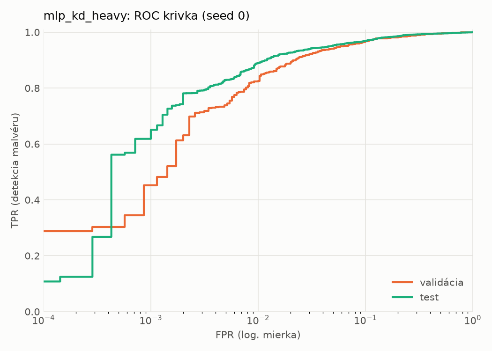
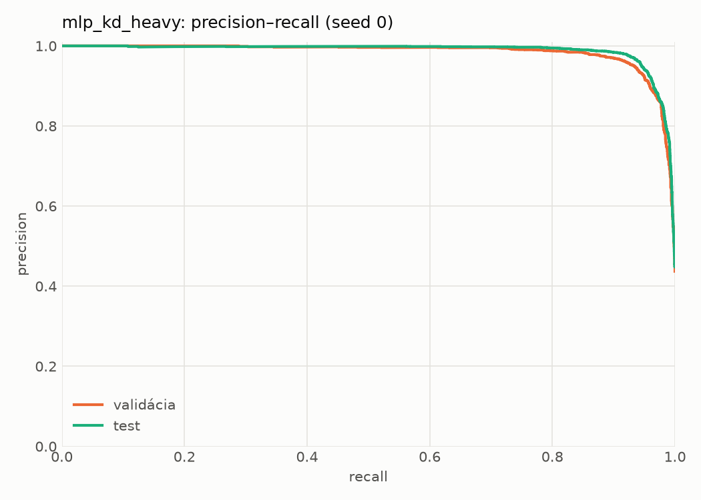
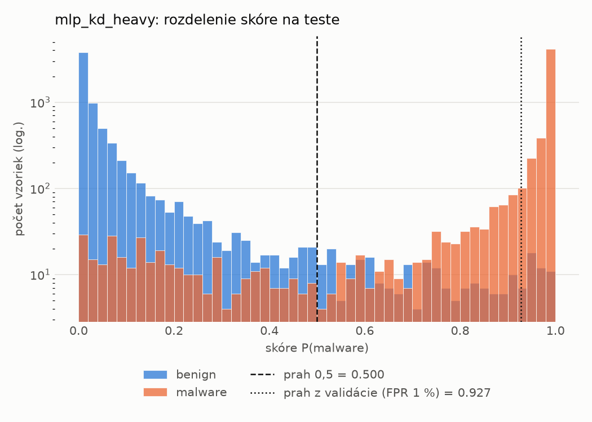
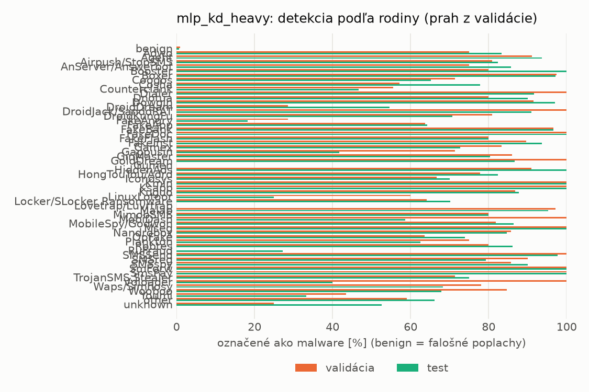
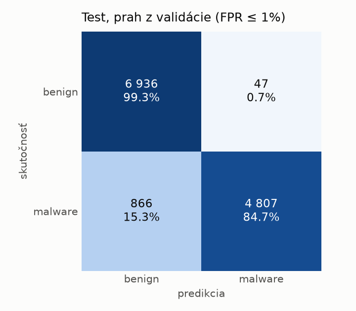
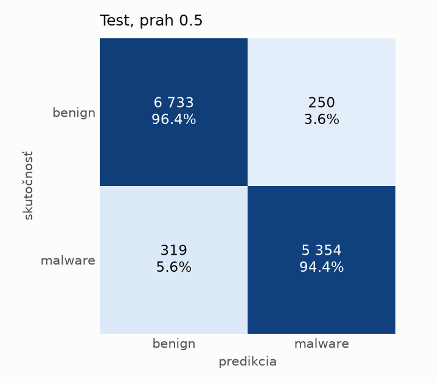
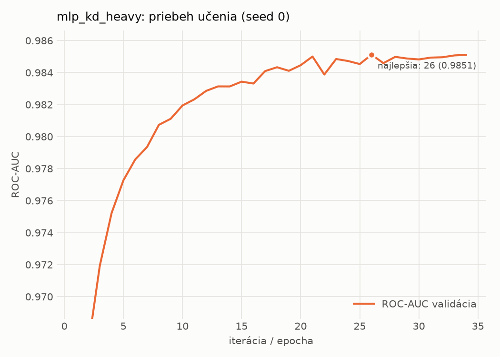

# static/mlp_kd_heavy – beh `20261123-222720`

> Automaticky generované (`src/training/run_tabular.py`). Konfigurácia: `config.yaml`, protokol: `protocol.yaml`.

- **Model:** `mlp` – študent – malé MLP učené destiláciou z mlp_large hybridu (V4)
- **Ladenie:** bez ladenia – hyperparametre prevzaté z `runs_v4/emu_p/full/students_static/mlp_kd_heavy/20261123-204329`
- **Finálne modely:** seedy [0, 1, 2]; hodnoty sú priemer ± smerodajná odchýlka cez seedy
- **Najlepšie hyperparametre:** `{"hidden_layers": 1, "max_epochs": 100, "patience": 8, "hidden_width": 64, "dropout": 0.1254973730751401, "lr": 0.0014439667191275393, "weight_decay": 1.2808340108243318e-06, "batch_size": 1024, "kd_alpha": 0.5142654341824873, "kd_temperature": 1.3883261824077338}`

## Detekčná kvalita (bez prahu)
| metrika | train (podvzorka) | validácia | test |
|---|---|---|---|
| ROC-AUC | 0.9914 ± 0.0002 | 0.9850 ± 0.0001 | 0.9881 ± 0.0002 |
| PR-AUC | 0.9910 ± 0.0002 | 0.9824 ± 0.0016 | 0.9874 ± 0.0007 |
| TPR pri FPR 1 % | 0.9092 ± 0.0009 | 0.8334 ± 0.0086 | 0.8815 ± 0.0071 |
| TPR pri FPR 0,1 % | 0.7793 ± 0.0047 | 0.5047 ± 0.0465 | 0.6399 ± 0.0200 |
| log loss | 0.1097 ± 0.0010 | 0.1469 ± 0.0010 | 0.1276 ± 0.0012 |
| Brier skóre | 0.0303 ± 0.0003 | 0.0405 ± 0.0003 | 0.0347 ± 0.0004 |

Rozdiel ROC-AUC train − validácia: **0.0065** (veľký rozdiel = preučenie).

## Pri prahu z validácie (FPR ≤ 1% na validácii)
| metrika | train (podvzorka) | validácia | test |
|---|---|---|---|
| accuracy | 0.9346 ± 0.0021 | 0.9217 ± 0.0038 | 0.9274 ± 0.0017 |
| balanced accuracy | 0.9247 ± 0.0026 | 0.9119 ± 0.0043 | 0.9198 ± 0.0020 |
| precision | 0.9950 ± 0.0010 | 0.9853 ± 0.0003 | 0.9905 ± 0.0009 |
| recall (TPR) | 0.8528 ± 0.0058 | 0.8334 ± 0.0086 | 0.8462 ± 0.0046 |
| FPR | 0.0033 ± 0.0007 | 0.0096 ± 0.0002 | 0.0066 ± 0.0007 |
| F1 | 0.9184 ± 0.0030 | 0.9030 ± 0.0051 | 0.9127 ± 0.0023 |
| MCC | 0.8715 ± 0.0039 | 0.8465 ± 0.0071 | 0.8590 ± 0.0030 |

## Pri pevnom prahu 0.5
| metrika | train (podvzorka) | validácia | test |
|---|---|---|---|
| accuracy | 0.9611 ± 0.0005 | 0.9482 ± 0.0002 | 0.9553 ± 0.0011 |
| balanced accuracy | 0.9595 ± 0.0005 | 0.9470 ± 0.0000 | 0.9542 ± 0.0010 |
| precision | 0.9614 ± 0.0013 | 0.9438 ± 0.0014 | 0.9557 ± 0.0025 |
| recall (TPR) | 0.9480 ± 0.0011 | 0.9374 ± 0.0011 | 0.9439 ± 0.0002 |
| FPR | 0.0289 ± 0.0010 | 0.0434 ± 0.0012 | 0.0356 ± 0.0021 |
| F1 | 0.9546 ± 0.0005 | 0.9406 ± 0.0001 | 0.9498 ± 0.0012 |
| MCC | 0.9207 ± 0.0009 | 0.8947 ± 0.0003 | 0.9095 ± 0.0023 |

## Výpočtové nároky (seed 0, testovacia množina)
| meranie | hodnota |
|---|---|
| tréning finálneho modelu | 2.9 s (priemer cez seedy) |
| ladenie spolu | 0 s |
| počet parametrov / uzlov | 10 625 |
| veľkosť modelu na disku | 0.05 MB |
| transformácia vstupu – latencia (1 vlákno) | 0.015 ms |
| transformácia vstupu – priepustnosť | 743 827 vzoriek/s |
| CPU latencia modelu (batch 1, 1 vlákno) | 0.153 ms (p95 0.161) |
| CPU priepustnosť (24 vlákien) | 4 507 283 vzoriek/s |
| GPU latencia (batch 1) | 0.444 ms (p95 0.472) |
| GPU priepustnosť | 2 195 202 vzoriek/s |
| GPU špičková pamäť | 94 MB |

## Grafy
| | |
|---|---|
|  |  |
|  |  |
|  |  |
|  |  |

## Súbory
`metrics.json` (všetky metriky po seedoch vrátane rodín), `timing.json`, `hpo_trials.csv`,
`predictions/<časť>_seed<N>.parquet` (sha256, family, label, score), `model/seed_<N>/`, `log.txt`.
