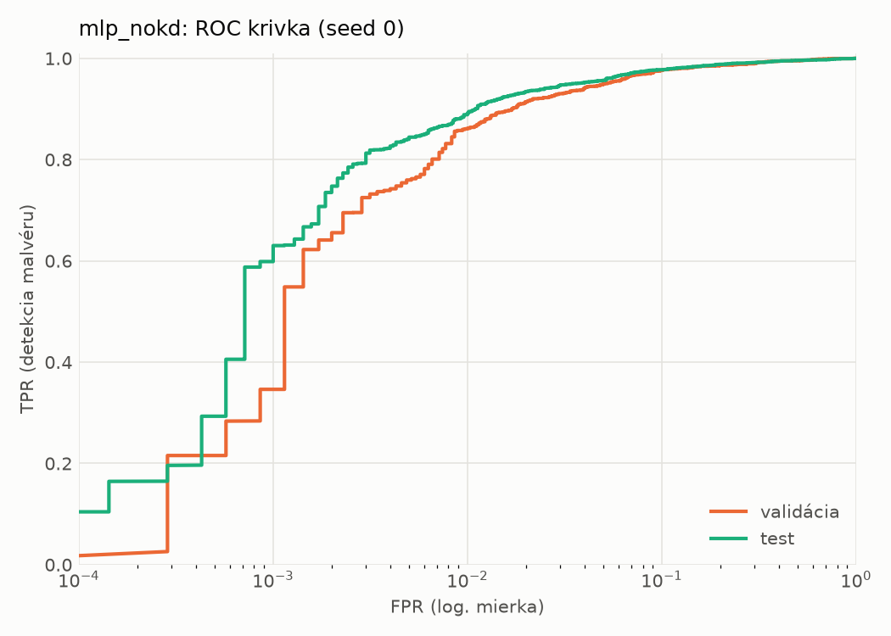
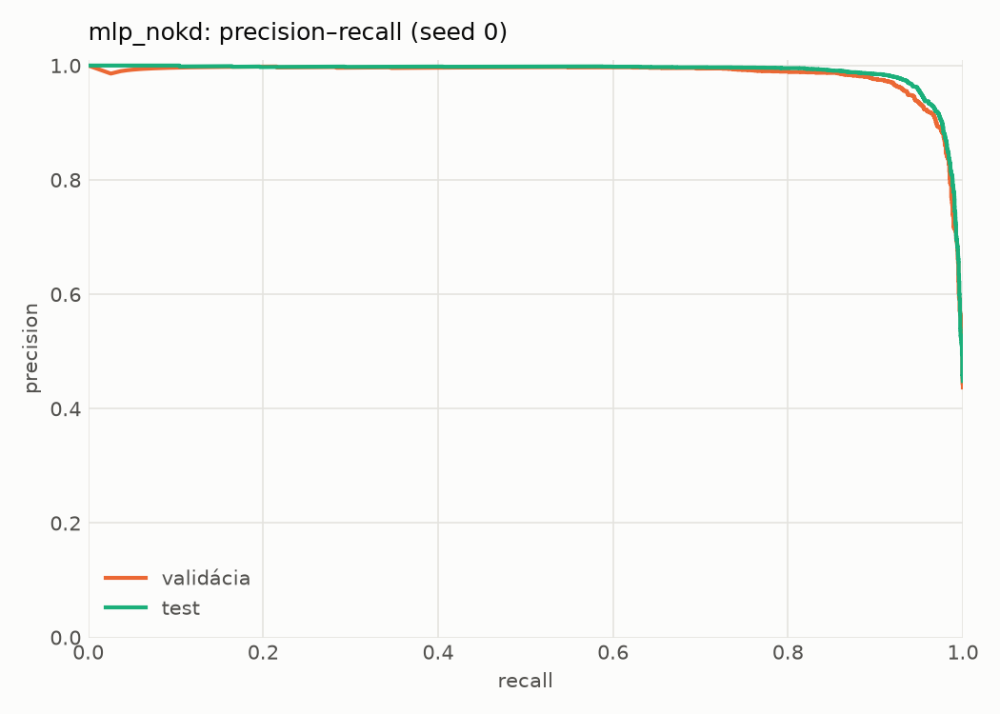
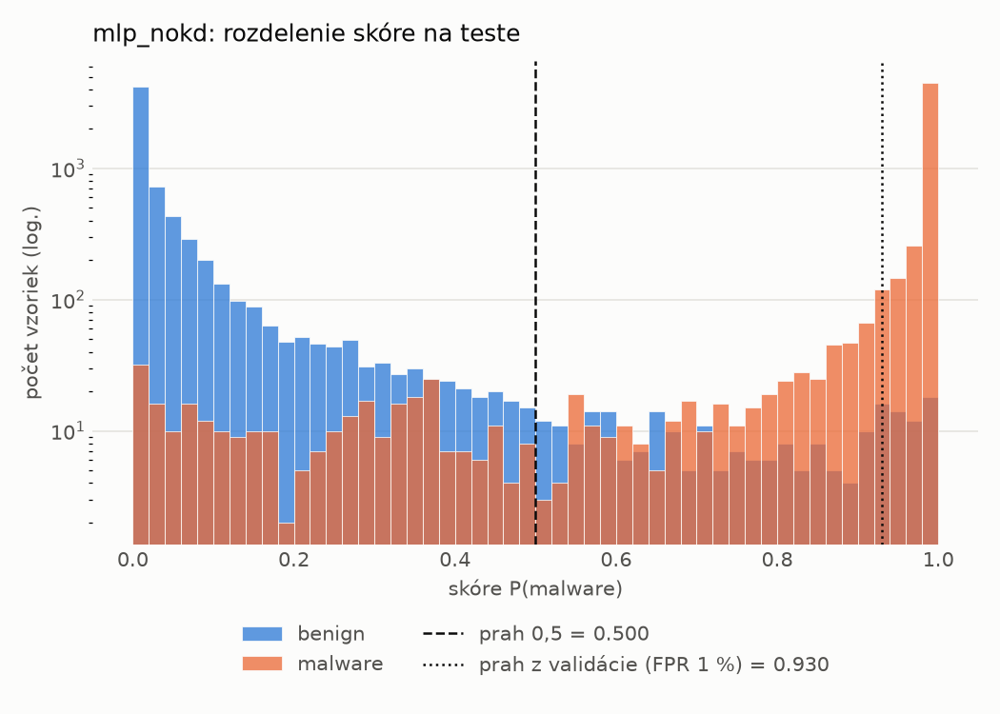
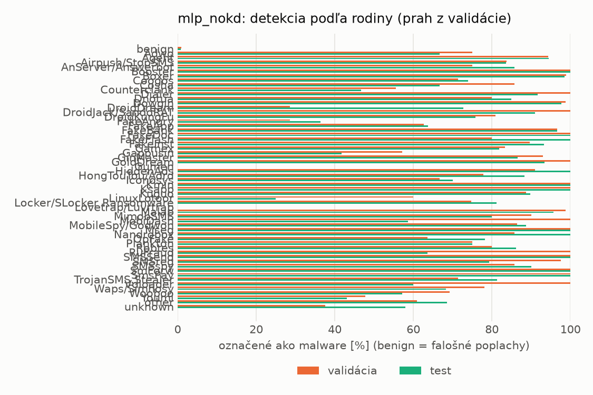
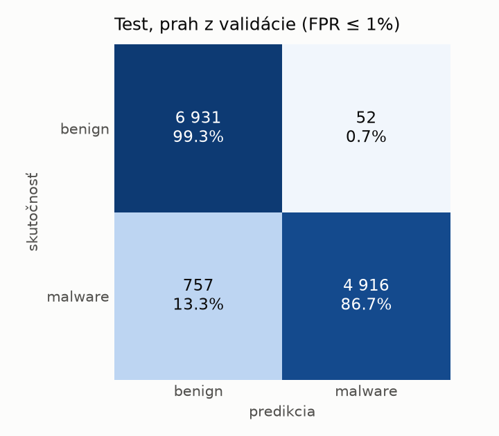
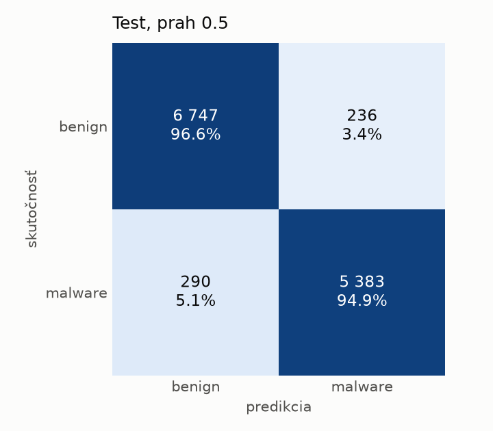
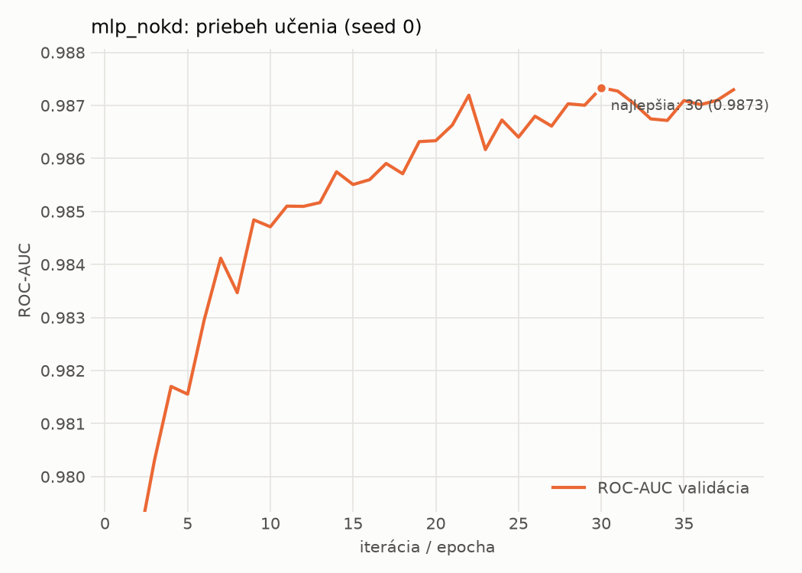

# static/mlp_nokd – beh `20261123-222631`

> Automaticky generované (`src/training/run_tabular.py`). Konfigurácia: `config.yaml`, protokol: `protocol.yaml`.

- **Model:** `mlp` – kontrola – rovnaké malé MLP bez destilácie (iba skutočné označenia)
- **Ladenie:** bez ladenia – hyperparametre prevzaté z `runs_v4/emu_p/full/students_static/mlp_nokd/20261123-203547`
- **Finálne modely:** seedy [0, 1, 2]; hodnoty sú priemer ± smerodajná odchýlka cez seedy
- **Najlepšie hyperparametre:** `{"hidden_layers": 1, "max_epochs": 100, "patience": 8, "hidden_width": 64, "dropout": 0.15022694447625398, "lr": 0.0027248227778296176, "weight_decay": 1.7062100113192703e-06, "batch_size": 256}`

## Detekčná kvalita (bez prahu)
| metrika | train (podvzorka) | validácia | test |
|---|---|---|---|
| ROC-AUC | 0.9937 ± 0.0008 | 0.9871 ± 0.0007 | 0.9888 ± 0.0008 |
| PR-AUC | 0.9934 ± 0.0008 | 0.9846 ± 0.0012 | 0.9880 ± 0.0017 |
| TPR pri FPR 1 % | 0.9321 ± 0.0053 | 0.8498 ± 0.0161 | 0.8818 ± 0.0063 |
| TPR pri FPR 0,1 % | 0.8197 ± 0.0055 | 0.5093 ± 0.1519 | 0.5372 ± 0.1068 |
| log loss | 0.0929 ± 0.0061 | 0.1385 ± 0.0055 | 0.1254 ± 0.0055 |
| Brier skóre | 0.0253 ± 0.0018 | 0.0374 ± 0.0015 | 0.0328 ± 0.0014 |

Rozdiel ROC-AUC train − validácia: **0.0066** (veľký rozdiel = preučenie).

## Pri prahu z validácie (FPR ≤ 1% na validácii)
| metrika | train (podvzorka) | validácia | test |
|---|---|---|---|
| accuracy | 0.9425 ± 0.0062 | 0.9290 ± 0.0070 | 0.9332 ± 0.0035 |
| balanced accuracy | 0.9339 ± 0.0072 | 0.9202 ± 0.0080 | 0.9264 ± 0.0039 |
| precision | 0.9957 ± 0.0007 | 0.9859 ± 0.0005 | 0.9889 ± 0.0012 |
| recall (TPR) | 0.8706 ± 0.0143 | 0.8498 ± 0.0161 | 0.8606 ± 0.0082 |
| FPR | 0.0029 ± 0.0004 | 0.0095 ± 0.0003 | 0.0078 ± 0.0009 |
| F1 | 0.9289 ± 0.0082 | 0.9127 ± 0.0094 | 0.9203 ± 0.0045 |
| MCC | 0.8866 ± 0.0118 | 0.8602 ± 0.0132 | 0.8694 ± 0.0064 |

## Pri pevnom prahu 0.5
| metrika | train (podvzorka) | validácia | test |
|---|---|---|---|
| accuracy | 0.9682 ± 0.0025 | 0.9511 ± 0.0013 | 0.9586 ± 0.0020 |
| balanced accuracy | 0.9667 ± 0.0027 | 0.9500 ± 0.0013 | 0.9576 ± 0.0019 |
| precision | 0.9703 ± 0.0023 | 0.9470 ± 0.0032 | 0.9591 ± 0.0031 |
| recall (TPR) | 0.9557 ± 0.0047 | 0.9408 ± 0.0033 | 0.9481 ± 0.0016 |
| FPR | 0.0222 ± 0.0018 | 0.0409 ± 0.0027 | 0.0328 ± 0.0026 |
| F1 | 0.9629 ± 0.0029 | 0.9439 ± 0.0015 | 0.9536 ± 0.0022 |
| MCC | 0.9352 ± 0.0050 | 0.9006 ± 0.0026 | 0.9163 ± 0.0040 |

## Výpočtové nároky (seed 0, testovacia množina)
| meranie | hodnota |
|---|---|
| tréning finálneho modelu | 7.8 s (priemer cez seedy) |
| ladenie spolu | 0 s |
| počet parametrov / uzlov | 10 625 |
| veľkosť modelu na disku | 0.05 MB |
| transformácia vstupu – latencia (1 vlákno) | 0.015 ms |
| transformácia vstupu – priepustnosť | 754 362 vzoriek/s |
| CPU latencia modelu (batch 1, 1 vlákno) | 0.152 ms (p95 0.161) |
| CPU priepustnosť (24 vlákien) | 5 496 395 vzoriek/s |
| GPU latencia (batch 1) | 0.439 ms (p95 0.471) |
| GPU priepustnosť | 2 519 108 vzoriek/s |
| GPU špičková pamäť | 94 MB |

## Grafy
| | |
|---|---|
|  |  |
|  |  |
|  |  |
|  |  |

## Súbory
`metrics.json` (všetky metriky po seedoch vrátane rodín), `timing.json`, `hpo_trials.csv`,
`predictions/<časť>_seed<N>.parquet` (sha256, family, label, score), `model/seed_<N>/`, `log.txt`.
