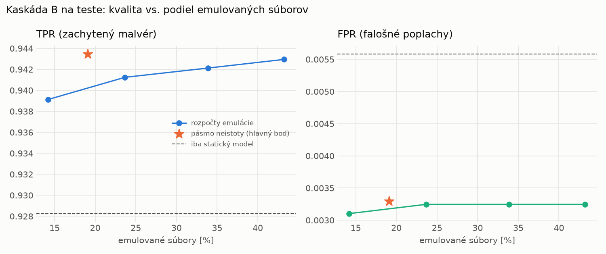

# Kaskáda B `b_baselines` – beh `20261123-214409`

> Generované `src/cascade/evaluate_b.py` (2026-11-23T21:44:09+01:00). Seedy: [0, 1, 2]; hodnoty = priemer ± sm. odchýlka.
> Všetky prahy a pásmo neistoty sú z validácie; test sa na nič nenastavuje. Postup: `docs/09_plan_v2.md`.

| rola | beh |
|---|---|
| static | `runs_v4/emu_p/lofo/Boxer/static/lightgbm/20261123-011538` |
| dynamic | `runs_v4/emu_p/lofo/Boxer/dynamic/lightgbm/20261123-212946` |
| hybrid | `runs_v4/emu_p/lofo/Boxer/hybrid/lightgbm/20261123-213325` |

Druhý stupeň: **dynamic**. Pásmo neistoty statického modelu: FPR ≤ 0.1% nad `hi`,
najviac 1% malvéru validácie pod `lo` (seed 0: lo = 0.0040, hi = 0.9984, seed 1: lo = 0.0066, hi = 0.9967, seed 2: lo = 0.0040, hi = 0.9986).

## Test
| prístup | accuracy | balanced_accuracy | precision | recall_tpr | fpr | f1 | mcc |
|---|---|---|---|---|---|---|---|
| kaskáda B | 0.9728 ± 0.0008 | 0.9701 ± 0.0009 | 0.9957 ± 0.0005 | 0.9435 ± 0.0022 | 0.0033 ± 0.0004 | 0.9689 ± 0.0009 | 0.9459 ± 0.0015 |
| statický | 0.9648 ± 0.0010 | 0.9613 ± 0.0012 | 0.9926 ± 0.0006 | 0.9283 ± 0.0028 | 0.0056 ± 0.0005 | 0.9594 ± 0.0013 | 0.9300 ± 0.0020 |
| dynamický | 0.8882 ± 0.0010 | 0.8764 ± 0.0011 | 0.9856 ± 0.0007 | 0.7618 ± 0.0027 | 0.0091 ± 0.0005 | 0.8593 ± 0.0014 | 0.7867 ± 0.0016 |
| hybrid (každá vzorka) | 0.9753 ± 0.0011 | 0.9731 ± 0.0013 | 0.9928 ± 0.0007 | 0.9518 ± 0.0032 | 0.0056 ± 0.0005 | 0.9718 ± 0.0014 | 0.9505 ± 0.0022 |

- **emulované súbory: 19.10%** (ostatné rozhodne iba statický model); na hybrid ide 5.13% súborov
- chyby pri istom rozhodnutí statického modelu (seed 0): 59
- validácia: emulované 15.81%, na hybrid 3.41%

## Validácia
| prístup | accuracy | balanced_accuracy | precision | recall_tpr | fpr | f1 | mcc |
|---|---|---|---|---|---|---|---|
| kaskáda B | 0.9741 ± 0.0003 | 0.9702 ± 0.0004 | 0.9904 ± 0.0005 | 0.9468 ± 0.0011 | 0.0065 ± 0.0003 | 0.9681 ± 0.0004 | 0.9470 ± 0.0007 |
| statický | 0.9665 ± 0.0010 | 0.9616 ± 0.0012 | 0.9858 ± 0.0003 | 0.9328 ± 0.0024 | 0.0096 ± 0.0002 | 0.9586 ± 0.0013 | 0.9315 ± 0.0021 |
| dynamický | 0.9239 ± 0.0020 | 0.9104 ± 0.0024 | 0.9839 ± 0.0002 | 0.8304 ± 0.0049 | 0.0096 ± 0.0002 | 0.9007 ± 0.0029 | 0.8476 ± 0.0038 |
| hybrid (každá vzorka) | 0.9744 ± 0.0004 | 0.9712 ± 0.0006 | 0.9862 ± 0.0007 | 0.9518 ± 0.0016 | 0.0095 ± 0.0005 | 0.9687 ± 0.0006 | 0.9475 ± 0.0008 |

## Januárové vzorky vynechanej rodiny (iba malvér → TPR)
| prístup | TPR |
|---|---|
| kaskáda B | 0.9027 ± 0.0043 |
| statický | 0.9037 ± 0.0030 |
| dynamický | 0.3483 ± 0.0156 |
| hybrid (každá vzorka) | 0.9267 ± 0.0027 |

Podiel emulovaných: 62.98%

## Krivka rozpočtu emulácie (test, priemer cez seedy)
| budget_val | emulation_rate | hybrid_rate | recall_tpr | fpr | f1 |
|---|---|---|---|---|---|
| 0.1000 | 0.1420 | 0.0598 | 0.9391 | 0.0031 | 0.9667 |
| 0.2000 | 0.2366 | 0.0745 | 0.9412 | 0.0032 | 0.9677 |
| 0.3000 | 0.3387 | 0.0871 | 0.9421 | 0.0032 | 0.9682 |
| 0.4000 | 0.4322 | 0.0945 | 0.9429 | 0.0032 | 0.9686 |

## Výpočtové nároky
Čas dynamickej analýzy (beh v emulátore alebo na zariadení) dataset neuvádza, preto sa neodhaduje. Úspora kaskády B = podiel súborov s dynamickou analýzou: **19.10%** (ostatné prístupy 100 %).

_Chýba benchmark niektorého komponentu (v zero-day behoch sa nemeria)._

