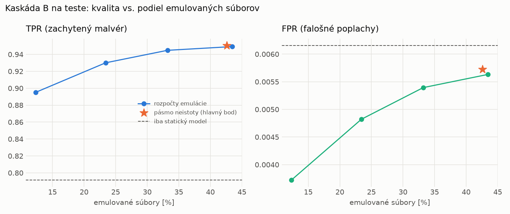

# Kaskáda B `b_direct` – beh `20261123-214405`

> Generované `src/cascade/evaluate_b.py` (2026-11-23T21:44:05+01:00). Seedy: [0, 1, 2]; hodnoty = priemer ± sm. odchýlka.
> Všetky prahy a pásmo neistoty sú z validácie; test sa na nič nenastavuje. Postup: `docs/09_plan_v2.md`.

| rola | beh |
|---|---|
| static | `runs_v4/emu_p/lofo/Boxer/students_static/mlp_kd/20261123-214009` |
| hybrid | `runs_v4/emu_p/lofo/Boxer/hybrid/lightgbm/20261123-213325` |

Druhý stupeň: **hybrid**. Pásmo neistoty statického modelu: FPR ≤ 0.1% nad `hi`,
najviac 1% malvéru validácie pod `lo` (seed 0: lo = 0.0073, hi = 0.9999, seed 1: lo = 0.0088, hi = 0.9997, seed 2: lo = 0.0076, hi = 0.9997).

## Test
| prístup | accuracy | balanced_accuracy | precision | recall_tpr | fpr | f1 | mcc |
|---|---|---|---|---|---|---|---|
| kaskáda B | 0.9747 ± 0.0009 | 0.9724 ± 0.0010 | 0.9926 ± 0.0006 | 0.9506 ± 0.0026 | 0.0057 ± 0.0005 | 0.9712 ± 0.0011 | 0.9493 ± 0.0017 |
| statický | 0.9032 ± 0.0144 | 0.8927 ± 0.0161 | 0.9905 ± 0.0007 | 0.7916 ± 0.0324 | 0.0062 ± 0.0005 | 0.8797 ± 0.0198 | 0.8148 ± 0.0261 |
| hybrid (každá vzorka) | 0.9753 ± 0.0011 | 0.9731 ± 0.0013 | 0.9928 ± 0.0007 | 0.9518 ± 0.0032 | 0.0056 ± 0.0005 | 0.9718 ± 0.0014 | 0.9505 ± 0.0022 |

- **emulované súbory: 42.60%** (ostatné rozhodne iba statický model); na hybrid ide 42.60% súborov
- chyby pri istom rozhodnutí statického modelu (seed 0): 50
- validácia: emulované 39.20%, na hybrid 39.20%

## Validácia
| prístup | accuracy | balanced_accuracy | precision | recall_tpr | fpr | f1 | mcc |
|---|---|---|---|---|---|---|---|
| kaskáda B | 0.9741 ± 0.0003 | 0.9708 ± 0.0005 | 0.9859 ± 0.0006 | 0.9512 ± 0.0015 | 0.0096 ± 0.0004 | 0.9683 ± 0.0005 | 0.9468 ± 0.0007 |
| statický | 0.9270 ± 0.0043 | 0.9142 ± 0.0051 | 0.9839 ± 0.0002 | 0.8382 ± 0.0102 | 0.0097 ± 0.0000 | 0.9052 ± 0.0061 | 0.8537 ± 0.0082 |
| hybrid (každá vzorka) | 0.9744 ± 0.0004 | 0.9712 ± 0.0006 | 0.9862 ± 0.0007 | 0.9518 ± 0.0016 | 0.0095 ± 0.0005 | 0.9687 ± 0.0006 | 0.9475 ± 0.0008 |

## Januárové vzorky vynechanej rodiny (iba malvér → TPR)
| prístup | TPR |
|---|---|
| kaskáda B | 0.9267 ± 0.0030 |
| statický | 0.4517 ± 0.2493 |
| hybrid (každá vzorka) | 0.9267 ± 0.0027 |

Podiel emulovaných: 98.47%

## Krivka rozpočtu emulácie (test, priemer cez seedy)
| budget_val | emulation_rate | hybrid_rate | recall_tpr | fpr | f1 |
|---|---|---|---|---|---|
| 0.1000 | 0.1235 | 0.1235 | 0.8952 | 0.0037 | 0.9424 |
| 0.2000 | 0.2341 | 0.2341 | 0.9300 | 0.0048 | 0.9608 |
| 0.3000 | 0.3320 | 0.3320 | 0.9448 | 0.0054 | 0.9683 |
| 0.4000 | 0.4346 | 0.4346 | 0.9492 | 0.0056 | 0.9705 |

## Výpočtové nároky
Čas dynamickej analýzy (beh v emulátore alebo na zariadení) dataset neuvádza, preto sa neodhaduje. Úspora kaskády B = podiel súborov s dynamickou analýzou: **42.60%** (ostatné prístupy 100 %).

_Chýba benchmark niektorého komponentu (v zero-day behoch sa nemeria)._

