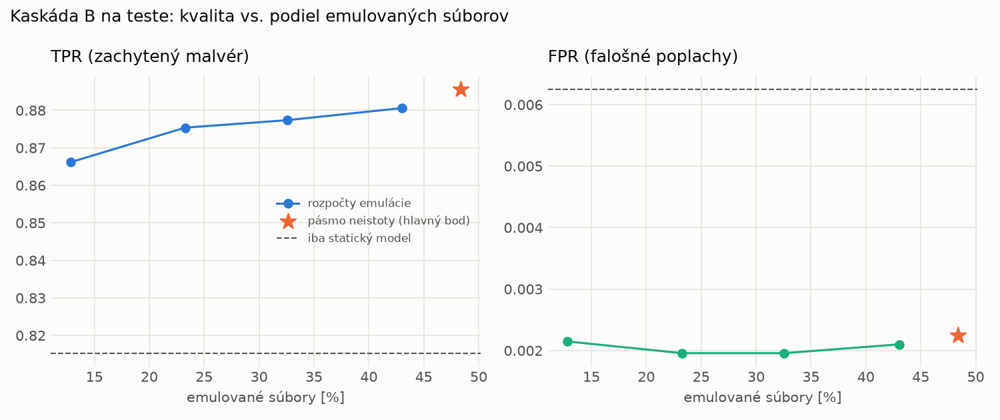
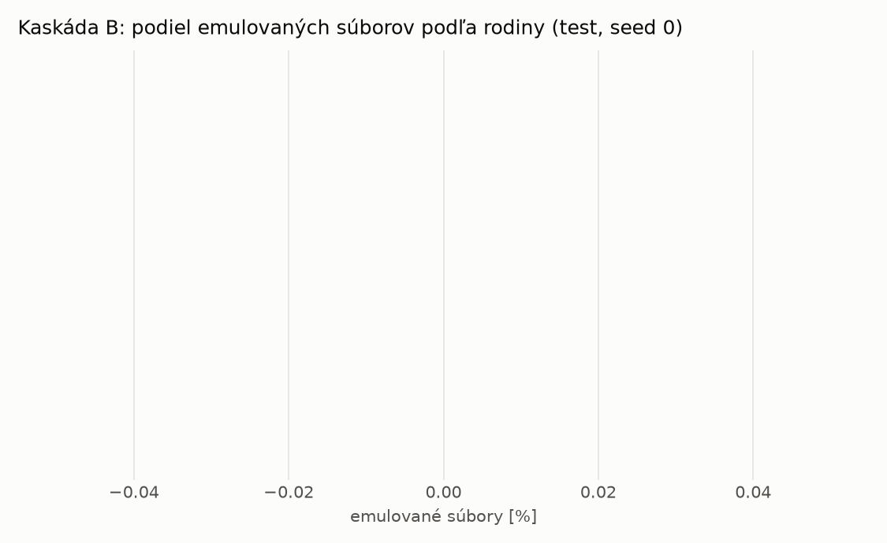

# Kaskáda B `b_heavyteacher` – beh `20261123-214412`

> Generované `src/cascade/evaluate_b.py` (2026-11-23T21:44:13+01:00). Seedy: [0, 1, 2]; hodnoty = priemer ± sm. odchýlka.
> Všetky prahy a pásmo neistoty sú z validácie; test sa na nič nenastavuje. Postup: `docs/09_plan_v2.md`.

| rola | beh |
|---|---|
| static | `runs_v4/emu_p/lofo/Boxer/students_static/mlp_kd_heavy/20261123-214110` |
| dynamic | `runs_v4/emu_p/lofo/Boxer/students_dynamic/mlp_kd_heavy/20261123-214248` |
| hybrid | `runs_v4/emu_p/lofo/Boxer/hybrid/lightgbm/20261123-213325` |

Druhý stupeň: **dynamic**. Pásmo neistoty statického modelu: FPR ≤ 0.1% nad `hi`,
najviac 1% malvéru validácie pod `lo` (seed 0: lo = 0.0494, hi = 0.9963, seed 1: lo = 0.0412, hi = 0.9943, seed 2: lo = 0.0396, hi = 0.9931).

## Test
| prístup | accuracy | balanced_accuracy | precision | recall_tpr | fpr | f1 | mcc |
|---|---|---|---|---|---|---|---|
| kaskáda B | 0.9475 ± 0.0025 | 0.9417 ± 0.0028 | 0.9969 ± 0.0005 | 0.8857 ± 0.0061 | 0.0022 ± 0.0004 | 0.9380 ± 0.0031 | 0.8975 ± 0.0046 |
| statický | 0.9137 ± 0.0123 | 0.9045 ± 0.0138 | 0.9906 ± 0.0004 | 0.8153 ± 0.0278 | 0.0063 ± 0.0004 | 0.8943 ± 0.0168 | 0.8339 ± 0.0224 |
| dynamický | 0.8153 ± 0.0044 | 0.7950 ± 0.0049 | 0.9836 ± 0.0009 | 0.5980 ± 0.0100 | 0.0081 ± 0.0005 | 0.7438 ± 0.0077 | 0.6589 ± 0.0076 |
| hybrid (každá vzorka) | 0.9753 ± 0.0011 | 0.9731 ± 0.0013 | 0.9928 ± 0.0007 | 0.9518 ± 0.0032 | 0.0056 ± 0.0005 | 0.9718 ± 0.0014 | 0.9505 ± 0.0022 |

- **emulované súbory: 48.37%** (ostatné rozhodne iba statický model); na hybrid ide 12.42% súborov
- chyby pri istom rozhodnutí statického modelu (seed 0): 43
- validácia: emulované 45.61%, na hybrid 10.18%

## Validácia
| prístup | accuracy | balanced_accuracy | precision | recall_tpr | fpr | f1 | mcc |
|---|---|---|---|---|---|---|---|
| kaskáda B | 0.9485 ± 0.0029 | 0.9390 ± 0.0035 | 0.9922 ± 0.0002 | 0.8830 ± 0.0071 | 0.0050 ± 0.0002 | 0.9344 ± 0.0039 | 0.8963 ± 0.0056 |
| statický | 0.9235 ± 0.0028 | 0.9099 ± 0.0033 | 0.9839 ± 0.0002 | 0.8294 ± 0.0068 | 0.0096 ± 0.0002 | 0.9001 ± 0.0040 | 0.8468 ± 0.0053 |
| dynamický | 0.8360 ± 0.0063 | 0.8048 ± 0.0076 | 0.9783 ± 0.0005 | 0.6193 ± 0.0152 | 0.0097 ± 0.0000 | 0.7584 ± 0.0115 | 0.6822 ± 0.0117 |
| hybrid (každá vzorka) | 0.9744 ± 0.0004 | 0.9712 ± 0.0006 | 0.9862 ± 0.0007 | 0.9518 ± 0.0016 | 0.0095 ± 0.0005 | 0.9687 ± 0.0006 | 0.9475 ± 0.0008 |

## Januárové vzorky vynechanej rodiny (iba malvér → TPR)
| prístup | TPR |
|---|---|
| kaskáda B | 0.8890 ± 0.0154 |
| statický | 0.6929 ± 0.1865 |
| dynamický | 0.5678 ± 0.0213 |
| hybrid (každá vzorka) | 0.9267 ± 0.0027 |

Podiel emulovaných: 94.52%

## Krivka rozpočtu emulácie (test, priemer cez seedy)
| budget_val | emulation_rate | hybrid_rate | recall_tpr | fpr | f1 |
|---|---|---|---|---|---|
| 0.1000 | 0.1281 | 0.0646 | 0.8661 | 0.0021 | 0.9270 |
| 0.2000 | 0.2325 | 0.0987 | 0.8754 | 0.0020 | 0.9323 |
| 0.3000 | 0.3256 | 0.1260 | 0.8774 | 0.0020 | 0.9335 |
| 0.4000 | 0.4304 | 0.1503 | 0.8806 | 0.0021 | 0.9352 |

## Výpočtové nároky
Čas dynamickej analýzy (beh v emulátore alebo na zariadení) dataset neuvádza, preto sa neodhaduje. Úspora kaskády B = podiel súborov s dynamickou analýzou: **48.37%** (ostatné prístupy 100 %).

_Chýba benchmark niektorého komponentu (v zero-day behoch sa nemeria)._

