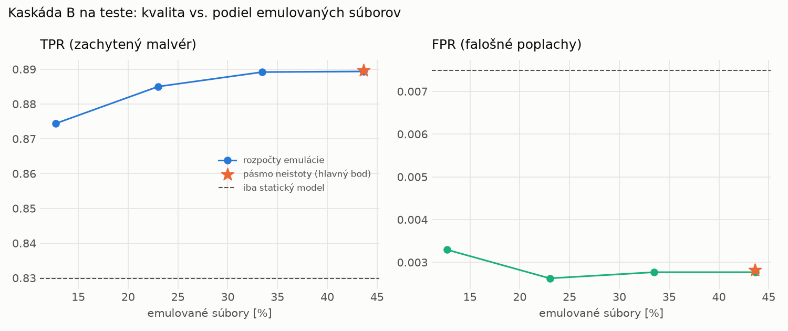

# Kaskáda B `b_nokd` – beh `20261123-214411`

> Generované `src/cascade/evaluate_b.py` (2026-11-23T21:44:11+01:00). Seedy: [0, 1, 2]; hodnoty = priemer ± sm. odchýlka.
> Všetky prahy a pásmo neistoty sú z validácie; test sa na nič nenastavuje. Postup: `docs/09_plan_v2.md`.

| rola | beh |
|---|---|
| static | `runs_v4/emu_p/lofo/Boxer/students_static/mlp_nokd/20261123-214024` |
| dynamic | `runs_v4/emu_p/lofo/Boxer/students_dynamic/mlp_nokd/20261123-214146` |
| hybrid | `runs_v4/emu_p/lofo/Boxer/hybrid/lightgbm/20261123-213325` |

Druhý stupeň: **dynamic**. Pásmo neistoty statického modelu: FPR ≤ 0.1% nad `hi`,
najviac 1% malvéru validácie pod `lo` (seed 0: lo = 0.0291, hi = 0.9997, seed 1: lo = 0.0309, hi = 0.9998, seed 2: lo = 0.0356, hi = 0.9973).

## Test
| prístup | accuracy | balanced_accuracy | precision | recall_tpr | fpr | f1 | mcc |
|---|---|---|---|---|---|---|---|
| kaskáda B | 0.9490 ± 0.0025 | 0.9434 ± 0.0028 | 0.9961 ± 0.0001 | 0.8897 ± 0.0056 | 0.0028 ± 0.0001 | 0.9399 ± 0.0031 | 0.9002 ± 0.0047 |
| statický | 0.9196 ± 0.0103 | 0.9112 ± 0.0116 | 0.9890 ± 0.0004 | 0.8299 ± 0.0236 | 0.0075 ± 0.0005 | 0.9024 ± 0.0138 | 0.8444 ± 0.0189 |
| dynamický | 0.8157 ± 0.0049 | 0.7954 ± 0.0055 | 0.9816 ± 0.0009 | 0.6000 ± 0.0115 | 0.0091 ± 0.0006 | 0.7447 ± 0.0087 | 0.6589 ± 0.0082 |
| hybrid (každá vzorka) | 0.9753 ± 0.0011 | 0.9731 ± 0.0013 | 0.9928 ± 0.0007 | 0.9518 ± 0.0032 | 0.0056 ± 0.0005 | 0.9718 ± 0.0014 | 0.9505 ± 0.0022 |

- **emulované súbory: 43.62%** (ostatné rozhodne iba statický model); na hybrid ide 10.89% súborov
- chyby pri istom rozhodnutí statického modelu (seed 0): 50
- validácia: emulované 40.34%, na hybrid 9.12%

## Validácia
| prístup | accuracy | balanced_accuracy | precision | recall_tpr | fpr | f1 | mcc |
|---|---|---|---|---|---|---|---|
| kaskáda B | 0.9534 ± 0.0026 | 0.9449 ± 0.0032 | 0.9924 ± 0.0007 | 0.8947 ± 0.0069 | 0.0049 ± 0.0005 | 0.9410 ± 0.0035 | 0.9060 ± 0.0051 |
| statický | 0.9321 ± 0.0050 | 0.9203 ± 0.0060 | 0.9841 ± 0.0002 | 0.8503 ± 0.0121 | 0.0097 ± 0.0000 | 0.9123 ± 0.0070 | 0.8635 ± 0.0098 |
| dynamický | 0.8367 ± 0.0072 | 0.8056 ± 0.0087 | 0.9784 ± 0.0006 | 0.6209 ± 0.0174 | 0.0097 ± 0.0000 | 0.7596 ± 0.0133 | 0.6835 ± 0.0135 |
| hybrid (každá vzorka) | 0.9744 ± 0.0004 | 0.9712 ± 0.0006 | 0.9862 ± 0.0007 | 0.9518 ± 0.0016 | 0.0095 ± 0.0005 | 0.9687 ± 0.0006 | 0.9475 ± 0.0008 |

## Januárové vzorky vynechanej rodiny (iba malvér → TPR)
| prístup | TPR |
|---|---|
| kaskáda B | 0.8887 ± 0.0170 |
| statický | 0.6991 ± 0.1343 |
| dynamický | 0.5695 ± 0.0043 |
| hybrid (každá vzorka) | 0.9267 ± 0.0027 |

Podiel emulovaných: 94.36%

## Krivka rozpočtu emulácie (test, priemer cez seedy)
| budget_val | emulation_rate | hybrid_rate | recall_tpr | fpr | f1 |
|---|---|---|---|---|---|
| 0.1000 | 0.1271 | 0.0605 | 0.8744 | 0.0033 | 0.9310 |
| 0.2000 | 0.2301 | 0.0865 | 0.8850 | 0.0026 | 0.9374 |
| 0.3000 | 0.3348 | 0.1052 | 0.8892 | 0.0028 | 0.9396 |
| 0.4000 | 0.4366 | 0.1173 | 0.8894 | 0.0028 | 0.9397 |

## Výpočtové nároky
Čas dynamickej analýzy (beh v emulátore alebo na zariadení) dataset neuvádza, preto sa neodhaduje. Úspora kaskády B = podiel súborov s dynamickou analýzou: **43.62%** (ostatné prístupy 100 %).

_Chýba benchmark niektorého komponentu (v zero-day behoch sa nemeria)._

