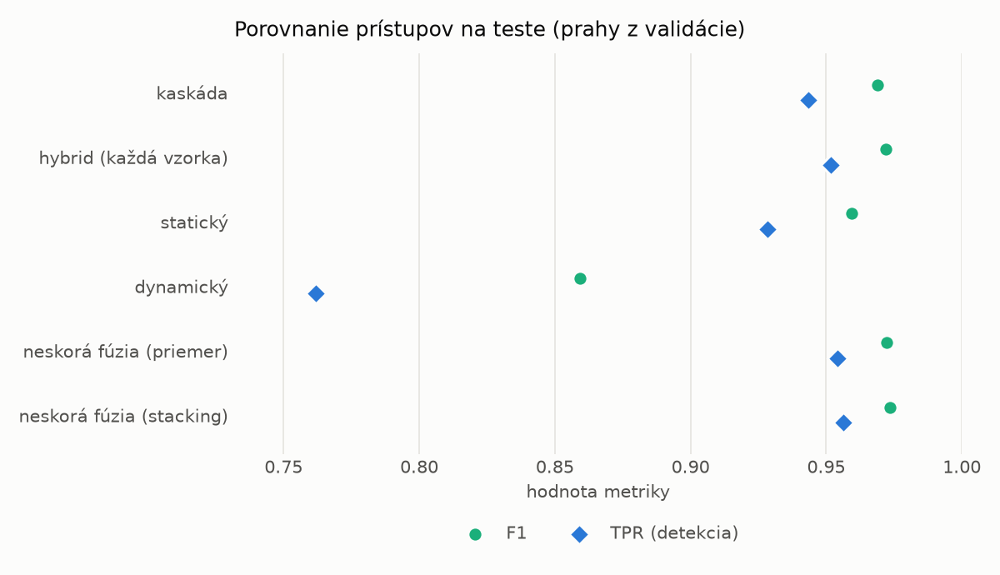
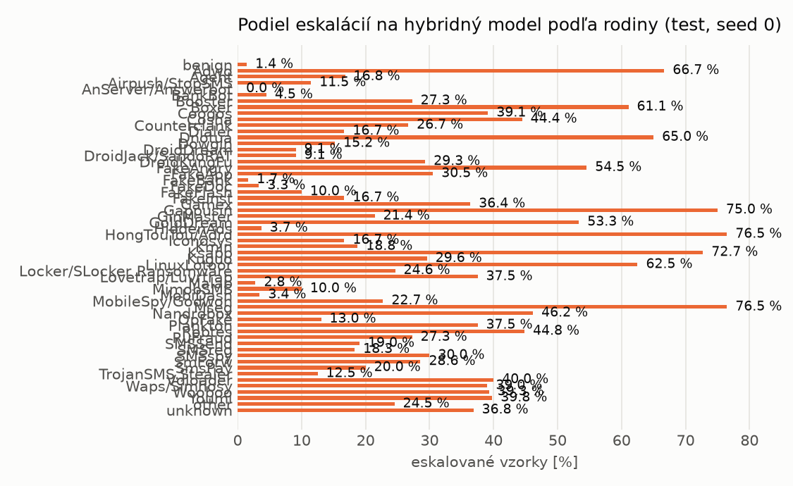

# Kaskáda `baselines` – beh `20261123-214317`

> Generované `src/cascade/evaluate.py` (2026-11-23T21:43:18+01:00). Seedy: [0, 1, 2]; hodnoty = priemer ± sm. odchýlka.
> Všetky prahy sú určené na validácii (FPR ≤ 1 %); test sa na nič nenastavuje.

| rola | beh |
|---|---|
| static | `runs_v4/emu_p/lofo/Boxer/static/lightgbm/20261123-011538` |
| dynamic | `runs_v4/emu_p/lofo/Boxer/dynamic/lightgbm/20261123-212946` |
| hybrid | `runs_v4/emu_p/lofo/Boxer/hybrid/lightgbm/20261123-213325` |

## Test
| prístup | accuracy | balanced_accuracy | precision | recall_tpr | fpr | f1 | mcc |
|---|---|---|---|---|---|---|---|
| kaskáda | 0.9728 ± 0.0011 | 0.9701 ± 0.0012 | 0.9958 ± 0.0006 | 0.9434 ± 0.0028 | 0.0032 ± 0.0004 | 0.9689 ± 0.0013 | 0.9459 ± 0.0020 |
| hybrid (každá vzorka) | 0.9753 ± 0.0011 | 0.9731 ± 0.0013 | 0.9928 ± 0.0007 | 0.9518 ± 0.0032 | 0.0056 ± 0.0005 | 0.9718 ± 0.0014 | 0.9505 ± 0.0022 |
| statický | 0.9648 ± 0.0010 | 0.9613 ± 0.0012 | 0.9926 ± 0.0006 | 0.9283 ± 0.0028 | 0.0056 ± 0.0005 | 0.9594 ± 0.0013 | 0.9300 ± 0.0020 |
| dynamický | 0.8882 ± 0.0010 | 0.8764 ± 0.0011 | 0.9856 ± 0.0007 | 0.7618 ± 0.0027 | 0.0091 ± 0.0005 | 0.8593 ± 0.0014 | 0.7867 ± 0.0016 |
| neskorá fúzia (priemer) | 0.9756 ± 0.0016 | 0.9736 ± 0.0018 | 0.9912 ± 0.0005 | 0.9541 ± 0.0039 | 0.0069 ± 0.0004 | 0.9722 ± 0.0018 | 0.9510 ± 0.0030 |
| neskorá fúzia (stacking) | 0.9766 ± 0.0001 | 0.9747 ± 0.0002 | 0.9911 ± 0.0013 | 0.9564 ± 0.0014 | 0.0070 ± 0.0010 | 0.9734 ± 0.0002 | 0.9530 ± 0.0002 |

## Validácia
| prístup | accuracy | balanced_accuracy | precision | recall_tpr | fpr | f1 | mcc |
|---|---|---|---|---|---|---|---|
| kaskáda | 0.9742 ± 0.0004 | 0.9702 ± 0.0005 | 0.9909 ± 0.0005 | 0.9465 ± 0.0012 | 0.0062 ± 0.0003 | 0.9682 ± 0.0005 | 0.9471 ± 0.0008 |
| hybrid (každá vzorka) | 0.9744 ± 0.0004 | 0.9712 ± 0.0006 | 0.9862 ± 0.0007 | 0.9518 ± 0.0016 | 0.0095 ± 0.0005 | 0.9687 ± 0.0006 | 0.9475 ± 0.0008 |
| statický | 0.9665 ± 0.0010 | 0.9616 ± 0.0012 | 0.9858 ± 0.0003 | 0.9328 ± 0.0024 | 0.0096 ± 0.0002 | 0.9586 ± 0.0013 | 0.9315 ± 0.0021 |
| dynamický | 0.9239 ± 0.0020 | 0.9104 ± 0.0024 | 0.9839 ± 0.0002 | 0.8304 ± 0.0049 | 0.0096 ± 0.0002 | 0.9007 ± 0.0029 | 0.8476 ± 0.0038 |
| neskorá fúzia (priemer) | 0.9800 ± 0.0024 | 0.9778 ± 0.0028 | 0.9868 ± 0.0009 | 0.9648 ± 0.0051 | 0.0092 ± 0.0006 | 0.9757 ± 0.0030 | 0.9589 ± 0.0050 |
| neskorá fúzia (stacking) | 0.9805 ± 0.0010 | 0.9785 ± 0.0012 | 0.9866 ± 0.0004 | 0.9663 ± 0.0026 | 0.0094 ± 0.0003 | 0.9763 ± 0.0012 | 0.9599 ± 0.0020 |

## Správanie kaskády (test, seed 0)
- podiel eskalácií na hybrid: **11.03%** (1396 vzoriek)
- chyby pri zhode študentov (kaskáda ich nemôže opraviť): **231**
  (2.052% zo zhôd; FP 3, FN 228)
- úspešnosť na eskalovaných vzorkách: hybrid 0.9240687679083095, statický 0.8545845272206304,
  dynamický 0.14541547277936961  → prínos hybridu pri nezhode

## Výpočtové nároky (odhad z benchmarkov komponentov)
_Chýba benchmark niektorého komponentu (`python -m src.evaluation.benchmark`)._

