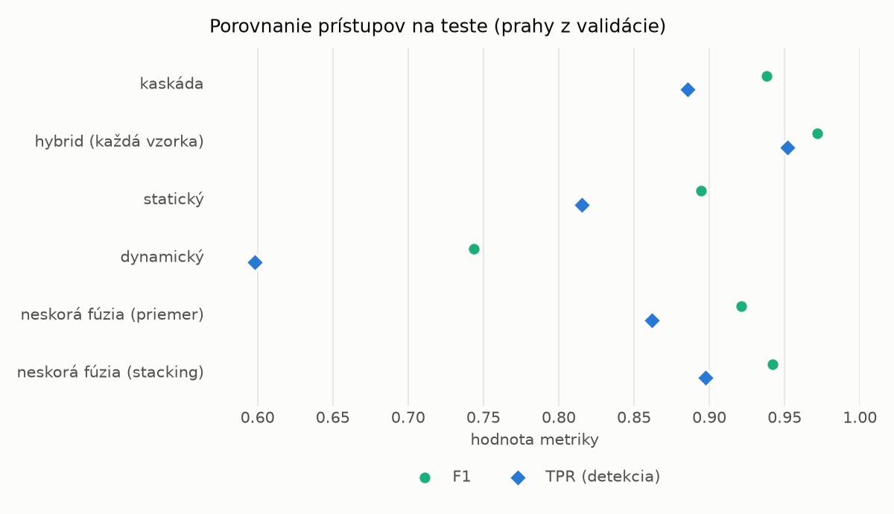
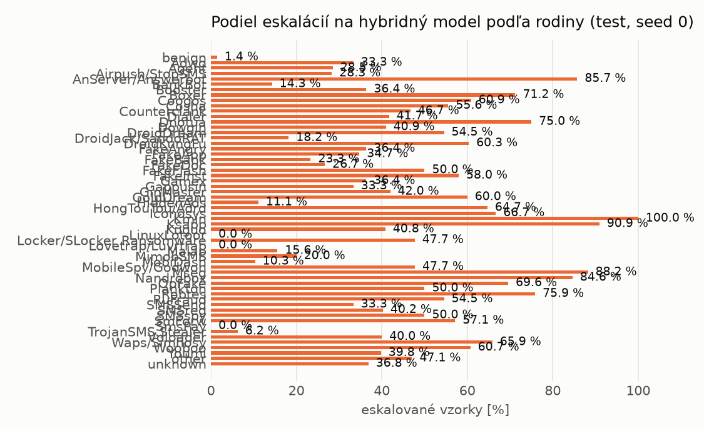

# Kaskáda `heavyteacher` – beh `20261123-214400`

> Generované `src/cascade/evaluate.py` (2026-11-23T21:44:01+01:00). Seedy: [0, 1, 2]; hodnoty = priemer ± sm. odchýlka.
> Všetky prahy sú určené na validácii (FPR ≤ 1 %); test sa na nič nenastavuje.

| rola | beh |
|---|---|
| static | `runs_v4/emu_p/lofo/Boxer/students_static/mlp_kd_heavy/20261123-214110` |
| dynamic | `runs_v4/emu_p/lofo/Boxer/students_dynamic/mlp_kd_heavy/20261123-214248` |
| hybrid | `runs_v4/emu_p/lofo/Boxer/hybrid/lightgbm/20261123-213325` |

## Test
| prístup | accuracy | balanced_accuracy | precision | recall_tpr | fpr | f1 | mcc |
|---|---|---|---|---|---|---|---|
| kaskáda | 0.9476 ± 0.0024 | 0.9418 ± 0.0027 | 0.9970 ± 0.0005 | 0.8857 ± 0.0058 | 0.0021 ± 0.0004 | 0.9380 ± 0.0030 | 0.8976 ± 0.0044 |
| hybrid (každá vzorka) | 0.9753 ± 0.0011 | 0.9731 ± 0.0013 | 0.9928 ± 0.0007 | 0.9518 ± 0.0032 | 0.0056 ± 0.0005 | 0.9718 ± 0.0014 | 0.9505 ± 0.0022 |
| statický | 0.9137 ± 0.0123 | 0.9045 ± 0.0138 | 0.9906 ± 0.0004 | 0.8153 ± 0.0278 | 0.0063 ± 0.0004 | 0.8943 ± 0.0168 | 0.8339 ± 0.0224 |
| dynamický | 0.8153 ± 0.0044 | 0.7950 ± 0.0049 | 0.9836 ± 0.0009 | 0.5980 ± 0.0100 | 0.0081 ± 0.0005 | 0.7438 ± 0.0077 | 0.6589 ± 0.0076 |
| neskorá fúzia (priemer) | 0.9339 ± 0.0020 | 0.9271 ± 0.0022 | 0.9891 ± 0.0014 | 0.8620 ± 0.0052 | 0.0077 ± 0.0011 | 0.9212 ± 0.0026 | 0.8708 ± 0.0035 |
| neskorá fúzia (stacking) | 0.9504 ± 0.0005 | 0.9454 ± 0.0006 | 0.9910 ± 0.0005 | 0.8975 ± 0.0014 | 0.0066 ± 0.0004 | 0.9419 ± 0.0006 | 0.9022 ± 0.0009 |

## Validácia
| prístup | accuracy | balanced_accuracy | precision | recall_tpr | fpr | f1 | mcc |
|---|---|---|---|---|---|---|---|
| kaskáda | 0.9488 ± 0.0029 | 0.9393 ± 0.0035 | 0.9929 ± 0.0002 | 0.8832 ± 0.0070 | 0.0045 ± 0.0002 | 0.9348 ± 0.0039 | 0.8971 ± 0.0056 |
| hybrid (každá vzorka) | 0.9744 ± 0.0004 | 0.9712 ± 0.0006 | 0.9862 ± 0.0007 | 0.9518 ± 0.0016 | 0.0095 ± 0.0005 | 0.9687 ± 0.0006 | 0.9475 ± 0.0008 |
| statický | 0.9235 ± 0.0028 | 0.9099 ± 0.0033 | 0.9839 ± 0.0002 | 0.8294 ± 0.0068 | 0.0096 ± 0.0002 | 0.9001 ± 0.0040 | 0.8468 ± 0.0053 |
| dynamický | 0.8360 ± 0.0063 | 0.8048 ± 0.0076 | 0.9783 ± 0.0005 | 0.6193 ± 0.0152 | 0.0097 ± 0.0000 | 0.7584 ± 0.0115 | 0.6822 ± 0.0117 |
| neskorá fúzia (priemer) | 0.9400 ± 0.0025 | 0.9298 ± 0.0030 | 0.9846 ± 0.0002 | 0.8693 ± 0.0061 | 0.0096 ± 0.0002 | 0.9234 ± 0.0034 | 0.8790 ± 0.0048 |
| neskorá fúzia (stacking) | 0.9493 ± 0.0005 | 0.9409 ± 0.0006 | 0.9852 ± 0.0003 | 0.8914 ± 0.0010 | 0.0096 ± 0.0002 | 0.9359 ± 0.0007 | 0.8971 ± 0.0010 |

## Správanie kaskády (test, seed 0)
- podiel eskalácií na hybrid: **18.80%** (2379 vzoriek)
- chyby pri zhode študentov (kaskáda ich nemôže opraviť): **631**
  (6.140% zo zhôd; FP 0, FN 631)
- úspešnosť na eskalovaných vzorkách: hybrid 0.9794031105506515, statický 0.735603194619588,
  dynamický 0.26439680538041194  → prínos hybridu pri nezhode

## Výpočtové nároky (odhad z benchmarkov komponentov)
_Chýba benchmark niektorého komponentu (`python -m src.evaluation.benchmark`)._

