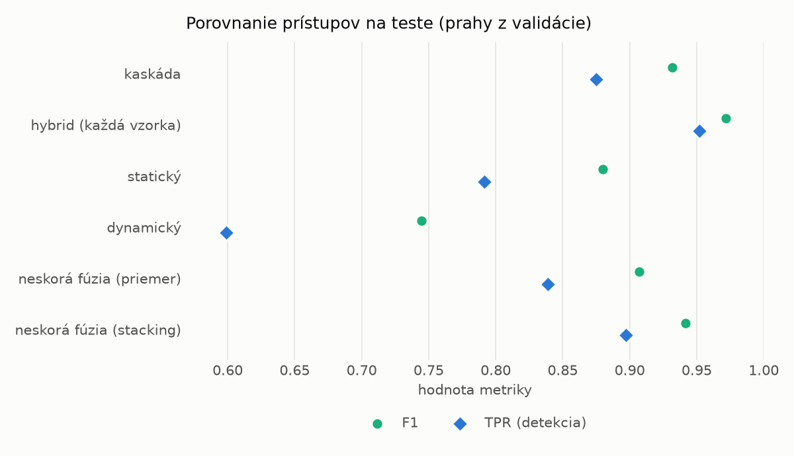
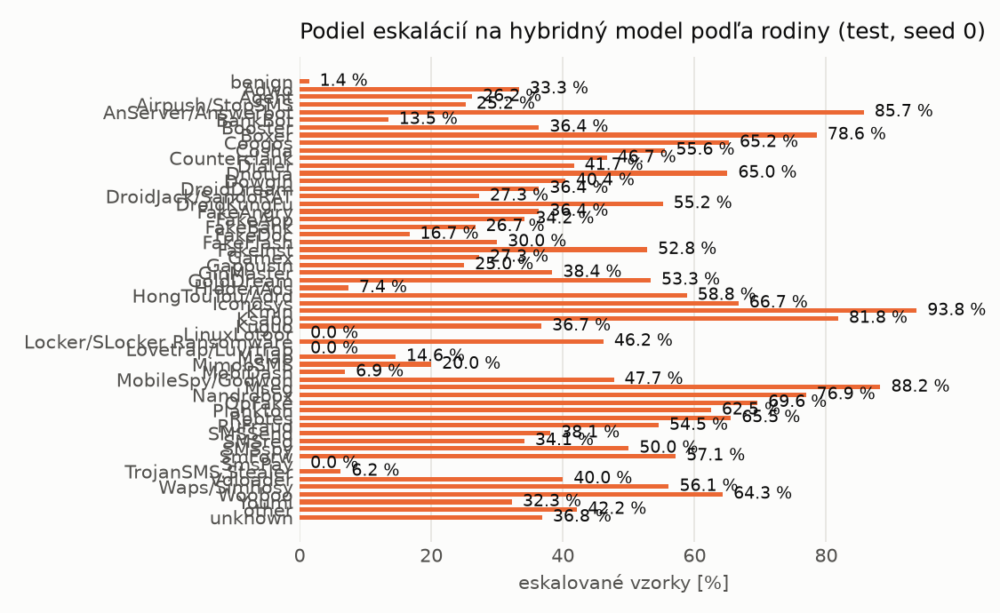

# Kaskáda `main` – beh `20261123-214308`

> Generované `src/cascade/evaluate.py` (2026-11-23T21:43:08+01:00). Seedy: [0, 1, 2]; hodnoty = priemer ± sm. odchýlka.
> Všetky prahy sú určené na validácii (FPR ≤ 1 %); test sa na nič nenastavuje.

| rola | beh |
|---|---|
| static | `runs_v4/emu_p/lofo/Boxer/students_static/mlp_kd/20261123-214009` |
| dynamic | `runs_v4/emu_p/lofo/Boxer/students_dynamic/mlp_kd/20261123-214125` |
| hybrid | `runs_v4/emu_p/lofo/Boxer/hybrid/lightgbm/20261123-213325` |

## Test
| prístup | accuracy | balanced_accuracy | precision | recall_tpr | fpr | f1 | mcc |
|---|---|---|---|---|---|---|---|
| kaskáda | 0.9425 ± 0.0020 | 0.9361 ± 0.0022 | 0.9965 ± 0.0004 | 0.8747 ± 0.0041 | 0.0025 ± 0.0003 | 0.9317 ± 0.0025 | 0.8880 ± 0.0038 |
| hybrid (každá vzorka) | 0.9753 ± 0.0011 | 0.9731 ± 0.0013 | 0.9928 ± 0.0007 | 0.9518 ± 0.0032 | 0.0056 ± 0.0005 | 0.9718 ± 0.0014 | 0.9505 ± 0.0022 |
| statický | 0.9032 ± 0.0144 | 0.8927 ± 0.0161 | 0.9905 ± 0.0007 | 0.7916 ± 0.0324 | 0.0062 ± 0.0005 | 0.8797 ± 0.0198 | 0.8148 ± 0.0261 |
| dynamický | 0.8157 ± 0.0036 | 0.7954 ± 0.0042 | 0.9837 ± 0.0028 | 0.5989 ± 0.0099 | 0.0081 ± 0.0015 | 0.7445 ± 0.0068 | 0.6596 ± 0.0053 |
| neskorá fúzia (priemer) | 0.9231 ± 0.0031 | 0.9152 ± 0.0034 | 0.9878 ± 0.0004 | 0.8388 ± 0.0073 | 0.0084 ± 0.0004 | 0.9072 ± 0.0041 | 0.8505 ± 0.0056 |
| neskorá fúzia (stacking) | 0.9500 ± 0.0021 | 0.9450 ± 0.0024 | 0.9906 ± 0.0010 | 0.8969 ± 0.0048 | 0.0069 ± 0.0007 | 0.9414 ± 0.0026 | 0.9014 ± 0.0041 |

## Validácia
| prístup | accuracy | balanced_accuracy | precision | recall_tpr | fpr | f1 | mcc |
|---|---|---|---|---|---|---|---|
| kaskáda | 0.9482 ± 0.0021 | 0.9386 ± 0.0025 | 0.9930 ± 0.0003 | 0.8815 ± 0.0049 | 0.0044 ± 0.0002 | 0.9340 ± 0.0028 | 0.8959 ± 0.0041 |
| hybrid (každá vzorka) | 0.9744 ± 0.0004 | 0.9712 ± 0.0006 | 0.9862 ± 0.0007 | 0.9518 ± 0.0016 | 0.0095 ± 0.0005 | 0.9687 ± 0.0006 | 0.9475 ± 0.0008 |
| statický | 0.9270 ± 0.0043 | 0.9142 ± 0.0051 | 0.9839 ± 0.0002 | 0.8382 ± 0.0102 | 0.0097 ± 0.0000 | 0.9052 ± 0.0061 | 0.8537 ± 0.0082 |
| dynamický | 0.8357 ± 0.0059 | 0.8043 ± 0.0071 | 0.9783 ± 0.0005 | 0.6183 ± 0.0143 | 0.0097 ± 0.0000 | 0.7577 ± 0.0109 | 0.6815 ± 0.0110 |
| neskorá fúzia (priemer) | 0.9354 ± 0.0024 | 0.9242 ± 0.0028 | 0.9846 ± 0.0006 | 0.8580 ± 0.0055 | 0.0096 ± 0.0003 | 0.9170 ± 0.0033 | 0.8700 ± 0.0046 |
| neskorá fúzia (stacking) | 0.9529 ± 0.0010 | 0.9453 ± 0.0012 | 0.9850 ± 0.0000 | 0.9003 ± 0.0024 | 0.0097 ± 0.0000 | 0.9408 ± 0.0013 | 0.9043 ± 0.0020 |

## Správanie kaskády (test, seed 0)
- podiel eskalácií na hybrid: **18.13%** (2295 vzoriek)
- chyby pri zhode študentov (kaskáda ich nemôže opraviť): **675**
  (6.515% zo zhôd; FP 1, FN 674)
- úspešnosť na eskalovaných vzorkách: hybrid 0.9777777777777777, statický 0.7124183006535948,
  dynamický 0.2875816993464052  → prínos hybridu pri nezhode

## Výpočtové nároky (odhad z benchmarkov komponentov)
_Chýba benchmark niektorého komponentu (`python -m src.evaluation.benchmark`)._

