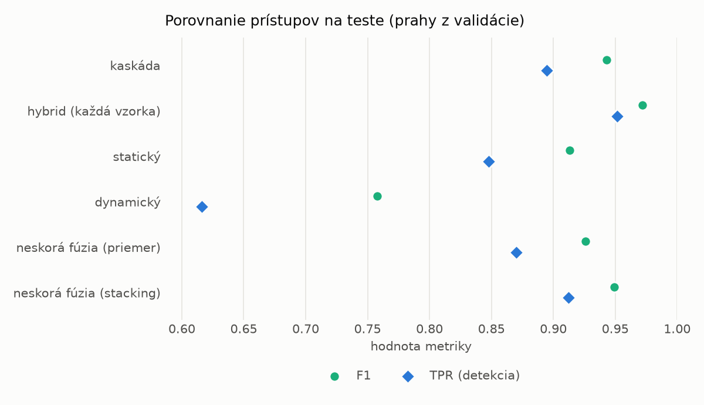
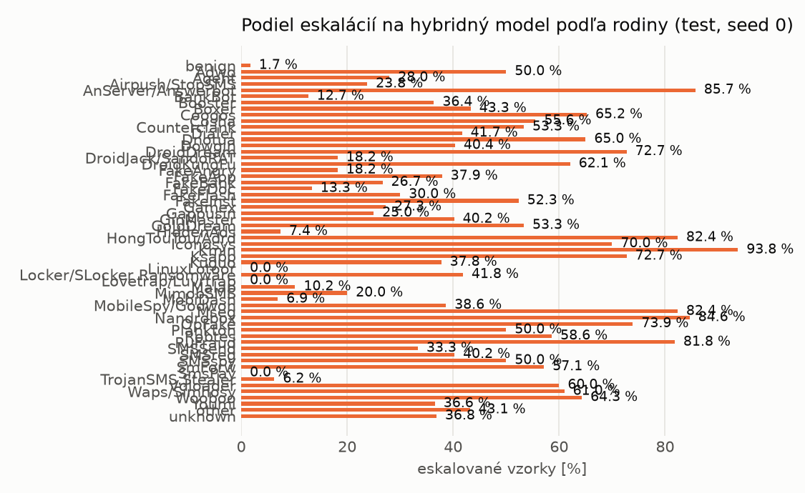

# Kaskáda `modal` – beh `20261123-214313`

> Generované `src/cascade/evaluate.py` (2026-11-23T21:43:13+01:00). Seedy: [0, 1, 2]; hodnoty = priemer ± sm. odchýlka.
> Všetky prahy sú určené na validácii (FPR ≤ 1 %); test sa na nič nenastavuje.

| rola | beh |
|---|---|
| static | `runs_v4/emu_p/lofo/Boxer/students_static/mlp_kd_modal/20261123-214047` |
| dynamic | `runs_v4/emu_p/lofo/Boxer/students_dynamic/mlp_kd_modal/20261123-214228` |
| hybrid | `runs_v4/emu_p/lofo/Boxer/hybrid/lightgbm/20261123-213325` |

## Test
| prístup | accuracy | balanced_accuracy | precision | recall_tpr | fpr | f1 | mcc |
|---|---|---|---|---|---|---|---|
| kaskáda | 0.9515 ± 0.0012 | 0.9462 ± 0.0014 | 0.9967 ± 0.0002 | 0.8948 ± 0.0027 | 0.0024 ± 0.0001 | 0.9430 ± 0.0015 | 0.9049 ± 0.0024 |
| hybrid (každá vzorka) | 0.9753 ± 0.0011 | 0.9731 ± 0.0013 | 0.9928 ± 0.0007 | 0.9518 ± 0.0032 | 0.0056 ± 0.0005 | 0.9718 ± 0.0014 | 0.9505 ± 0.0022 |
| statický | 0.9276 ± 0.0022 | 0.9202 ± 0.0024 | 0.9894 ± 0.0007 | 0.8477 ± 0.0045 | 0.0074 ± 0.0004 | 0.9131 ± 0.0028 | 0.8592 ± 0.0042 |
| dynamický | 0.8232 ± 0.0029 | 0.8038 ± 0.0033 | 0.9829 ± 0.0019 | 0.6163 ± 0.0077 | 0.0087 ± 0.0011 | 0.7576 ± 0.0053 | 0.6722 ± 0.0044 |
| neskorá fúzia (priemer) | 0.9377 ± 0.0088 | 0.9313 ± 0.0101 | 0.9898 ± 0.0025 | 0.8699 ± 0.0222 | 0.0073 ± 0.0020 | 0.9259 ± 0.0114 | 0.8780 ± 0.0163 |
| neskorá fúzia (stacking) | 0.9563 ± 0.0018 | 0.9522 ± 0.0021 | 0.9892 ± 0.0008 | 0.9125 ± 0.0045 | 0.0081 ± 0.0007 | 0.9493 ± 0.0023 | 0.9133 ± 0.0035 |

## Validácia
| prístup | accuracy | balanced_accuracy | precision | recall_tpr | fpr | f1 | mcc |
|---|---|---|---|---|---|---|---|
| kaskáda | 0.9537 ± 0.0016 | 0.9453 ± 0.0017 | 0.9924 ± 0.0012 | 0.8955 ± 0.0027 | 0.0049 ± 0.0008 | 0.9415 ± 0.0020 | 0.9066 ± 0.0032 |
| hybrid (každá vzorka) | 0.9744 ± 0.0004 | 0.9712 ± 0.0006 | 0.9862 ± 0.0007 | 0.9518 ± 0.0016 | 0.0095 ± 0.0005 | 0.9687 ± 0.0006 | 0.9475 ± 0.0008 |
| statický | 0.9339 ± 0.0011 | 0.9225 ± 0.0013 | 0.9844 ± 0.0003 | 0.8546 ± 0.0025 | 0.0096 ± 0.0002 | 0.9149 ± 0.0015 | 0.8671 ± 0.0021 |
| dynamický | 0.8447 ± 0.0044 | 0.8152 ± 0.0053 | 0.9792 ± 0.0001 | 0.6401 ± 0.0108 | 0.0096 ± 0.0002 | 0.7741 ± 0.0079 | 0.6985 ± 0.0081 |
| neskorá fúzia (priemer) | 0.9420 ± 0.0043 | 0.9322 ± 0.0052 | 0.9846 ± 0.0002 | 0.8742 ± 0.0103 | 0.0097 ± 0.0000 | 0.9261 ± 0.0058 | 0.8829 ± 0.0084 |
| neskorá fúzia (stacking) | 0.9566 ± 0.0004 | 0.9498 ± 0.0005 | 0.9852 ± 0.0000 | 0.9093 ± 0.0011 | 0.0097 ± 0.0000 | 0.9457 ± 0.0006 | 0.9117 ± 0.0009 |

## Správanie kaskády (test, seed 0)
- podiel eskalácií na hybrid: **16.14%** (2043 vzoriek)
- chyby pri zhode študentov (kaskáda ich nemôže opraviť): **554**
  (5.220% zo zhôd; FP 2, FN 552)
- úspešnosť na eskalovaných vzorkách: hybrid 0.9720998531571219, statický 0.8081253059226627,
  dynamický 0.19187469407733726  → prínos hybridu pri nezhode

## Výpočtové nároky (odhad z benchmarkov komponentov)
_Chýba benchmark niektorého komponentu (`python -m src.evaluation.benchmark`)._

