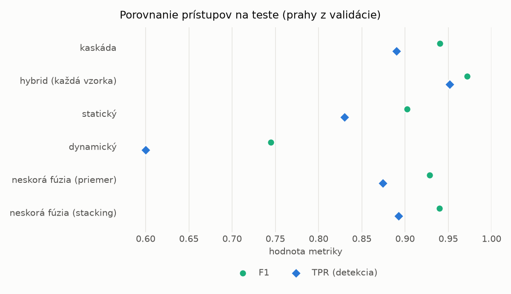
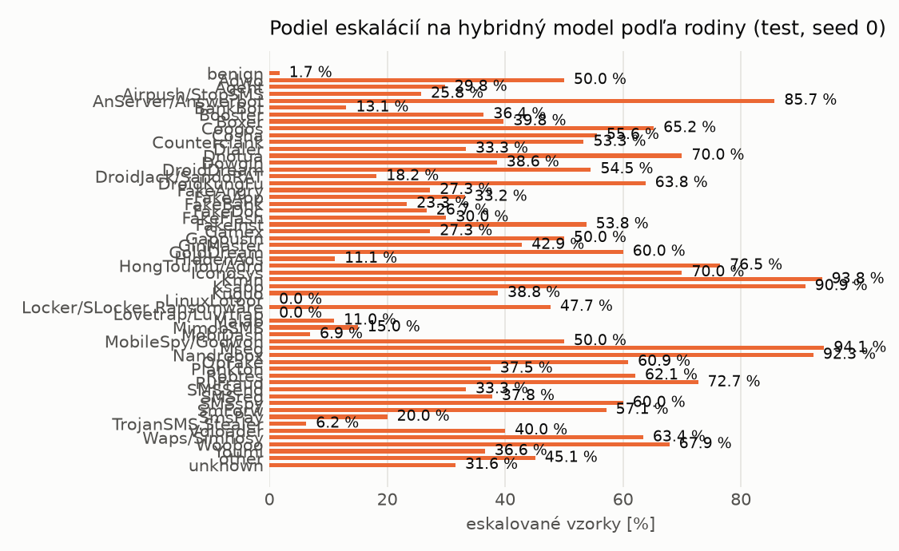

# Kaskáda `nokd` – beh `20261123-214310`

> Generované `src/cascade/evaluate.py` (2026-11-23T21:43:11+01:00). Seedy: [0, 1, 2]; hodnoty = priemer ± sm. odchýlka.
> Všetky prahy sú určené na validácii (FPR ≤ 1 %); test sa na nič nenastavuje.

| rola | beh |
|---|---|
| static | `runs_v4/emu_p/lofo/Boxer/students_static/mlp_nokd/20261123-214024` |
| dynamic | `runs_v4/emu_p/lofo/Boxer/students_dynamic/mlp_nokd/20261123-214146` |
| hybrid | `runs_v4/emu_p/lofo/Boxer/hybrid/lightgbm/20261123-213325` |

## Test
| prístup | accuracy | balanced_accuracy | precision | recall_tpr | fpr | f1 | mcc |
|---|---|---|---|---|---|---|---|
| kaskáda | 0.9494 ± 0.0026 | 0.9438 ± 0.0029 | 0.9965 ± 0.0001 | 0.8901 ± 0.0059 | 0.0025 ± 0.0001 | 0.9403 ± 0.0033 | 0.9009 ± 0.0049 |
| hybrid (každá vzorka) | 0.9753 ± 0.0011 | 0.9731 ± 0.0013 | 0.9928 ± 0.0007 | 0.9518 ± 0.0032 | 0.0056 ± 0.0005 | 0.9718 ± 0.0014 | 0.9505 ± 0.0022 |
| statický | 0.9196 ± 0.0103 | 0.9112 ± 0.0116 | 0.9890 ± 0.0004 | 0.8299 ± 0.0236 | 0.0075 ± 0.0005 | 0.9024 ± 0.0138 | 0.8444 ± 0.0189 |
| dynamický | 0.8157 ± 0.0049 | 0.7954 ± 0.0055 | 0.9816 ± 0.0009 | 0.6000 ± 0.0115 | 0.0091 ± 0.0006 | 0.7447 ± 0.0087 | 0.6589 ± 0.0082 |
| neskorá fúzia (priemer) | 0.9395 ± 0.0027 | 0.9334 ± 0.0031 | 0.9898 ± 0.0012 | 0.8741 ± 0.0071 | 0.0074 ± 0.0009 | 0.9283 ± 0.0035 | 0.8814 ± 0.0048 |
| neskorá fúzia (stacking) | 0.9489 ± 0.0048 | 0.9436 ± 0.0054 | 0.9926 ± 0.0006 | 0.8926 ± 0.0112 | 0.0054 ± 0.0005 | 0.9399 ± 0.0060 | 0.8995 ± 0.0090 |

## Validácia
| prístup | accuracy | balanced_accuracy | precision | recall_tpr | fpr | f1 | mcc |
|---|---|---|---|---|---|---|---|
| kaskáda | 0.9538 ± 0.0026 | 0.9453 ± 0.0032 | 0.9929 ± 0.0004 | 0.8952 ± 0.0067 | 0.0046 ± 0.0003 | 0.9415 ± 0.0036 | 0.9068 ± 0.0051 |
| hybrid (každá vzorka) | 0.9744 ± 0.0004 | 0.9712 ± 0.0006 | 0.9862 ± 0.0007 | 0.9518 ± 0.0016 | 0.0095 ± 0.0005 | 0.9687 ± 0.0006 | 0.9475 ± 0.0008 |
| statický | 0.9321 ± 0.0050 | 0.9203 ± 0.0060 | 0.9841 ± 0.0002 | 0.8503 ± 0.0121 | 0.0097 ± 0.0000 | 0.9123 ± 0.0070 | 0.8635 ± 0.0098 |
| dynamický | 0.8367 ± 0.0072 | 0.8056 ± 0.0087 | 0.9784 ± 0.0006 | 0.6209 ± 0.0174 | 0.0097 ± 0.0000 | 0.7596 ± 0.0133 | 0.6835 ± 0.0135 |
| neskorá fúzia (priemer) | 0.9473 ± 0.0039 | 0.9386 ± 0.0047 | 0.9848 ± 0.0002 | 0.8869 ± 0.0095 | 0.0097 ± 0.0000 | 0.9333 ± 0.0053 | 0.8933 ± 0.0077 |
| neskorá fúzia (stacking) | 0.9517 ± 0.0037 | 0.9438 ± 0.0045 | 0.9850 ± 0.0001 | 0.8974 ± 0.0090 | 0.0097 ± 0.0000 | 0.9391 ± 0.0050 | 0.9019 ± 0.0074 |

## Správanie kaskády (test, seed 0)
- podiel eskalácií na hybrid: **16.49%** (2087 vzoriek)
- chyby pri zhode študentov (kaskáda ich nemôže opraviť): **535**
  (5.062% zo zhôd; FP 1, FN 534)
- úspešnosť na eskalovaných vzorkách: hybrid 0.9669381887877336, statický 0.8346909439386679,
  dynamický 0.16530905606133206  → prínos hybridu pri nezhode

## Výpočtové nároky (odhad z benchmarkov komponentov)
_Chýba benchmark niektorého komponentu (`python -m src.evaluation.benchmark`)._

