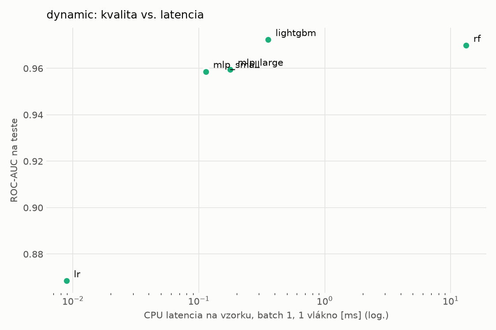
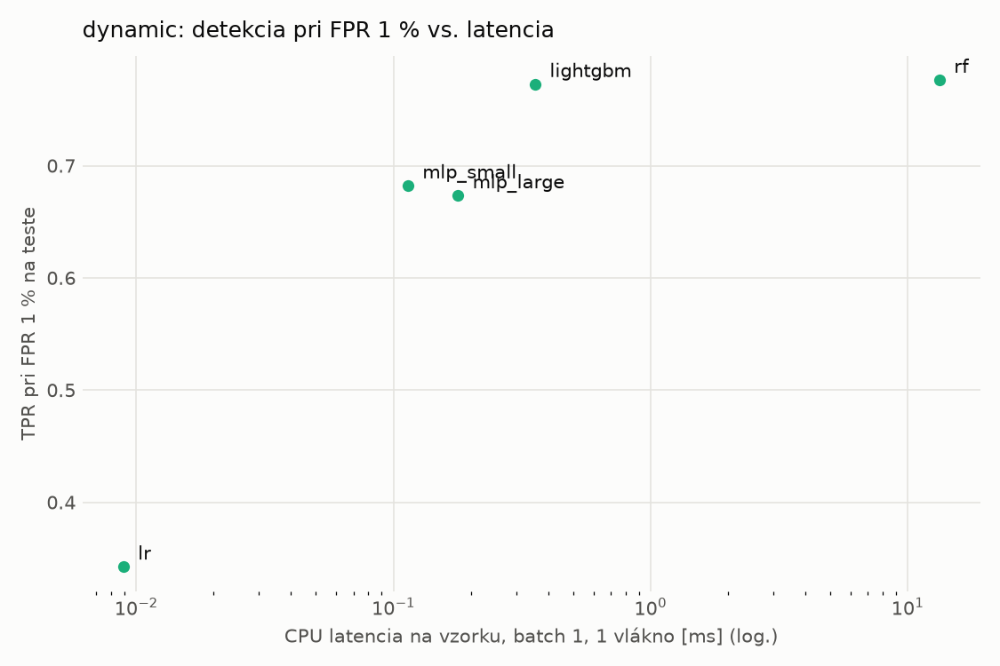
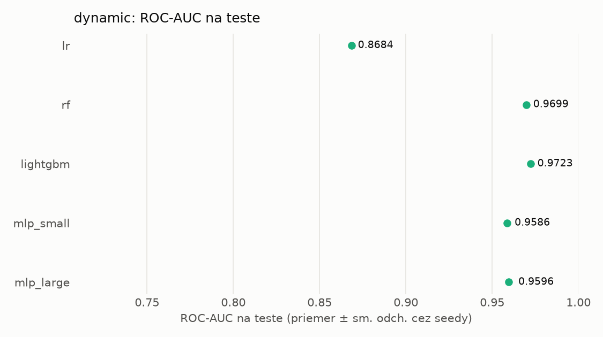
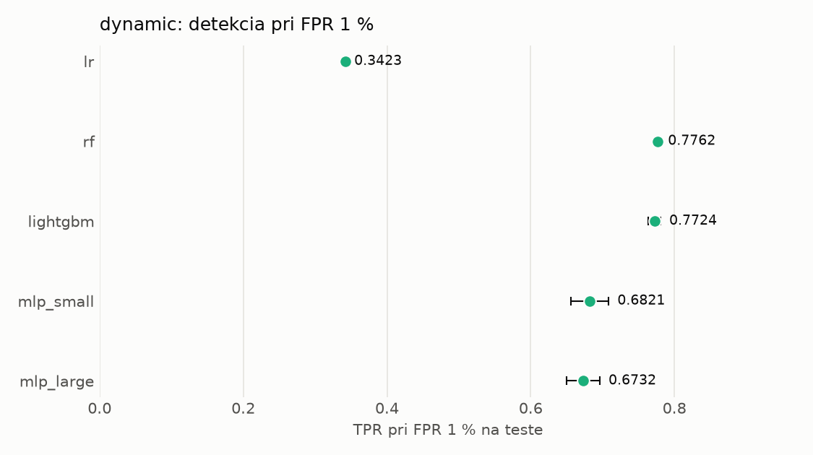

# Porovnanie modelov – dynamic

> Generované `src/evaluation/compare.py` (2026-11-23T21:33:10+01:00); použitý je posledný beh každého modelu.
> Metriky sú priemer cez seedy. \* = pri prahu určenom na validácii (FPR ≤ 1 %).
> CPU ms/vz. = medián latencie jednej vzorky na 1 vlákne vrátane transformácie vstupu (meranie hneď po tréningu,
> orientačné). Oficiálne merania spotreby sú v časti „Spotreba zdrojov pri inferencii“.

## Detekčná kvalita a orientačné časy
| model | ROC-AUC val | ROC-AUC test | TPR@FPR 1 % test | TPR@FPR 0,1 % test | F1 test* | FPR test* | gap train−val | CPU ms/vz. | CPU vz./s | GPU ms/vz. | parametre | MB | tréning s | ladenie min |
|---|---|---|---|---|---|---|---|---|---|---|---|---|---|---|
| [lr](../../dynamic/lr/20261123-212926/README.md) | 0.8777 | 0.8684 ± 0.0000 | 0.3423 | 0.1400 | 0.4826 | 0.0079 | -0.0049 | 0.009 | 4 562 365 | – | 124 | 0.01 | 0.4 | 0.0 |
| [rf](../../dynamic/rf/20261123-212929/README.md) | 0.9732 | 0.9699 ± 0.0002 | 0.7762 | 0.5597 | 0.8188 | 0.0064 | 0.0266 | 13.258 | 100 964 | – | 4 123 746 | 330.25 | 2.4 | 0.0 |
| [lightgbm](../../dynamic/lightgbm/20261123-212946/README.md) | 0.9786 | 0.9723 ± 0.0001 | 0.7724 | 0.6201 | 0.8593 | 0.0091 | 0.0214 | 0.355 | 34 083 | – | 931 309 | 51.83 | 31.1 | 0.0 |
| [mlp_small](../../dynamic/mlp_small/20261123-213151/README.md) | 0.9627 | 0.9586 ± 0.0006 | 0.6821 | 0.3369 | 0.8054 | 0.0097 | 0.0244 | 0.114 | 2 847 949 | 0.642 | 65 537 | 0.27 | 17.2 | 0.0 |
| [mlp_large](../../dynamic/mlp_large/20261123-213244/README.md) | 0.9655 | 0.9596 ± 0.0019 | 0.6732 | 0.4269 | 0.7937 | 0.0091 | 0.0239 | 0.178 | 426 253 | 0.434 | 786 945 | 3.17 | 7.7 | 0.0 |

## Nízka prevalencia malvéru (test, prah z validácie)
| model | TPR | FPR | precision @ 1 % | falošné na 1 skutočný poplach @ 1 % | precision @ 0.1 % | falošné na 1 skutočný poplach @ 0.1 % |
|---|---|---|---|---|---|---|
| lr | 0.3212 | 0.0079 | 0.292 | 2.43 | 0.039 | 24.50 |
| rf | 0.6990 | 0.0064 | 0.523 | 0.91 | 0.098 | 9.21 |
| lightgbm | 0.7618 | 0.0091 | 0.459 | 1.18 | 0.078 | 11.89 |
| mlp_small | 0.6825 | 0.0097 | 0.415 | 1.41 | 0.066 | 14.25 |
| mlp_large | 0.6658 | 0.0091 | 0.424 | 1.36 | 0.068 | 13.68 |

Prepočet: TPR a FPR nezávisia od podielu malvéru, preto sa dajú preniesť na nízku prevalenciu (v reálnej prevádzke je malvéru ~1 % alebo menej; v teste 54 %). „Falošné na 1 skutočný poplach“ = koľko neškodných súborov je označených na každý zachytený malvér.

## Spotreba zdrojov pri inferencii (benchmark, testovacia množina)
_Benchmark zatiaľ nebol spustený (`python -m src.evaluation.benchmark --approach dynamic`)._

## Grafy

