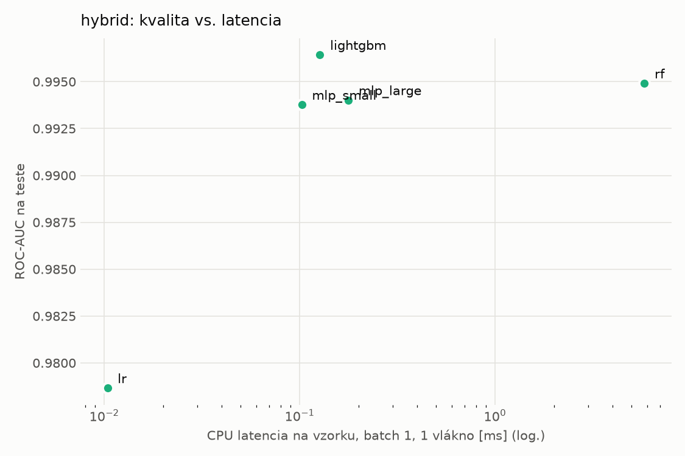
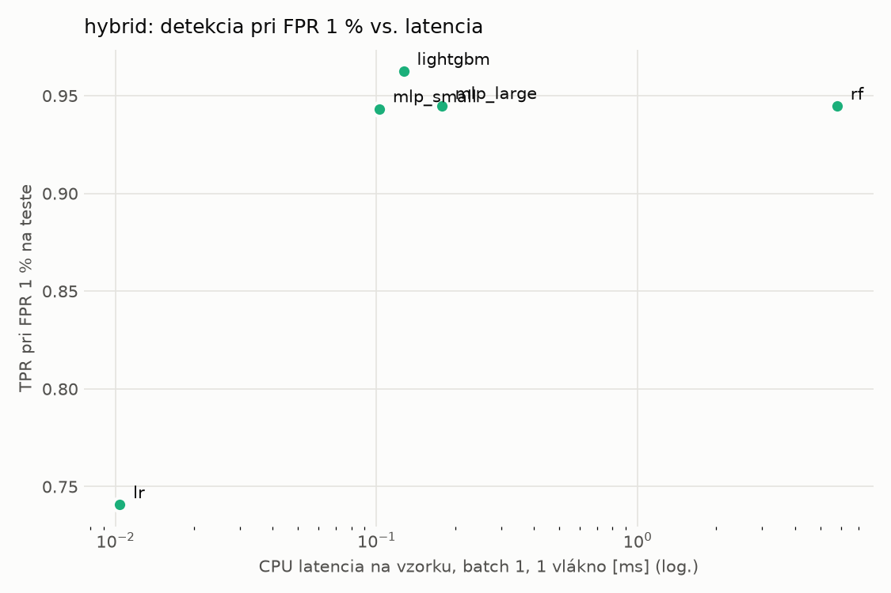
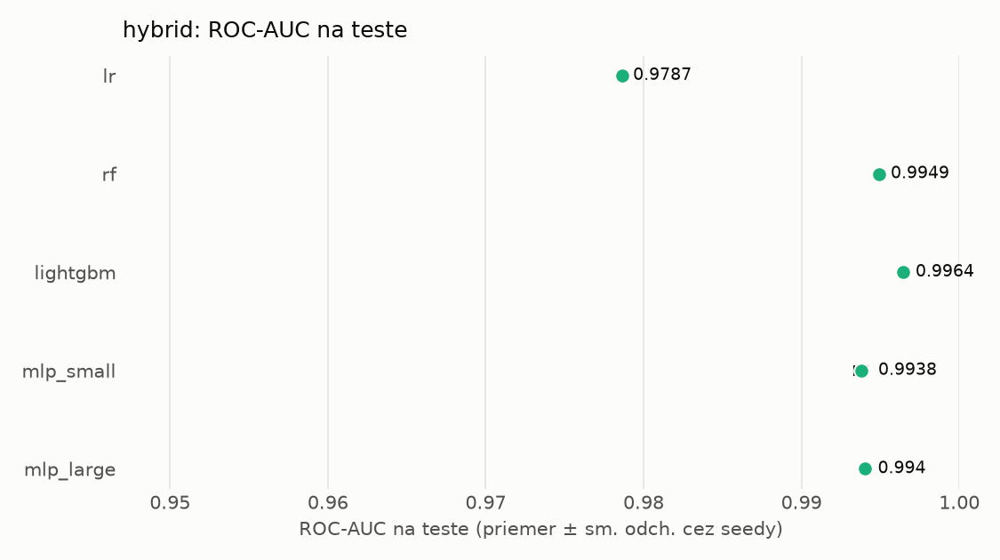
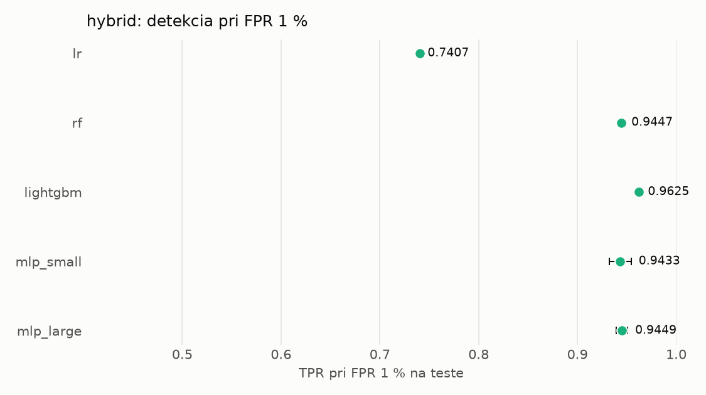

# Porovnanie modelov – hybrid

> Generované `src/evaluation/compare.py` (2026-11-23T21:35:02+01:00); použitý je posledný beh každého modelu.
> Metriky sú priemer cez seedy. \* = pri prahu určenom na validácii (FPR ≤ 1 %).
> CPU ms/vz. = medián latencie jednej vzorky na 1 vlákne vrátane transformácie vstupu (meranie hneď po tréningu,
> orientačné). Oficiálne merania spotreby sú v časti „Spotreba zdrojov pri inferencii“.

## Detekčná kvalita a orientačné časy
| model | ROC-AUC val | ROC-AUC test | TPR@FPR 1 % test | TPR@FPR 0,1 % test | F1 test* | FPR test* | gap train−val | CPU ms/vz. | CPU vz./s | GPU ms/vz. | parametre | MB | tréning s | ladenie min |
|---|---|---|---|---|---|---|---|---|---|---|---|---|---|---|
| [lr](../../hybrid/lr/20261123-213313/README.md) | 0.9763 | 0.9787 ± 0.0000 | 0.7407 | 0.3235 | 0.8330 | 0.0086 | 0.0042 | 0.010 | 2 379 037 | – | 287 | 0.01 | 0.4 | 0.0 |
| [rf](../../hybrid/rf/20261123-213316/README.md) | 0.9937 | 0.9949 ± 0.0001 | 0.9447 | 0.8434 | 0.9600 | 0.0066 | 0.0063 | 5.817 | 170 238 | – | 1 007 620 | 80.86 | 1.3 | 0.0 |
| [lightgbm](../../hybrid/lightgbm/20261123-213325/README.md) | 0.9955 | 0.9964 ± 0.0001 | 0.9625 | 0.8747 | 0.9718 | 0.0056 | 0.0045 | 0.127 | 114 602 | – | 318 542 | 17.79 | 14.2 | 0.0 |
| [mlp_small](../../hybrid/mlp_small/20261123-213417/README.md) | 0.9922 | 0.9938 ± 0.0004 | 0.9433 | 0.7522 | 0.9564 | 0.0068 | 0.0068 | 0.103 | 1 256 528 | 0.412 | 107 265 | 0.45 | 3.9 | 0.0 |
| [mlp_large](../../hybrid/mlp_large/20261123-213431/README.md) | 0.9929 | 0.9940 ± 0.0001 | 0.9449 | 0.7935 | 0.9568 | 0.0068 | 0.0059 | 0.178 | 736 748 | 0.716 | 323 521 | 1.32 | 9.7 | 0.0 |

## Nízka prevalencia malvéru (test, prah z validácie)
| model | TPR | FPR | precision @ 1 % | falošné na 1 skutočný poplach @ 1 % | precision @ 0.1 % | falošné na 1 skutočný poplach @ 0.1 % |
|---|---|---|---|---|---|---|
| lr | 0.7213 | 0.0086 | 0.459 | 1.18 | 0.078 | 11.90 |
| rf | 0.9307 | 0.0066 | 0.586 | 0.71 | 0.123 | 7.12 |
| lightgbm | 0.9518 | 0.0056 | 0.631 | 0.59 | 0.145 | 5.91 |
| mlp_small | 0.9241 | 0.0068 | 0.578 | 0.73 | 0.119 | 7.38 |
| mlp_large | 0.9250 | 0.0068 | 0.578 | 0.73 | 0.119 | 7.37 |

Prepočet: TPR a FPR nezávisia od podielu malvéru, preto sa dajú preniesť na nízku prevalenciu (v reálnej prevádzke je malvéru ~1 % alebo menej; v teste 54 %). „Falošné na 1 skutočný poplach“ = koľko neškodných súborov je označených na každý zachytený malvér.

## Spotreba zdrojov pri inferencii (benchmark, testovacia množina)
_Benchmark zatiaľ nebol spustený (`python -m src.evaluation.benchmark --approach hybrid`)._

## Grafy

