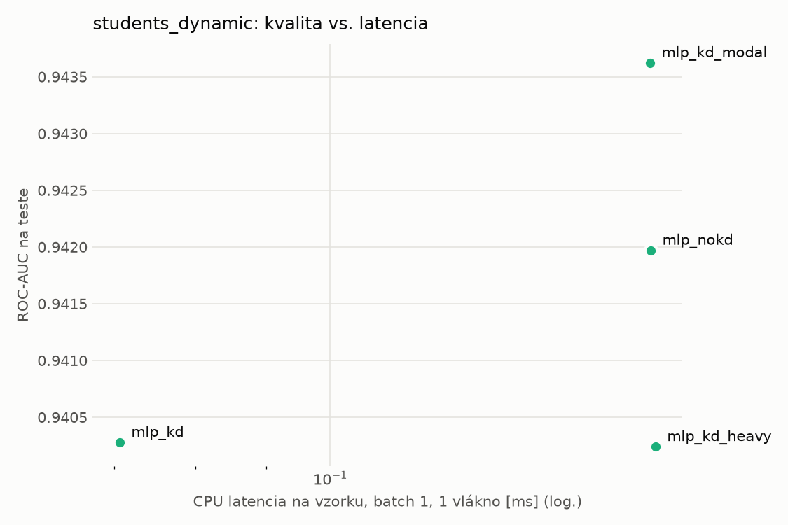
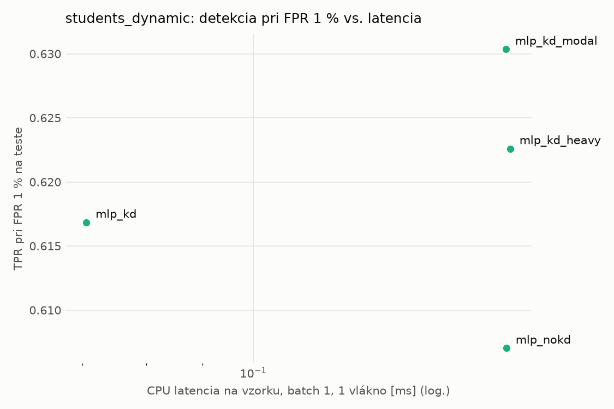
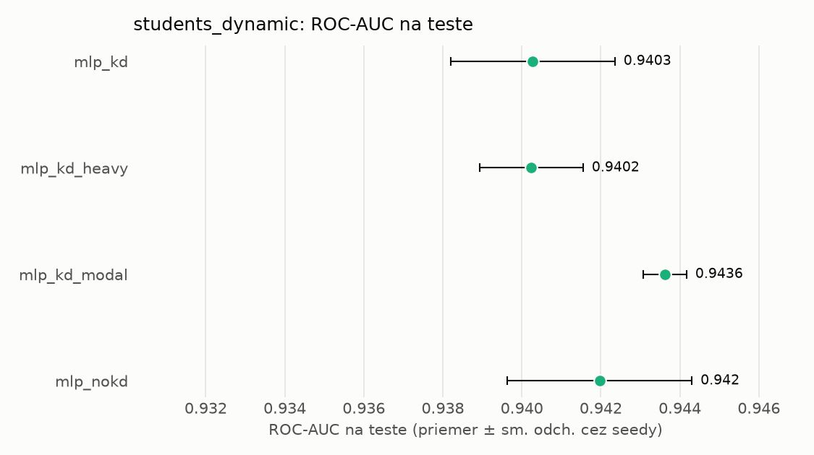
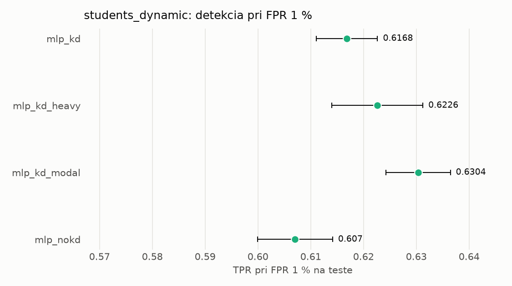

# Porovnanie modelov – students_dynamic

> Generované `src/evaluation/compare.py` (2026-11-23T21:43:05+01:00); použitý je posledný beh každého modelu.
> Metriky sú priemer cez seedy. \* = pri prahu určenom na validácii (FPR ≤ 1 %).
> CPU ms/vz. = medián latencie jednej vzorky na 1 vlákne vrátane transformácie vstupu (meranie hneď po tréningu,
> orientačné). Oficiálne merania spotreby sú v časti „Spotreba zdrojov pri inferencii“.

## Detekčná kvalita a orientačné časy
| model | ROC-AUC val | ROC-AUC test | TPR@FPR 1 % test | TPR@FPR 0,1 % test | F1 test* | FPR test* | gap train−val | CPU ms/vz. | CPU vz./s | GPU ms/vz. | parametre | MB | tréning s | ladenie min |
|---|---|---|---|---|---|---|---|---|---|---|---|---|---|---|
| [mlp_kd](../../students_dynamic/mlp_kd/20261123-214125/README.md) | 0.9444 | 0.9403 ± 0.0021 | 0.6168 | 0.3306 | 0.7445 | 0.0081 | 0.0067 | 0.071 | 7 194 997 | 0.264 | 8 129 | 0.04 | 6.3 | 0.0 |
| [mlp_kd_heavy](../../students_dynamic/mlp_kd_heavy/20261123-214248/README.md) | 0.9451 | 0.9402 ± 0.0013 | 0.6226 | 0.2465 | 0.7438 | 0.0081 | 0.0069 | 0.171 | 5 807 902 | 0.301 | 8 129 | 0.04 | 5.2 | 0.0 |
| [mlp_kd_modal](../../students_dynamic/mlp_kd_modal/20261123-214228/README.md) | 0.9478 | 0.9436 ± 0.0005 | 0.6304 | 0.3054 | 0.7576 | 0.0087 | 0.0065 | 0.170 | 5 872 854 | 0.469 | 8 129 | 0.04 | 6.2 | 0.0 |
| [mlp_nokd](../../students_dynamic/mlp_nokd/20261123-214146/README.md) | 0.9464 | 0.9420 ± 0.0023 | 0.6070 | 0.2471 | 0.7447 | 0.0091 | 0.0106 | 0.170 | 5 812 170 | 0.466 | 8 129 | 0.04 | 13.3 | 0.0 |

## Nízka prevalencia malvéru (test, prah z validácie)
| model | TPR | FPR | precision @ 1 % | falošné na 1 skutočný poplach @ 1 % | precision @ 0.1 % | falošné na 1 skutočný poplach @ 0.1 % |
|---|---|---|---|---|---|---|
| mlp_kd | 0.5989 | 0.0081 | 0.429 | 1.33 | 0.069 | 13.46 |
| mlp_kd_heavy | 0.5980 | 0.0081 | 0.427 | 1.34 | 0.069 | 13.56 |
| mlp_kd_modal | 0.6163 | 0.0087 | 0.416 | 1.40 | 0.066 | 14.16 |
| mlp_nokd | 0.6000 | 0.0091 | 0.399 | 1.50 | 0.062 | 15.18 |

Prepočet: TPR a FPR nezávisia od podielu malvéru, preto sa dajú preniesť na nízku prevalenciu (v reálnej prevádzke je malvéru ~1 % alebo menej; v teste 54 %). „Falošné na 1 skutočný poplach“ = koľko neškodných súborov je označených na každý zachytený malvér.

## Spotreba zdrojov pri inferencii (benchmark, testovacia množina)
_Benchmark zatiaľ nebol spustený (`python -m src.evaluation.benchmark --approach students_dynamic`)._

## Grafy

