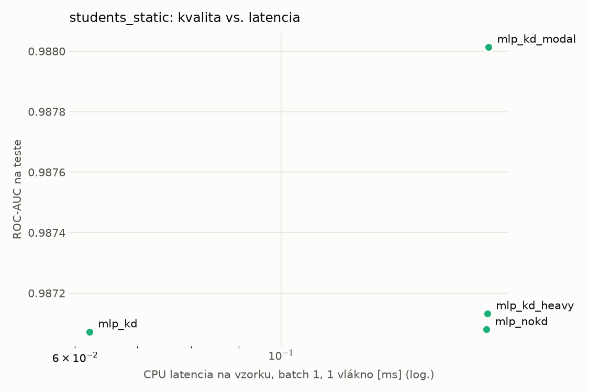
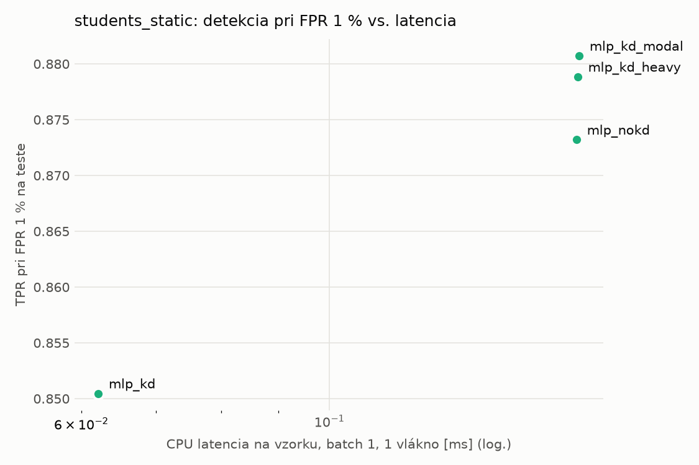
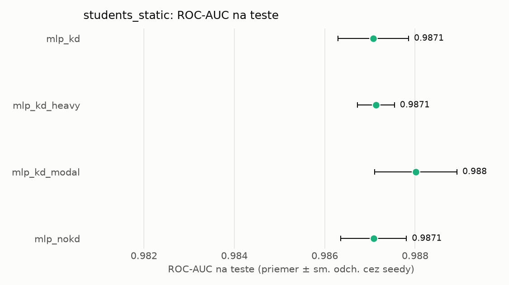
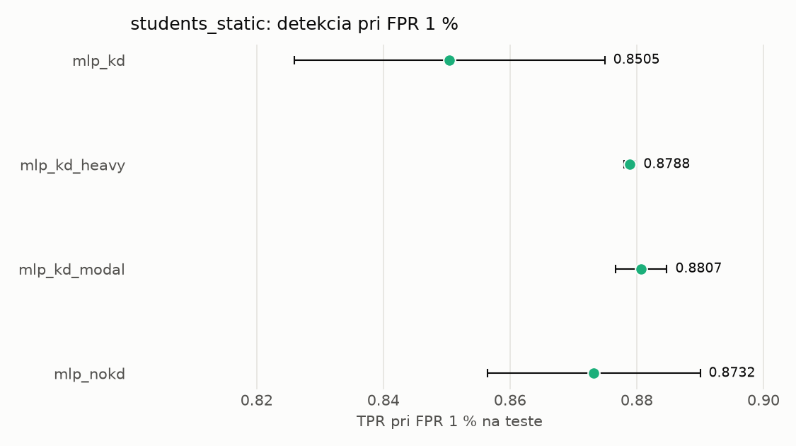

# Porovnanie modelov – students_static

> Generované `src/evaluation/compare.py` (2026-11-23T21:41:22+01:00); použitý je posledný beh každého modelu.
> Metriky sú priemer cez seedy. \* = pri prahu určenom na validácii (FPR ≤ 1 %).
> CPU ms/vz. = medián latencie jednej vzorky na 1 vlákne vrátane transformácie vstupu (meranie hneď po tréningu,
> orientačné). Oficiálne merania spotreby sú v časti „Spotreba zdrojov pri inferencii“.

## Detekčná kvalita a orientačné časy
| model | ROC-AUC val | ROC-AUC test | TPR@FPR 1 % test | TPR@FPR 0,1 % test | F1 test* | FPR test* | gap train−val | CPU ms/vz. | CPU vz./s | GPU ms/vz. | parametre | MB | tréning s | ladenie min |
|---|---|---|---|---|---|---|---|---|---|---|---|---|---|---|
| [mlp_kd](../../students_static/mlp_kd/20261123-214009/README.md) | 0.9862 | 0.9871 ± 0.0008 | 0.8505 | 0.5524 | 0.8797 | 0.0062 | 0.0051 | 0.062 | 4 024 165 | 0.264 | 10 689 | 0.05 | 4.4 | 0.0 |
| [mlp_kd_heavy](../../students_static/mlp_kd_heavy/20261123-214110/README.md) | 0.9846 | 0.9871 ± 0.0004 | 0.8788 | 0.6171 | 0.8943 | 0.0063 | 0.0056 | 0.167 | 5 379 580 | 0.477 | 10 689 | 0.05 | 3.5 | 0.0 |
| [mlp_kd_modal](../../students_static/mlp_kd_modal/20261123-214047/README.md) | 0.9864 | 0.9880 ± 0.0009 | 0.8807 | 0.5804 | 0.9131 | 0.0074 | 0.0046 | 0.167 | 3 967 522 | 0.442 | 10 689 | 0.05 | 7.1 | 0.0 |
| [mlp_nokd](../../students_static/mlp_nokd/20261123-214024/README.md) | 0.9860 | 0.9871 ± 0.0007 | 0.8732 | 0.5110 | 0.9024 | 0.0075 | 0.0072 | 0.166 | 6 890 244 | 0.275 | 10 689 | 0.05 | 7.1 | 0.0 |

## Nízka prevalencia malvéru (test, prah z validácie)
| model | TPR | FPR | precision @ 1 % | falošné na 1 skutočný poplach @ 1 % | precision @ 0.1 % | falošné na 1 skutočný poplach @ 0.1 % |
|---|---|---|---|---|---|---|
| mlp_kd | 0.7916 | 0.0062 | 0.565 | 0.77 | 0.114 | 7.77 |
| mlp_kd_heavy | 0.8153 | 0.0063 | 0.568 | 0.76 | 0.115 | 7.66 |
| mlp_kd_modal | 0.8477 | 0.0074 | 0.536 | 0.86 | 0.103 | 8.72 |
| mlp_nokd | 0.8299 | 0.0075 | 0.528 | 0.89 | 0.100 | 9.02 |

Prepočet: TPR a FPR nezávisia od podielu malvéru, preto sa dajú preniesť na nízku prevalenciu (v reálnej prevádzke je malvéru ~1 % alebo menej; v teste 54 %). „Falošné na 1 skutočný poplach“ = koľko neškodných súborov je označených na každý zachytený malvér.

## Spotreba zdrojov pri inferencii (benchmark, testovacia množina)
_Benchmark zatiaľ nebol spustený (`python -m src.evaluation.benchmark --approach students_static`)._

## Grafy

