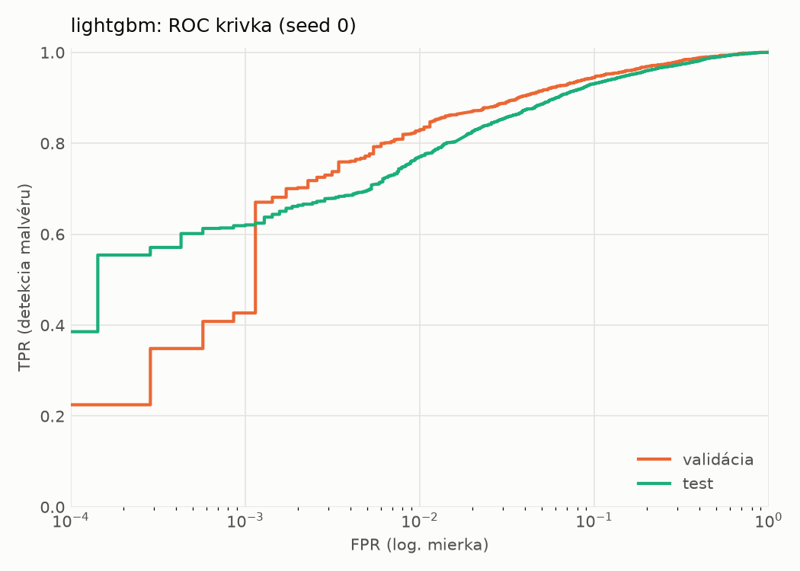
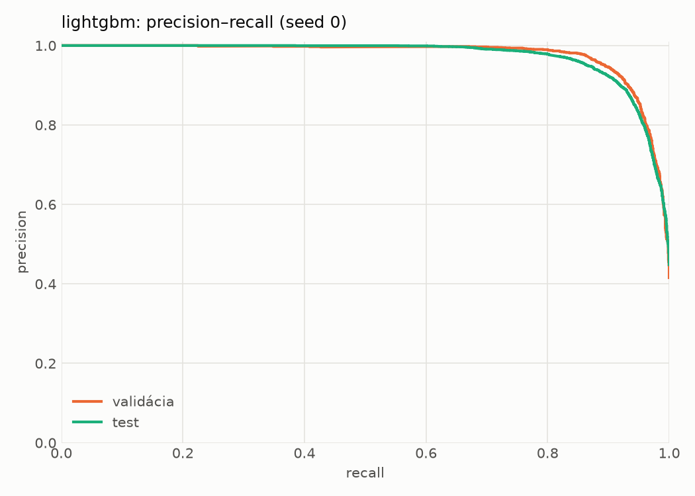
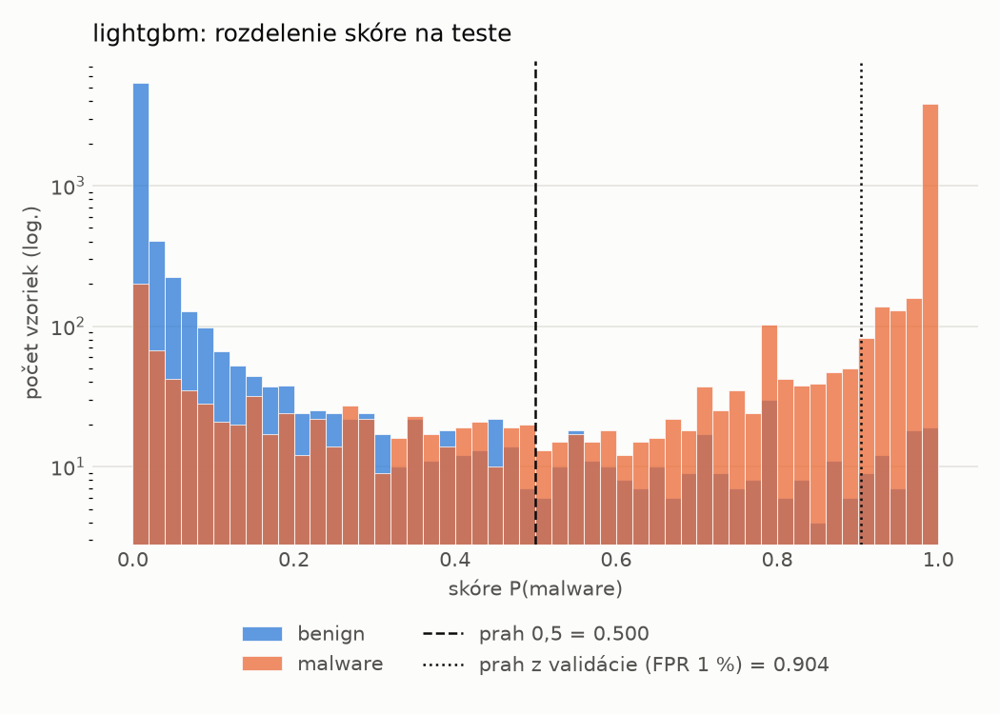
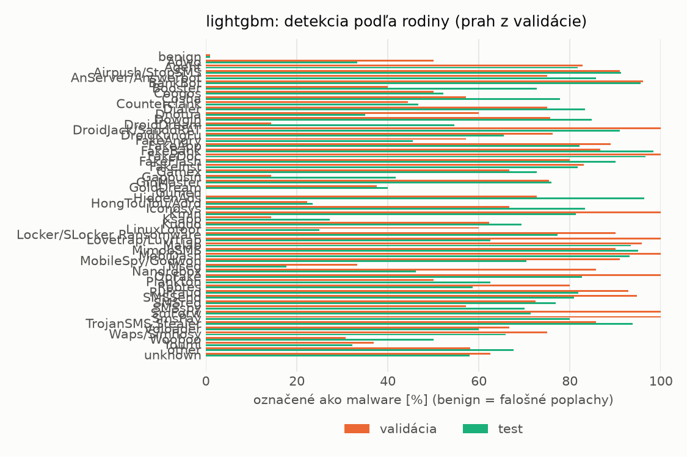
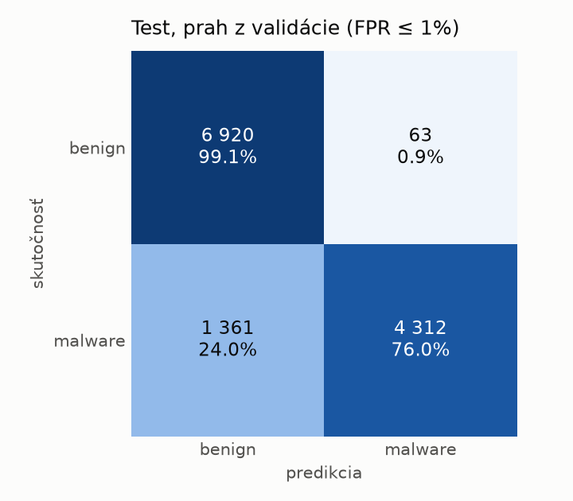
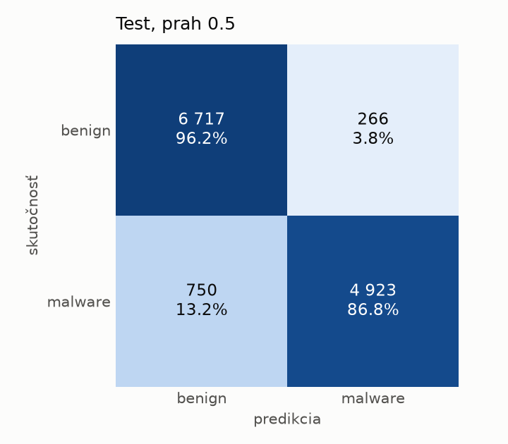
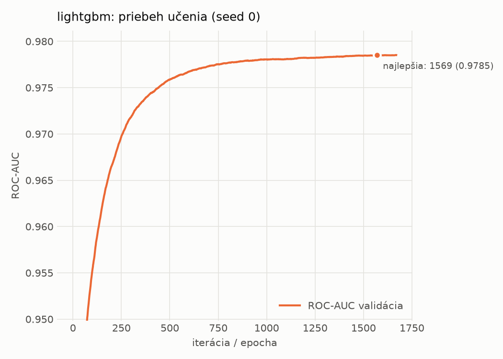

# dynamic/lightgbm – beh `20261123-212946`

> Automaticky generované (`src/training/run_tabular.py`). Konfigurácia: `config.yaml`, protokol: `protocol.yaml`.

- **Model:** `lightgbm` – LightGBM, gradient boosting stromov s early stopping na validácii (pôvodné hodnoty príznakov)
- **Ladenie:** bez ladenia – hyperparametre prevzaté z `runs_v4/emu_p/full/dynamic/lightgbm/20261123-191933`
- **Finálne modely:** seedy [0, 1, 2]; hodnoty sú priemer ± smerodajná odchýlka cez seedy
- **Najlepšie hyperparametre:** `{"num_boost_round": 5000, "early_stopping_rounds": 100, "learning_rate": 0.020757076290036595, "num_leaves": 469, "min_child_samples": 116, "feature_fraction": 0.9578728497385997, "bagging_fraction": 0.9870779948179744, "lambda_l1": 0.002495609179699052, "lambda_l2": 0.0024900497451761272}`

## Detekčná kvalita (bez prahu)
| metrika | train (podvzorka) | validácia | test |
|---|---|---|---|
| ROC-AUC | 1.0000 ± 0.0000 | 0.9786 ± 0.0001 | 0.9723 ± 0.0001 |
| PR-AUC | 0.9999 ± 0.0000 | 0.9765 ± 0.0001 | 0.9730 ± 0.0001 |
| TPR pri FPR 1 % | 1.0000 ± 0.0000 | 0.8304 ± 0.0049 | 0.7724 ± 0.0083 |
| TPR pri FPR 0,1 % | 0.9830 ± 0.0010 | 0.4277 ± 0.0178 | 0.6201 ± 0.0033 |
| log loss | 0.0118 ± 0.0014 | 0.2003 ± 0.0051 | 0.2477 ± 0.0090 |
| Brier skóre | 0.0026 ± 0.0002 | 0.0498 ± 0.0001 | 0.0626 ± 0.0010 |

Rozdiel ROC-AUC train − validácia: **0.0214** (veľký rozdiel = preučenie).

## Pri prahu z validácie (FPR ≤ 1% na validácii)
| metrika | train (podvzorka) | validácia | test |
|---|---|---|---|
| accuracy | 0.9896 ± 0.0008 | 0.9239 ± 0.0020 | 0.8882 ± 0.0010 |
| balanced accuracy | 0.9873 ± 0.0010 | 0.9104 ± 0.0024 | 0.8764 ± 0.0011 |
| precision | 1.0000 ± 0.0000 | 0.9839 ± 0.0002 | 0.9856 ± 0.0007 |
| recall (TPR) | 0.9745 ± 0.0019 | 0.8304 ± 0.0049 | 0.7618 ± 0.0027 |
| FPR | 0.0000 ± 0.0000 | 0.0096 ± 0.0002 | 0.0091 ± 0.0005 |
| F1 | 0.9871 ± 0.0010 | 0.9007 ± 0.0029 | 0.8593 ± 0.0014 |
| MCC | 0.9787 ± 0.0016 | 0.8476 ± 0.0038 | 0.7867 ± 0.0016 |

## Pri pevnom prahu 0.5
| metrika | train (podvzorka) | validácia | test |
|---|---|---|---|
| accuracy | 0.9968 ± 0.0001 | 0.9376 ± 0.0011 | 0.9202 ± 0.0014 |
| balanced accuracy | 0.9970 ± 0.0001 | 0.9332 ± 0.0012 | 0.9153 ± 0.0015 |
| precision | 0.9936 ± 0.0000 | 0.9408 ± 0.0007 | 0.9497 ± 0.0010 |
| recall (TPR) | 0.9984 ± 0.0001 | 0.9069 ± 0.0020 | 0.8679 ± 0.0026 |
| FPR | 0.0044 ± 0.0000 | 0.0406 ± 0.0004 | 0.0373 ± 0.0007 |
| F1 | 0.9960 ± 0.0001 | 0.9235 ± 0.0014 | 0.9069 ± 0.0017 |
| MCC | 0.9933 ± 0.0001 | 0.8713 ± 0.0022 | 0.8399 ± 0.0027 |

## Výpočtové nároky (seed 0, testovacia množina)
| meranie | hodnota |
|---|---|
| tréning finálneho modelu | 31.1 s (priemer cez seedy) |
| ladenie spolu | 0 s |
| počet parametrov / uzlov | 931 309 |
| veľkosť modelu na disku | 51.83 MB |
| CPU latencia modelu (batch 1, 1 vlákno) | 0.355 ms (p95 0.431) |
| CPU priepustnosť (24 vlákien) | 34 083 vzoriek/s |

## Grafy
| | |
|---|---|
|  |  |
|  |  |
|  |  |
|  |  |

## Súbory
`metrics.json` (všetky metriky po seedoch vrátane rodín), `timing.json`, `hpo_trials.csv`,
`predictions/<časť>_seed<N>.parquet` (sha256, family, label, score), `model/seed_<N>/`, `log.txt`.
