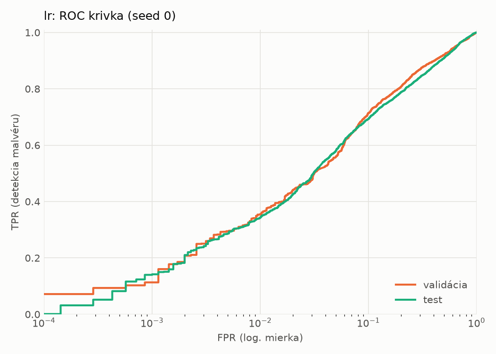
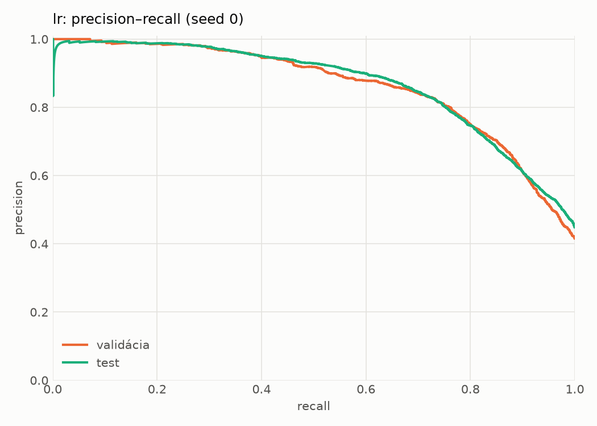
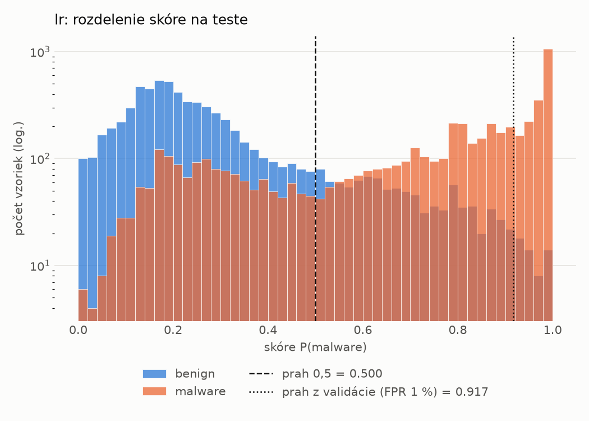
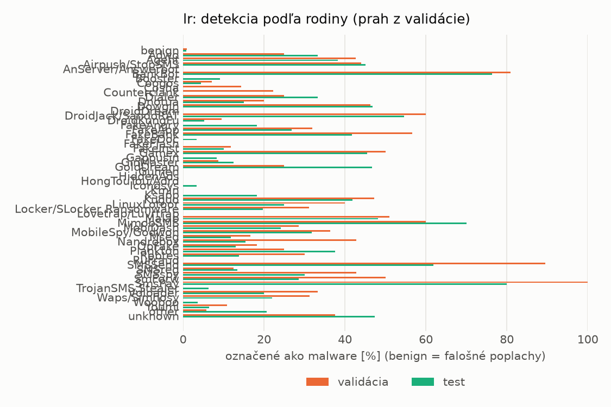
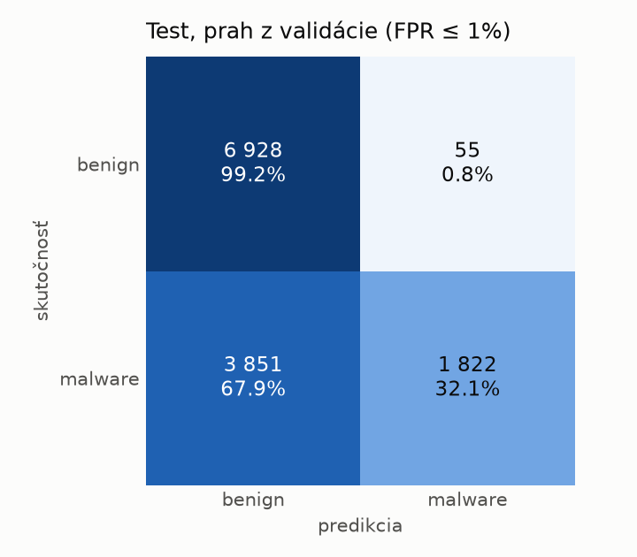
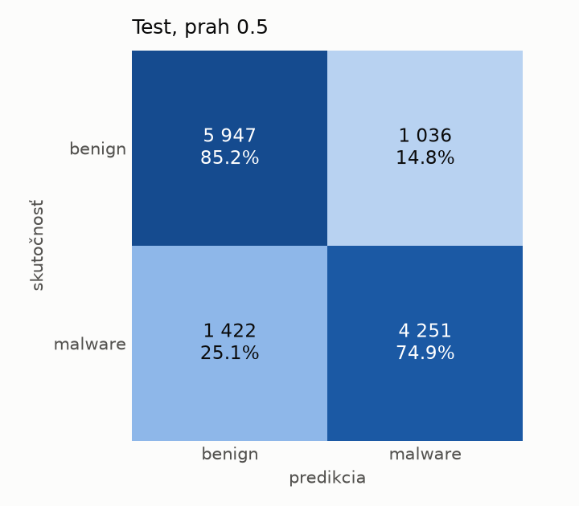

# dynamic/lr – beh `20261123-212926`

> Automaticky generované (`src/training/run_tabular.py`). Konfigurácia: `config.yaml`, protokol: `protocol.yaml`.

- **Model:** `logreg` – logistická regresia s L2 regularizáciou (vstup signed log1p + štandardizácia)
- **Ladenie:** bez ladenia – hyperparametre prevzaté z `runs_v4/emu_p/full/dynamic/lr/20261123-191800`
- **Finálne modely:** seedy [0, 1, 2]; hodnoty sú priemer ± smerodajná odchýlka cez seedy
- **Najlepšie hyperparametre:** `{"max_iter": 2000, "C": 7.504621081078761}`

## Detekčná kvalita (bez prahu)
| metrika | train (podvzorka) | validácia | test |
|---|---|---|---|
| ROC-AUC | 0.8728 ± 0.0000 | 0.8777 ± 0.0000 | 0.8684 ± 0.0000 |
| PR-AUC | 0.8582 ± 0.0000 | 0.8632 ± 0.0000 | 0.8676 ± 0.0000 |
| TPR pri FPR 1 % | 0.3791 ± 0.0000 | 0.3537 ± 0.0000 | 0.3423 ± 0.0000 |
| TPR pri FPR 0,1 % | 0.1359 ± 0.0000 | 0.1132 ± 0.0000 | 0.1400 ± 0.0000 |
| log loss | 0.4306 ± 0.0000 | 0.4299 ± 0.0000 | 0.4408 ± 0.0000 |
| Brier skóre | 0.1365 ± 0.0000 | 0.1355 ± 0.0000 | 0.1409 ± 0.0000 |

Rozdiel ROC-AUC train − validácia: **-0.0049** (veľký rozdiel = preučenie).

## Pri prahu z validácie (FPR ≤ 1% na validácii)
| metrika | train (podvzorka) | validácia | test |
|---|---|---|---|
| accuracy | 0.7328 ± 0.0000 | 0.7258 ± 0.0000 | 0.6914 ± 0.0000 |
| balanced accuracy | 0.6734 ± 0.0000 | 0.6721 ± 0.0000 | 0.6566 ± 0.0000 |
| precision | 0.9685 ± 0.0000 | 0.9638 ± 0.0000 | 0.9707 ± 0.0000 |
| recall (TPR) | 0.3547 ± 0.0000 | 0.3537 ± 0.0000 | 0.3212 ± 0.0000 |
| FPR | 0.0079 ± 0.0000 | 0.0095 ± 0.0000 | 0.0079 ± 0.0000 |
| F1 | 0.5193 ± 0.0000 | 0.5175 ± 0.0000 | 0.4826 ± 0.0000 |
| MCC | 0.4784 ± 0.0000 | 0.4719 ± 0.0000 | 0.4384 ± 0.0000 |

## Pri pevnom prahu 0.5
| metrika | train (podvzorka) | validácia | test |
|---|---|---|---|
| accuracy | 0.8148 ± 0.0000 | 0.8171 ± 0.0000 | 0.8058 ± 0.0000 |
| balanced accuracy | 0.8062 ± 0.0000 | 0.8105 ± 0.0000 | 0.8005 ± 0.0000 |
| precision | 0.7794 ± 0.0000 | 0.7851 ± 0.0000 | 0.8040 ± 0.0000 |
| recall (TPR) | 0.7598 ± 0.0000 | 0.7712 ± 0.0000 | 0.7493 ± 0.0000 |
| FPR | 0.1475 ± 0.0000 | 0.1502 ± 0.0000 | 0.1484 ± 0.0000 |
| F1 | 0.7695 ± 0.0000 | 0.7780 ± 0.0000 | 0.7757 ± 0.0000 |
| MCC | 0.6149 ± 0.0000 | 0.6226 ± 0.0000 | 0.6060 ± 0.0000 |

## Výpočtové nároky (seed 0, testovacia množina)
| meranie | hodnota |
|---|---|
| tréning finálneho modelu | 0.4 s (priemer cez seedy) |
| ladenie spolu | 0 s |
| počet parametrov / uzlov | 124 |
| veľkosť modelu na disku | 0.01 MB |
| transformácia vstupu – latencia (1 vlákno) | 0.005 ms |
| transformácia vstupu – priepustnosť | 1 375 159 vzoriek/s |
| CPU latencia modelu (batch 1, 1 vlákno) | 0.004 ms (p95 0.004) |
| CPU priepustnosť (24 vlákien) | 4 562 365 vzoriek/s |

## Grafy
| | |
|---|---|
|  |  |
|  |  |
|  |  |
|  |  |

## Súbory
`metrics.json` (všetky metriky po seedoch vrátane rodín), `timing.json`, `hpo_trials.csv`,
`predictions/<časť>_seed<N>.parquet` (sha256, family, label, score), `model/seed_<N>/`, `log.txt`.
