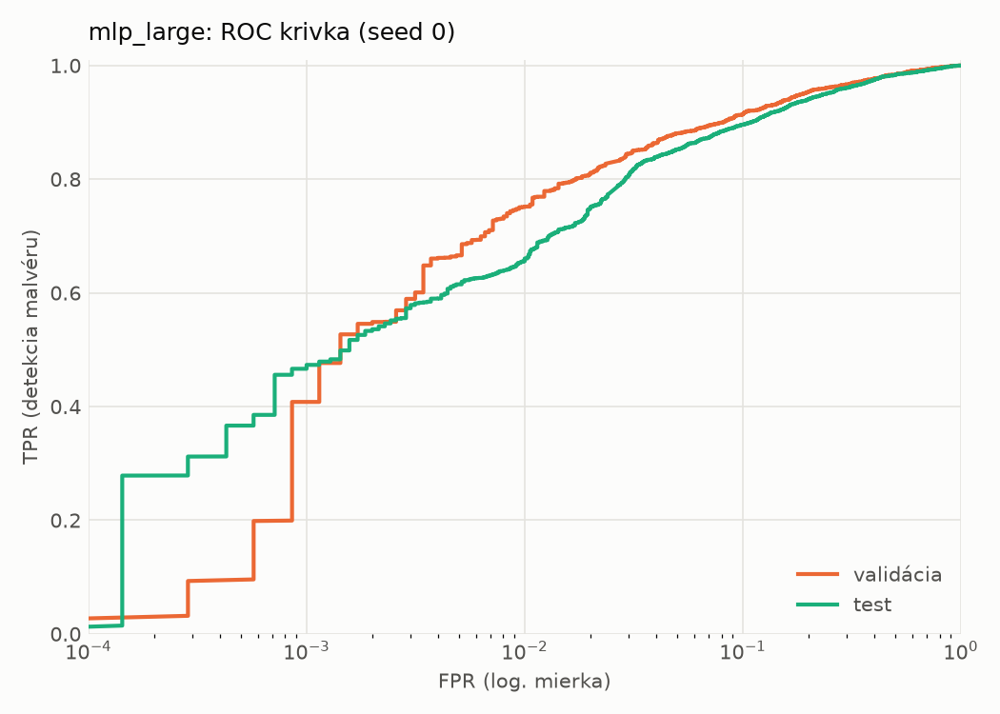
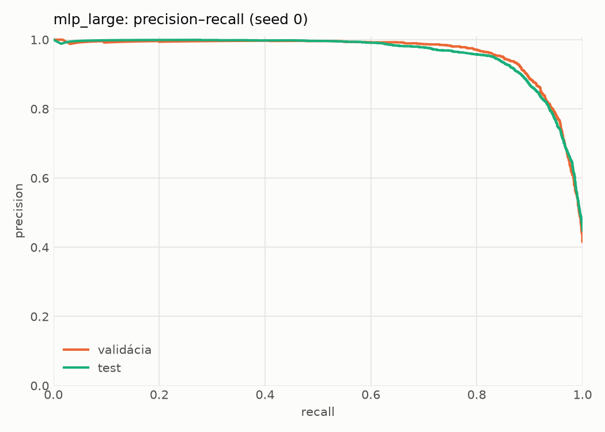
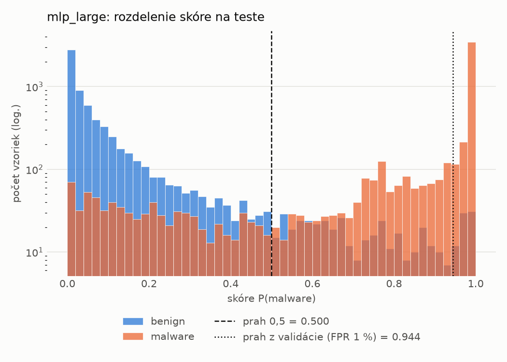
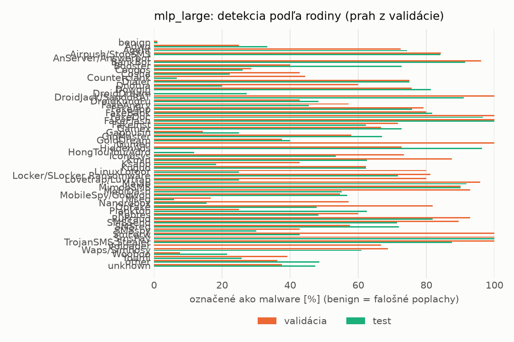
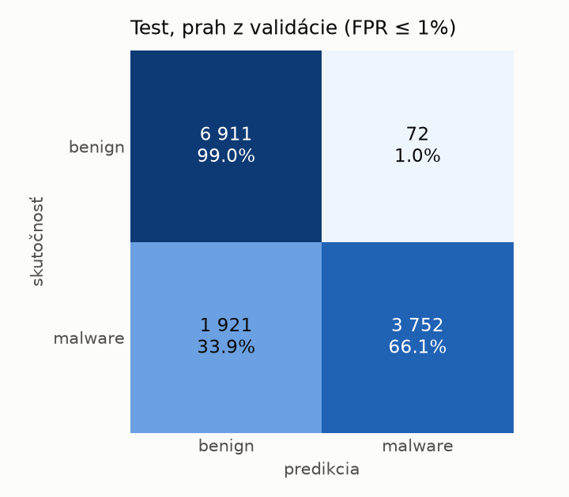
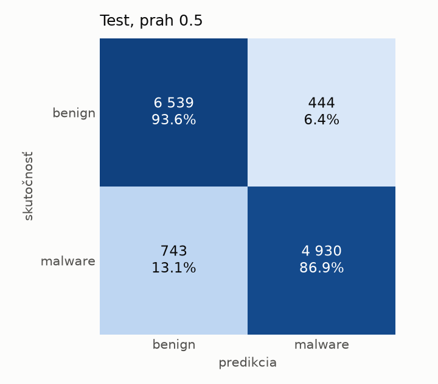
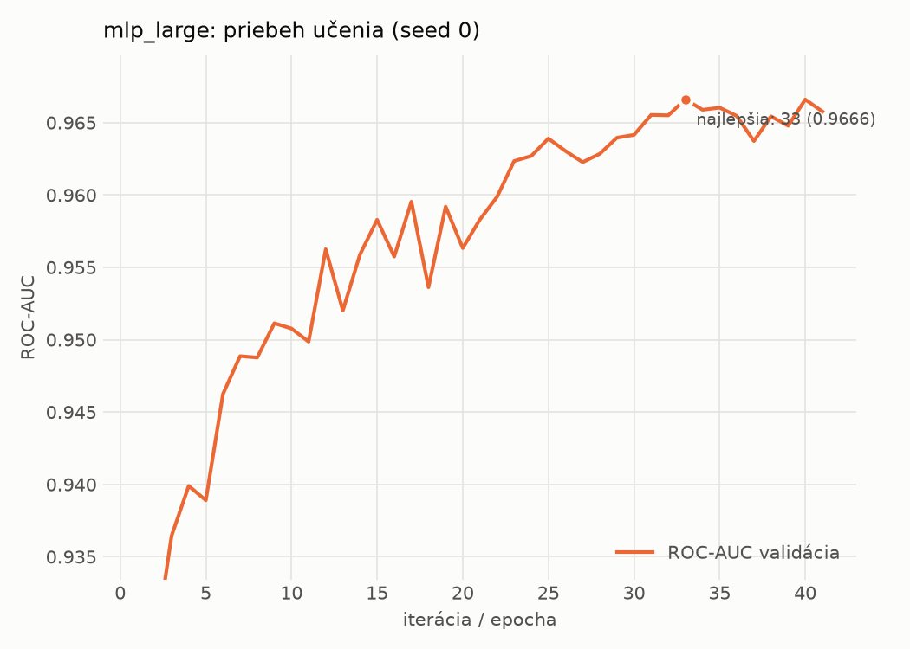

# dynamic/mlp_large – beh `20261123-213244`

> Automaticky generované (`src/training/run_tabular.py`). Konfigurácia: `config.yaml`, protokol: `protocol.yaml`.

- **Model:** `mlp` – veľká neurónová sieť (3–5 skrytých vrstiev, 512–2048 neurónov), kandidát na učiteľa
- **Ladenie:** bez ladenia – hyperparametre prevzaté z `runs_v4/emu_p/full/dynamic/mlp_large/20261123-194626`
- **Finálne modely:** seedy [0, 1, 2]; hodnoty sú priemer ± smerodajná odchýlka cez seedy
- **Najlepšie hyperparametre:** `{"max_epochs": 100, "patience": 8, "hidden_layers": 3, "hidden_width": 1024, "width_decay": 0.5, "dropout": 0.11628417924821868, "lr": 0.0004582958225587737, "weight_decay": 0.0007705605519981878, "batch_size": 512}`

## Detekčná kvalita (bez prahu)
| metrika | train (podvzorka) | validácia | test |
|---|---|---|---|
| ROC-AUC | 0.9895 ± 0.0018 | 0.9655 ± 0.0013 | 0.9596 ± 0.0019 |
| PR-AUC | 0.9876 ± 0.0020 | 0.9618 ± 0.0013 | 0.9591 ± 0.0022 |
| TPR pri FPR 1 % | 0.8917 ± 0.0109 | 0.7519 ± 0.0123 | 0.6732 ± 0.0231 |
| TPR pri FPR 0,1 % | 0.8169 ± 0.0179 | 0.3821 ± 0.0721 | 0.4269 ± 0.0379 |
| log loss | 0.1239 ± 0.0105 | 0.2380 ± 0.0078 | 0.2593 ± 0.0111 |
| Brier skóre | 0.0349 ± 0.0033 | 0.0645 ± 0.0019 | 0.0734 ± 0.0031 |

Rozdiel ROC-AUC train − validácia: **0.0239** (veľký rozdiel = preučenie).

## Pri prahu z validácie (FPR ≤ 1% na validácii)
| metrika | train (podvzorka) | validácia | test |
|---|---|---|---|
| accuracy | 0.9096 ± 0.0025 | 0.8912 ± 0.0051 | 0.8452 ± 0.0135 |
| balanced accuracy | 0.8890 ± 0.0032 | 0.8711 ± 0.0062 | 0.8283 ± 0.0152 |
| precision | 0.9991 ± 0.0005 | 0.9821 ± 0.0003 | 0.9835 ± 0.0026 |
| recall (TPR) | 0.7784 ± 0.0066 | 0.7519 ± 0.0123 | 0.6658 ± 0.0315 |
| FPR | 0.0005 ± 0.0003 | 0.0097 ± 0.0000 | 0.0091 ± 0.0017 |
| F1 | 0.8750 ± 0.0040 | 0.8517 ± 0.0080 | 0.7937 ± 0.0219 |
| MCC | 0.8213 ± 0.0047 | 0.7853 ± 0.0097 | 0.7104 ± 0.0231 |

## Pri pevnom prahu 0.5
| metrika | train (podvzorka) | validácia | test |
|---|---|---|---|
| accuracy | 0.9561 ± 0.0043 | 0.9148 ± 0.0041 | 0.9020 ± 0.0064 |
| balanced accuracy | 0.9527 ± 0.0039 | 0.9120 ± 0.0035 | 0.8986 ± 0.0073 |
| precision | 0.9568 ± 0.0093 | 0.8991 ± 0.0097 | 0.9116 ± 0.0058 |
| recall (TPR) | 0.9344 ± 0.0037 | 0.8956 ± 0.0043 | 0.8655 ± 0.0168 |
| FPR | 0.0290 ± 0.0066 | 0.0716 ± 0.0079 | 0.0683 ± 0.0056 |
| F1 | 0.9455 ± 0.0051 | 0.8974 ± 0.0044 | 0.8879 ± 0.0084 |
| MCC | 0.9090 ± 0.0089 | 0.8246 ± 0.0081 | 0.8020 ± 0.0128 |

## Výpočtové nároky (seed 0, testovacia množina)
| meranie | hodnota |
|---|---|
| tréning finálneho modelu | 7.7 s (priemer cez seedy) |
| ladenie spolu | 0 s |
| počet parametrov / uzlov | 786 945 |
| veľkosť modelu na disku | 3.17 MB |
| transformácia vstupu – latencia (1 vlákno) | 0.015 ms |
| transformácia vstupu – priepustnosť | 768 143 vzoriek/s |
| CPU latencia modelu (batch 1, 1 vlákno) | 0.163 ms (p95 0.380) |
| CPU priepustnosť (24 vlákien) | 426 253 vzoriek/s |
| GPU latencia (batch 1) | 0.434 ms (p95 0.953) |
| GPU priepustnosť | 1 494 780 vzoriek/s |
| GPU špičková pamäť | 146 MB |

## Grafy
| | |
|---|---|
|  |  |
|  |  |
|  |  |
|  |  |

## Súbory
`metrics.json` (všetky metriky po seedoch vrátane rodín), `timing.json`, `hpo_trials.csv`,
`predictions/<časť>_seed<N>.parquet` (sha256, family, label, score), `model/seed_<N>/`, `log.txt`.
