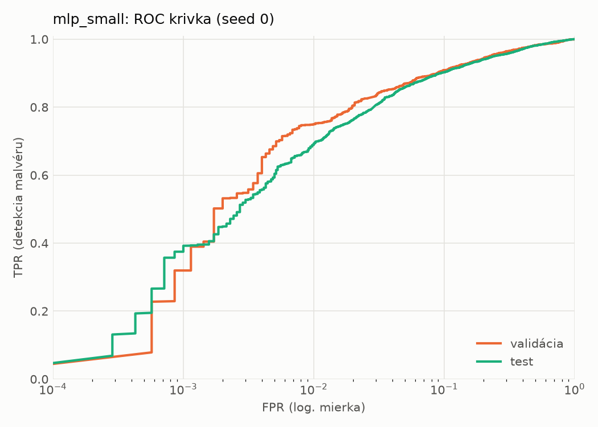
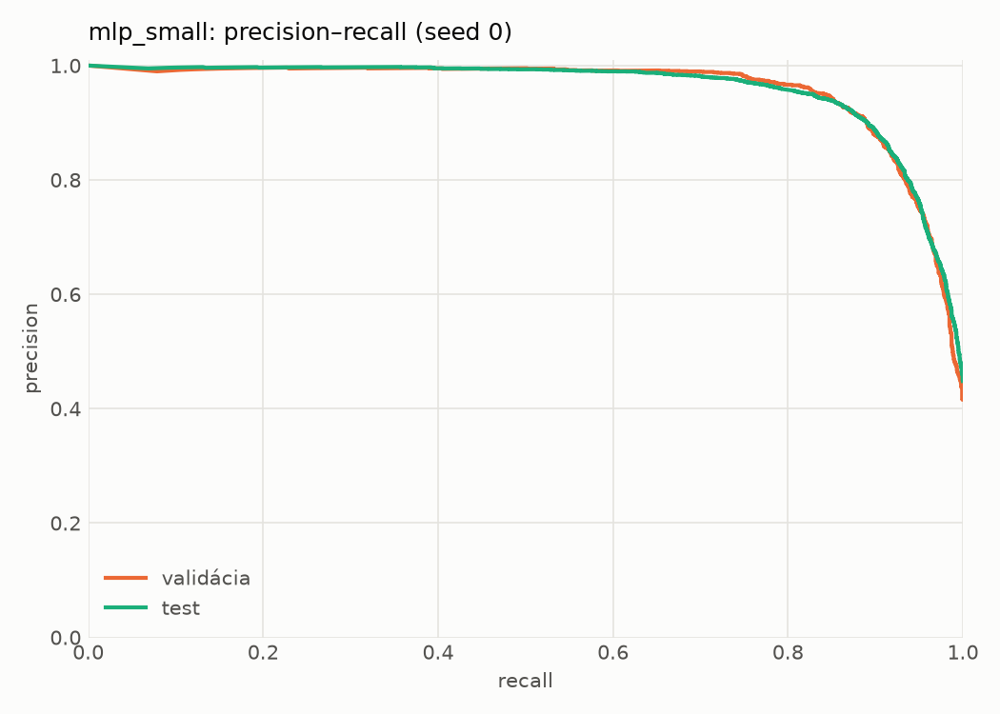
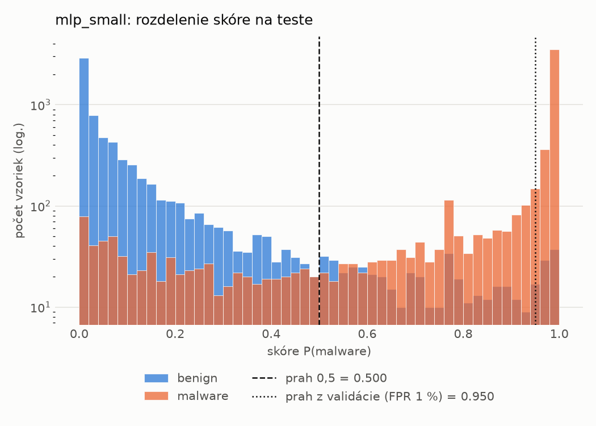
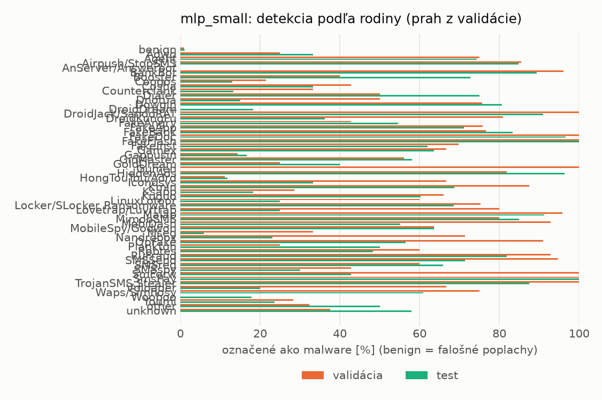
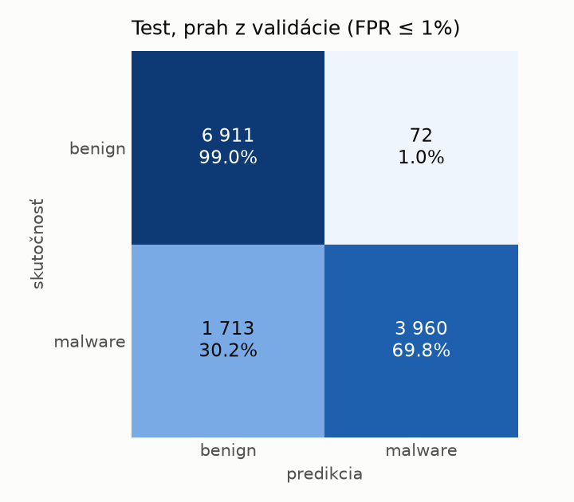
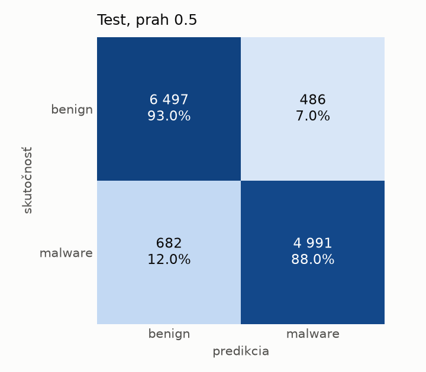
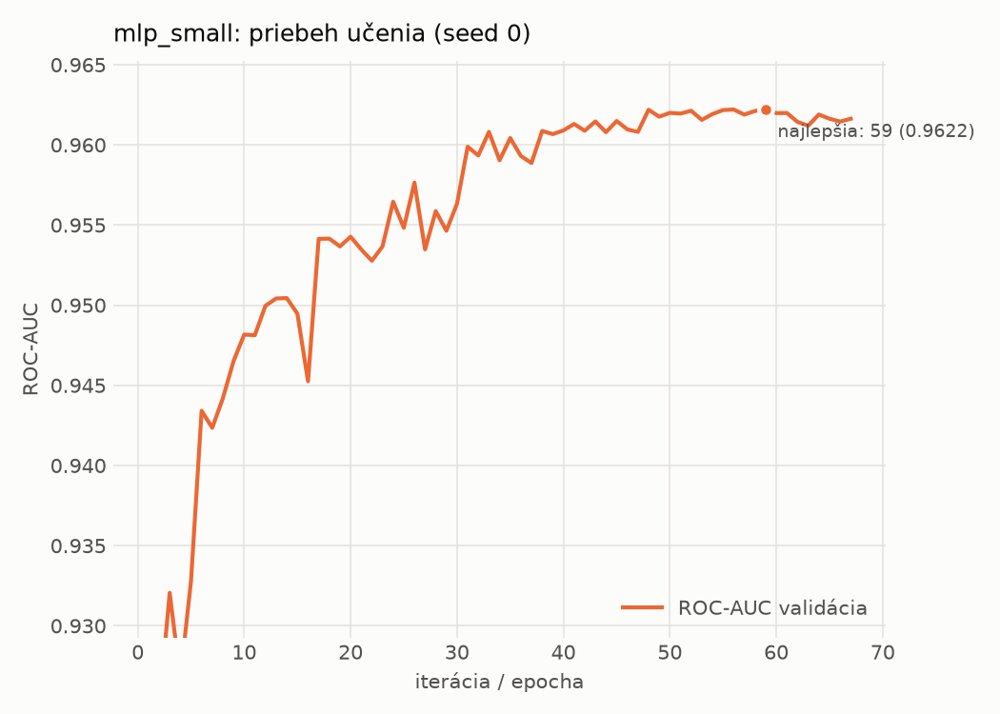

# dynamic/mlp_small – beh `20261123-213151`

> Automaticky generované (`src/training/run_tabular.py`). Konfigurácia: `config.yaml`, protokol: `protocol.yaml`.

- **Model:** `mlp` – malá neurónová sieť (1–2 skryté vrstvy), kandidát na ľahkého študenta
- **Ladenie:** bez ladenia – hyperparametre prevzaté z `runs_v4/emu_p/full/dynamic/mlp_small/20261123-193925`
- **Finálne modely:** seedy [0, 1, 2]; hodnoty sú priemer ± smerodajná odchýlka cez seedy
- **Najlepšie hyperparametre:** `{"width_decay": 0.5, "max_epochs": 100, "patience": 8, "hidden_layers": 2, "hidden_width": 256, "dropout": 0.06125761383416514, "lr": 0.0018225597913134257, "weight_decay": 9.759441755448828e-06, "batch_size": 256}`

## Detekčná kvalita (bez prahu)
| metrika | train (podvzorka) | validácia | test |
|---|---|---|---|
| ROC-AUC | 0.9871 ± 0.0020 | 0.9627 ± 0.0004 | 0.9586 ± 0.0006 |
| PR-AUC | 0.9847 ± 0.0024 | 0.9585 ± 0.0004 | 0.9585 ± 0.0008 |
| TPR pri FPR 1 % | 0.8673 ± 0.0222 | 0.7467 ± 0.0054 | 0.6821 ± 0.0265 |
| TPR pri FPR 0,1 % | 0.7850 ± 0.0299 | 0.2838 ± 0.0905 | 0.3369 ± 0.0546 |
| log loss | 0.1373 ± 0.0105 | 0.2475 ± 0.0031 | 0.2604 ± 0.0015 |
| Brier skóre | 0.0391 ± 0.0034 | 0.0672 ± 0.0008 | 0.0722 ± 0.0011 |

Rozdiel ROC-AUC train − validácia: **0.0244** (veľký rozdiel = preučenie).

## Pri prahu z validácie (FPR ≤ 1% na validácii)
| metrika | train (podvzorka) | validácia | test |
|---|---|---|---|
| accuracy | 0.9052 ± 0.0041 | 0.8890 ± 0.0022 | 0.8523 ± 0.0098 |
| balanced accuracy | 0.8836 ± 0.0050 | 0.8685 ± 0.0027 | 0.8364 ± 0.0109 |
| precision | 0.9987 ± 0.0006 | 0.9820 ± 0.0001 | 0.9827 ± 0.0015 |
| recall (TPR) | 0.7679 ± 0.0098 | 0.7467 ± 0.0054 | 0.6825 ± 0.0216 |
| FPR | 0.0007 ± 0.0003 | 0.0097 ± 0.0000 | 0.0097 ± 0.0008 |
| F1 | 0.8682 ± 0.0064 | 0.8483 ± 0.0035 | 0.8054 ± 0.0154 |
| MCC | 0.8130 ± 0.0078 | 0.7812 ± 0.0042 | 0.7226 ± 0.0173 |

## Pri pevnom prahu 0.5
| metrika | train (podvzorka) | validácia | test |
|---|---|---|---|
| accuracy | 0.9500 ± 0.0046 | 0.9109 ± 0.0029 | 0.9054 ± 0.0020 |
| balanced accuracy | 0.9465 ± 0.0048 | 0.9079 ± 0.0027 | 0.9024 ± 0.0024 |
| precision | 0.9488 ± 0.0059 | 0.8949 ± 0.0053 | 0.9117 ± 0.0014 |
| recall (TPR) | 0.9272 ± 0.0056 | 0.8903 ± 0.0024 | 0.8737 ± 0.0059 |
| FPR | 0.0343 ± 0.0040 | 0.0744 ± 0.0041 | 0.0688 ± 0.0015 |
| F1 | 0.9379 ± 0.0057 | 0.8926 ± 0.0033 | 0.8922 ± 0.0027 |
| MCC | 0.8963 ± 0.0096 | 0.8165 ± 0.0059 | 0.8086 ± 0.0041 |

## Výpočtové nároky (seed 0, testovacia množina)
| meranie | hodnota |
|---|---|
| tréning finálneho modelu | 17.2 s (priemer cez seedy) |
| ladenie spolu | 0 s |
| počet parametrov / uzlov | 65 537 |
| veľkosť modelu na disku | 0.27 MB |
| transformácia vstupu – latencia (1 vlákno) | 0.014 ms |
| transformácia vstupu – priepustnosť | 1 093 060 vzoriek/s |
| CPU latencia modelu (batch 1, 1 vlákno) | 0.099 ms (p95 0.232) |
| CPU priepustnosť (24 vlákien) | 2 847 949 vzoriek/s |
| GPU latencia (batch 1) | 0.642 ms (p95 0.667) |
| GPU priepustnosť | 2 323 225 vzoriek/s |
| GPU špičková pamäť | 65 MB |

## Grafy
| | |
|---|---|
|  |  |
|  |  |
|  |  |
|  |  |

## Súbory
`metrics.json` (všetky metriky po seedoch vrátane rodín), `timing.json`, `hpo_trials.csv`,
`predictions/<časť>_seed<N>.parquet` (sha256, family, label, score), `model/seed_<N>/`, `log.txt`.
