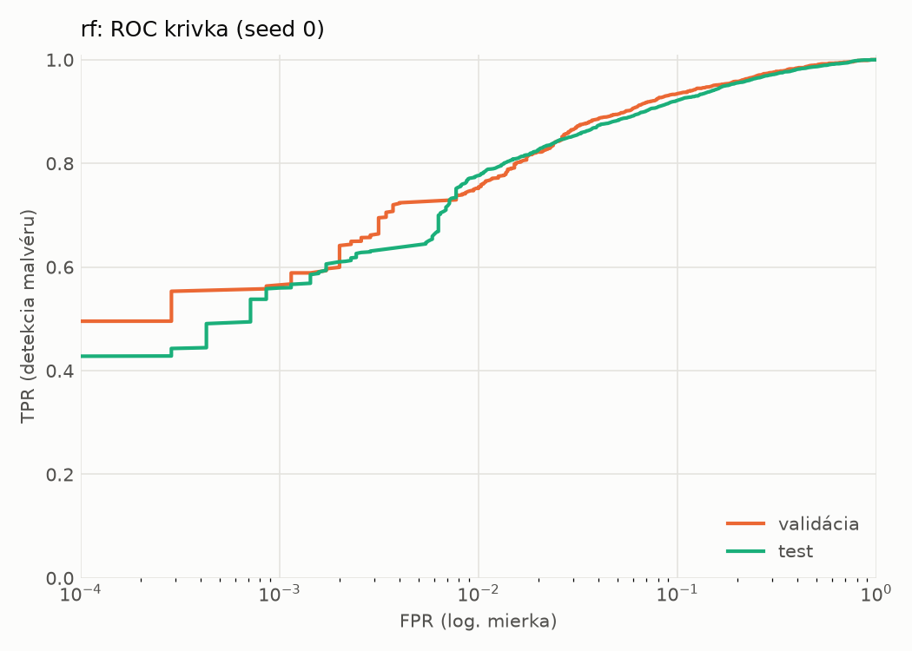
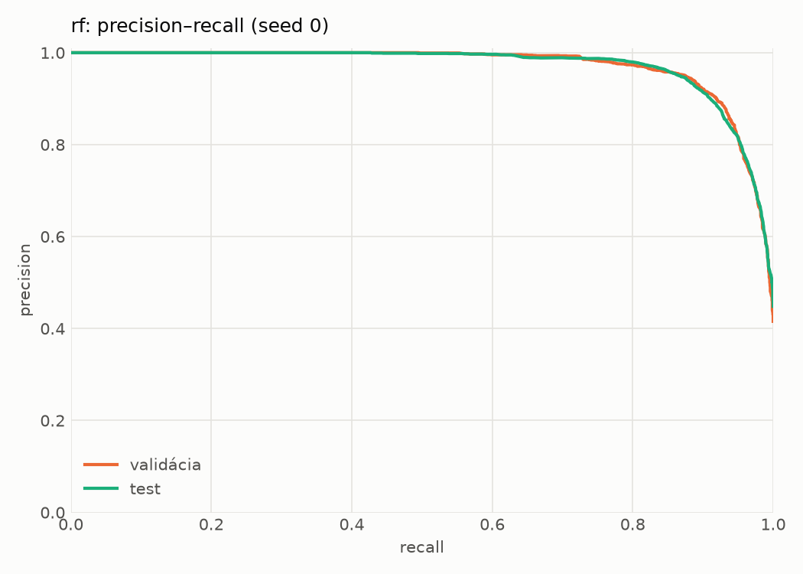
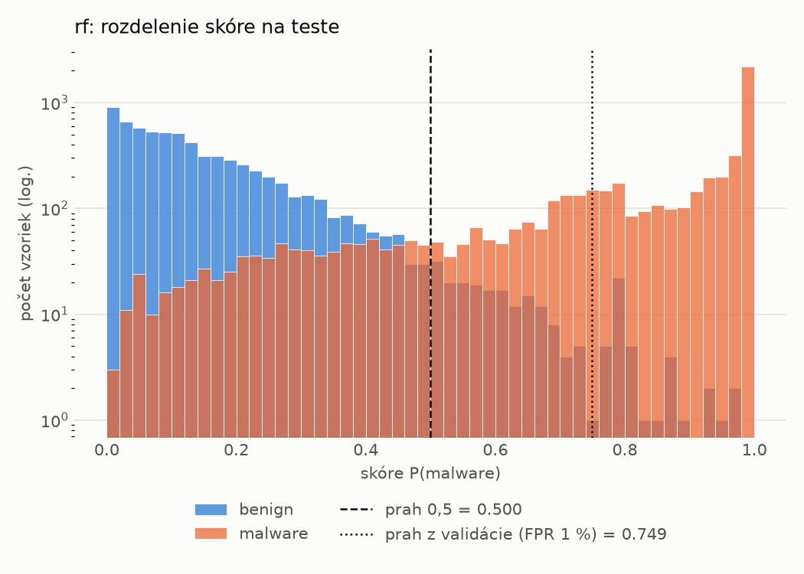
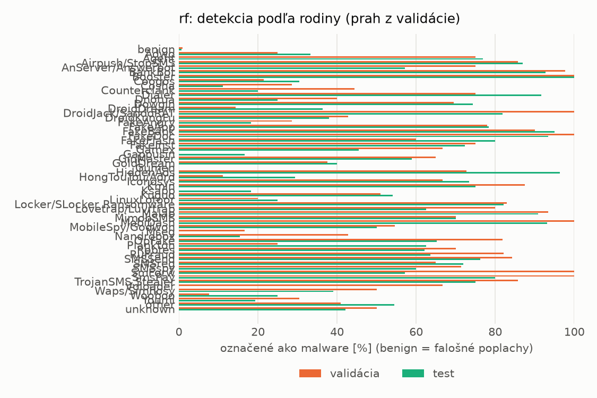
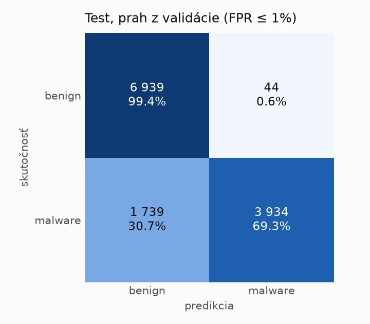
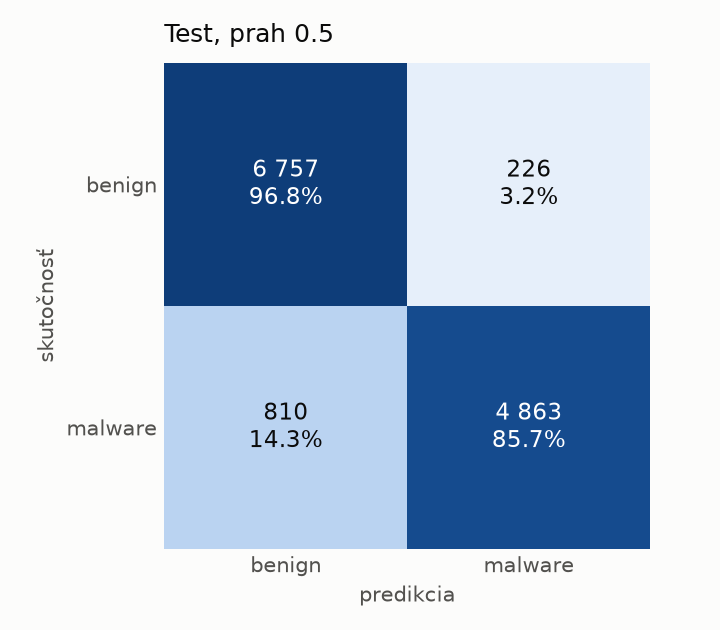

# dynamic/rf – beh `20261123-212929`

> Automaticky generované (`src/training/run_tabular.py`). Konfigurácia: `config.yaml`, protokol: `protocol.yaml`.

- **Model:** `random_forest` – Random Forest (pôvodné hodnoty príznakov)
- **Ladenie:** bez ladenia – hyperparametre prevzaté z `runs_v4/emu_p/full/dynamic/rf/20261123-191811`
- **Finálne modely:** seedy [0, 1, 2]; hodnoty sú priemer ± smerodajná odchýlka cez seedy
- **Najlepšie hyperparametre:** `{"n_estimators": 450, "max_depth": null, "min_samples_leaf": 1, "max_features": "sqrt"}`

## Detekčná kvalita (bez prahu)
| metrika | train (podvzorka) | validácia | test |
|---|---|---|---|
| ROC-AUC | 0.9998 ± 0.0000 | 0.9732 ± 0.0002 | 0.9699 ± 0.0002 |
| PR-AUC | 0.9997 ± 0.0000 | 0.9709 ± 0.0001 | 0.9707 ± 0.0002 |
| TPR pri FPR 1 % | 0.9995 ± 0.0000 | 0.7522 ± 0.0050 | 0.7762 ± 0.0027 |
| TPR pri FPR 0,1 % | 0.9335 ± 0.0012 | 0.5745 ± 0.0195 | 0.5597 ± 0.0049 |
| log loss | 0.0663 ± 0.0001 | 0.2174 ± 0.0005 | 0.2382 ± 0.0003 |
| Brier skóre | 0.0094 ± 0.0000 | 0.0612 ± 0.0002 | 0.0678 ± 0.0004 |

Rozdiel ROC-AUC train − validácia: **0.0266** (veľký rozdiel = preučenie).

## Pri prahu z validácie (FPR ≤ 1% na validácii)
| metrika | train (podvzorka) | validácia | test |
|---|---|---|---|
| accuracy | 0.9872 ± 0.0009 | 0.8913 ± 0.0021 | 0.8615 ± 0.0125 |
| balanced accuracy | 0.9849 ± 0.0011 | 0.8712 ± 0.0025 | 0.8463 ± 0.0140 |
| precision | 0.9957 ± 0.0000 | 0.9821 ± 0.0001 | 0.9888 ± 0.0002 |
| recall (TPR) | 0.9727 ± 0.0023 | 0.7522 ± 0.0050 | 0.6990 ± 0.0284 |
| FPR | 0.0029 ± 0.0000 | 0.0097 ± 0.0000 | 0.0064 ± 0.0004 |
| F1 | 0.9841 ± 0.0012 | 0.8519 ± 0.0033 | 0.8188 ± 0.0194 |
| MCC | 0.9736 ± 0.0019 | 0.7855 ± 0.0040 | 0.7403 ± 0.0219 |

## Pri pevnom prahu 0.5
| metrika | train (podvzorka) | validácia | test |
|---|---|---|---|
| accuracy | 0.9975 ± 0.0000 | 0.9280 ± 0.0016 | 0.9184 ± 0.0002 |
| balanced accuracy | 0.9978 ± 0.0000 | 0.9206 ± 0.0015 | 0.9126 ± 0.0002 |
| precision | 0.9944 ± 0.0000 | 0.9462 ± 0.0031 | 0.9564 ± 0.0008 |
| recall (TPR) | 0.9995 ± 0.0000 | 0.8766 ± 0.0012 | 0.8570 ± 0.0002 |
| FPR | 0.0039 ± 0.0000 | 0.0354 ± 0.0021 | 0.0317 ± 0.0006 |
| F1 | 0.9969 ± 0.0000 | 0.9101 ± 0.0019 | 0.9040 ± 0.0002 |
| MCC | 0.9948 ± 0.0000 | 0.8519 ± 0.0034 | 0.8372 ± 0.0005 |

## Výpočtové nároky (seed 0, testovacia množina)
| meranie | hodnota |
|---|---|
| tréning finálneho modelu | 2.4 s (priemer cez seedy) |
| ladenie spolu | 0 s |
| počet parametrov / uzlov | 4 123 746 |
| veľkosť modelu na disku | 330.25 MB |
| CPU latencia modelu (batch 1, 1 vlákno) | 13.258 ms (p95 13.742) |
| CPU priepustnosť (24 vlákien) | 100 964 vzoriek/s |

## Grafy
| | |
|---|---|
|  |  |
|  |  |
|  |  |
|  |  |

## Súbory
`metrics.json` (všetky metriky po seedoch vrátane rodín), `timing.json`, `hpo_trials.csv`,
`predictions/<časť>_seed<N>.parquet` (sha256, family, label, score), `model/seed_<N>/`, `log.txt`.
