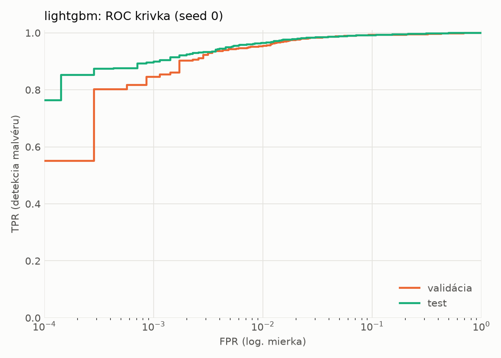
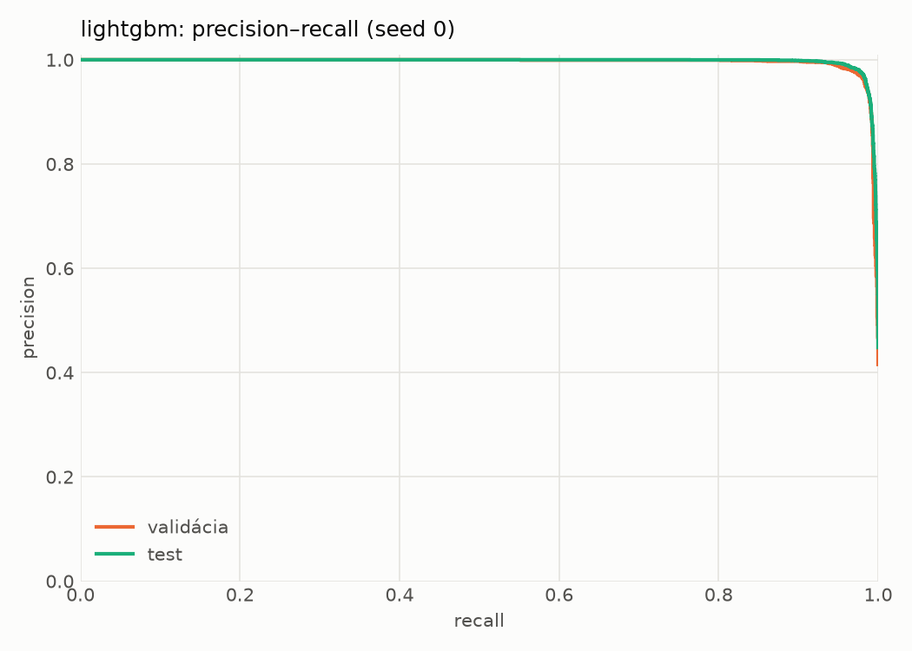
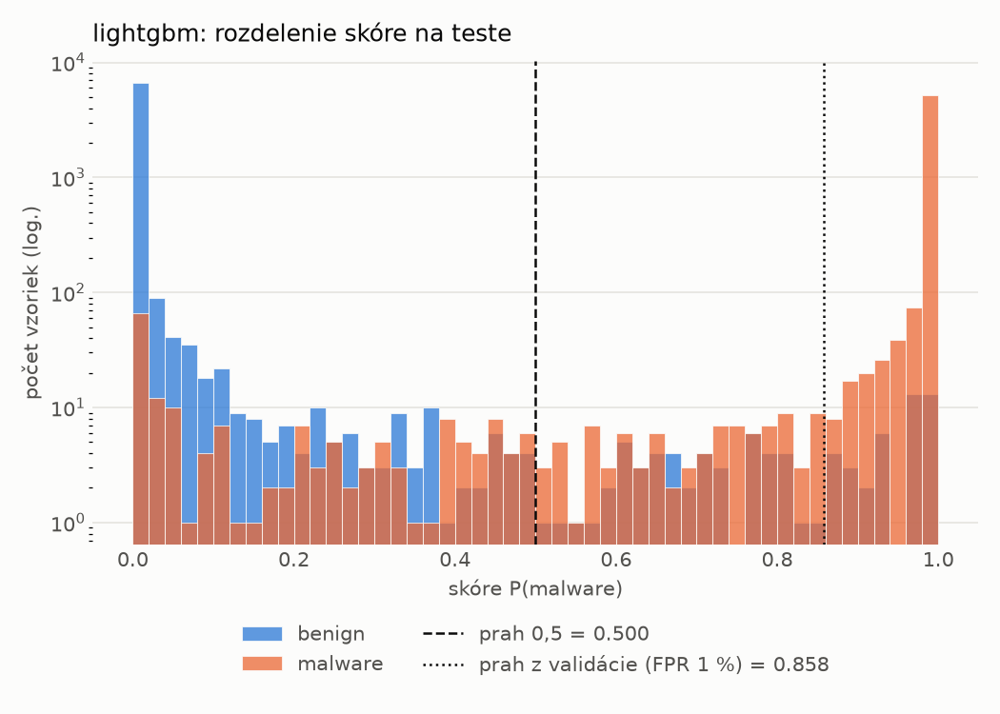
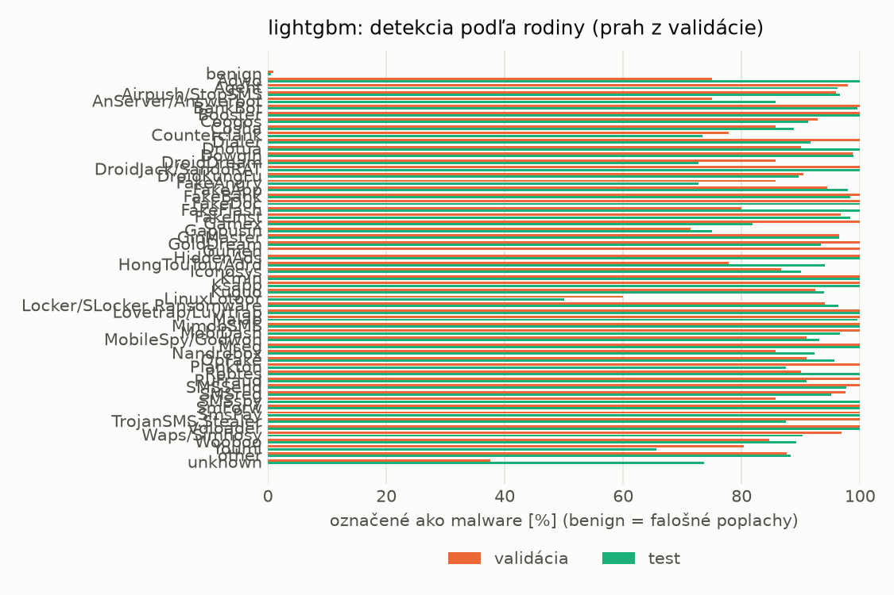
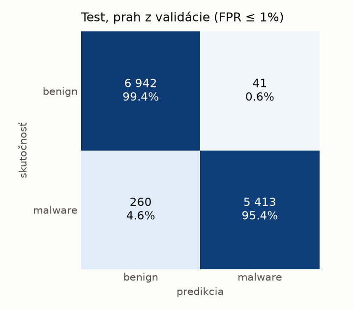
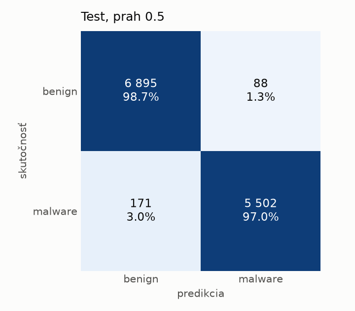
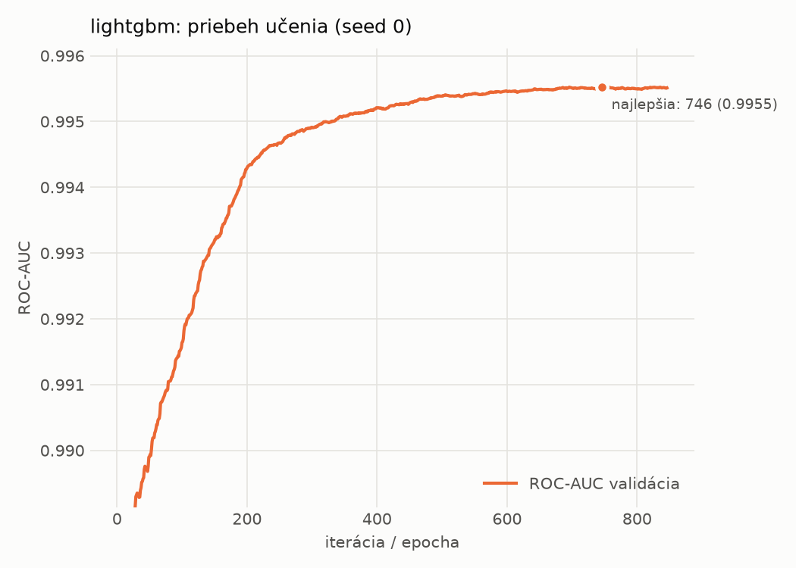

# hybrid/lightgbm – beh `20261123-213325`

> Automaticky generované (`src/training/run_tabular.py`). Konfigurácia: `config.yaml`, protokol: `protocol.yaml`.

- **Model:** `lightgbm` – LightGBM, gradient boosting stromov s early stopping na validácii (pôvodné hodnoty príznakov)
- **Ladenie:** bez ladenia – hyperparametre prevzaté z `runs_v4/emu_p/full/hybrid/lightgbm/20261123-195420`
- **Finálne modely:** seedy [0, 1, 2]; hodnoty sú priemer ± smerodajná odchýlka cez seedy
- **Najlepšie hyperparametre:** `{"num_boost_round": 5000, "early_stopping_rounds": 100, "learning_rate": 0.021805367982090686, "num_leaves": 214, "min_child_samples": 11, "feature_fraction": 0.7934614803684483, "bagging_fraction": 0.9747297177039957, "lambda_l1": 3.6112431454858456e-05, "lambda_l2": 1.814656418208834e-05}`

## Detekčná kvalita (bez prahu)
| metrika | train (podvzorka) | validácia | test |
|---|---|---|---|
| ROC-AUC | 1.0000 ± 0.0000 | 0.9955 ± 0.0001 | 0.9964 ± 0.0001 |
| PR-AUC | 1.0000 ± 0.0000 | 0.9953 ± 0.0001 | 0.9966 ± 0.0001 |
| TPR pri FPR 1 % | 1.0000 ± 0.0000 | 0.9518 ± 0.0016 | 0.9625 ± 0.0012 |
| TPR pri FPR 0,1 % | 1.0000 ± 0.0000 | 0.8452 ± 0.0027 | 0.8747 ± 0.0203 |
| log loss | 0.0019 ± 0.0015 | 0.0754 ± 0.0045 | 0.0690 ± 0.0029 |
| Brier skóre | 0.0000 ± 0.0000 | 0.0179 ± 0.0001 | 0.0165 ± 0.0002 |

Rozdiel ROC-AUC train − validácia: **0.0045** (veľký rozdiel = preučenie).

## Pri prahu z validácie (FPR ≤ 1% na validácii)
| metrika | train (podvzorka) | validácia | test |
|---|---|---|---|
| accuracy | 0.9999 ± 0.0001 | 0.9744 ± 0.0004 | 0.9753 ± 0.0011 |
| balanced accuracy | 0.9999 ± 0.0001 | 0.9712 ± 0.0006 | 0.9731 ± 0.0013 |
| precision | 1.0000 ± 0.0000 | 0.9862 ± 0.0007 | 0.9928 ± 0.0007 |
| recall (TPR) | 0.9998 ± 0.0003 | 0.9518 ± 0.0016 | 0.9518 ± 0.0032 |
| FPR | 0.0000 ± 0.0000 | 0.0095 ± 0.0005 | 0.0056 ± 0.0005 |
| F1 | 0.9999 ± 0.0001 | 0.9687 ± 0.0006 | 0.9718 ± 0.0014 |
| MCC | 0.9999 ± 0.0002 | 0.9475 ± 0.0008 | 0.9505 ± 0.0022 |

## Pri pevnom prahu 0.5
| metrika | train (podvzorka) | validácia | test |
|---|---|---|---|
| accuracy | 1.0000 ± 0.0000 | 0.9778 ± 0.0004 | 0.9786 ± 0.0009 |
| balanced accuracy | 1.0000 ± 0.0000 | 0.9768 ± 0.0004 | 0.9777 ± 0.0009 |
| precision | 1.0000 ± 0.0000 | 0.9756 ± 0.0010 | 0.9827 ± 0.0017 |
| recall (TPR) | 1.0000 ± 0.0000 | 0.9710 ± 0.0000 | 0.9693 ± 0.0005 |
| FPR | 0.0000 ± 0.0000 | 0.0173 ± 0.0007 | 0.0139 ± 0.0014 |
| F1 | 1.0000 ± 0.0000 | 0.9733 ± 0.0005 | 0.9760 ± 0.0010 |
| MCC | 1.0000 ± 0.0000 | 0.9544 ± 0.0009 | 0.9567 ± 0.0019 |

## Výpočtové nároky (seed 0, testovacia množina)
| meranie | hodnota |
|---|---|
| tréning finálneho modelu | 14.2 s (priemer cez seedy) |
| ladenie spolu | 0 s |
| počet parametrov / uzlov | 318 542 |
| veľkosť modelu na disku | 17.79 MB |
| CPU latencia modelu (batch 1, 1 vlákno) | 0.127 ms (p95 0.150) |
| CPU priepustnosť (24 vlákien) | 114 602 vzoriek/s |

## Grafy
| | |
|---|---|
|  |  |
|  |  |
|  |  |
|  |  |

## Súbory
`metrics.json` (všetky metriky po seedoch vrátane rodín), `timing.json`, `hpo_trials.csv`,
`predictions/<časť>_seed<N>.parquet` (sha256, family, label, score), `model/seed_<N>/`, `log.txt`.
