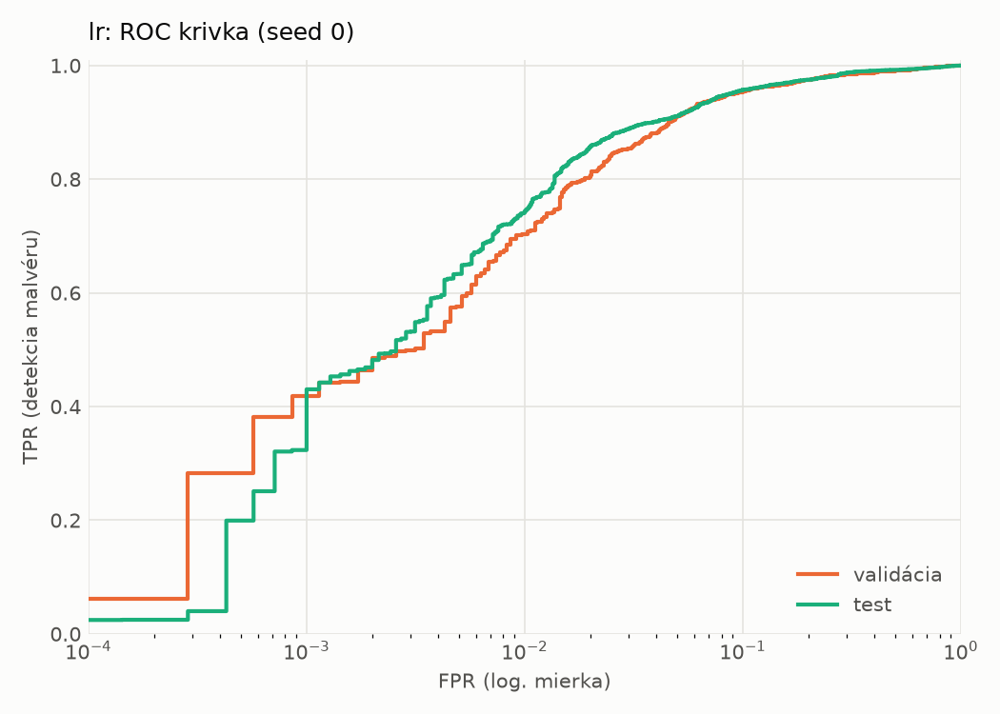
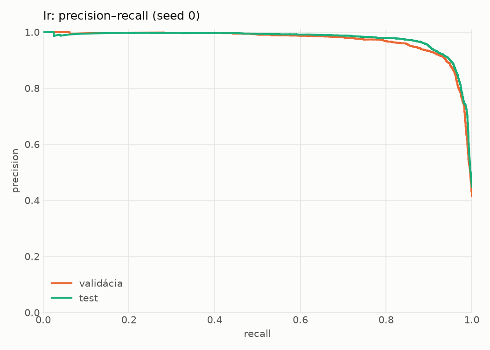
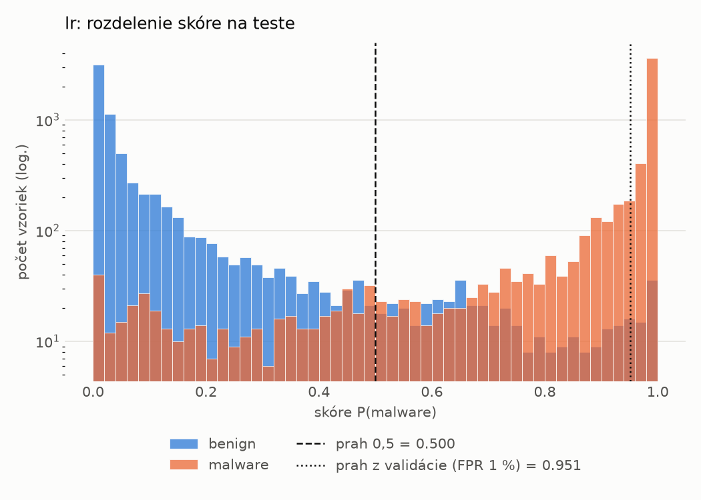
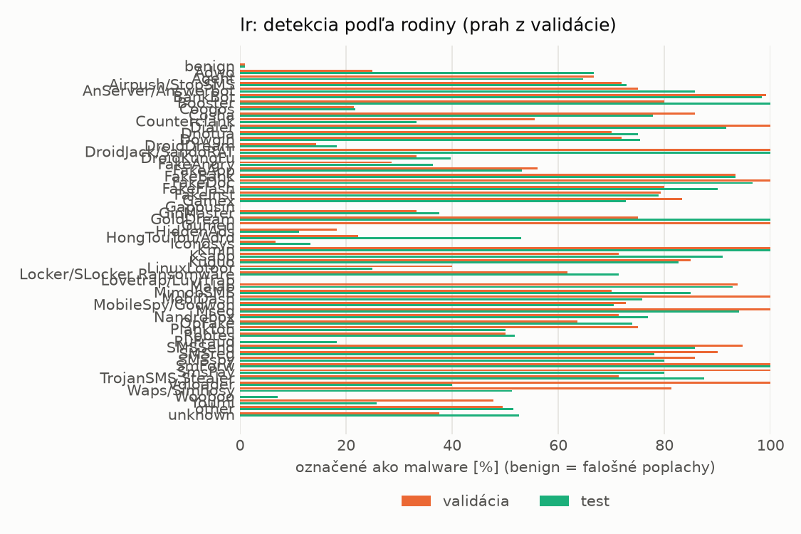
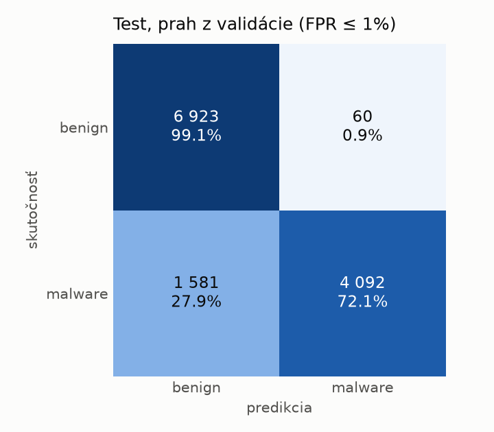
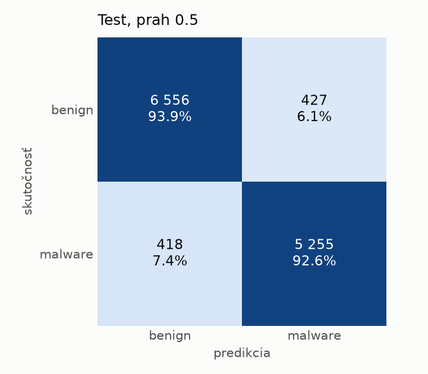

# hybrid/lr – beh `20261123-213313`

> Automaticky generované (`src/training/run_tabular.py`). Konfigurácia: `config.yaml`, protokol: `protocol.yaml`.

- **Model:** `logreg` – logistická regresia s L2 regularizáciou (vstup signed log1p + štandardizácia)
- **Ladenie:** bez ladenia – hyperparametre prevzaté z `runs_v4/emu_p/full/hybrid/lr/20261123-195300`
- **Finálne modely:** seedy [0, 1, 2]; hodnoty sú priemer ± smerodajná odchýlka cez seedy
- **Najlepšie hyperparametre:** `{"max_iter": 2000, "C": 7.106361724509844}`

## Detekčná kvalita (bez prahu)
| metrika | train (podvzorka) | validácia | test |
|---|---|---|---|
| ROC-AUC | 0.9805 ± 0.0000 | 0.9763 ± 0.0000 | 0.9787 ± 0.0000 |
| PR-AUC | 0.9763 ± 0.0000 | 0.9711 ± 0.0000 | 0.9762 ± 0.0000 |
| TPR pri FPR 1 % | 0.7584 ± 0.0000 | 0.7035 ± 0.0000 | 0.7407 ± 0.0000 |
| TPR pri FPR 0,1 % | 0.4149 ± 0.0000 | 0.4186 ± 0.0000 | 0.3235 ± 0.0000 |
| log loss | 0.1710 ± 0.0000 | 0.1915 ± 0.0000 | 0.1826 ± 0.0000 |
| Brier skóre | 0.0476 ± 0.0000 | 0.0523 ± 0.0000 | 0.0497 ± 0.0000 |

Rozdiel ROC-AUC train − validácia: **0.0042** (veľký rozdiel = preučenie).

## Pri prahu z validácie (FPR ≤ 1% na validácii)
| metrika | train (podvzorka) | validácia | test |
|---|---|---|---|
| accuracy | 0.8810 ± 0.0000 | 0.8710 ± 0.0000 | 0.8703 ± 0.0000 |
| balanced accuracy | 0.8549 ± 0.0000 | 0.8469 ± 0.0000 | 0.8564 ± 0.0000 |
| precision | 0.9901 ± 0.0000 | 0.9809 ± 0.0000 | 0.9855 ± 0.0000 |
| recall (TPR) | 0.7146 ± 0.0000 | 0.7035 ± 0.0000 | 0.7213 ± 0.0000 |
| FPR | 0.0049 ± 0.0000 | 0.0097 ± 0.0000 | 0.0086 ± 0.0000 |
| F1 | 0.8301 ± 0.0000 | 0.8193 ± 0.0000 | 0.8330 ± 0.0000 |
| MCC | 0.7655 ± 0.0000 | 0.7474 ± 0.0000 | 0.7549 ± 0.0000 |

## Pri pevnom prahu 0.5
| metrika | train (podvzorka) | validácia | test |
|---|---|---|---|
| accuracy | 0.9382 ± 0.0000 | 0.9338 ± 0.0000 | 0.9332 ± 0.0000 |
| balanced accuracy | 0.9367 ± 0.0000 | 0.9328 ± 0.0000 | 0.9326 ± 0.0000 |
| precision | 0.9203 ± 0.0000 | 0.9152 ± 0.0000 | 0.9249 ± 0.0000 |
| recall (TPR) | 0.9285 ± 0.0000 | 0.9267 ± 0.0000 | 0.9263 ± 0.0000 |
| FPR | 0.0551 ± 0.0000 | 0.0610 ± 0.0000 | 0.0611 ± 0.0000 |
| F1 | 0.9244 ± 0.0000 | 0.9209 ± 0.0000 | 0.9256 ± 0.0000 |
| MCC | 0.8722 ± 0.0000 | 0.8641 ± 0.0000 | 0.8650 ± 0.0000 |

## Výpočtové nároky (seed 0, testovacia množina)
| meranie | hodnota |
|---|---|
| tréning finálneho modelu | 0.4 s (priemer cez seedy) |
| ladenie spolu | 0 s |
| počet parametrov / uzlov | 287 |
| veľkosť modelu na disku | 0.01 MB |
| transformácia vstupu – latencia (1 vlákno) | 0.006 ms |
| transformácia vstupu – priepustnosť | 505 381 vzoriek/s |
| CPU latencia modelu (batch 1, 1 vlákno) | 0.004 ms (p95 0.004) |
| CPU priepustnosť (24 vlákien) | 2 379 037 vzoriek/s |

## Grafy
| | |
|---|---|
|  |  |
|  |  |
|  |  |
|  |  |

## Súbory
`metrics.json` (všetky metriky po seedoch vrátane rodín), `timing.json`, `hpo_trials.csv`,
`predictions/<časť>_seed<N>.parquet` (sha256, family, label, score), `model/seed_<N>/`, `log.txt`.
