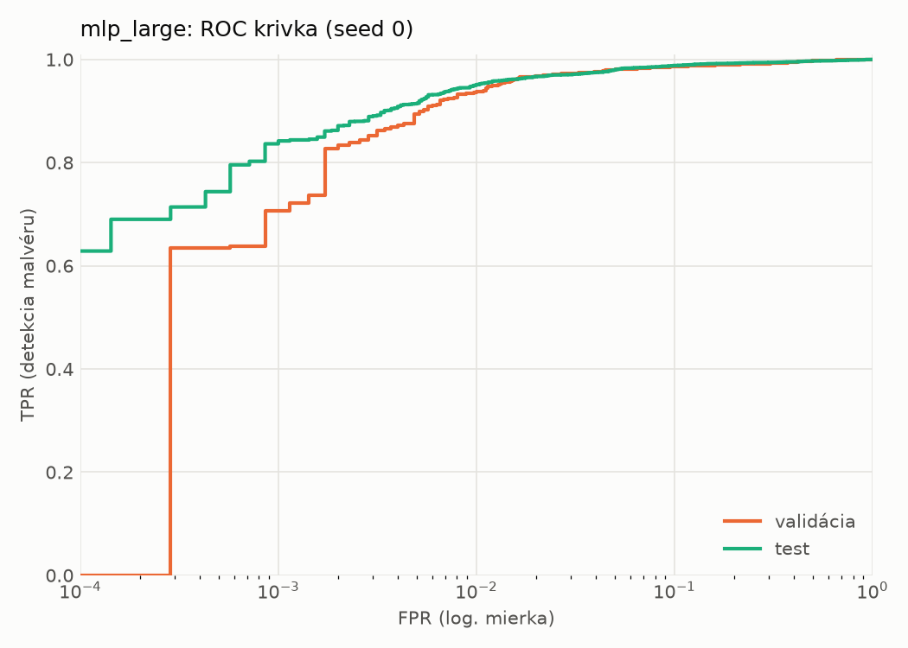
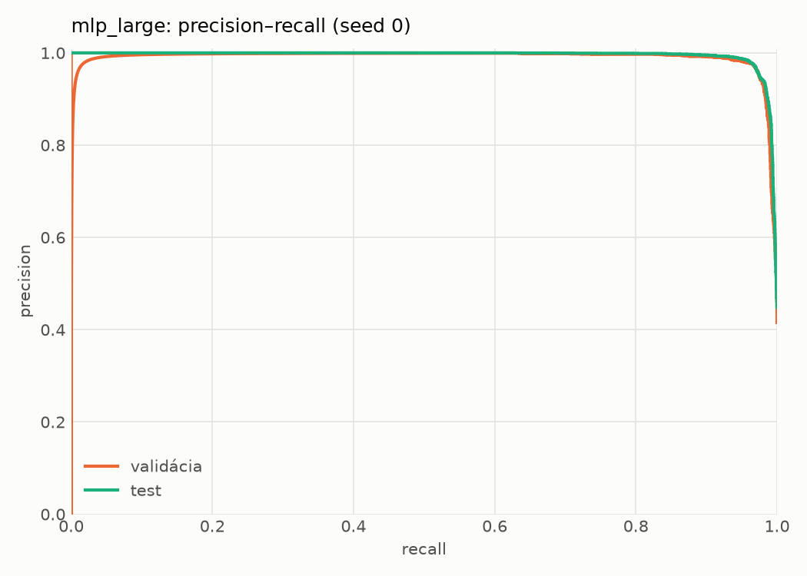
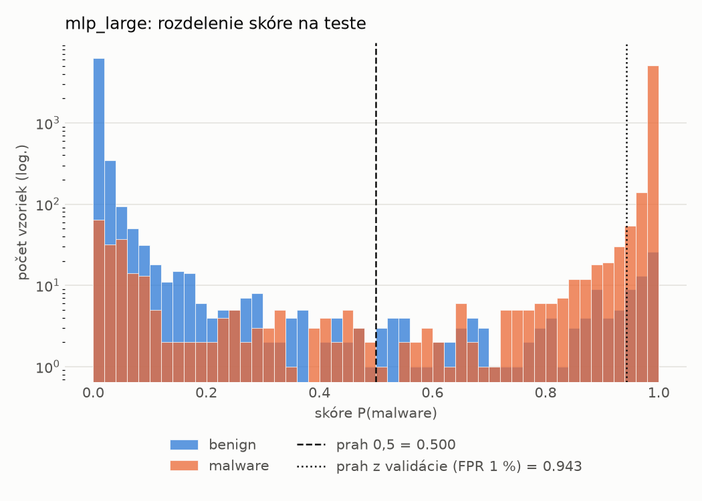
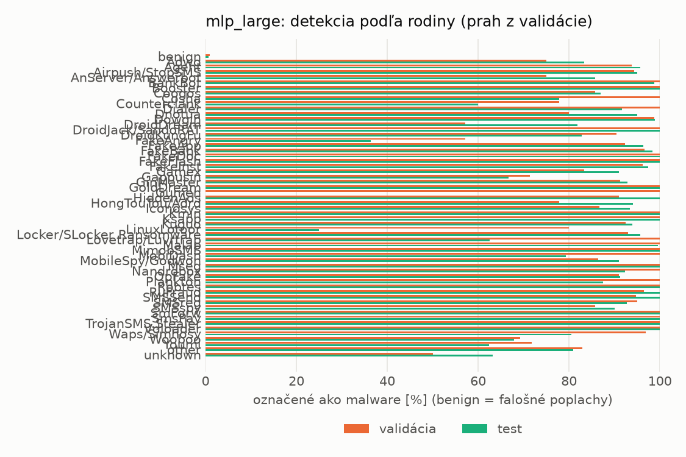
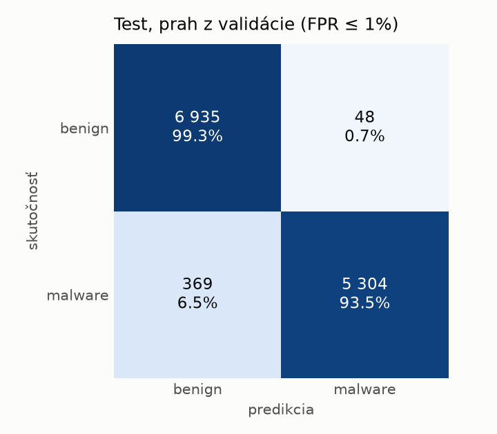
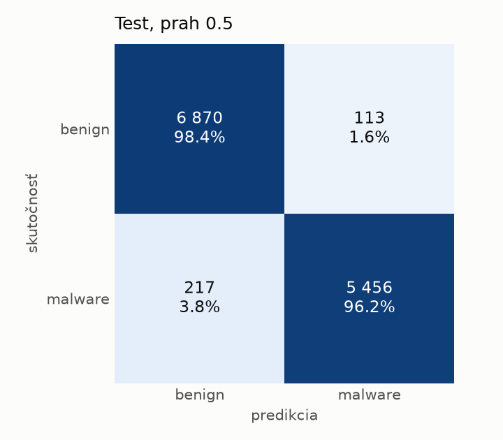
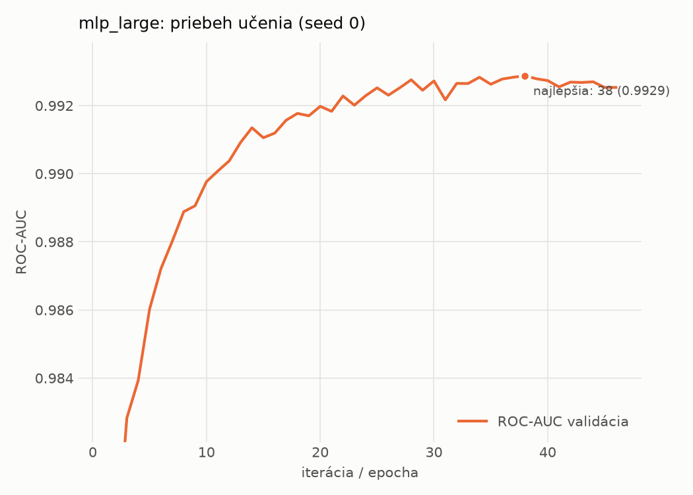

# hybrid/mlp_large – beh `20261123-213431`

> Automaticky generované (`src/training/run_tabular.py`). Konfigurácia: `config.yaml`, protokol: `protocol.yaml`.

- **Model:** `mlp` – veľká neurónová sieť (3–5 skrytých vrstiev, 512–2048 neurónov), kandidát na učiteľa
- **Ladenie:** bez ladenia – hyperparametre prevzaté z `runs_v4/emu_p/full/hybrid/mlp_large/20261123-200933`
- **Finálne modely:** seedy [0, 1, 2]; hodnoty sú priemer ± smerodajná odchýlka cez seedy
- **Najlepšie hyperparametre:** `{"max_epochs": 100, "patience": 8, "hidden_layers": 5, "hidden_width": 512, "width_decay": 0.5, "dropout": 0.18561035972653261, "lr": 0.00013117672209273214, "weight_decay": 3.948210593203141e-06, "batch_size": 512}`

## Detekčná kvalita (bez prahu)
| metrika | train (podvzorka) | validácia | test |
|---|---|---|---|
| ROC-AUC | 0.9988 ± 0.0005 | 0.9929 ± 0.0002 | 0.9940 ± 0.0001 |
| PR-AUC | 0.9986 ± 0.0006 | 0.9914 ± 0.0014 | 0.9942 ± 0.0003 |
| TPR pri FPR 1 % | 0.9894 ± 0.0048 | 0.9331 ± 0.0115 | 0.9449 ± 0.0058 |
| TPR pri FPR 0,1 % | 0.9680 ± 0.0163 | 0.6680 ± 0.0421 | 0.7935 ± 0.0382 |
| log loss | 0.0343 ± 0.0111 | 0.0950 ± 0.0039 | 0.0886 ± 0.0005 |
| Brier skóre | 0.0073 ± 0.0022 | 0.0233 ± 0.0015 | 0.0223 ± 0.0005 |

Rozdiel ROC-AUC train − validácia: **0.0059** (veľký rozdiel = preučenie).

## Pri prahu z validácie (FPR ≤ 1% na validácii)
| metrika | train (podvzorka) | validácia | test |
|---|---|---|---|
| accuracy | 0.9826 ± 0.0061 | 0.9667 ± 0.0045 | 0.9626 ± 0.0066 |
| balanced accuracy | 0.9788 ± 0.0075 | 0.9618 ± 0.0055 | 0.9591 ± 0.0075 |
| precision | 0.9990 ± 0.0004 | 0.9860 ± 0.0006 | 0.9910 ± 0.0022 |
| recall (TPR) | 0.9582 ± 0.0149 | 0.9331 ± 0.0115 | 0.9250 ± 0.0165 |
| FPR | 0.0007 ± 0.0003 | 0.0095 ± 0.0005 | 0.0068 ± 0.0018 |
| F1 | 0.9781 ± 0.0079 | 0.9588 ± 0.0058 | 0.9568 ± 0.0080 |
| MCC | 0.9643 ± 0.0124 | 0.9319 ± 0.0090 | 0.9257 ± 0.0125 |

## Pri pevnom prahu 0.5
| metrika | train (podvzorka) | validácia | test |
|---|---|---|---|
| accuracy | 0.9910 ± 0.0027 | 0.9723 ± 0.0021 | 0.9731 ± 0.0007 |
| balanced accuracy | 0.9900 ± 0.0028 | 0.9717 ± 0.0019 | 0.9722 ± 0.0006 |
| precision | 0.9927 ± 0.0040 | 0.9650 ± 0.0045 | 0.9760 ± 0.0037 |
| recall (TPR) | 0.9851 ± 0.0028 | 0.9684 ± 0.0012 | 0.9636 ± 0.0028 |
| FPR | 0.0050 ± 0.0027 | 0.0250 ± 0.0033 | 0.0192 ± 0.0031 |
| F1 | 0.9889 ± 0.0034 | 0.9667 ± 0.0025 | 0.9698 ± 0.0008 |
| MCC | 0.9813 ± 0.0057 | 0.9429 ± 0.0043 | 0.9456 ± 0.0015 |

## Výpočtové nároky (seed 0, testovacia množina)
| meranie | hodnota |
|---|---|
| tréning finálneho modelu | 9.7 s (priemer cez seedy) |
| ladenie spolu | 0 s |
| počet parametrov / uzlov | 323 521 |
| veľkosť modelu na disku | 1.32 MB |
| transformácia vstupu – latencia (1 vlákno) | 0.017 ms |
| transformácia vstupu – priepustnosť | 284 545 vzoriek/s |
| CPU latencia modelu (batch 1, 1 vlákno) | 0.161 ms (p95 0.184) |
| CPU priepustnosť (24 vlákien) | 736 748 vzoriek/s |
| GPU latencia (batch 1) | 0.716 ms (p95 0.794) |
| GPU priepustnosť | 1 097 554 vzoriek/s |
| GPU špičková pamäť | 178 MB |

## Grafy
| | |
|---|---|
|  |  |
|  |  |
|  |  |
|  |  |

## Súbory
`metrics.json` (všetky metriky po seedoch vrátane rodín), `timing.json`, `hpo_trials.csv`,
`predictions/<časť>_seed<N>.parquet` (sha256, family, label, score), `model/seed_<N>/`, `log.txt`.
