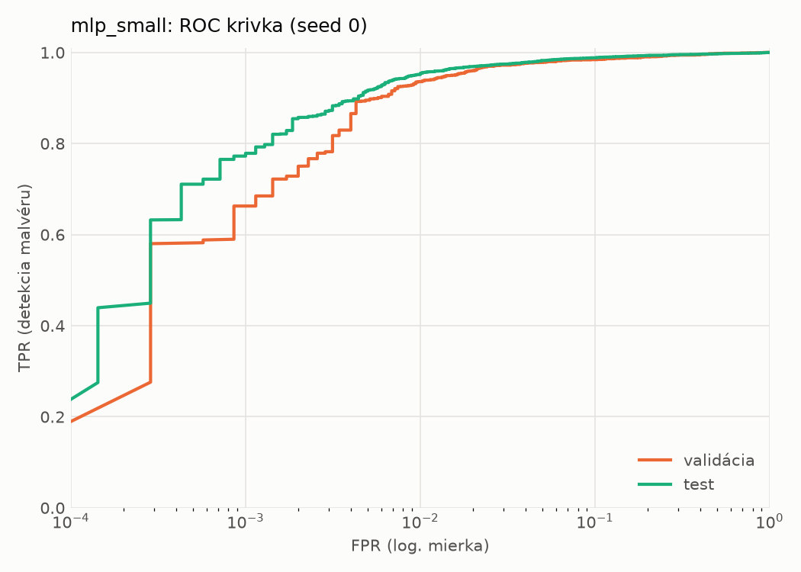
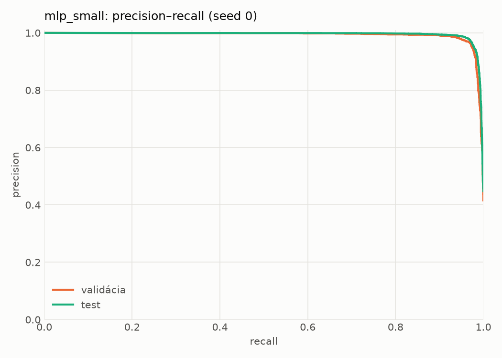
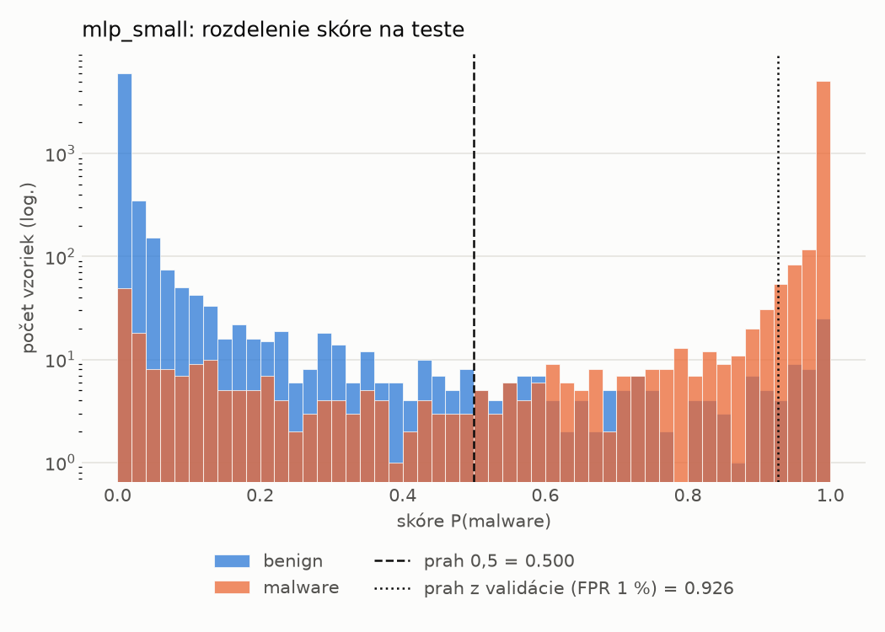
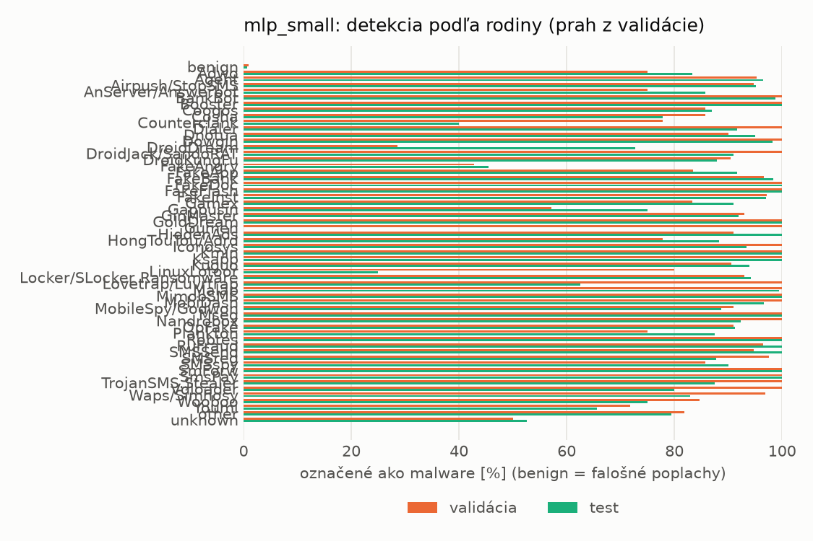
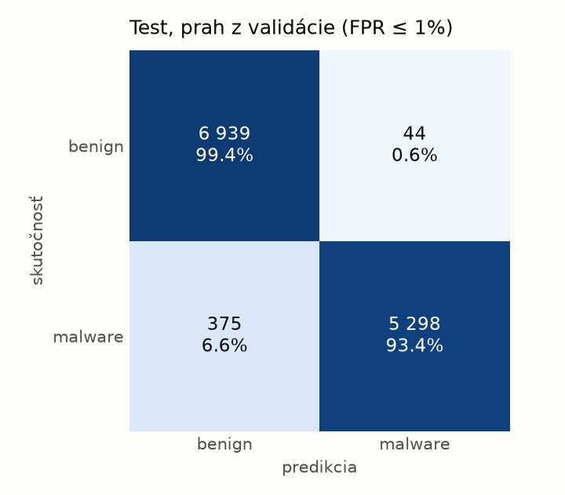
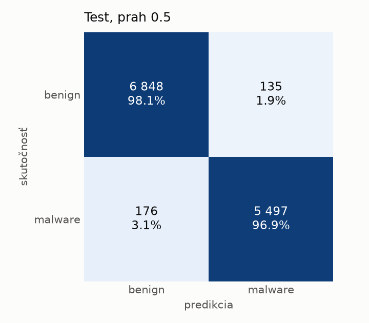
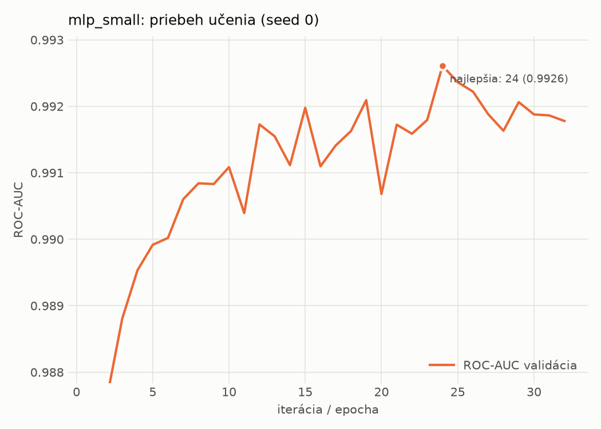

# hybrid/mlp_small – beh `20261123-213417`

> Automaticky generované (`src/training/run_tabular.py`). Konfigurácia: `config.yaml`, protokol: `protocol.yaml`.

- **Model:** `mlp` – malá neurónová sieť (1–2 skryté vrstvy), kandidát na ľahkého študenta
- **Ladenie:** bez ladenia – hyperparametre prevzaté z `runs_v4/emu_p/full/hybrid/mlp_small/20261123-200627`
- **Finálne modely:** seedy [0, 1, 2]; hodnoty sú priemer ± smerodajná odchýlka cez seedy
- **Najlepšie hyperparametre:** `{"width_decay": 0.5, "max_epochs": 100, "patience": 8, "hidden_layers": 2, "hidden_width": 256, "dropout": 0.2736594475747717, "lr": 0.0019631646658614973, "weight_decay": 0.0007425190310675283, "batch_size": 512}`

## Detekčná kvalita (bez prahu)
| metrika | train (podvzorka) | validácia | test |
|---|---|---|---|
| ROC-AUC | 0.9990 ± 0.0003 | 0.9922 ± 0.0004 | 0.9938 ± 0.0004 |
| PR-AUC | 0.9987 ± 0.0004 | 0.9908 ± 0.0005 | 0.9939 ± 0.0006 |
| TPR pri FPR 1 % | 0.9847 ± 0.0038 | 0.9283 ± 0.0066 | 0.9433 ± 0.0111 |
| TPR pri FPR 0,1 % | 0.9606 ± 0.0163 | 0.6330 ± 0.0374 | 0.7522 ± 0.0184 |
| log loss | 0.0337 ± 0.0058 | 0.1078 ± 0.0024 | 0.0900 ± 0.0027 |
| Brier skóre | 0.0088 ± 0.0017 | 0.0239 ± 0.0009 | 0.0210 ± 0.0008 |

Rozdiel ROC-AUC train − validácia: **0.0068** (veľký rozdiel = preučenie).

## Pri prahu z validácie (FPR ≤ 1% na validácii)
| metrika | train (podvzorka) | validácia | test |
|---|---|---|---|
| accuracy | 0.9788 ± 0.0033 | 0.9645 ± 0.0028 | 0.9622 ± 0.0040 |
| balanced accuracy | 0.9740 ± 0.0039 | 0.9593 ± 0.0033 | 0.9587 ± 0.0045 |
| precision | 0.9995 ± 0.0005 | 0.9855 ± 0.0001 | 0.9910 ± 0.0008 |
| recall (TPR) | 0.9483 ± 0.0076 | 0.9283 ± 0.0066 | 0.9241 ± 0.0084 |
| FPR | 0.0003 ± 0.0003 | 0.0097 ± 0.0000 | 0.0068 ± 0.0006 |
| F1 | 0.9732 ± 0.0042 | 0.9560 ± 0.0036 | 0.9564 ± 0.0048 |
| MCC | 0.9566 ± 0.0066 | 0.9275 ± 0.0055 | 0.9249 ± 0.0079 |

## Pri pevnom prahu 0.5
| metrika | train (podvzorka) | validácia | test |
|---|---|---|---|
| accuracy | 0.9886 ± 0.0022 | 0.9713 ± 0.0019 | 0.9739 ± 0.0015 |
| balanced accuracy | 0.9877 ± 0.0024 | 0.9710 ± 0.0017 | 0.9735 ± 0.0013 |
| precision | 0.9885 ± 0.0021 | 0.9624 ± 0.0035 | 0.9728 ± 0.0036 |
| recall (TPR) | 0.9834 ± 0.0033 | 0.9688 ± 0.0009 | 0.9690 ± 0.0009 |
| FPR | 0.0079 ± 0.0015 | 0.0269 ± 0.0026 | 0.0221 ± 0.0030 |
| F1 | 0.9859 ± 0.0027 | 0.9656 ± 0.0022 | 0.9709 ± 0.0016 |
| MCC | 0.9763 ± 0.0046 | 0.9410 ± 0.0038 | 0.9473 ± 0.0029 |

## Výpočtové nároky (seed 0, testovacia množina)
| meranie | hodnota |
|---|---|
| tréning finálneho modelu | 3.9 s (priemer cez seedy) |
| ladenie spolu | 0 s |
| počet parametrov / uzlov | 107 265 |
| veľkosť modelu na disku | 0.45 MB |
| transformácia vstupu – latencia (1 vlákno) | 0.017 ms |
| transformácia vstupu – priepustnosť | 293 776 vzoriek/s |
| CPU latencia modelu (batch 1, 1 vlákno) | 0.086 ms (p95 0.235) |
| CPU priepustnosť (24 vlákien) | 1 256 528 vzoriek/s |
| GPU latencia (batch 1) | 0.412 ms (p95 0.445) |
| GPU priepustnosť | 1 252 809 vzoriek/s |
| GPU špičková pamäť | 104 MB |

## Grafy
| | |
|---|---|
|  |  |
|  |  |
|  |  |
|  |  |

## Súbory
`metrics.json` (všetky metriky po seedoch vrátane rodín), `timing.json`, `hpo_trials.csv`,
`predictions/<časť>_seed<N>.parquet` (sha256, family, label, score), `model/seed_<N>/`, `log.txt`.
