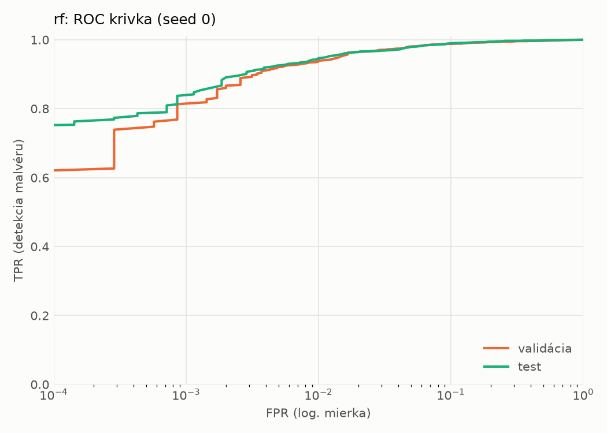
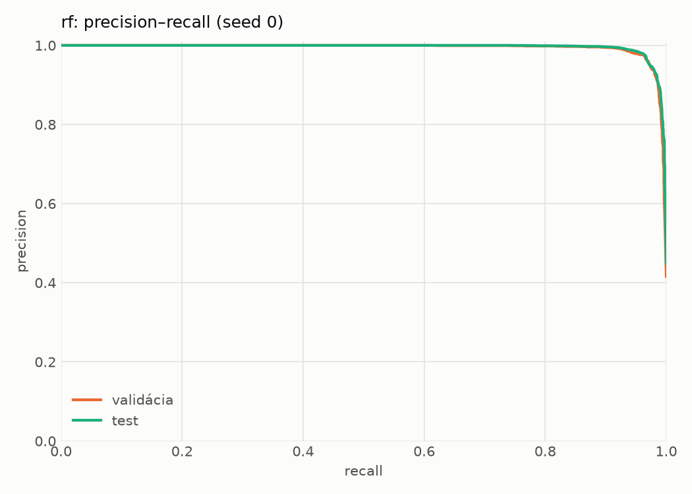
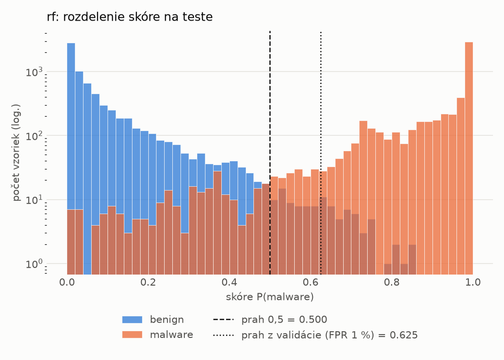
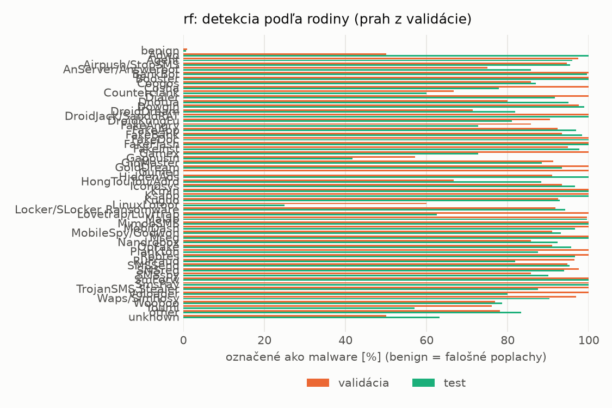
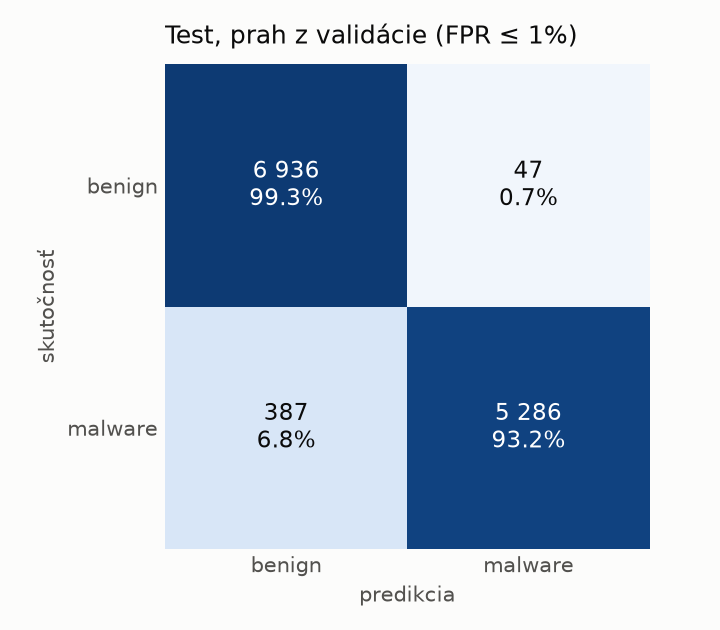
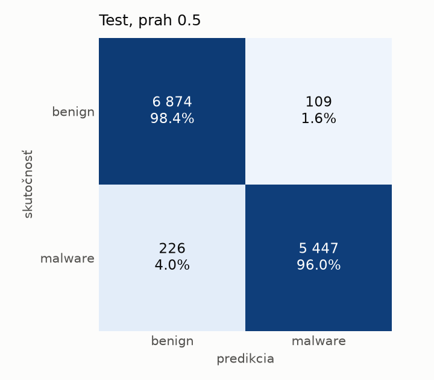

# hybrid/rf – beh `20261123-213316`

> Automaticky generované (`src/training/run_tabular.py`). Konfigurácia: `config.yaml`, protokol: `protocol.yaml`.

- **Model:** `random_forest` – Random Forest (pôvodné hodnoty príznakov)
- **Ladenie:** bez ladenia – hyperparametre prevzaté z `runs_v4/emu_p/full/hybrid/rf/20261123-195313`
- **Finálne modely:** seedy [0, 1, 2]; hodnoty sú priemer ± smerodajná odchýlka cez seedy
- **Najlepšie hyperparametre:** `{"n_estimators": 200, "max_depth": null, "min_samples_leaf": 1, "max_features": "sqrt"}`

## Detekčná kvalita (bez prahu)
| metrika | train (podvzorka) | validácia | test |
|---|---|---|---|
| ROC-AUC | 1.0000 ± 0.0000 | 0.9937 ± 0.0002 | 0.9949 ± 0.0001 |
| PR-AUC | 1.0000 ± 0.0000 | 0.9934 ± 0.0002 | 0.9949 ± 0.0000 |
| TPR pri FPR 1 % | 1.0000 ± 0.0000 | 0.9354 ± 0.0006 | 0.9447 ± 0.0023 |
| TPR pri FPR 0,1 % | 1.0000 ± 0.0000 | 0.7948 ± 0.0164 | 0.8434 ± 0.0141 |
| log loss | 0.0313 ± 0.0001 | 0.1122 ± 0.0009 | 0.1177 ± 0.0009 |
| Brier skóre | 0.0034 ± 0.0000 | 0.0267 ± 0.0003 | 0.0282 ± 0.0003 |

Rozdiel ROC-AUC train − validácia: **0.0063** (veľký rozdiel = preučenie).

## Pri prahu z validácie (FPR ≤ 1% na validácii)
| metrika | train (podvzorka) | validácia | test |
|---|---|---|---|
| accuracy | 1.0000 ± 0.0001 | 0.9675 ± 0.0002 | 0.9653 ± 0.0011 |
| balanced accuracy | 1.0000 ± 0.0001 | 0.9629 ± 0.0002 | 0.9620 ± 0.0012 |
| precision | 1.0000 ± 0.0000 | 0.9857 ± 0.0002 | 0.9913 ± 0.0004 |
| recall (TPR) | 0.9999 ± 0.0001 | 0.9354 ± 0.0006 | 0.9307 ± 0.0021 |
| FPR | 0.0000 ± 0.0000 | 0.0096 ± 0.0002 | 0.0066 ± 0.0003 |
| F1 | 1.0000 ± 0.0001 | 0.9599 ± 0.0002 | 0.9600 ± 0.0013 |
| MCC | 0.9999 ± 0.0001 | 0.9335 ± 0.0003 | 0.9308 ± 0.0021 |

## Pri pevnom prahu 0.5
| metrika | train (podvzorka) | validácia | test |
|---|---|---|---|
| accuracy | 1.0000 ± 0.0000 | 0.9725 ± 0.0015 | 0.9728 ± 0.0006 |
| balanced accuracy | 1.0000 ± 0.0000 | 0.9712 ± 0.0014 | 0.9716 ± 0.0006 |
| precision | 1.0000 ± 0.0000 | 0.9702 ± 0.0026 | 0.9799 ± 0.0006 |
| recall (TPR) | 1.0000 ± 0.0000 | 0.9635 ± 0.0010 | 0.9591 ± 0.0009 |
| FPR | 0.0000 ± 0.0000 | 0.0210 ± 0.0019 | 0.0160 ± 0.0004 |
| F1 | 1.0000 ± 0.0000 | 0.9668 ± 0.0017 | 0.9694 ± 0.0007 |
| MCC | 1.0000 ± 0.0000 | 0.9434 ± 0.0030 | 0.9452 ± 0.0012 |

## Výpočtové nároky (seed 0, testovacia množina)
| meranie | hodnota |
|---|---|
| tréning finálneho modelu | 1.3 s (priemer cez seedy) |
| ladenie spolu | 0 s |
| počet parametrov / uzlov | 1 007 620 |
| veľkosť modelu na disku | 80.86 MB |
| CPU latencia modelu (batch 1, 1 vlákno) | 5.817 ms (p95 6.372) |
| CPU priepustnosť (24 vlákien) | 170 238 vzoriek/s |

## Grafy
| | |
|---|---|
|  |  |
|  |  |
|  |  |
|  |  |

## Súbory
`metrics.json` (všetky metriky po seedoch vrátane rodín), `timing.json`, `hpo_trials.csv`,
`predictions/<časť>_seed<N>.parquet` (sha256, family, label, score), `model/seed_<N>/`, `log.txt`.
