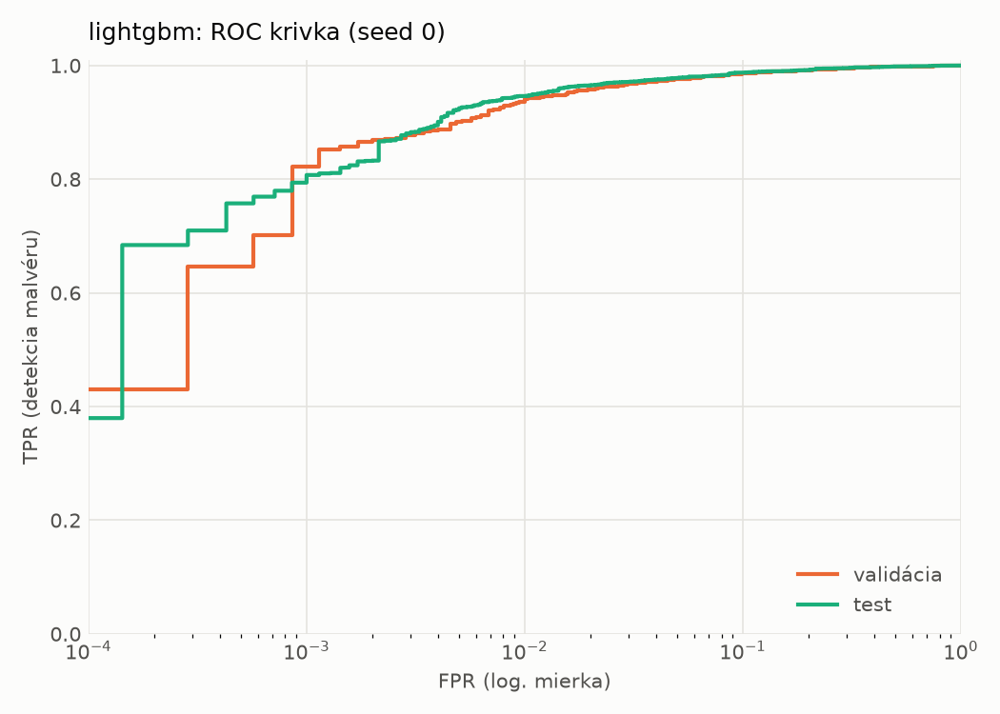
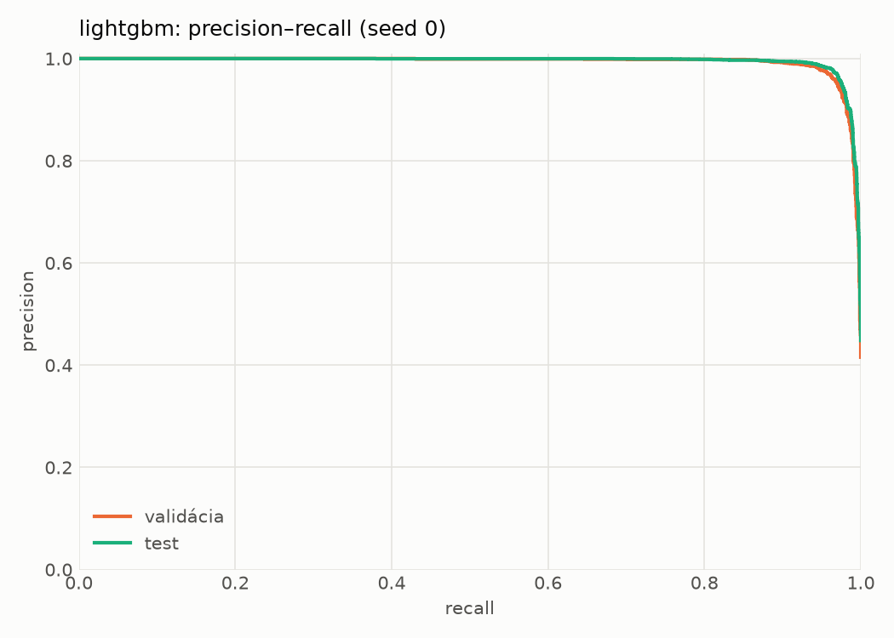
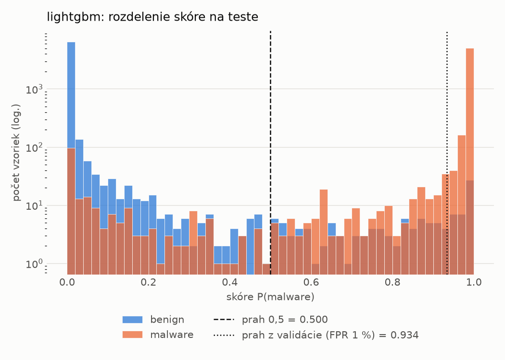
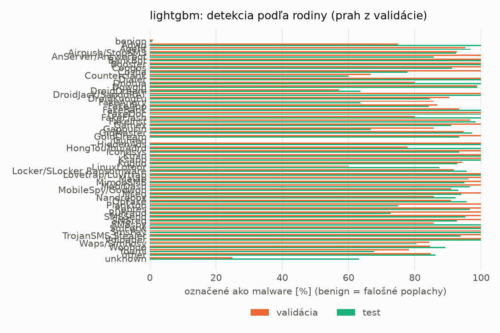
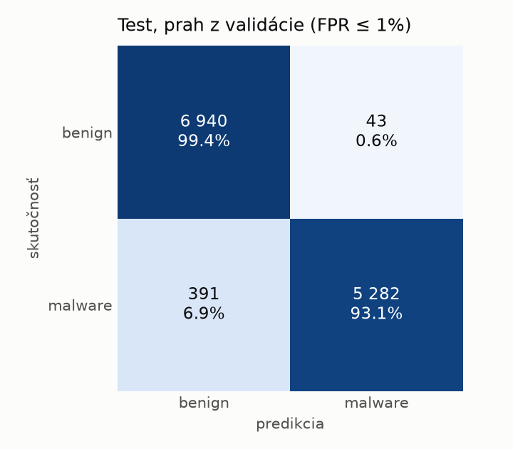
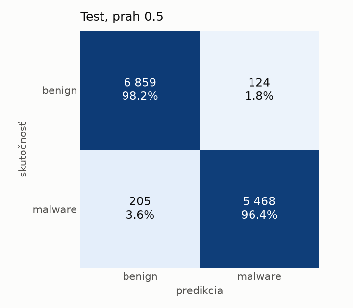
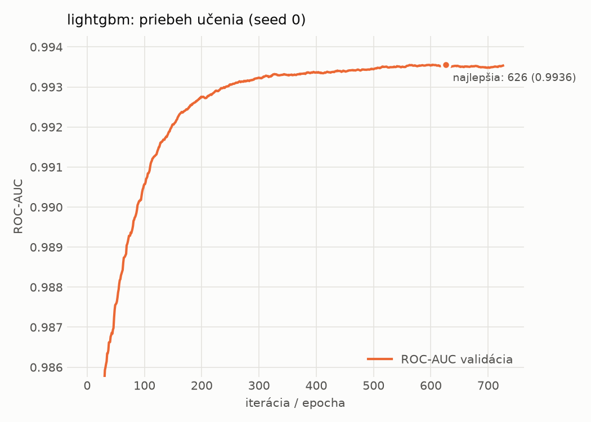

# static/lightgbm – beh `20261123-011538`

> Automaticky generované (`src/training/run_tabular.py`). Konfigurácia: `config.yaml`, protokol: `protocol.yaml`.

- **Model:** `lightgbm` – LightGBM, gradient boosting stromov s early stopping na validácii (pôvodné hodnoty príznakov)
- **Ladenie:** bez ladenia – hyperparametre prevzaté z `runs_v4/real_p/full/static/lightgbm/20261122-231010`
- **Finálne modely:** seedy [0, 1, 2]; hodnoty sú priemer ± smerodajná odchýlka cez seedy
- **Najlepšie hyperparametre:** `{"num_boost_round": 5000, "early_stopping_rounds": 100, "learning_rate": 0.03701536655085927, "num_leaves": 240, "min_child_samples": 18, "feature_fraction": 0.860319963795015, "bagging_fraction": 0.9949001098214416, "lambda_l1": 1.0205843882460235e-07, "lambda_l2": 0.00015478320101473535}`

## Detekčná kvalita (bez prahu)
| metrika | train (podvzorka) | validácia | test |
|---|---|---|---|
| ROC-AUC | 1.0000 ± 0.0000 | 0.9935 ± 0.0001 | 0.9942 ± 0.0002 |
| PR-AUC | 1.0000 ± 0.0000 | 0.9928 ± 0.0001 | 0.9942 ± 0.0002 |
| TPR pri FPR 1 % | 1.0000 ± 0.0000 | 0.9328 ± 0.0024 | 0.9465 ± 0.0017 |
| TPR pri FPR 0,1 % | 0.9998 ± 0.0000 | 0.8247 ± 0.0022 | 0.7874 ± 0.0113 |
| log loss | 0.0031 ± 0.0011 | 0.1101 ± 0.0049 | 0.0980 ± 0.0031 |
| Brier skóre | 0.0004 ± 0.0001 | 0.0247 ± 0.0003 | 0.0220 ± 0.0002 |

Rozdiel ROC-AUC train − validácia: **0.0065** (veľký rozdiel = preučenie).

## Pri prahu z validácie (FPR ≤ 1% na validácii)
| metrika | train (podvzorka) | validácia | test |
|---|---|---|---|
| accuracy | 0.9966 ± 0.0015 | 0.9665 ± 0.0010 | 0.9648 ± 0.0010 |
| balanced accuracy | 0.9958 ± 0.0018 | 0.9616 ± 0.0012 | 0.9613 ± 0.0012 |
| precision | 1.0000 ± 0.0000 | 0.9858 ± 0.0003 | 0.9926 ± 0.0006 |
| recall (TPR) | 0.9916 ± 0.0036 | 0.9328 ± 0.0024 | 0.9283 ± 0.0028 |
| FPR | 0.0000 ± 0.0000 | 0.0096 ± 0.0002 | 0.0056 ± 0.0005 |
| F1 | 0.9958 ± 0.0018 | 0.9586 ± 0.0013 | 0.9594 ± 0.0013 |
| MCC | 0.9929 ± 0.0030 | 0.9315 ± 0.0021 | 0.9300 ± 0.0020 |

## Pri pevnom prahu 0.5
| metrika | train (podvzorka) | validácia | test |
|---|---|---|---|
| accuracy | 0.9996 ± 0.0000 | 0.9704 ± 0.0006 | 0.9740 ± 0.0007 |
| balanced accuracy | 0.9996 ± 0.0000 | 0.9688 ± 0.0006 | 0.9730 ± 0.0007 |
| precision | 0.9993 ± 0.0000 | 0.9691 ± 0.0011 | 0.9784 ± 0.0006 |
| recall (TPR) | 0.9998 ± 0.0000 | 0.9593 ± 0.0004 | 0.9632 ± 0.0013 |
| FPR | 0.0005 ± 0.0000 | 0.0218 ± 0.0008 | 0.0173 ± 0.0005 |
| F1 | 0.9995 ± 0.0000 | 0.9642 ± 0.0007 | 0.9707 ± 0.0008 |
| MCC | 0.9992 ± 0.0000 | 0.9389 ± 0.0012 | 0.9474 ± 0.0014 |

## Výpočtové nároky (seed 0, testovacia množina)
| meranie | hodnota |
|---|---|
| tréning finálneho modelu | 7.5 s (priemer cez seedy) |
| ladenie spolu | 0 s |
| počet parametrov / uzlov | 299 854 |
| veľkosť modelu na disku | 16.75 MB |
| CPU latencia modelu (batch 1, 1 vlákno) | 0.117 ms (p95 0.138) |
| CPU priepustnosť (24 vlákien) | 126 508 vzoriek/s |

## Grafy
| | |
|---|---|
|  |  |
|  |  |
|  |  |
|  |  |

## Súbory
`metrics.json` (všetky metriky po seedoch vrátane rodín), `timing.json`, `hpo_trials.csv`,
`predictions/<časť>_seed<N>.parquet` (sha256, family, label, score), `model/seed_<N>/`, `log.txt`.
