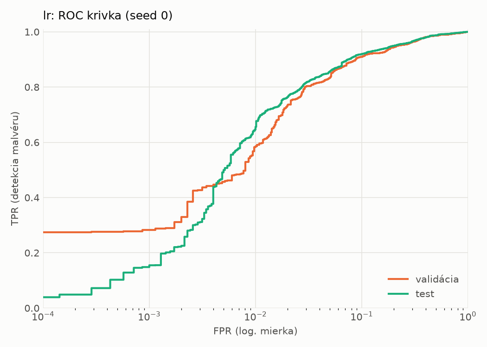
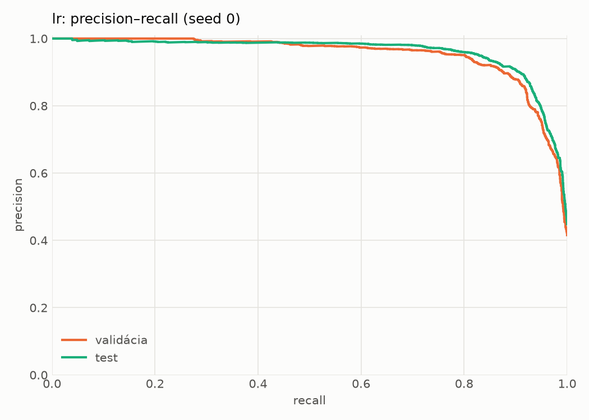
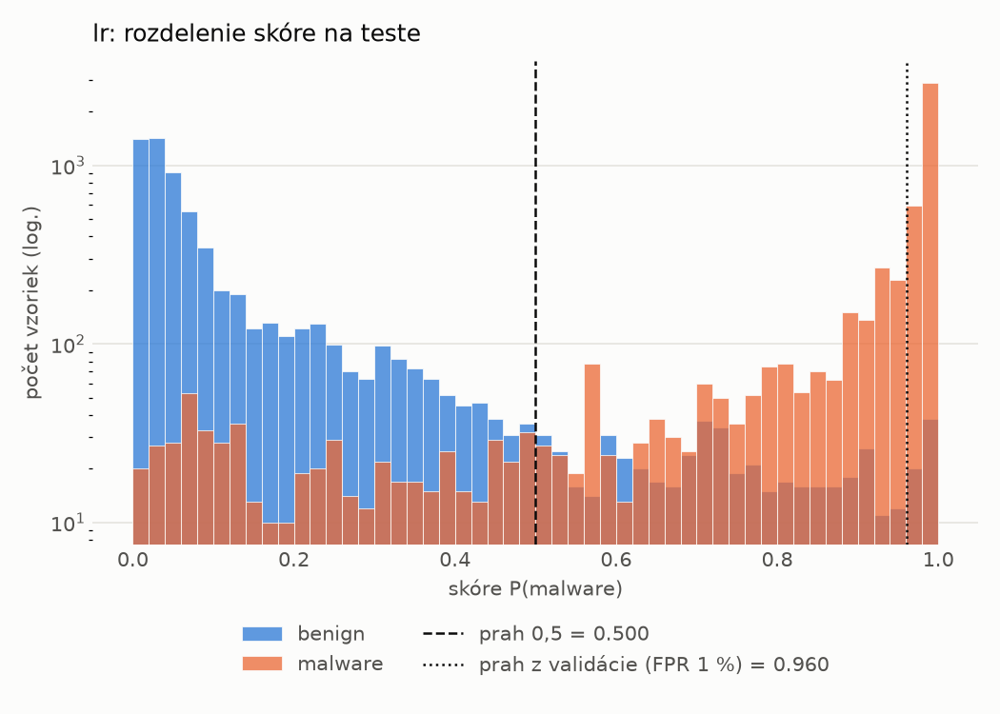
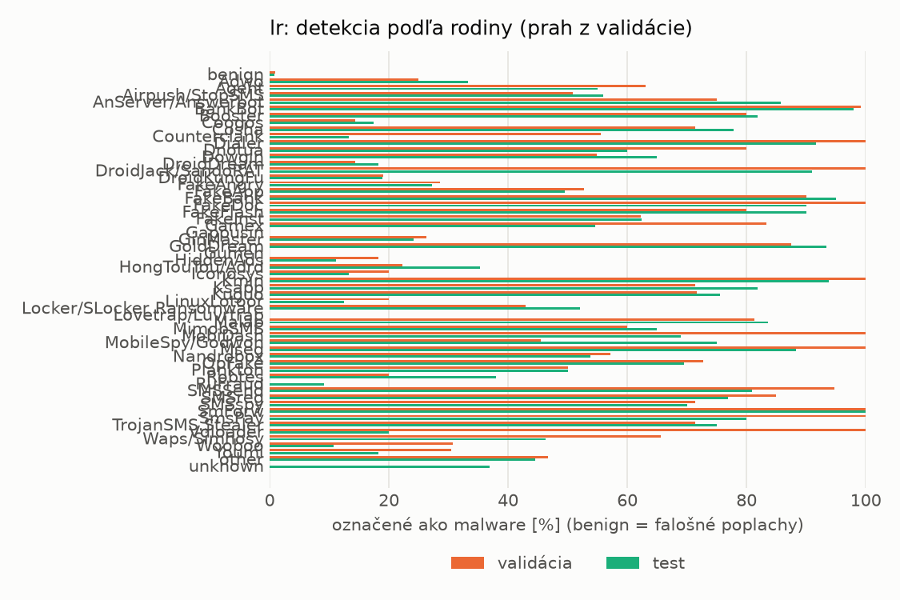
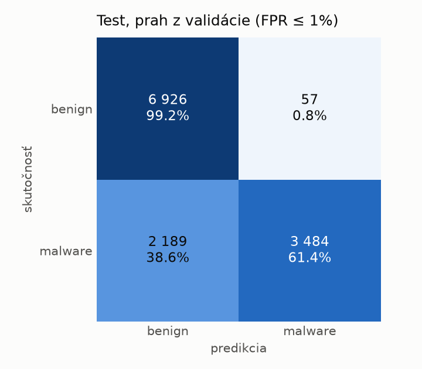
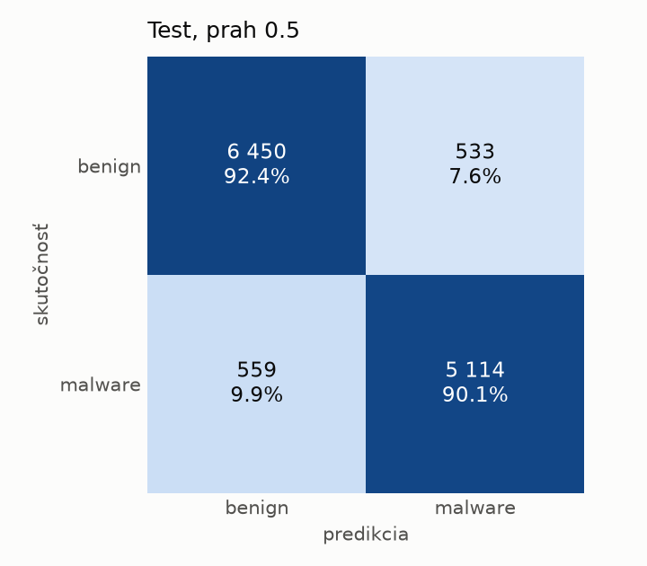

# static/lr – beh `20261123-011520`

> Automaticky generované (`src/training/run_tabular.py`). Konfigurácia: `config.yaml`, protokol: `protocol.yaml`.

- **Model:** `logreg` – logistická regresia s L2 regularizáciou (vstup signed log1p + štandardizácia)
- **Ladenie:** bez ladenia – hyperparametre prevzaté z `runs_v4/real_p/full/static/lr/20261122-230905`
- **Finálne modely:** seedy [0, 1, 2]; hodnoty sú priemer ± smerodajná odchýlka cez seedy
- **Najlepšie hyperparametre:** `{"max_iter": 2000, "C": 5.669849511478847}`

## Detekčná kvalita (bez prahu)
| metrika | train (podvzorka) | validácia | test |
|---|---|---|---|
| ROC-AUC | 0.9634 ± 0.0000 | 0.9594 ± 0.0000 | 0.9635 ± 0.0000 |
| PR-AUC | 0.9545 ± 0.0000 | 0.9521 ± 0.0000 | 0.9595 ± 0.0000 |
| TPR pri FPR 1 % | 0.6359 ± 0.0000 | 0.5826 ± 0.0000 | 0.6462 ± 0.0000 |
| TPR pri FPR 0,1 % | 0.2431 ± 0.0000 | 0.2832 ± 0.0000 | 0.1484 ± 0.0000 |
| log loss | 0.2401 ± 0.0000 | 0.2518 ± 0.0000 | 0.2406 ± 0.0000 |
| Brier skóre | 0.0681 ± 0.0000 | 0.0718 ± 0.0000 | 0.0683 ± 0.0000 |

Rozdiel ROC-AUC train − validácia: **0.0040** (veľký rozdiel = preučenie).

## Pri prahu z validácie (FPR ≤ 1% na validácii)
| metrika | train (podvzorka) | validácia | test |
|---|---|---|---|
| accuracy | 0.8295 ± 0.0000 | 0.8208 ± 0.0000 | 0.8225 ± 0.0000 |
| balanced accuracy | 0.7921 ± 0.0000 | 0.7864 ± 0.0000 | 0.8030 ± 0.0000 |
| precision | 0.9824 ± 0.0000 | 0.9770 ± 0.0000 | 0.9839 ± 0.0000 |
| recall (TPR) | 0.5914 ± 0.0000 | 0.5826 ± 0.0000 | 0.6141 ± 0.0000 |
| FPR | 0.0072 ± 0.0000 | 0.0097 ± 0.0000 | 0.0082 ± 0.0000 |
| F1 | 0.7384 ± 0.0000 | 0.7299 ± 0.0000 | 0.7562 ± 0.0000 |
| MCC | 0.6673 ± 0.0000 | 0.6539 ± 0.0000 | 0.6713 ± 0.0000 |

## Pri pevnom prahu 0.5
| metrika | train (podvzorka) | validácia | test |
|---|---|---|---|
| accuracy | 0.9156 ± 0.0000 | 0.9092 ± 0.0000 | 0.9137 ± 0.0000 |
| balanced accuracy | 0.9130 ± 0.0000 | 0.9063 ± 0.0000 | 0.9126 ± 0.0000 |
| precision | 0.8939 ± 0.0000 | 0.8921 ± 0.0000 | 0.9056 ± 0.0000 |
| recall (TPR) | 0.8992 ± 0.0000 | 0.8892 ± 0.0000 | 0.9015 ± 0.0000 |
| FPR | 0.0732 ± 0.0000 | 0.0765 ± 0.0000 | 0.0763 ± 0.0000 |
| F1 | 0.8966 ± 0.0000 | 0.8906 ± 0.0000 | 0.9035 ± 0.0000 |
| MCC | 0.8253 ± 0.0000 | 0.8131 ± 0.0000 | 0.8255 ± 0.0000 |

## Výpočtové nároky (seed 0, testovacia množina)
| meranie | hodnota |
|---|---|
| tréning finálneho modelu | 0.2 s (priemer cez seedy) |
| ladenie spolu | 0 s |
| počet parametrov / uzlov | 164 |
| veľkosť modelu na disku | 0.01 MB |
| transformácia vstupu – latencia (1 vlákno) | 0.005 ms |
| transformácia vstupu – priepustnosť | 1 229 227 vzoriek/s |
| CPU latencia modelu (batch 1, 1 vlákno) | 0.004 ms (p95 0.004) |
| CPU priepustnosť (24 vlákien) | 3 425 818 vzoriek/s |

## Grafy
| | |
|---|---|
|  |  |
|  |  |
|  |  |
|  |  |

## Súbory
`metrics.json` (všetky metriky po seedoch vrátane rodín), `timing.json`, `hpo_trials.csv`,
`predictions/<časť>_seed<N>.parquet` (sha256, family, label, score), `model/seed_<N>/`, `log.txt`.
