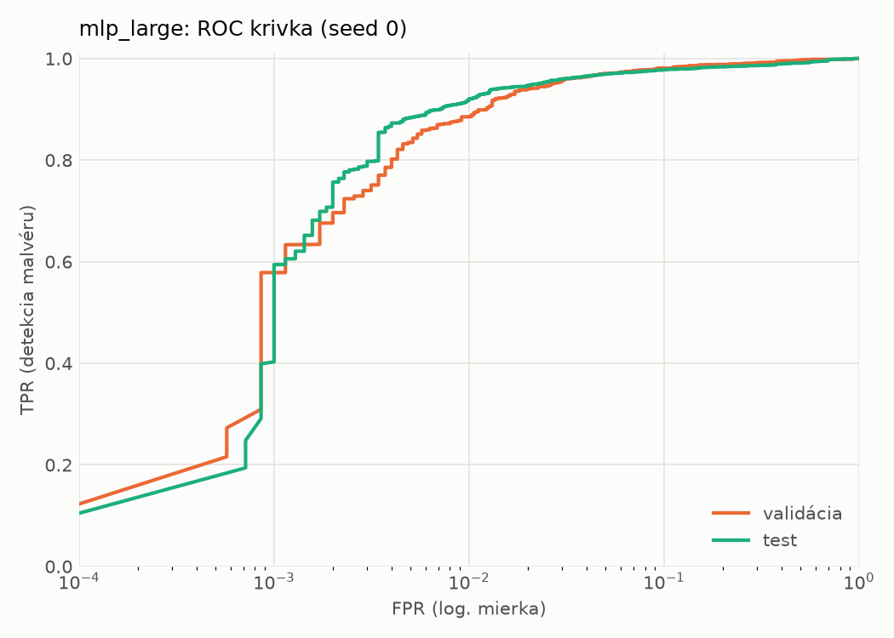
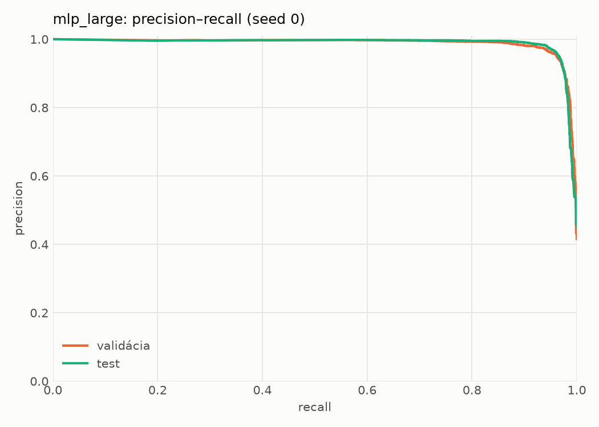
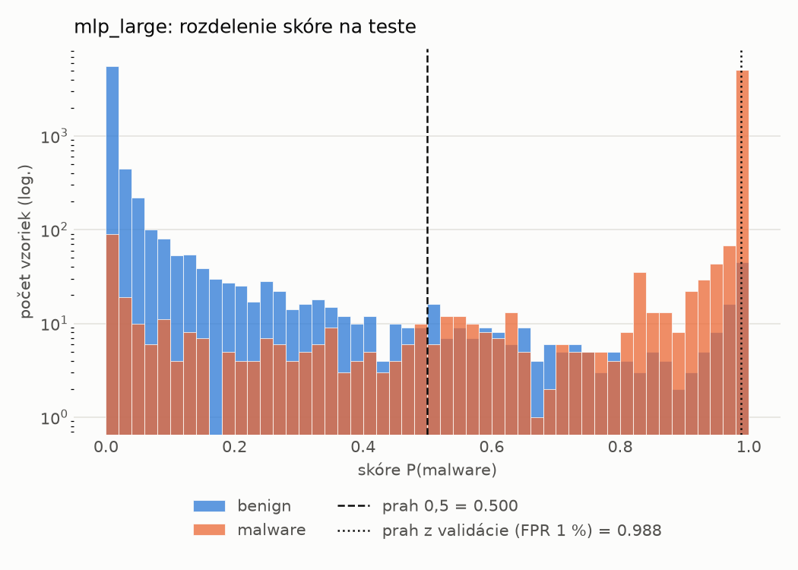
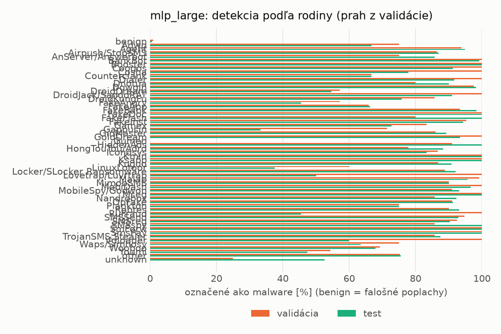
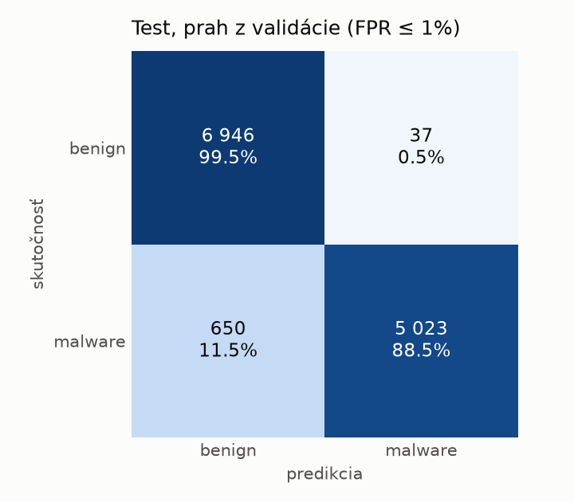
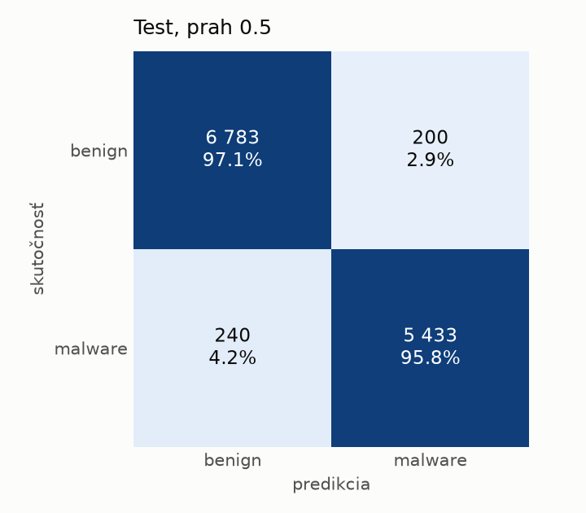
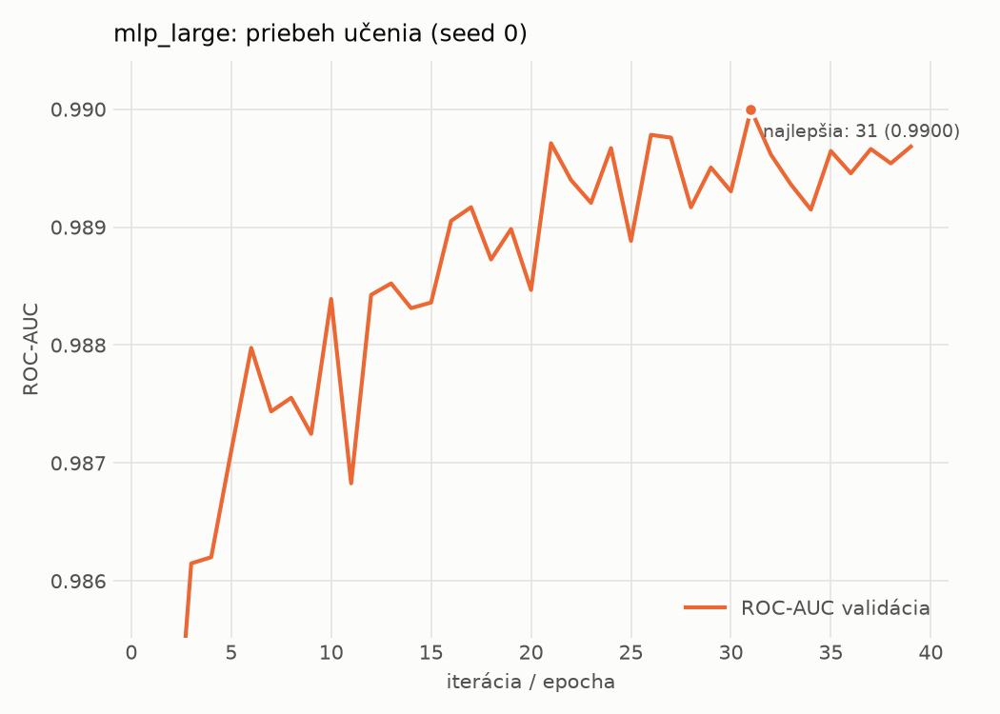

# static/mlp_large – beh `20261123-011647`

> Automaticky generované (`src/training/run_tabular.py`). Konfigurácia: `config.yaml`, protokol: `protocol.yaml`.

- **Model:** `mlp` – veľká neurónová sieť (3–5 skrytých vrstiev, 512–2048 neurónov), kandidát na učiteľa
- **Ladenie:** bez ladenia – hyperparametre prevzaté z `runs_v4/real_p/full/static/mlp_large/20261122-232356`
- **Finálne modely:** seedy [0, 1, 2]; hodnoty sú priemer ± smerodajná odchýlka cez seedy
- **Najlepšie hyperparametre:** `{"max_epochs": 100, "patience": 8, "hidden_layers": 3, "hidden_width": 2048, "width_decay": 0.5, "dropout": 0.24592095800405475, "lr": 0.0002046278772560144, "weight_decay": 0.007038560648637635, "batch_size": 256}`

## Detekčná kvalita (bez prahu)
| metrika | train (podvzorka) | validácia | test |
|---|---|---|---|
| ROC-AUC | 0.9979 ± 0.0008 | 0.9898 ± 0.0002 | 0.9893 ± 0.0015 |
| PR-AUC | 0.9974 ± 0.0010 | 0.9880 ± 0.0004 | 0.9887 ± 0.0010 |
| TPR pri FPR 1 % | 0.9691 ± 0.0112 | 0.8962 ± 0.0104 | 0.9195 ± 0.0018 |
| TPR pri FPR 0,1 % | 0.9108 ± 0.0310 | 0.5569 ± 0.0509 | 0.4862 ± 0.0802 |
| log loss | 0.0552 ± 0.0134 | 0.1296 ± 0.0056 | 0.1241 ± 0.0102 |
| Brier skóre | 0.0150 ± 0.0036 | 0.0310 ± 0.0015 | 0.0296 ± 0.0012 |

Rozdiel ROC-AUC train − validácia: **0.0081** (veľký rozdiel = preučenie).

## Pri prahu z validácie (FPR ≤ 1% na validácii)
| metrika | train (podvzorka) | validácia | test |
|---|---|---|---|
| accuracy | 0.9652 ± 0.0034 | 0.9513 ± 0.0041 | 0.9494 ± 0.0038 |
| balanced accuracy | 0.9574 ± 0.0042 | 0.9433 ± 0.0050 | 0.9443 ± 0.0043 |
| precision | 0.9985 ± 0.0009 | 0.9852 ± 0.0004 | 0.9913 ± 0.0012 |
| recall (TPR) | 0.9158 ± 0.0084 | 0.8962 ± 0.0104 | 0.8949 ± 0.0096 |
| FPR | 0.0010 ± 0.0006 | 0.0096 ± 0.0003 | 0.0064 ± 0.0010 |
| F1 | 0.9554 ± 0.0046 | 0.9386 ± 0.0056 | 0.9406 ± 0.0048 |
| MCC | 0.9293 ± 0.0068 | 0.9011 ± 0.0081 | 0.9003 ± 0.0071 |

## Pri pevnom prahu 0.5
| metrika | train (podvzorka) | validácia | test |
|---|---|---|---|
| accuracy | 0.9807 ± 0.0045 | 0.9619 ± 0.0035 | 0.9624 ± 0.0028 |
| balanced accuracy | 0.9803 ± 0.0043 | 0.9616 ± 0.0030 | 0.9619 ± 0.0026 |
| precision | 0.9741 ± 0.0076 | 0.9488 ± 0.0076 | 0.9594 ± 0.0054 |
| recall (TPR) | 0.9785 ± 0.0032 | 0.9601 ± 0.0004 | 0.9566 ± 0.0010 |
| FPR | 0.0179 ± 0.0053 | 0.0369 ± 0.0058 | 0.0329 ± 0.0045 |
| F1 | 0.9763 ± 0.0054 | 0.9544 ± 0.0040 | 0.9580 ± 0.0030 |
| MCC | 0.9600 ± 0.0092 | 0.9217 ± 0.0070 | 0.9240 ± 0.0056 |

## Výpočtové nároky (seed 0, testovacia množina)
| meranie | hodnota |
|---|---|
| tréning finálneho modelu | 16.9 s (priemer cez seedy) |
| ladenie spolu | 0 s |
| počet parametrov / uzlov | 2 966 529 |
| veľkosť modelu na disku | 11.91 MB |
| transformácia vstupu – latencia (1 vlákno) | 0.015 ms |
| transformácia vstupu – priepustnosť | 671 449 vzoriek/s |
| CPU latencia modelu (batch 1, 1 vlákno) | 0.773 ms (p95 1.649) |
| CPU priepustnosť (24 vlákien) | 45 992 vzoriek/s |
| GPU latencia (batch 1) | 0.980 ms (p95 1.204) |
| GPU priepustnosť | 330 020 vzoriek/s |
| GPU špičková pamäť | 247 MB |

## Grafy
| | |
|---|---|
|  |  |
|  |  |
|  |  |
|  |  |

## Súbory
`metrics.json` (všetky metriky po seedoch vrátane rodín), `timing.json`, `hpo_trials.csv`,
`predictions/<časť>_seed<N>.parquet` (sha256, family, label, score), `model/seed_<N>/`, `log.txt`.
