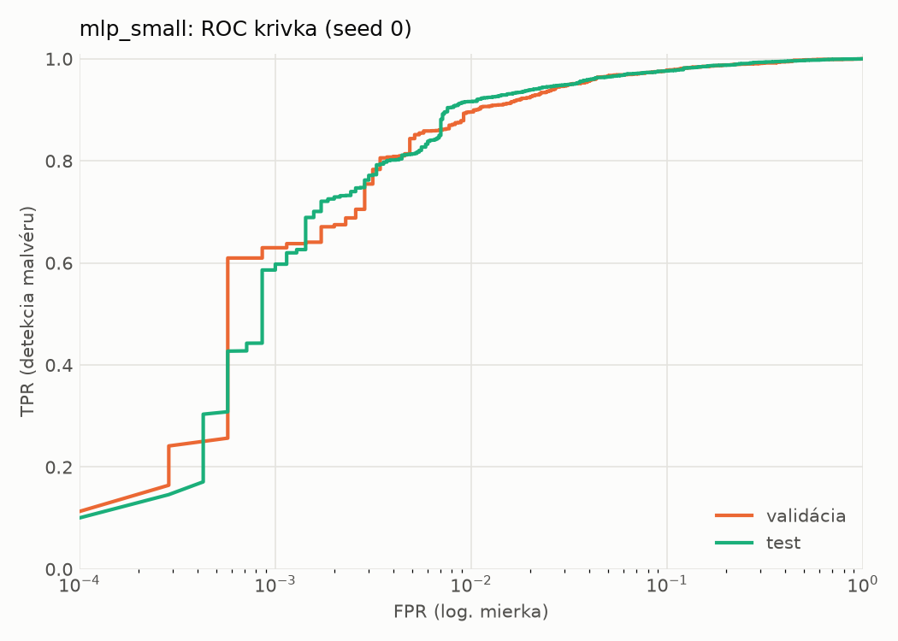
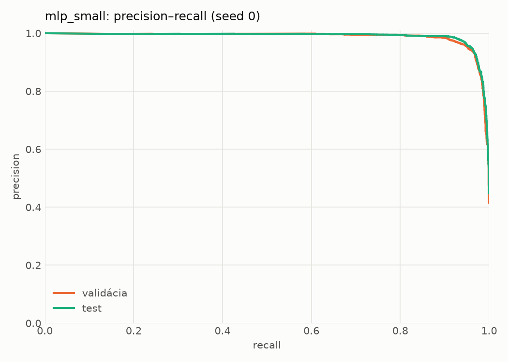
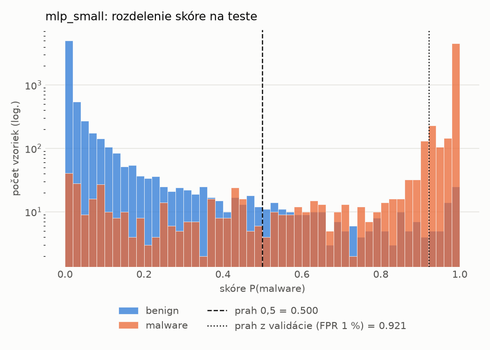
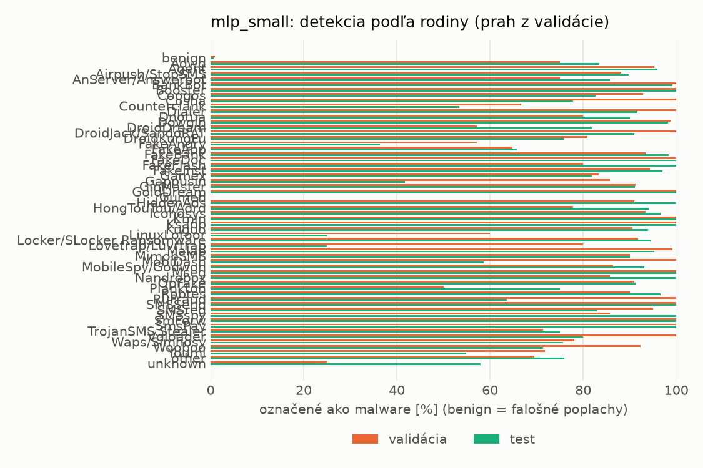
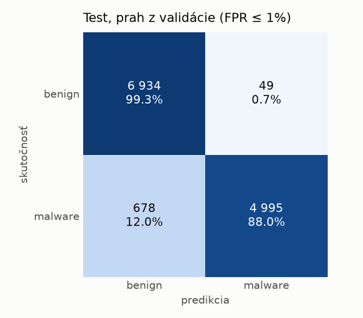
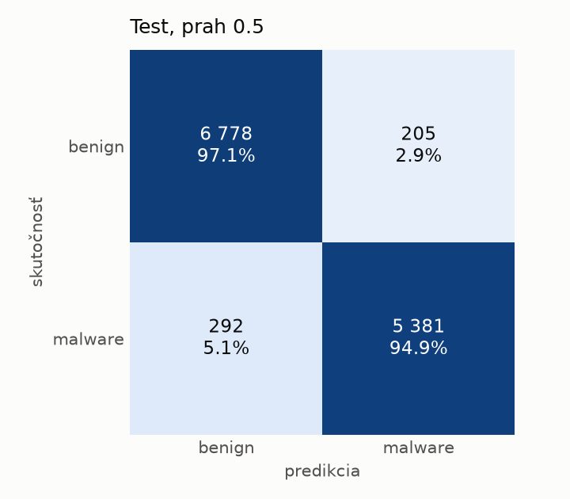
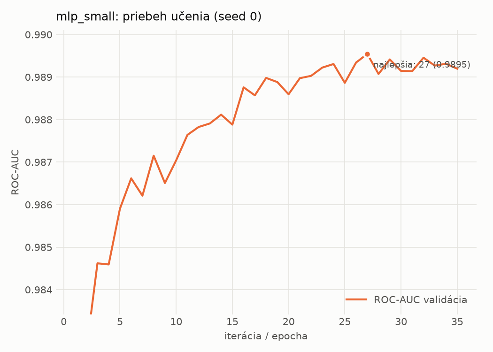

# static/mlp_small – beh `20261123-011611`

> Automaticky generované (`src/training/run_tabular.py`). Konfigurácia: `config.yaml`, protokol: `protocol.yaml`.

- **Model:** `mlp` – malá neurónová sieť (1–2 skryté vrstvy), kandidát na ľahkého študenta
- **Ladenie:** bez ladenia – hyperparametre prevzaté z `runs_v4/real_p/full/static/mlp_small/20261122-231849`
- **Finálne modely:** seedy [0, 1, 2]; hodnoty sú priemer ± smerodajná odchýlka cez seedy
- **Najlepšie hyperparametre:** `{"width_decay": 0.5, "max_epochs": 100, "patience": 8, "hidden_layers": 2, "hidden_width": 256, "dropout": 0.2770731649287669, "lr": 0.0010447758392925718, "weight_decay": 0.0006745378680415608, "batch_size": 256}`

## Detekčná kvalita (bez prahu)
| metrika | train (podvzorka) | validácia | test |
|---|---|---|---|
| ROC-AUC | 0.9966 ± 0.0002 | 0.9893 ± 0.0003 | 0.9898 ± 0.0002 |
| PR-AUC | 0.9960 ± 0.0002 | 0.9870 ± 0.0002 | 0.9892 ± 0.0003 |
| TPR pri FPR 1 % | 0.9534 ± 0.0056 | 0.8893 ± 0.0065 | 0.9155 ± 0.0010 |
| TPR pri FPR 0,1 % | 0.8887 ± 0.0065 | 0.5704 ± 0.0866 | 0.5910 ± 0.0230 |
| log loss | 0.0676 ± 0.0030 | 0.1278 ± 0.0010 | 0.1204 ± 0.0008 |
| Brier skóre | 0.0186 ± 0.0010 | 0.0324 ± 0.0009 | 0.0307 ± 0.0005 |

Rozdiel ROC-AUC train − validácia: **0.0074** (veľký rozdiel = preučenie).

## Pri prahu z validácie (FPR ≤ 1% na validácii)
| metrika | train (podvzorka) | validácia | test |
|---|---|---|---|
| accuracy | 0.9605 ± 0.0019 | 0.9483 ± 0.0027 | 0.9385 ± 0.0123 |
| balanced accuracy | 0.9519 ± 0.0023 | 0.9398 ± 0.0032 | 0.9321 ± 0.0137 |
| precision | 0.9965 ± 0.0004 | 0.9848 ± 0.0001 | 0.9907 ± 0.0004 |
| recall (TPR) | 0.9060 ± 0.0049 | 0.8893 ± 0.0065 | 0.8710 ± 0.0279 |
| FPR | 0.0022 ± 0.0003 | 0.0097 ± 0.0000 | 0.0067 ± 0.0005 |
| F1 | 0.9491 ± 0.0025 | 0.9346 ± 0.0036 | 0.9268 ± 0.0158 |
| MCC | 0.9197 ± 0.0037 | 0.8953 ± 0.0053 | 0.8797 ± 0.0229 |

## Pri pevnom prahu 0.5
| metrika | train (podvzorka) | validácia | test |
|---|---|---|---|
| accuracy | 0.9758 ± 0.0015 | 0.9582 ± 0.0020 | 0.9601 ± 0.0007 |
| balanced accuracy | 0.9744 ± 0.0015 | 0.9568 ± 0.0020 | 0.9589 ± 0.0007 |
| precision | 0.9737 ± 0.0023 | 0.9507 ± 0.0034 | 0.9634 ± 0.0017 |
| recall (TPR) | 0.9667 ± 0.0015 | 0.9486 ± 0.0023 | 0.9471 ± 0.0015 |
| FPR | 0.0179 ± 0.0016 | 0.0350 ± 0.0025 | 0.0293 ± 0.0014 |
| F1 | 0.9701 ± 0.0019 | 0.9496 ± 0.0024 | 0.9551 ± 0.0008 |
| MCC | 0.9498 ± 0.0031 | 0.9139 ± 0.0042 | 0.9194 ± 0.0014 |

## Výpočtové nároky (seed 0, testovacia množina)
| meranie | hodnota |
|---|---|
| tréning finálneho modelu | 11.2 s (priemer cez seedy) |
| ladenie spolu | 0 s |
| počet parametrov / uzlov | 75 777 |
| veľkosť modelu na disku | 0.32 MB |
| transformácia vstupu – latencia (1 vlákno) | 0.014 ms |
| transformácia vstupu – priepustnosť | 744 602 vzoriek/s |
| CPU latencia modelu (batch 1, 1 vlákno) | 0.100 ms (p95 0.232) |
| CPU priepustnosť (24 vlákien) | 1 932 656 vzoriek/s |
| GPU latencia (batch 1) | 0.647 ms (p95 0.679) |
| GPU priepustnosť | 1 277 610 vzoriek/s |
| GPU špičková pamäť | 74 MB |

## Grafy
| | |
|---|---|
|  |  |
|  |  |
|  |  |
|  |  |

## Súbory
`metrics.json` (všetky metriky po seedoch vrátane rodín), `timing.json`, `hpo_trials.csv`,
`predictions/<časť>_seed<N>.parquet` (sha256, family, label, score), `model/seed_<N>/`, `log.txt`.
