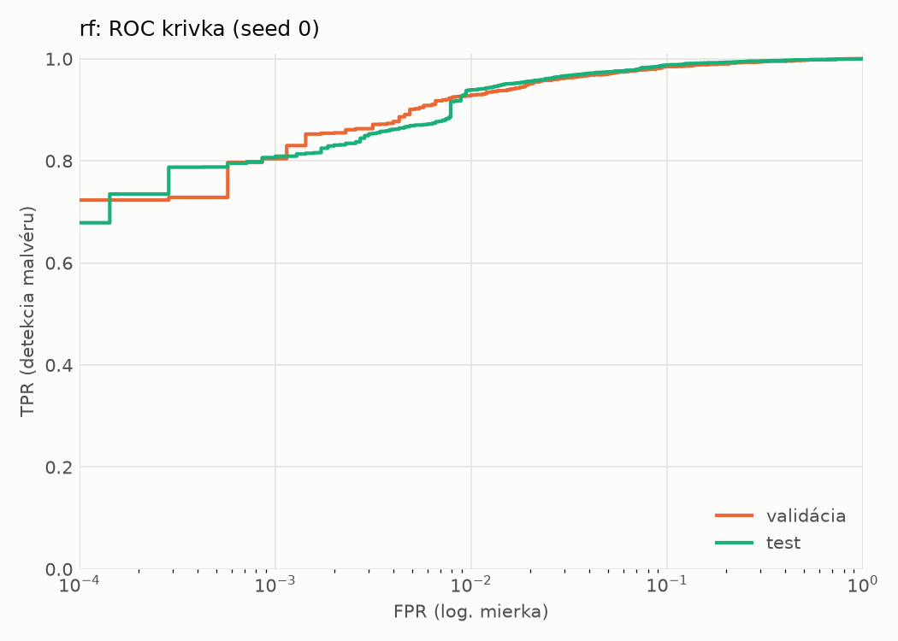
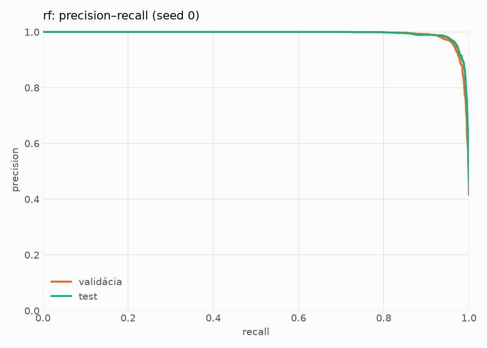
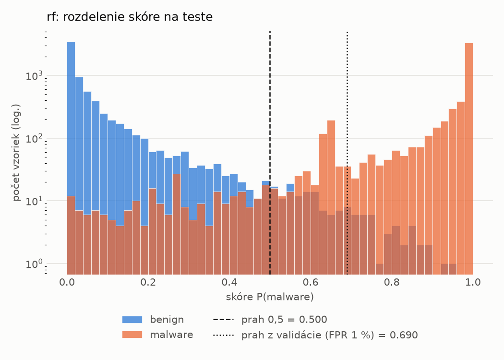
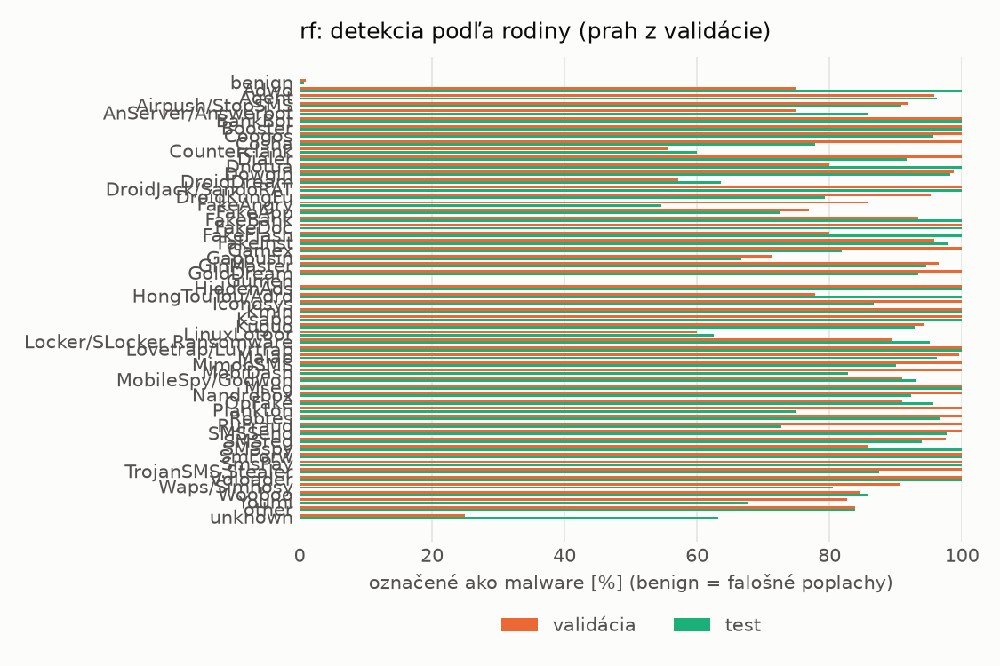
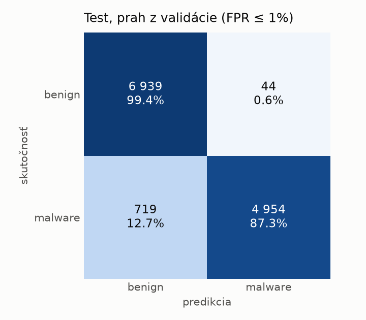
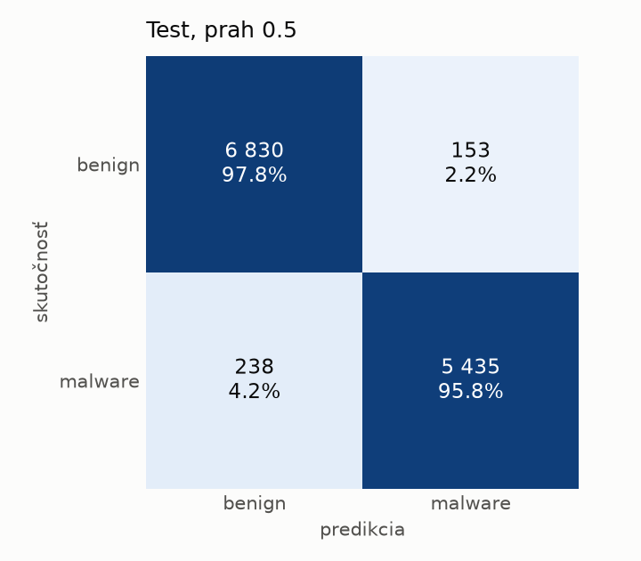

# static/rf – beh `20261123-011523`

> Automaticky generované (`src/training/run_tabular.py`). Konfigurácia: `config.yaml`, protokol: `protocol.yaml`.

- **Model:** `random_forest` – Random Forest (pôvodné hodnoty príznakov)
- **Ladenie:** bez ladenia – hyperparametre prevzaté z `runs_v4/real_p/full/static/rf/20261122-230914`
- **Finálne modely:** seedy [0, 1, 2]; hodnoty sú priemer ± smerodajná odchýlka cez seedy
- **Najlepšie hyperparametre:** `{"n_estimators": 500, "max_depth": 32, "min_samples_leaf": 1, "max_features": "log2"}`

## Detekčná kvalita (bez prahu)
| metrika | train (podvzorka) | validácia | test |
|---|---|---|---|
| ROC-AUC | 1.0000 ± 0.0000 | 0.9928 ± 0.0001 | 0.9936 ± 0.0000 |
| PR-AUC | 1.0000 ± 0.0000 | 0.9922 ± 0.0000 | 0.9937 ± 0.0001 |
| TPR pri FPR 1 % | 0.9997 ± 0.0001 | 0.9290 ± 0.0015 | 0.9194 ± 0.0259 |
| TPR pri FPR 0,1 % | 0.9967 ± 0.0005 | 0.7992 ± 0.0180 | 0.8049 ± 0.0019 |
| log loss | 0.0389 ± 0.0004 | 0.1051 ± 0.0004 | 0.1114 ± 0.0002 |
| Brier skóre | 0.0059 ± 0.0001 | 0.0274 ± 0.0001 | 0.0290 ± 0.0002 |

Rozdiel ROC-AUC train − validácia: **0.0072** (veľký rozdiel = preučenie).

## Pri prahu z validácie (FPR ≤ 1% na validácii)
| metrika | train (podvzorka) | validácia | test |
|---|---|---|---|
| accuracy | 0.9914 ± 0.0004 | 0.9648 ± 0.0006 | 0.9402 ± 0.0006 |
| balanced accuracy | 0.9894 ± 0.0005 | 0.9596 ± 0.0008 | 0.9340 ± 0.0007 |
| precision | 0.9999 ± 0.0001 | 0.9855 ± 0.0000 | 0.9912 ± 0.0002 |
| recall (TPR) | 0.9789 ± 0.0011 | 0.9290 ± 0.0015 | 0.8743 ± 0.0014 |
| FPR | 0.0001 ± 0.0001 | 0.0097 ± 0.0000 | 0.0063 ± 0.0001 |
| F1 | 0.9893 ± 0.0005 | 0.9564 ± 0.0008 | 0.9291 ± 0.0007 |
| MCC | 0.9822 ± 0.0008 | 0.9280 ± 0.0013 | 0.8828 ± 0.0011 |

## Pri pevnom prahu 0.5
| metrika | train (podvzorka) | validácia | test |
|---|---|---|---|
| accuracy | 0.9976 ± 0.0001 | 0.9669 ± 0.0006 | 0.9696 ± 0.0005 |
| balanced accuracy | 0.9973 ± 0.0001 | 0.9660 ± 0.0006 | 0.9687 ± 0.0006 |
| precision | 0.9988 ± 0.0001 | 0.9600 ± 0.0012 | 0.9726 ± 0.0002 |
| recall (TPR) | 0.9953 ± 0.0002 | 0.9604 ± 0.0008 | 0.9593 ± 0.0012 |
| FPR | 0.0008 ± 0.0001 | 0.0285 ± 0.0009 | 0.0220 ± 0.0002 |
| F1 | 0.9971 ± 0.0001 | 0.9602 ± 0.0008 | 0.9659 ± 0.0006 |
| MCC | 0.9951 ± 0.0002 | 0.9319 ± 0.0013 | 0.9386 ± 0.0010 |

## Výpočtové nároky (seed 0, testovacia množina)
| meranie | hodnota |
|---|---|
| tréning finálneho modelu | 1.5 s (priemer cez seedy) |
| ladenie spolu | 0 s |
| počet parametrov / uzlov | 3 056 536 |
| veľkosť modelu na disku | 244.89 MB |
| CPU latencia modelu (batch 1, 1 vlákno) | 15.364 ms (p95 16.446) |
| CPU priepustnosť (24 vlákien) | 110 436 vzoriek/s |

## Grafy
| | |
|---|---|
|  |  |
|  |  |
|  |  |
|  |  |

## Súbory
`metrics.json` (všetky metriky po seedoch vrátane rodín), `timing.json`, `hpo_trials.csv`,
`predictions/<časť>_seed<N>.parquet` (sha256, family, label, score), `model/seed_<N>/`, `log.txt`.
