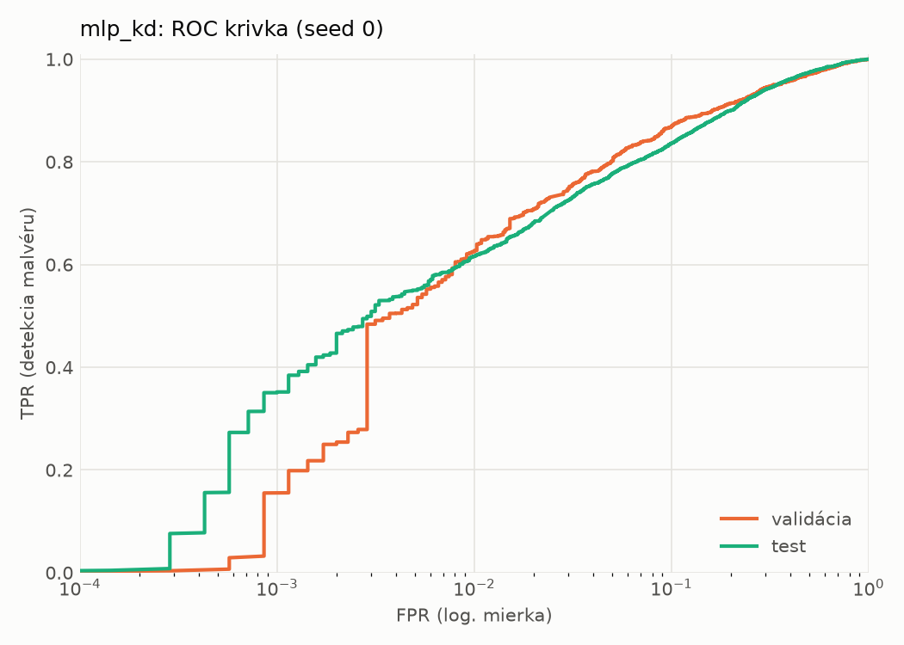
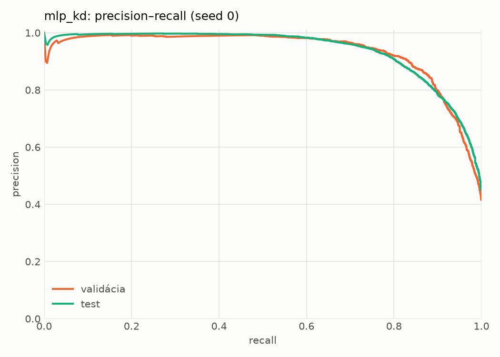
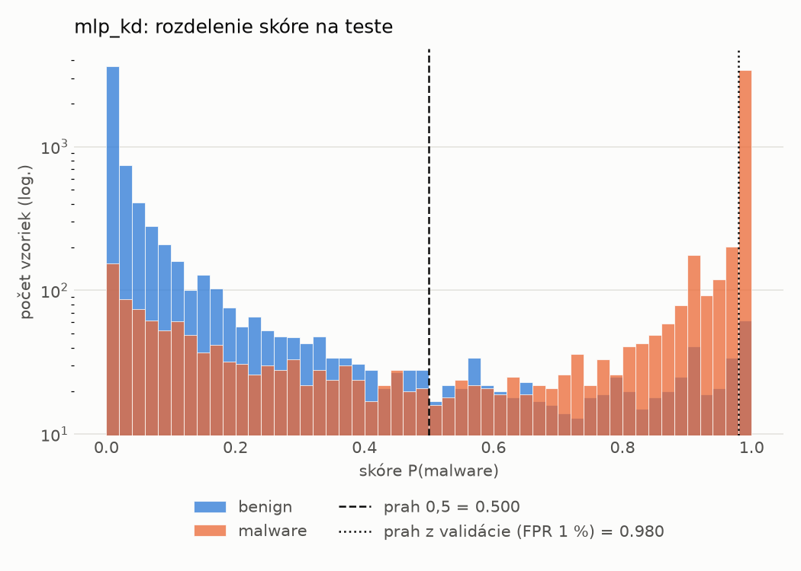
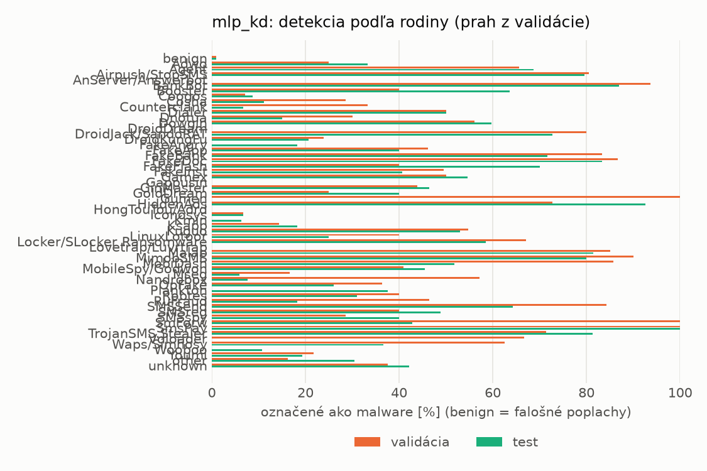
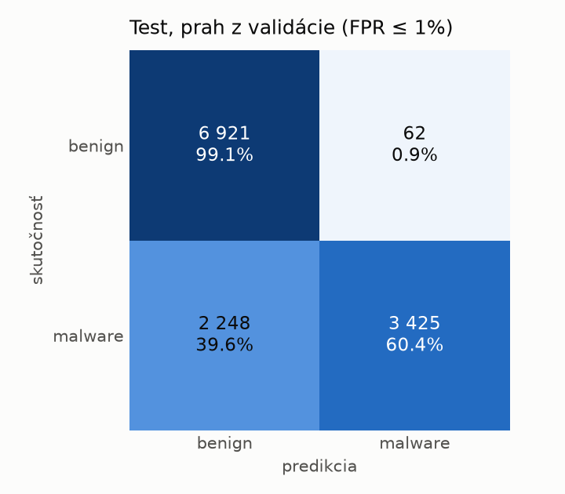
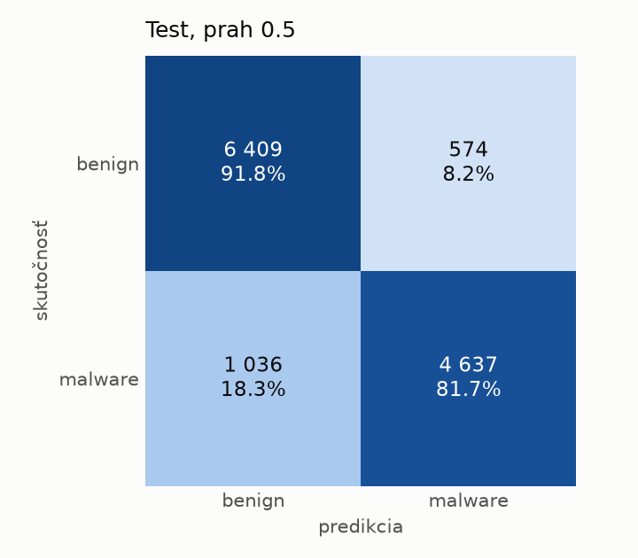
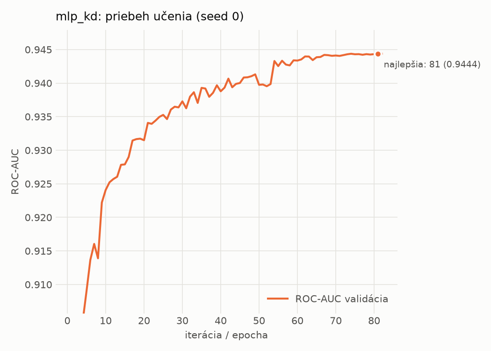

# dynamic/mlp_kd – beh `20261123-214125`

> Automaticky generované (`src/training/run_tabular.py`). Konfigurácia: `config.yaml`, protokol: `protocol.yaml`.

- **Model:** `mlp` – študent – malé MLP učené destiláciou z hybridného učiteľa
- **Ladenie:** bez ladenia – hyperparametre prevzaté z `runs_v4/emu_p/full/students_dynamic/mlp_kd/20261123-204643`
- **Finálne modely:** seedy [0, 1, 2]; hodnoty sú priemer ± smerodajná odchýlka cez seedy
- **Najlepšie hyperparametre:** `{"hidden_layers": 1, "max_epochs": 100, "patience": 8, "hidden_width": 64, "dropout": 0.18336599346560475, "lr": 0.002029071520651615, "weight_decay": 5.085344324013556e-05, "batch_size": 1024, "kd_alpha": 0.6628106947860043, "kd_temperature": 3.3639590927520047}`

## Detekčná kvalita (bez prahu)
| metrika | train (podvzorka) | validácia | test |
|---|---|---|---|
| ROC-AUC | 0.9510 ± 0.0019 | 0.9444 ± 0.0006 | 0.9403 ± 0.0021 |
| PR-AUC | 0.9468 ± 0.0021 | 0.9358 ± 0.0006 | 0.9396 ± 0.0013 |
| TPR pri FPR 1 % | 0.6875 ± 0.0070 | 0.6183 ± 0.0143 | 0.6168 ± 0.0058 |
| TPR pri FPR 0,1 % | 0.4398 ± 0.0198 | 0.1531 ± 0.0607 | 0.3306 ± 0.0200 |
| log loss | 0.2887 ± 0.0062 | 0.3284 ± 0.0010 | 0.3468 ± 0.0058 |
| Brier skóre | 0.0792 ± 0.0019 | 0.0869 ± 0.0012 | 0.0967 ± 0.0023 |

Rozdiel ROC-AUC train − validácia: **0.0067** (veľký rozdiel = preučenie).

## Pri prahu z validácie (FPR ≤ 1% na validácii)
| metrika | train (podvzorka) | validácia | test |
|---|---|---|---|
| accuracy | 0.8458 ± 0.0054 | 0.8357 ± 0.0059 | 0.8157 ± 0.0036 |
| balanced accuracy | 0.8119 ± 0.0068 | 0.8043 ± 0.0071 | 0.7954 ± 0.0042 |
| precision | 0.9857 ± 0.0006 | 0.9783 ± 0.0005 | 0.9837 ± 0.0028 |
| recall (TPR) | 0.6300 ± 0.0139 | 0.6183 ± 0.0143 | 0.5989 ± 0.0099 |
| FPR | 0.0063 ± 0.0004 | 0.0097 ± 0.0000 | 0.0081 ± 0.0015 |
| F1 | 0.7686 ± 0.0102 | 0.7577 ± 0.0109 | 0.7445 ± 0.0068 |
| MCC | 0.6985 ± 0.0100 | 0.6815 ± 0.0110 | 0.6596 ± 0.0053 |

## Pri pevnom prahu 0.5
| metrika | train (podvzorka) | validácia | test |
|---|---|---|---|
| accuracy | 0.8988 ± 0.0032 | 0.8897 ± 0.0022 | 0.8730 ± 0.0027 |
| balanced accuracy | 0.8908 ± 0.0035 | 0.8850 ± 0.0027 | 0.8679 ± 0.0029 |
| precision | 0.8978 ± 0.0038 | 0.8754 ± 0.0010 | 0.8895 ± 0.0016 |
| recall (TPR) | 0.8478 ± 0.0049 | 0.8567 ± 0.0056 | 0.8184 ± 0.0049 |
| FPR | 0.0662 ± 0.0024 | 0.0867 ± 0.0007 | 0.0826 ± 0.0009 |
| F1 | 0.8720 ± 0.0042 | 0.8659 ± 0.0031 | 0.8525 ± 0.0034 |
| MCC | 0.7893 ± 0.0068 | 0.7725 ± 0.0047 | 0.7433 ± 0.0053 |

## Výpočtové nároky (seed 0, testovacia množina)
| meranie | hodnota |
|---|---|
| tréning finálneho modelu | 6.3 s (priemer cez seedy) |
| ladenie spolu | 0 s |
| počet parametrov / uzlov | 8 129 |
| veľkosť modelu na disku | 0.04 MB |
| transformácia vstupu – latencia (1 vlákno) | 0.006 ms |
| transformácia vstupu – priepustnosť | 1 297 160 vzoriek/s |
| CPU latencia modelu (batch 1, 1 vlákno) | 0.065 ms (p95 0.075) |
| CPU priepustnosť (24 vlákien) | 7 194 997 vzoriek/s |
| GPU latencia (batch 1) | 0.264 ms (p95 0.292) |
| GPU priepustnosť | 2 318 798 vzoriek/s |
| GPU špičková pamäť | 52 MB |

## Grafy
| | |
|---|---|
|  |  |
|  |  |
|  |  |
|  |  |

## Súbory
`metrics.json` (všetky metriky po seedoch vrátane rodín), `timing.json`, `hpo_trials.csv`,
`predictions/<časť>_seed<N>.parquet` (sha256, family, label, score), `model/seed_<N>/`, `log.txt`.
