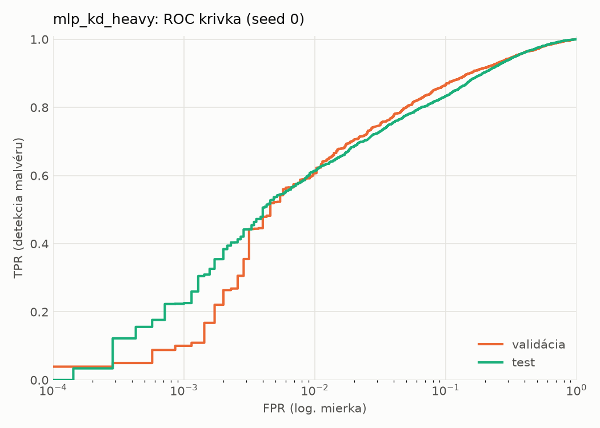
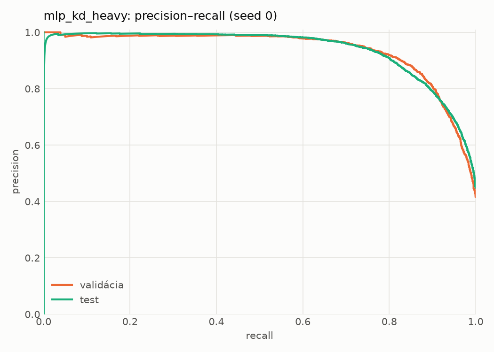
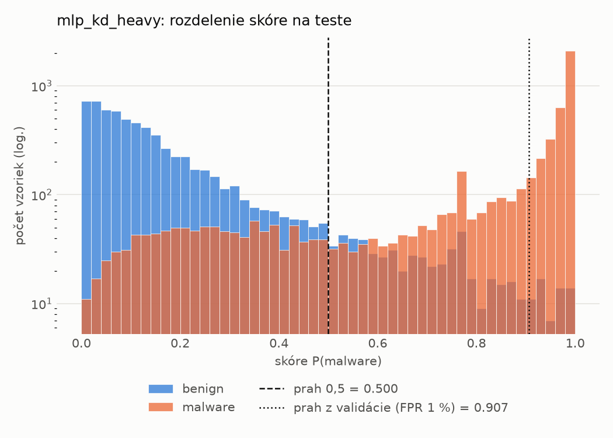
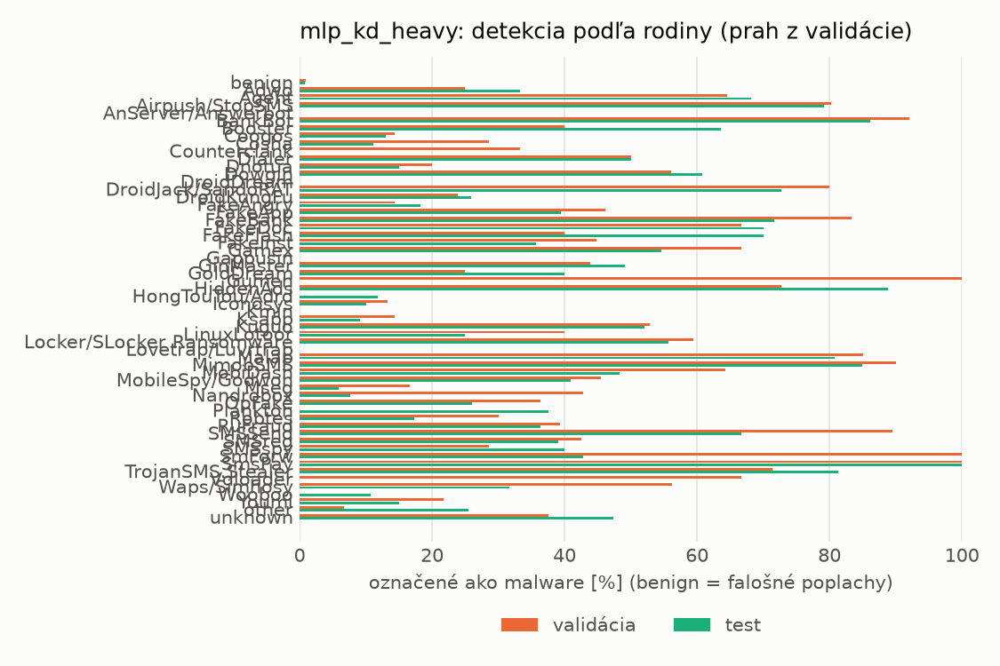
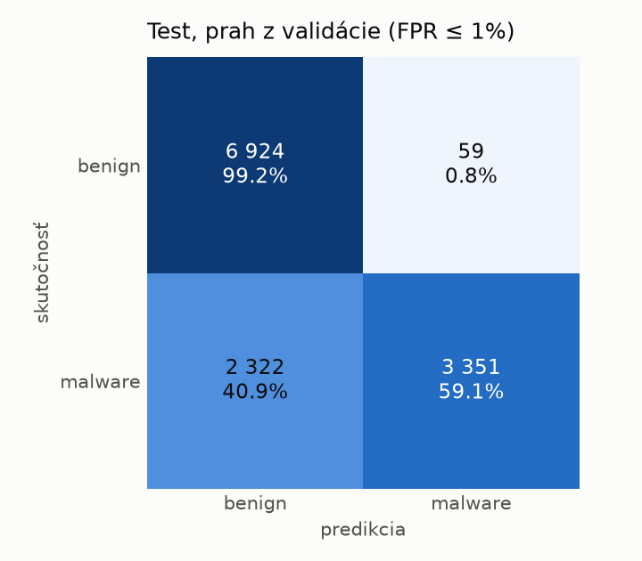
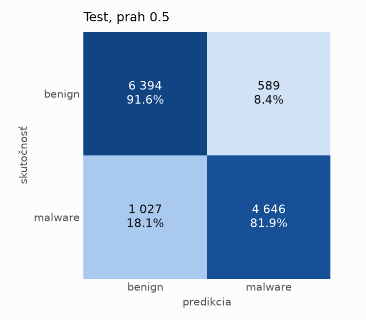
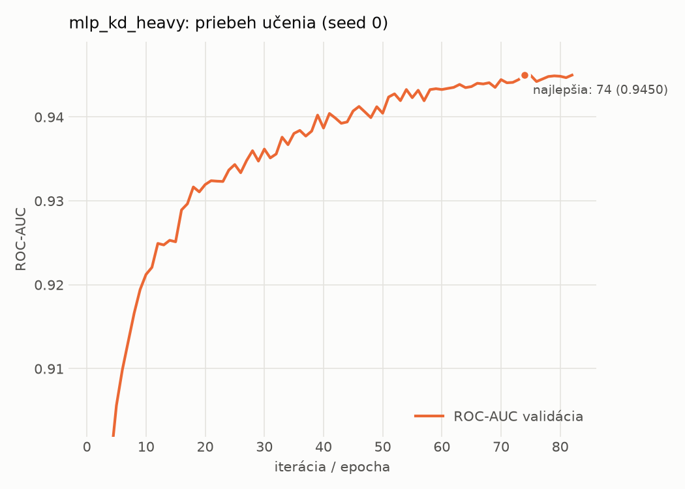

# dynamic/mlp_kd_heavy – beh `20261123-214248`

> Automaticky generované (`src/training/run_tabular.py`). Konfigurácia: `config.yaml`, protokol: `protocol.yaml`.

- **Model:** `mlp` – študent – malé MLP učené destiláciou z mlp_large hybridu (V4)
- **Ladenie:** bez ladenia – hyperparametre prevzaté z `runs_v4/emu_p/full/students_dynamic/mlp_kd_heavy/20261123-210504`
- **Finálne modely:** seedy [0, 1, 2]; hodnoty sú priemer ± smerodajná odchýlka cez seedy
- **Najlepšie hyperparametre:** `{"hidden_layers": 1, "max_epochs": 100, "patience": 8, "hidden_width": 64, "dropout": 0.11940169496551375, "lr": 0.0010131280233016235, "weight_decay": 6.964554367863767e-06, "batch_size": 1024, "kd_alpha": 0.5527208987397508, "kd_temperature": 1.1661827551200896}`

## Detekčná kvalita (bez prahu)
| metrika | train (podvzorka) | validácia | test |
|---|---|---|---|
| ROC-AUC | 0.9520 ± 0.0009 | 0.9451 ± 0.0001 | 0.9402 ± 0.0013 |
| PR-AUC | 0.9473 ± 0.0014 | 0.9370 ± 0.0004 | 0.9384 ± 0.0015 |
| TPR pri FPR 1 % | 0.6790 ± 0.0137 | 0.6193 ± 0.0152 | 0.6226 ± 0.0086 |
| TPR pri FPR 0,1 % | 0.4049 ± 0.0268 | 0.0931 ± 0.0177 | 0.2465 ± 0.0249 |
| log loss | 0.2665 ± 0.0014 | 0.2910 ± 0.0018 | 0.3032 ± 0.0025 |
| Brier skóre | 0.0786 ± 0.0004 | 0.0854 ± 0.0000 | 0.0922 ± 0.0008 |

Rozdiel ROC-AUC train − validácia: **0.0069** (veľký rozdiel = preučenie).

## Pri prahu z validácie (FPR ≤ 1% na validácii)
| metrika | train (podvzorka) | validácia | test |
|---|---|---|---|
| accuracy | 0.8452 ± 0.0063 | 0.8360 ± 0.0063 | 0.8153 ± 0.0044 |
| balanced accuracy | 0.8111 ± 0.0078 | 0.8048 ± 0.0076 | 0.7950 ± 0.0049 |
| precision | 0.9857 ± 0.0010 | 0.9783 ± 0.0005 | 0.9836 ± 0.0009 |
| recall (TPR) | 0.6285 ± 0.0156 | 0.6193 ± 0.0152 | 0.5980 ± 0.0100 |
| FPR | 0.0062 ± 0.0004 | 0.0097 ± 0.0000 | 0.0081 ± 0.0005 |
| F1 | 0.7675 ± 0.0116 | 0.7584 ± 0.0115 | 0.7438 ± 0.0077 |
| MCC | 0.6974 ± 0.0118 | 0.6822 ± 0.0117 | 0.6589 ± 0.0076 |

## Pri pevnom prahu 0.5
| metrika | train (podvzorka) | validácia | test |
|---|---|---|---|
| accuracy | 0.8983 ± 0.0011 | 0.8908 ± 0.0012 | 0.8723 ± 0.0038 |
| balanced accuracy | 0.8908 ± 0.0018 | 0.8862 ± 0.0019 | 0.8674 ± 0.0042 |
| precision | 0.8941 ± 0.0024 | 0.8762 ± 0.0032 | 0.8873 ± 0.0017 |
| recall (TPR) | 0.8507 ± 0.0056 | 0.8587 ± 0.0067 | 0.8192 ± 0.0078 |
| FPR | 0.0691 ± 0.0022 | 0.0864 ± 0.0032 | 0.0845 ± 0.0007 |
| F1 | 0.8718 ± 0.0019 | 0.8673 ± 0.0021 | 0.8519 ± 0.0050 |
| MCC | 0.7883 ± 0.0024 | 0.7747 ± 0.0027 | 0.7419 ± 0.0077 |

## Výpočtové nároky (seed 0, testovacia množina)
| meranie | hodnota |
|---|---|
| tréning finálneho modelu | 5.2 s (priemer cez seedy) |
| ladenie spolu | 0 s |
| počet parametrov / uzlov | 8 129 |
| veľkosť modelu na disku | 0.04 MB |
| transformácia vstupu – latencia (1 vlákno) | 0.015 ms |
| transformácia vstupu – priepustnosť | 754 083 vzoriek/s |
| CPU latencia modelu (batch 1, 1 vlákno) | 0.156 ms (p95 0.175) |
| CPU priepustnosť (24 vlákien) | 5 807 902 vzoriek/s |
| GPU latencia (batch 1) | 0.301 ms (p95 0.330) |
| GPU priepustnosť | 4 671 145 vzoriek/s |
| GPU špičková pamäť | 76 MB |

## Grafy
| | |
|---|---|
|  |  |
|  |  |
|  |  |
|  |  |

## Súbory
`metrics.json` (všetky metriky po seedoch vrátane rodín), `timing.json`, `hpo_trials.csv`,
`predictions/<časť>_seed<N>.parquet` (sha256, family, label, score), `model/seed_<N>/`, `log.txt`.
