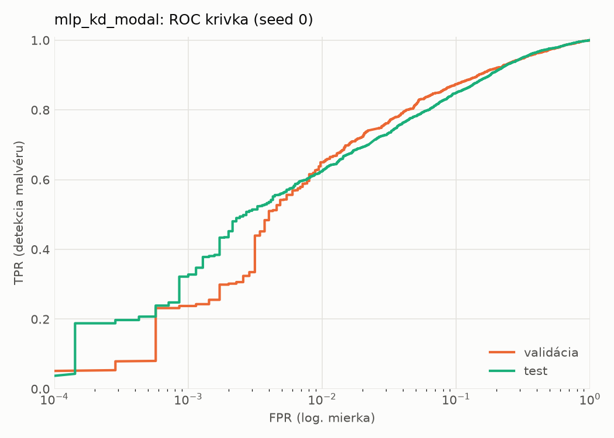
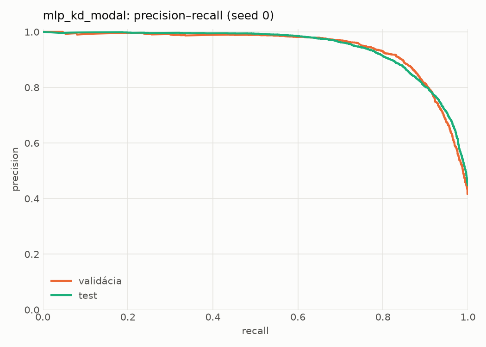
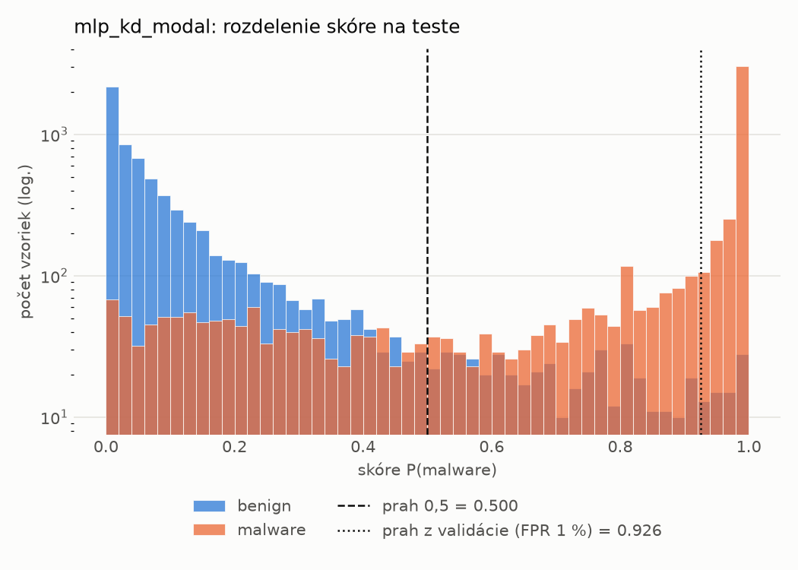
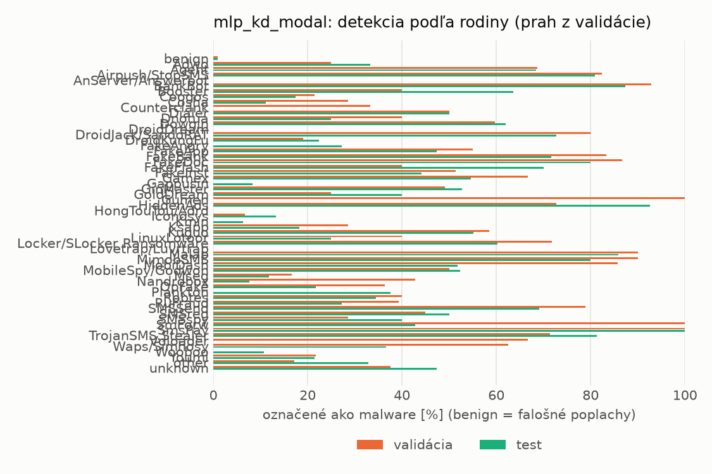
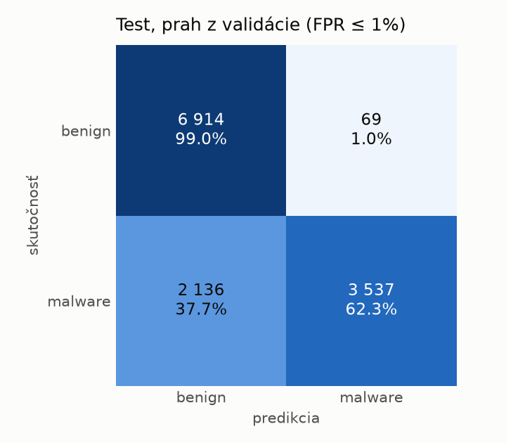
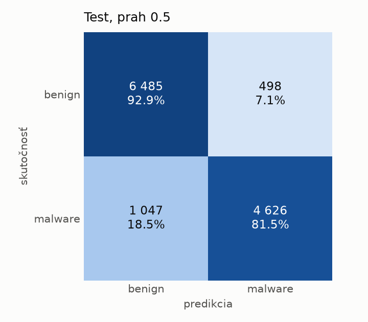
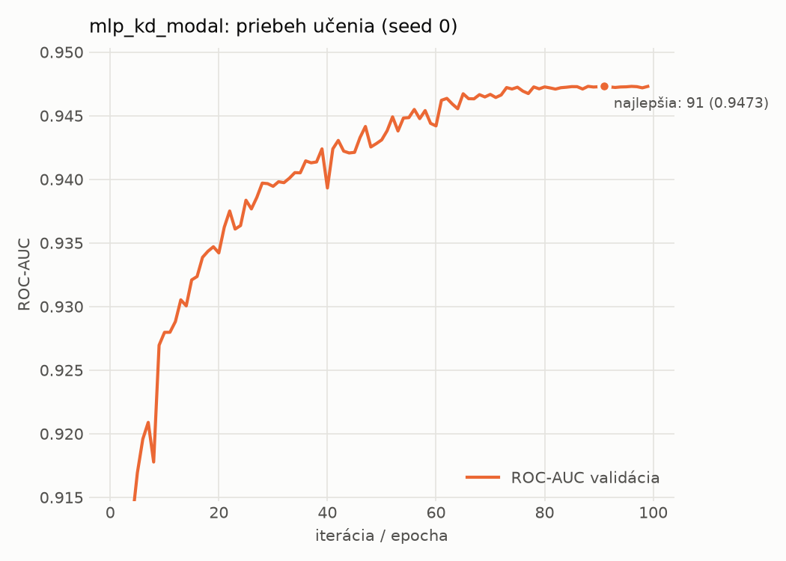

# dynamic/mlp_kd_modal – beh `20261123-214228`

> Automaticky generované (`src/training/run_tabular.py`). Konfigurácia: `config.yaml`, protokol: `protocol.yaml`.

- **Model:** `mlp` – študent – malé MLP učené destiláciou z učiteľa rovnakej modality (variant A)
- **Ladenie:** bez ladenia – hyperparametre prevzaté z `runs_v4/emu_p/full/students_dynamic/mlp_kd_modal/20261123-210004`
- **Finálne modely:** seedy [0, 1, 2]; hodnoty sú priemer ± smerodajná odchýlka cez seedy
- **Najlepšie hyperparametre:** `{"hidden_layers": 1, "max_epochs": 100, "patience": 8, "hidden_width": 64, "dropout": 0.17256398759806554, "lr": 0.00273877224500614, "weight_decay": 0.00015336049950880602, "batch_size": 1024, "kd_alpha": 0.5720540077101433, "kd_temperature": 1.5970216771892711}`

## Detekčná kvalita (bez prahu)
| metrika | train (podvzorka) | validácia | test |
|---|---|---|---|
| ROC-AUC | 0.9543 ± 0.0008 | 0.9478 ± 0.0005 | 0.9436 ± 0.0005 |
| PR-AUC | 0.9504 ± 0.0009 | 0.9422 ± 0.0007 | 0.9436 ± 0.0006 |
| TPR pri FPR 1 % | 0.6954 ± 0.0037 | 0.6401 ± 0.0108 | 0.6304 ± 0.0061 |
| TPR pri FPR 0,1 % | 0.4510 ± 0.0133 | 0.2393 ± 0.0058 | 0.3054 ± 0.0146 |
| log loss | 0.2542 ± 0.0022 | 0.2848 ± 0.0020 | 0.3006 ± 0.0011 |
| Brier skóre | 0.0740 ± 0.0009 | 0.0807 ± 0.0001 | 0.0894 ± 0.0006 |

Rozdiel ROC-AUC train − validácia: **0.0065** (veľký rozdiel = preučenie).

## Pri prahu z validácie (FPR ≤ 1% na validácii)
| metrika | train (podvzorka) | validácia | test |
|---|---|---|---|
| accuracy | 0.8531 ± 0.0033 | 0.8447 ± 0.0044 | 0.8232 ± 0.0029 |
| balanced accuracy | 0.8210 ± 0.0042 | 0.8152 ± 0.0053 | 0.8038 ± 0.0033 |
| precision | 0.9844 ± 0.0009 | 0.9792 ± 0.0001 | 0.9829 ± 0.0019 |
| recall (TPR) | 0.6491 ± 0.0089 | 0.6401 ± 0.0108 | 0.6163 ± 0.0077 |
| FPR | 0.0071 ± 0.0005 | 0.0096 ± 0.0002 | 0.0087 ± 0.0011 |
| F1 | 0.7823 ± 0.0062 | 0.7741 ± 0.0079 | 0.7576 ± 0.0053 |
| MCC | 0.7119 ± 0.0060 | 0.6985 ± 0.0081 | 0.6722 ± 0.0044 |

## Pri pevnom prahu 0.5
| metrika | train (podvzorka) | validácia | test |
|---|---|---|---|
| accuracy | 0.9033 ± 0.0016 | 0.8954 ± 0.0007 | 0.8778 ± 0.0017 |
| balanced accuracy | 0.8944 ± 0.0020 | 0.8892 ± 0.0009 | 0.8720 ± 0.0019 |
| precision | 0.9091 ± 0.0021 | 0.8915 ± 0.0038 | 0.9019 ± 0.0010 |
| recall (TPR) | 0.8469 ± 0.0045 | 0.8521 ± 0.0045 | 0.8162 ± 0.0037 |
| FPR | 0.0580 ± 0.0016 | 0.0738 ± 0.0032 | 0.0721 ± 0.0007 |
| F1 | 0.8769 ± 0.0023 | 0.8714 ± 0.0010 | 0.8569 ± 0.0023 |
| MCC | 0.7988 ± 0.0033 | 0.7840 ± 0.0014 | 0.7536 ± 0.0034 |

## Výpočtové nároky (seed 0, testovacia množina)
| meranie | hodnota |
|---|---|
| tréning finálneho modelu | 6.2 s (priemer cez seedy) |
| ladenie spolu | 0 s |
| počet parametrov / uzlov | 8 129 |
| veľkosť modelu na disku | 0.04 MB |
| transformácia vstupu – latencia (1 vlákno) | 0.015 ms |
| transformácia vstupu – priepustnosť | 770 664 vzoriek/s |
| CPU latencia modelu (batch 1, 1 vlákno) | 0.155 ms (p95 0.165) |
| CPU priepustnosť (24 vlákien) | 5 872 854 vzoriek/s |
| GPU latencia (batch 1) | 0.469 ms (p95 0.516) |
| GPU priepustnosť | 1 880 423 vzoriek/s |
| GPU špičková pamäť | 52 MB |

## Grafy
| | |
|---|---|
|  |  |
|  |  |
|  |  |
|  |  |

## Súbory
`metrics.json` (všetky metriky po seedoch vrátane rodín), `timing.json`, `hpo_trials.csv`,
`predictions/<časť>_seed<N>.parquet` (sha256, family, label, score), `model/seed_<N>/`, `log.txt`.
